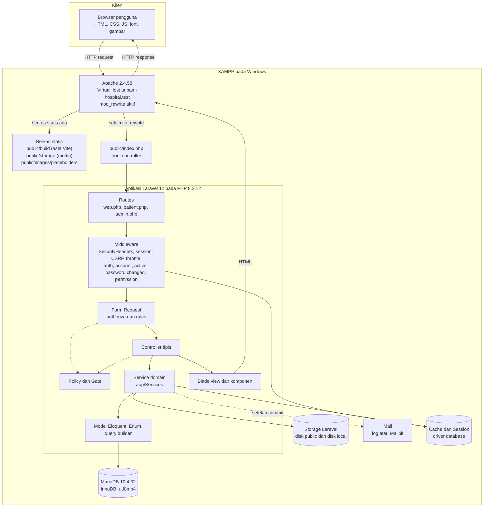
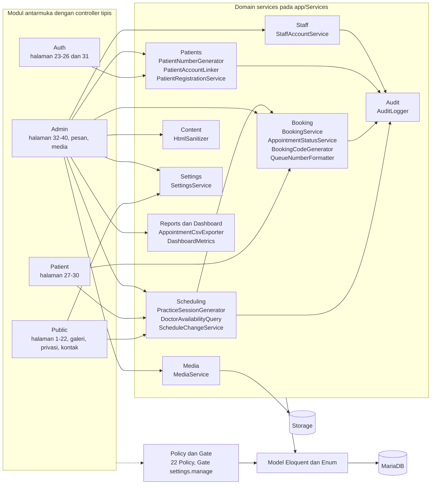
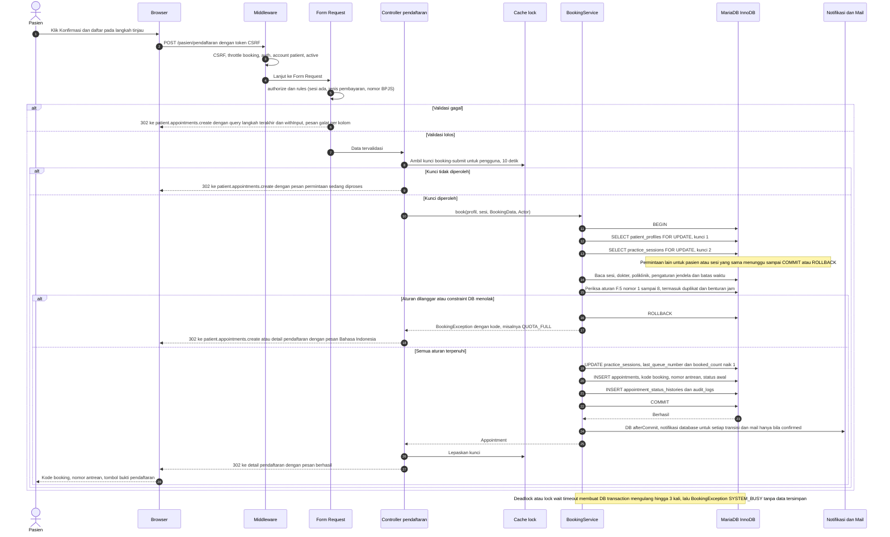

# 03 — Arsitektur Aplikasi

> **Tujuan bagian.** Bagian ini menjelaskan bagaimana UNPAM HOSPITAL disusun secara teknis: lapisan dari browser sampai database, batas modul dan arah ketergantungan, alur teknis proses booking, kompatibilitas rinci dengan MariaDB 10.4.32 (database bawaan XAMPP), strategi agar fitur inti tetap berjalan offline, ringkasan arsitektur keamanan, perbedaan konfigurasi lokal dan produksi, serta kebutuhan non-fungsional. Aturan bisnis (apa yang dilarang/diizinkan) ada di [12 — Aturan Bisnis, Validasi, dan Keamanan](12-aturan-bisnis-validasi-keamanan.md); bagian ini menjelaskan **di mana** aturan itu hidup dan **bagaimana** ia ditegakkan.
>
> **Bagian terkait:** [01 — Ringkasan dan Asumsi](01-ringkasan-asumsi.md) · [02 — Ruang Lingkup](02-ruang-lingkup.md) · [04 — Peran dan Hak Akses](04-peran-hak-akses.md) · [08 — ERD](08-erd.md) · [09 — Data Dictionary](09-data-dictionary.md) · [10 — Struktur Folder](10-struktur-folder.md) · [11 — Route, Controller, Model, Service](11-route-controller-model-service.md) · [16 — Instalasi dan Operasional](16-instalasi-operasional.md).
>
> **Penanda:** **[ASUMSI]** = ditetapkan tanpa data pemilik; **[KONFIRMASI]** = butuh keputusan pemilik. Nama tabel, kolom, enum, route, izin, dan service mengikuti [00 — Keputusan Inti](00-keputusan-inti.md).

---

## 1. Prinsip Arsitektur

| No | Prinsip | Konsekuensi |
|---|---|---|
| P1 | **Monolit Laravel 12** dengan Blade + Bootstrap 5 untuk publik, pasien, dan admin (K2) | Satu deployable, satu database, satu guard `web`; tanpa SPA, tanpa Filament |
| P2 | **Controller tipis, aturan bisnis di service** | Mengambil input tervalidasi, memanggil service/query, memilih respons; aturan waktu/kuota/status tidak ada di controller atau Blade |
| P3 | **Satu sumber kebenaran jadwal** (`DoctorAvailabilityQuery`) | Halaman publik, wizard, dan form walk-in tidak pernah menghitung ketersediaan sendiri |
| P4 | **Penegakan di server berlapis** | Middleware route → Form Request → Policy → scoping query; menyembunyikan menu hanya kenyamanan |
| P5 | **Kebenaran data dijaga database** | Transaksi + `lockForUpdate` + UNIQUE/CHECK sebagai lapis terakhir; bukan hanya validasi aplikasi |
| P6 | **Offline-first** | Aset, font, ikon, grafik, editor, placeholder dibundel lokal; peta adalah satu-satunya fitur opsional online |
| P7 | **Tanpa ketergantungan penjadwal tugas** untuk fitur inti | Pembangkitan sesi lazy; perintah Artisan manual tersedia |
| P8 | **Siap berkembang tanpa menulis ulang** | Titik perluasan untuk integrasi tersedia ([02](02-ruang-lingkup.md) bagian 4); migration tambahan hanya menambah |
| P9 | **Portabel MariaDB ↔ MySQL 8.4** | Hanya fitur SQL yang ada di keduanya; DDL khusus ditulis lewat `DB::statement` yang kompatibel |

---

## 2. Arsitektur Lapisan

### 2.1 Diagram lapisan permintaan



Catatan membaca diagram:

- Form Request dijalankan oleh container Laravel **saat controller dipanggil, sebelum badan metode controller berjalan**; karena itu ia digambar sebelum controller.
- Garis putus-putus adalah pemanggilan bersyarat: Policy dipanggil dari Form Request (`authorize()`) atau controller (`$this->authorize`), notifikasi dikirim hanya setelah transaksi berhasil commit.
- Browser memuat CSS, JS, font, dan gambar langsung dari Apache (berkas statis); hanya HTML dinamis yang melewati PHP.

### 2.2 Tanggung jawab per lapisan

| Lapisan | Tanggung jawab | Contoh | Tidak boleh |
|---|---|---|---|
| **Apache + VirtualHost** | Menerima HTTP, `mod_rewrite` mengarahkan semua permintaan non-berkas ke `public/index.php`; `DocumentRoot "D:/Project Web RS/public"` | `.htaccess` bawaan Laravel di `public/` | Menyajikan folder di luar `public/` |
| **Front controller** | `public/index.php` memuat autoloader dan `bootstrap/app.php` | — | Memuat logika aplikasi |
| **Routes** | Memetakan URI Indonesia ke controller dengan nama route berbahasa Inggris; tiga berkas: `routes/web.php`, `routes/patient.php`, `routes/admin.php` | `Route::get('/dokter', …)->name('doctors.index')` | Berisi closure berlogika bisnis |
| **Middleware** | Lintas-permintaan: header keamanan, session, CSRF, throttle, autentikasi, tipe akun, akun aktif, ganti password wajib, izin | `account:staff`, `permission:patients.view` | Membaca/menulis aturan domain |
| **Form Request** | Validasi bentuk data + `authorize()` per aksi + terjemahan pesan galat | Validasi unggahan, `payment_type` bersyarat | Mengubah database |
| **Controller** | Menerjemahkan HTTP ↔ service: ambil data tervalidasi, panggil satu service/query, pilih view/redirect/JSON | `store()` memanggil `BookingService::book()` | Menghitung kuota, memeriksa batas waktu, memodifikasi lebih dari satu model |
| **Policy/Gate** | Keputusan otorisasi per model dan per izin (murni, tanpa efek samping) | `AppointmentPolicy::view` | Menulis ke DB, memanggil service |
| **Service** | Aturan bisnis, transaksi, penguncian, pemanggilan `AuditLogger`, pengiriman notifikasi setelah commit | `BookingService`, `ScheduleChangeService` | Membaca `request()`, `auth()`, session; mengembalikan respons HTTP |
| **Model/Eloquent + Enum** | Relasi, cast (`hashed`, `encrypted`, `array`, enum), scope, accessor tampilan | `Appointment::scopeActive()` | Efek samping lintas model, pemanggilan service |
| **Blade** | Presentasi: layout, komponen, escape `{{ }}` | `<x-status-badge>` | Query database; `{!! !!}` selain lima kolom rich text |
| **MariaDB** | Penyimpanan, constraint, transaksi, kunci baris | UNIQUE, CHECK, FK | — |
| **Storage** | Berkas media: disk `public` (via `storage:link`) dan `local` (privat) | `storage/app/public/photo/2026/10/{uuid}.jpg` | Menyimpan BLOB gambar di DB |

### 2.3 Urutan eksekusi satu permintaan

| Urut | Tahap | Mekanisme |
|---|---|---|
| 1 | Penerimaan | Apache → `public/.htaccess` → `index.php` |
| 2 | Middleware global | `SecurityHeaders` (di-append global di `bootstrap/app.php`), penanganan ukuran POST, `TrimStrings`, `ConvertEmptyStringsToNull` |
| 3 | Grup `web` | Cookie terenkripsi, `StartSession` (driver `database`), `ShareErrorsFromSession`, validasi token CSRF, pengikatan model berdasarkan slug/kode |
| 4 | Middleware area | Publik: `throttle` hanya pada `contact.store`. Pasien: `auth`, `account:patient`, `active`, `throttle:booking` pada pengiriman. Admin: `auth`, `account:staff`, `active`, `password.changed`, `permission:*` |
| 5 | Form Request | `authorize()` lalu `rules()`; galat validasi mengembalikan redirect dengan pesan |
| 6 | Controller | Memanggil service atau query |
| 7 | Service | Transaksi, penguncian, aturan, tulis audit, jadwalkan notifikasi `DB::afterCommit` |
| 8 | Respons | View Blade, redirect + flash, atau JSON (`admin.dashboard.chart`); `SecurityHeaders` menambah header |

`bootstrap/app.php` (Laravel 12 tidak memakai `Http/Kernel.php`) mendaftarkan: tiga berkas route lewat `withRouting(... then: ...)`, alias middleware (`account`, `active`, `password.changed`, `role`, `permission`), `SecurityHeaders` global, serta pengalihan tamu/pengguna login:

```php
// bootstrap/app.php (ilustrasi)
$middleware->redirectGuestsTo(fn (Request $r) => $r->is('admin', 'admin/*') ? route('admin.login') : route('login'));
$middleware->redirectUsersTo(fn (Request $r) => $r->user()->account_type === AccountType::Staff
    ? route('admin.dashboard') : route('patient.dashboard'));
```

Perilaku penolakan akses selengkapnya ada di [04 — Peran dan Hak Akses](04-peran-hak-akses.md).

### 2.4 Pembangkitan sesi dalam permintaan

`PracticeSessionGenerator::ensureDailyHorizon()` dipanggil dari controller halaman jadwal publik dan wizard booking. Agar tidak membebani setiap permintaan: (1) penanda cache `sessions:generated:{Y-m-d}` dicek lebih dulu; (2) bila belum ada, `Cache::lock` non-blocking diambil — jika lock dipegang permintaan lain, permintaan ini **lanjut tanpa menunggu**; (3) pembangkitan memakai `insertOrIgnore` berdasarkan UNIQUE (`doctor_schedule_id`, `session_date`) sehingga aman bila dua proses berjalan; (4) penanda ditulis setelah selesai.

---

## 3. Batas Modul dan Aturan Dependensi

### 3.1 Diagram modul



### 3.2 Siapa memanggil siapa

| Pemanggil | Boleh memanggil | Tidak boleh |
|---|---|---|
| **Public** (controller) | `DoctorAvailabilityQuery`, `PracticeSessionGenerator::ensureDailyHorizon()`, `SettingsService`, model (baca), `ContactMessage` (simpan, setelah Form Request + limiter `contact`) | `BookingService`, `AppointmentStatusService`, menulis data selain pesan kontak |
| **Auth** (controller) | `PatientRegistrationService` (membuat `users` + `patient_profiles` dalam satu transaksi memakai `PatientNumberGenerator`), password broker, `Auth::attempt` | Mengubah peran/izin; menyentuh `appointments` |
| **Patient** (controller) | `DoctorAvailabilityQuery`, `PracticeSessionGenerator`, `BookingService::book()`, `AppointmentStatusService::transition()` (pembatalan oleh pemilik), model profil milik sendiri | Menerima `patient_profile_id` dari request; membaca appointment tanpa scoping kepemilikan |
| **Admin** (controller) | Semua service domain sesuai izin, `AuditLogger` (CRUD sederhana), `MediaService`, `HtmlSanitizer` (lewat Form Request/mutator), `SettingsService`, `AppointmentCsvExporter`, `DashboardMetrics`, `StaffAccountService` | Mengubah status/kuota langsung pada model |
| **`BookingService`** | `BookingCodeGenerator`, `AuditLogger`, model, `DB::afterCommit` untuk notifikasi, `SettingsService` (jendela dan batas) | Memanggil controller/Request; I/O eksternal di dalam transaksi |
| **`AppointmentStatusService`** | `AuditLogger`, model, notifikasi setelah commit | Mengubah `last_queue_number` (tidak pernah turun) |
| **`ScheduleChangeService`** | `PracticeSessionGenerator`, `AppointmentStatusService` (pembatalan massal saat resolusi `cancel`), `AuditLogger`, model; `applyDoctorInactive()` dipanggil dari controller dokter saat dokter dinonaktifkan atau diarsipkan (00 F.4) | Mengubah templat tanpa memeriksa sesi dengan appointment aktif |
| **`PracticeSessionGenerator`** | Model `DoctorSchedule`, `ScheduleException`, `PracticeSession`, `SettingsService` | Memanggil `BookingService` |
| **`DoctorAvailabilityQuery`** | Model (baca saja), `SettingsService` | Menulis apa pun |
| **`PatientAccountLinker`** | `AuditLogger`, model | Menggabungkan dua profil dengan riwayat |
| **`MediaService`** | Intervention Image (GD), Storage, model `Media` | Menulis ke disk sebelum validasi lolos; menghapus file lama sebelum commit |
| **Model** | Model lain (relasi), enum | Memanggil service atau controller |
| **Policy** | Model (baca), `$user->can('<izin>')` | Menulis ke DB, memanggil service |
| **Blade** | Komponen Blade, `@can`, data dari controller | Query, aturan bisnis |

### 3.3 Aturan wajib

1. **Controller tipis**: urutan baku `Form Request` → panggil service/query → respons. Pedoman: tidak ada aksi yang melampaui sekitar 15 baris; bila lebih, ada aturan yang harus dipindah ke service.
2. **Pembagian validasi**: Form Request memeriksa **bentuk** (tipe, panjang, keberadaan, format nomor BPJS); service memeriksa **keadaan** (kuota, status, jendela, duplikat, benturan) **di dalam transaksi setelah penguncian**, karena keadaan bisa berubah di antara validasi dan penulisan.
3. **Pelaku dilewatkan eksplisit** (`Actor`: tipe + pengguna) ke service; service tidak membaca `auth()`. Ini membuat service dapat dipanggil dari Artisan (`appointments:mark-no-show`, aktor `system`) dan dari pengujian.
4. **Model tidak memuat aturan transisi lintas-model.** Peta transisi status (siapa boleh dari/ke apa) berada di enum/service `AppointmentStatusService`.
5. **Audit di service**, bukan di controller, kecuali CRUD sederhana tanpa aturan lintas-model (FAQ, banner, dst.) yang boleh langsung dari controller ke model dengan `AuditLogger` (**[ASUMSI]** A-39).
6. **Tidak ada I/O eksternal di dalam transaksi** (mail, PDF, HTTP, tulis file): dikerjakan setelah commit. Alasan: transaksi yang menahan kunci baris harus sependek mungkin.
7. **Jadwal hanya lewat `DoctorAvailabilityQuery`**; tidak ada query jadwal ad hoc di controller atau view.
8. **Dependensi satu arah** seperti tabel 3.2; `ScheduleChangeService` → `AppointmentStatusService` diizinkan, kebalikannya tidak.
9. **Galat domain** berupa `BookingException` dengan kode baku (`SESSION_UNAVAILABLE`, `OUTSIDE_WINDOW`, `CUTOFF_PASSED`, `QUOTA_FULL`, `DUPLICATE_BOOKING`, `OVERLAPPING_BOOKING`, `ACTIVE_LIMIT_REACHED`, `INVALID_PAYMENT`, `SYSTEM_BUSY`); `SYSTEM_BUSY` dipakai bila lock wait timeout (errno 1205) atau deadlock (errno 1213) masih terjadi setelah `attempts: 3`. Controller menampilkannya sebagai flash galat berbahasa Indonesia, bukan halaman 500. Transisi status yang tidak diizinkan melempar `InvalidTransitionException` (00 F.8).

---

## 4. Alur Teknis Booking

Sesuai 00 F.5–F.6. Gambar berikut memperlihatkan jalur normal dan dua jalur gagal (kunci pengiriman ganda dan pelanggaran aturan/constraint).



Penjelasan langkah penting:

| Langkah | Alasan |
|---|---|
| Kunci `Cache::lock("booking-submit:{user_id}", 10)` di controller | Mencegah kirim ganda dari klik ganda/refresh; lapis pertama, bukan satu-satunya |
| Kunci 1 `patient_profiles` | Menserialkan semua perubahan appointment satu pasien, sehingga pemeriksaan **duplikat** dan **benturan jam** tidak bisa lolos bersamaan |
| Kunci 2 `practice_sessions` | Menserialkan pendaftaran pada sesi yang sama, sehingga **kuota** dan **nomor antrean** konsisten |
| Pemeriksaan keadaan **setelah** kunci | Keadaan dibaca ulang dari baris yang sudah terkunci; hasil pemeriksaan di Form Request hanya awal |
| Notifikasi lewat `DB::afterCommit` | Notifikasi tidak terkirim bila transaksi dibatalkan; galat kirim dicatat tanpa membatalkan booking |
| `attempts: 3` | Deadlock/lock-wait ditangani dengan mengulang seluruh closure, sehingga closure tidak boleh punya efek samping di luar database; bila masih gagal setelah tiga percobaan, galat dipetakan ke `SYSTEM_BUSY` ("Sistem sedang sibuk, silakan coba lagi beberapa saat.") dan tidak ada data tersimpan sebagian |
| Constraint DB sebagai lapis terakhir | UNIQUE (`practice_sessions` nomor antrean, kode booking, pasien+sesi+`active_flag`) dan CHECK `booked_count <= quota` menolak data salah walau kode memiliki bug |

---

## 5. Kompatibilitas MariaDB 10.4.32

XAMPP 8.2.12 membawa **MariaDB 10.4.32** yang pada panel XAMPP dilabeli "MySQL". Laravel 12 mendukung resmi MariaDB 10.3+, sehingga seluruh migration dan query dirancang untuk MariaDB 10.4 **dan** tetap portabel ke MySQL 8.4 / MariaDB ≥ 10.11 untuk produksi (**[KONFIRMASI]** K-01).

### 5.1 Konfigurasi koneksi

```php
// config/database.php (ilustrasi) — koneksi 'mariadb'
'mariadb' => [
    'driver'    => 'mariadb',
    'host'      => env('DB_HOST', '127.0.0.1'),
    'port'      => env('DB_PORT', '3306'),
    'database'  => env('DB_DATABASE', 'unpam_hospital'),
    'username'  => env('DB_USERNAME', 'unpam_app'),
    'password'  => env('DB_PASSWORD', ''),
    'charset'   => 'utf8mb4',
    'collation' => 'utf8mb4_unicode_ci',
    'timezone'  => '+07:00',
    'strict'    => true,
    'engine'    => 'InnoDB',
],
```

`DB_CONNECTION=mariadb` memilih tata bahasa (grammar) khusus MariaDB di Laravel, bukan `mysql`.

### 5.2 Tabel kompatibilitas

| No | Topik | Fakta MariaDB 10.4 | Keputusan dan implikasi di proyek |
|---|---|---|---|
| 1 | **Driver dan versi** | Laravel 12 mendukung MariaDB 10.3+. `SELECT VERSION()` menampilkan `10.4.32-MariaDB` | `DB_CONNECTION=mariadb`. Panduan 16 menyertakan pengecekan versi |
| 2 | **Tipe JSON** | `JSON` pada MariaDB adalah **alias `LONGTEXT`**; sejak 10.4.3 MariaDB otomatis menambah `CHECK (json_valid(kolom))`. Tidak ada tipe biner JSON, urutan kunci dipertahankan sebagai teks | Kolom `practice_sessions.pending_change`, `room_categories.amenities`, `audit_logs.old_values`/`new_values` memakai `$table->json()` dan cast Eloquent `array`. **Tidak ada query ke dalam isi JSON** (hanya dibaca utuh); tidak ada indeks JSON; verifikasi CHECK lewat `SHOW CREATE TABLE`. Bila CHECK tidak muncul pada suatu server, tambahkan lewat `DB::statement` |
| 3 | **Generated column** | `STORED` (alias `PERSISTENT`) didukung sejak 10.2.1; boleh diberi UNIQUE index; nilai tidak boleh diisi eksplisit | `appointments.active_flag` memakai `->storedAs("CASE WHEN status IN ('pending','confirmed','checked_in') THEN 1 ELSE NULL END")`. **Tidak boleh masuk `$fillable`** dan tidak boleh ada pada `insert`/`insertOrIgnore` massal. Menambah/mengubahnya memaksa rebuild tabel — hanya via migration |
| 4 | **CHECK constraint** | Ditegakkan sejak **10.2.1** (sebelumnya diparse tetapi diabaikan). Blueprint Laravel tidak punya helper `check()` | Ditambah dengan `DB::statement('ALTER TABLE … ADD CONSTRAINT chk_… CHECK (…)')` pada migration; `down()` memakai `ALTER TABLE … DROP CONSTRAINT chk_…` (sintaks ini juga diterima MySQL ≥ 8.0.19). Daftar final (09 bagian 11.3): `chk_sessions_quota` (`booked_count`), `chk_sessions_time`, `chk_sessions_quota_range`, `chk_sessions_queue`, `chk_schedules_time/day/quota/validity`, `chk_exceptions_dates`, `chk_appointments_queue`, `chk_room_categories_beds`, `chk_banners_period`, `chk_media_owner` |
| 5 | **Pemetaan error constraint** | Pelanggaran CHECK di MariaDB: errno **4025**, SQLSTATE `23000`. Di MySQL 8: errno **3819**, SQLSTATE `HY000`. Duplikat UNIQUE: errno **1062**, SQLSTATE `23000` di keduanya | Penerjemah `QueryException` → `BookingException` memeriksa `errorInfo[1]` **dan nama constraint/indeks** pada pesan, bukan hanya `23000`, agar tetap benar saat produksi pindah ke MySQL 8.4. Pemetaan: errno **1062** + `appointments_patient_session_active_unique` → `DUPLICATE_BOOKING`; errno **4025** (MariaDB) atau **3819** (MySQL 8) + `chk_sessions_quota` → `QUOTA_FULL`; errno **1205** (lock wait) atau **1213** (deadlock) setelah `attempts: 3` → `SYSTEM_BUSY` |
| 6 | **Partial/functional index** | Tidak ada (MySQL 8 punya functional index; MariaDB 10.4 tidak) | Solusi: **generated column + UNIQUE composite** (`active_flag`), memanfaatkan sifat UNIQUE yang mengizinkan banyak `NULL`. Tidak ada `CREATE INDEX … WHERE …` |
| 7 | **`SELECT … FOR UPDATE`** | InnoDB mendukung kunci baris; `lockForUpdate()` Laravel valid hanya di dalam transaksi | Dipakai pada `patient_profiles` dan `practice_sessions` **berdasarkan primary key** (hanya kunci rekaman, tanpa gap lock) |
| 8 | **Isolasi default REPEATABLE READ** | SELECT biasa memakai *snapshot* yang dibuat pada pembacaan konsisten **pertama** dalam transaksi; locking read (`FOR UPDATE`) selalu membaca versi **terbaru yang sudah commit** | Implikasi rinci di 5.3 |
| 9 | **`SKIP LOCKED`** | Baru ada di MariaDB **10.6+**; `NOWAIT`/`WAIT n` ada sejak 10.3 | **Tidak dipakai.** Booking memang harus menunggu giliran kunci, bukan melewati baris |
| 10 | **UUID native** | Tipe `UUID` baru ada di **10.7+** | `Schema` Laravel memakai `CHAR(36)` pada MariaDB < 10.7; `notifications.id` (UUID) menjadi `CHAR(36)`. Tidak memakai tipe `UUID` eksplisit |
| 11 | **Panjang index utf8mb4** | Row format default **DYNAMIC** sejak 10.2.2; batas prefiks indeks **3072 byte** (`VARCHAR(255)` utf8mb4 = 1020 byte) | **Tidak perlu** `Schema::defaultStringLength(191)`. UNIQUE composite (mis. `patient_profile_id`, `practice_session_id`, `active_flag`) jauh di bawah batas |
| 12 | **Collation** | `utf8mb4_unicode_ci`: tidak membedakan huruf besar/kecil dan aksen; `PAD SPACE` | Ditetapkan eksplisit (bukan default server) agar migration identik di MariaDB dan MySQL 8 (default MySQL 8 `utf8mb4_0900_ai_ci` berbeda). Akibat: UNIQUE `email`/`slug`/`booking_code` tidak peka huruf besar/kecil — memang diinginkan |
| 13 | **CTE dan window function** | CTE (`WITH`) didukung sejak 10.2.1, CTE rekursif 10.2.2, window function 10.2 | Boleh dipakai bila memudahkan laporan dashboard. Query tetap lewat Eloquent/query builder |
| 14 | **Fitur yang dihindari** | `JSON_TABLE` (MariaDB 10.6+), `LATERAL` join (tidak ada di MariaDB), functional index, `DEFAULT (ekspresi)`, `->>` pada JSON di klausa WHERE, `INSERT … RETURNING` (khusus MariaDB), tipe `UUID`/`INET6` | Memastikan migration dan query berjalan di 10.4 **dan** MySQL 8.4 |
| 15 | **`INSERT IGNORE`** | Mengubah banyak jenis galat (bukan hanya duplikat) menjadi peringatan | `PracticeSessionGenerator` memakai `insertOrIgnore` hanya setelah memvalidasi data (jam, kuota 1–200) dan memeriksa jumlah baris terpengaruh; tidak dipakai untuk tabel lain |
| 16 | **Mode ketat** | Laravel menyetel `strict` untuk koneksi | `strict => true` dipertahankan agar data terpotong/ tidak valid ditolak, bukan dimodifikasi diam-diam |
| 17 | **Zona waktu dan TIMESTAMP** | `TIMESTAMP` disimpan UTC dan dikonversi menurut zona sesi; rentang berakhir 2038-01-19 | `'timezone' => '+07:00'` pada koneksi agar konsisten di mesin mana pun (A-33). Rincian tipe kolom waktu domain ditetapkan di [09](09-data-dictionary.md); batas 2038 dicatat sebagai risiko jangka panjang yang sama pada MySQL 8.4 |
| 18 | **Engine** | InnoDB adalah default; MyISAM tidak mendukung transaksi/FK | `'engine' => 'InnoDB'` eksplisit pada koneksi |
| 19 | **Pengujian** | SQLite tidak setara untuk generated column, CHECK, dan locking | `phpunit.xml`/`.env.testing` memakai database MariaDB terpisah (`unpam_hospital_test`) (A-29). Uji konkurensi **tidak** memakai `RefreshDatabase` karena membungkus seluruh uji dalam satu transaksi; gunakan `DatabaseTruncation` atau seed per uji, dan jalankan permintaan paralel ke Apache |
| 20 | **Backup/restore** | `mysqldump` MariaDB menangani kolom generated | `scripts/backup.ps1` memakai `--single-transaction --routines --default-character-set=utf8mb4`; **skenario uji restore wajib memverifikasi tabel `appointments`** (kolom `active_flag`) |
| 21 | **Query** | — | Semua akses data lewat **Eloquent atau query builder** dengan parameter terikat. SQL mentah hanya untuk DDL pada migration (`DB::statement`) dan ekspresi kolom (`DB::raw`) tanpa input pengguna |

### 5.3 Isolasi REPEATABLE READ dan penguncian: implikasi rancangan

1. **Locking read membaca versi terbaru.** Karena itu baris `practice_sessions` dikunci dulu, lalu `booked_count` dibaca dari baris terkunci itu — bukan dari snapshot lama.
2. **Snapshot dibuat oleh SELECT biasa pertama dalam transaksi.** Bila ada SELECT biasa **sebelum** kunci diperoleh (misalnya memuat relasi model di dalam closure), pemeriksaan duplikat/benturan sesudahnya dapat membaca data usang dan melewatkan booking yang baru di-commit transaksi lain. **Aturan:** pernyataan pertama di dalam transaksi `book()` adalah `lockForUpdate()` pada `patient_profiles`; model lain dimuat **setelah** kedua kunci diperoleh. Karena semua perubahan appointment satu pasien menunggu kunci pasien, snapshot yang dibuat setelah kunci tersebut sudah memuat semua perubahan yang di-commit sebelumnya.
3. **Kunci berdasarkan primary key** (`whereKey`) hanya mengunci rekaman. Locking read berdasarkan rentang non-unik (mis. `WHERE patient_profile_id = ? AND …` pada `appointments`) akan mengambil *next-key lock* di REPEATABLE READ, memperbesar peluang deadlock dan memblokir INSERT; karena itu pemeriksaan duplikat/benturan memakai SELECT biasa di bawah perlindungan kunci pasien, bukan locking read pada `appointments`.
4. **Urutan kunci baku** (00 F.6): `patient_profiles` → `practice_sessions` → `appointments`. Berlaku untuk booking, pembatalan, transisi status, dan resolusi sesi.

   | Operasi | Urutan kunci |
   |---|---|
   | Booking | pasien → sesi → INSERT appointment |
   | Transisi status satu appointment (konfirmasi, check-in, selesai, batal, koreksi) | pemilik profil → sesi → baris appointment (PK) |
   | Aksi massal per sesi (`admin.queue.mark-no-show`, resolusi `cancel`) | baca daftar pasien terdampak, kunci seluruh `patient_profiles` **berurutan `id` menaik**, lalu sesi, lalu appointment menaik `id`; baca ulang dengan kunci dan pastikan himpunan tidak bertambah (sesi `needs_review` tertutup untuk booking baru) |
   | Hubungkan akun | kedua profil menaik `id` (profil kosong akun + profil walk-in), tidak menyentuh sesi |

5. **Deadlock dan timeout** (errno 1213/1205) diulang oleh `DB::transaction(..., attempts: 3)`; bila masih gagal, `BookingException` `SYSTEM_BUSY`. `innodb_lock_wait_timeout` bawaan XAMPP 50 detik terlalu lama untuk pengalaman pengguna; **[ASUMSI]** disarankan menurunkannya ke 10 detik pada `my.ini` (opsional, dibahas di 16).
6. **Transaksi sependek mungkin**: tidak ada mail, PDF, HTTP, atau tulis file di dalam closure; closure harus dapat diulang tanpa efek samping di luar DB.

### 5.4 Potongan ilustratif DDL

```php
// migration appointments (ilustrasi, dari 00 E.3)
$table->tinyInteger('active_flag')->nullable()
      ->storedAs("CASE WHEN status IN ('pending','confirmed','checked_in') THEN 1 ELSE NULL END");
$table->unique(['patient_profile_id', 'practice_session_id', 'active_flag'], 'appointments_patient_session_active_unique');

// migration practice_sessions (ilustrasi)
DB::statement('ALTER TABLE practice_sessions ADD CONSTRAINT chk_sessions_quota
               CHECK (booked_count >= 0 AND booked_count <= quota)');
// down():
DB::statement('ALTER TABLE practice_sessions DROP CONSTRAINT chk_sessions_quota');
```

Nama indeks/constraint di atas adalah nama final dari [09 — Data Dictionary](09-data-dictionary.md) (nama eksplisit `appointments_patient_session_active_unique` karena nama bawaan Laravel 70 karakter melewati batas 64).

---

## 6. Strategi Offline

Tujuan: fitur inti berjalan di localhost **tanpa internet** (kebutuhan §2, §13, §16). Internet hanya dibutuhkan saat instalasi dan build awal (`composer install`, `npm install`).

| Sumber daya | Pendekatan lokal | Perilaku saat offline |
|---|---|---|
| CSS dan JS | Vite membundel Bootstrap 5 (SCSS), `@popperjs/core`, JS aplikasi ke `public/build` | Tampil normal |
| Font | `@fontsource/plus-jakarta-sans` (bobot 400/500/600/700, subset latin) dibundel ke berkas `woff2` lokal; fallback `system-ui, -apple-system, "Segoe UI", sans-serif` | Tampil normal; tanpa Google Fonts |
| Ikon | `bootstrap-icons` (font lokal) | Tampil normal |
| Grafik dashboard | `chart.js` ^4 dibundel dan dimuat dinamis hanya di halaman dashboard | Tampil normal |
| Editor rich text | `quill` ^2 dibundel dan dimuat dinamis hanya di layar yang punya kolom rich text | Tampil normal |
| Gambar entitas | Media di disk `public`; placeholder SVG lokal `public/images/placeholders/{doctor,clinic,facility,room,article,banner,gallery,logo}.svg` bila media NULL; bila file fisik hilang, komponen `x-image` memberi atribut `data-fallback="{url placeholder}"` dan satu listener terdelegasi di `resources/js/app.js` (`document.addEventListener('error', …, true)`) mengganti `src` ke placeholder (tanpa atribut inline `onerror` agar kompatibel dengan CSP ketat); `alt` selalu terisi | Tampil normal |
| QR code | `chillerlan/php-qrcode` menghasilkan SVG di server | Tampil normal |
| PDF bukti | `barryvdh/laravel-dompdf` dengan **akses remote dimatikan** (`config/dompdf.php` → `options.enable_remote = false`, setara opsi Dompdf `isRemoteEnabled`), logo dan QR disematkan lokal | Berfungsi; juga mencegah SSRF dari konten |
| Peta tersemat | Iframe Google Maps dari `map.embed_url` — **satu-satunya sumber eksternal opsional** | Komponen `map-embed` menampilkan alamat teks dan tombol "Petunjuk Arah" **tanpa bergantung pada iframe**; bila iframe gagal dimuat (offline atau diblokir), blok pengganti "Peta tidak dapat dimuat, gunakan alamat di atas" ditampilkan |
| Tombol "Petunjuk Arah" | Tautan `<a>` ke `map.directions_url` | Tautan tetap tampil; baru berfungsi saat online |
| Email | `MAIL_MAILER=log` (opsional Mailpit lokal) | Berfungsi tanpa internet |
| Pencarian dokter/artikel | SQL `LIKE` pada database lokal | Berfungsi |
| CAPTCHA/analitik/CDN | **Tidak dipakai**; pembatasan penyalahgunaan memakai limiter bernama | — |

**Penjaga regresi offline:** pengujian otomatis memindai berkas Blade, SCSS, dan JS terhadap URL `http(s)://` eksternal (daftar putih: `map.embed_url`, `map.directions_url`, `wa.me`) dan gagal bila ada sumber daya eksternal baru. CSP produksi (`script-src`, `style-src`, `font-src`, `img-src` ke `'self'`; `frame-src` hanya Google Maps) menjadi lapis kedua.

---

## 7. Cache, Session, Queue, dan Mail Lokal

| Komponen | Lokal | Produksi | Catatan |
|---|---|---|---|
| **Session** | `SESSION_DRIVER=database` (tabel `sessions`) | `database` | Tanpa Redis; `SESSION_SECURE_COOKIE=false` lokal, `true` produksi. Menonaktifkan staf dapat menghapus baris `sessions` miliknya agar terputus segera |
| **Cache** | Driver `database` (tabel `cache`, `cache_locks`) | `database` (atau Redis bila tersedia) | Dipakai untuk: `SettingsService` (cache pengaturan), penanda `sessions:generated:{Y-m-d}`, `Cache::lock` (`booking-submit:{user_id}` dan pembangkit sesi), cache izin Spatie, penghitung rate limiter |
| **Queue** | `QUEUE_CONNECTION=sync` | `database` + `php artisan queue:work` | Tabel `jobs`, `job_batches`, `failed_jobs` sudah tersedia. Notifikasi dikirim lewat `DB::afterCommit` sehingga perilaku konsisten pada `sync` maupun `database` |
| **Mail** | `MAIL_MAILER=log`; opsional `smtp` ke Mailpit `127.0.0.1:1025` | `smtp` resmi (**[KONFIRMASI]** K-02) | Mail notifikasi hanya untuk `confirmed`, `cancelled`, dan perubahan jadwal (kanal `database` untuk setiap transisi; default K-13), ditambah email reset password. Dengan `LOG_CHANNEL=daily`, mail log tertulis di `storage/logs/laravel-YYYY-MM-DD.log` (bukan `laravel.log` tunggal). Tautan reset password hanya terlihat di log/Mailpit, **tidak pernah di halaman** |
| **Log** | `LOG_CHANNEL=daily` | `daily` | Galat sistem; audit bisnis ada di tabel `audit_logs`, bukan di log berkas |
| **Scheduler/cron** | Tidak dipakai | Opsional | Fitur inti tidak bergantung padanya; `sessions:generate`, `appointments:mark-no-show`, `media:prune` dapat dijalankan manual atau dijadwalkan di produksi |

---

## 8. Penyimpanan File dan Media (ringkas)

- Disk `public`: `storage/app/public/{collection}/{YYYY}/{MM}/{uuid}.{ext}`, diakses lewat `public/storage` (`php artisan storage:link`). Di Windows, `storage:link` membuat symlink sehingga terminal harus dijalankan sebagai Administrator atau Windows Developer Mode aktif; VirtualHost memerlukan `Options FollowSymLinks` (rincian di [16](16-instalasi-operasional.md)).
- Disk `local` (privat): `storage/app/private/…` untuk dokumen pasien di masa depan; **tidak pernah** diberi URL publik, hanya dilayani controller + policy.
- Database hanya menyimpan metadata (tabel `media`); tidak ada BLOB.
- Pemrosesan, validasi, penggantian, dan `media:prune` mengikuti 00 bagian K; rincian aturan di [12](12-aturan-bisnis-validasi-keamanan.md).

---

## 9. Pipeline Aset

| Aspek | Keputusan |
|---|---|
| **Bundler** | Vite + `laravel-vite-plugin` (bawaan skeleton) |
| **Hapus Tailwind** | `npm remove tailwindcss @tailwindcss/vite`; hapus plugin Tailwind dari `vite.config.js`; ganti berkas `resources/css/app.css` bawaan (yang mengimpor Tailwind) dengan SCSS; hapus `welcome.blade.php` bawaan |
| **Gaya** | SCSS yang mengimpor Bootstrap 5.3 dengan penimpaan variabel token 00 bagian M (`$primary` `#0A4D8C`, aksen `#0E7C74`, `#13A89E` hanya dekorasi, `$success` `#1E7D45`, `$light` `#F3F7FB`, font Plus Jakarta Sans 16 px, tinggi baris 1,6). Impor hanya modul Bootstrap yang dipakai |
| **JS** | Impor komponen Bootstrap satu per satu (Collapse, Dropdown, Offcanvas, Modal, Toast, Tooltip) agar bundel kecil; Chart.js dan Quill di-`import()` dinamis hanya di layar yang membutuhkan |
| **Entry point** | Dua bundel: **publik + pasien** dan **admin** (masing-masing SCSS + JS); layout `layouts.public`/`layouts.patient`/`layouts.auth` memuat bundel pertama, `layouts.admin` memuat bundel kedua. Nama berkas final di [10](10-struktur-folder.md) |
| **Peringatan Sass** | Bootstrap 5.3 memakai `@import` Sass; Dart Sass baru menampilkan peringatan deprecation (bukan galat). Dibungkam lewat `css.preprocessorOptions.scss.silenceDeprecations` di `vite.config.js` sesuai versi Sass terpasang |
| **Perintah** | `npm install` → `npm run build` (menghasilkan `public/build` + `manifest.json` dengan nama berkas ber-hash untuk cache busting). `npm run dev` hanya untuk pengembangan |
| **Peringatan penting** | Saat memakai Apache, `public/hot` (dibuat `npm run dev`) harus tidak ada; bila ada, Laravel mencoba memuat aset dari dev server `localhost:5173` |
| **Skrip `composer dev`** | `concurrently` untuk `php artisan serve` + `npm run dev`; **tanpa `pail`** |

```js
// vite.config.js (ilustrasi)
import { defineConfig } from 'vite';
import laravel from 'laravel-vite-plugin';

export default defineConfig({
  plugins: [laravel({
    input: ['resources/scss/app.scss', 'resources/js/app.js',
            'resources/scss/admin.scss', 'resources/js/admin.js'],
    refresh: true,
  })],
  css: { preprocessorOptions: { scss: { silenceDeprecations: ['import', 'global-builtin', 'color-functions', 'mixed-decls'] } } },
});
```

---

## 10. Arsitektur Keamanan Ringkas

Rincian aturan, daftar validasi, dan skenario ada di [12 — Aturan Bisnis, Validasi, dan Keamanan](12-aturan-bisnis-validasi-keamanan.md); matriks hak akses di [04 — Peran dan Hak Akses](04-peran-hak-akses.md).

| Lapisan | Mekanisme | Tempat penegakan |
|---|---|---|
| 1. Transport dan header | HTTPS di produksi, `SESSION_SECURE_COOKIE`, `SecurityHeaders` (`X-Content-Type-Options`, `X-Frame-Options: SAMEORIGIN`, `Referrer-Policy`, `Permissions-Policy`, CSP produksi dengan `frame-src https://www.google.com https://maps.google.com`) | Middleware global |
| 2. Autentikasi | Guard `web` + session database; `Auth::attempt` + `session()->regenerate()`; logout `invalidate()` + `regenerateToken()`; limiter `login`, `password-reset`, `register`, `booking`, `contact` | Controller auth + `RateLimiter::for` |
| 3. Middleware akses | `auth` → `account:patient/staff` → `active` → `password.changed` → `permission:*` | Route group |
| 4. Otorisasi | Spatie Permission + `Gate::before` (Super Admin) + 22 Policy + Gate `settings.manage` | Form Request `authorize()`, controller, Policy |
| 5. Scoping data | Pasien selalu melalui `patient_profile_id` milik pengguna login; tidak pernah menerima ID kepemilikan dari request | Controller portal pasien, query |
| 6. Validasi input | Form Request; aturan unggahan (MIME, ekstensi, ukuran, dimensi; SVG ditolak); mass-assignment dibatasi `$fillable` | Form Request, `MediaService` |
| 7. Query aman | Eloquent/query builder berparameter | Seluruh akses data |
| 8. Output | Blade `{{ }}` default; `{!! !!}` hanya lima kolom rich text yang disanitasi `HtmlSanitizer` (mews/purifier) saat simpan | Blade, `HtmlSanitizer` |
| 9. Data sensitif | Hash password (bcrypt, cast `hashed`); `bpjs_number` dan `payment_reference` ber-cast `encrypted` + kolom 4 digit terakhir; `ip_hash` SHA-256 (IP mentah tidak disimpan); `APP_KEY` dijaga terpisah | Model, `.env` |
| 10. Audit | `AuditLogger` dengan redaksi (`password`, `remember_token`, `token`, `bpjs_number`, `payment_reference`); `audit_logs` append-only | Service |
| 11. Rahasia | Kredensial hanya di `.env`; akun demo hanya di lokal; Super Admin produksi via `app:create-super-admin` | Konfigurasi |

---

## 11. Konfigurasi Lokal versus Produksi

Sumber: 00 B.2. Baris di bawah garis pemisah adalah tambahan blueprint (**[ASUMSI]** A-40).

| Kunci `.env` / pengaturan | Lokal | Produksi |
|---|---|---|
| `APP_ENV` / `APP_DEBUG` | `local` / `true` | `production` / `false` |
| `APP_URL` | `http://unpam-hospital.test` | URL HTTPS resmi |
| `DB_CONNECTION` | `mariadb` | `mariadb` atau `mysql` |
| `DB_USERNAME` | `unpam_app` (user khusus, bukan `root`) | user khusus, password kuat |
| `SESSION_DRIVER` | `database` | `database` |
| `SESSION_SECURE_COOKIE` | `false` | `true` |
| `QUEUE_CONNECTION` | `sync` | `database` + worker |
| `MAIL_MAILER` | `log` (opsional `smtp` ke Mailpit `127.0.0.1:1025`) | `smtp` resmi **[KONFIRMASI]** |
| `LOG_CHANNEL` | `daily` | `daily` |
| Seeder demo | aktif (`DemoSeeder` hanya jalan bila `app()->environment(['local','testing'])`) | **tidak pernah**; Super Admin via `php artisan app:create-super-admin` |
| Header CSP | dinonaktifkan/longgar (Vite dev server) | aktif ketat |
| `CACHE_STORE` | `database` | `database` (atau Redis) |
| `LOG_LEVEL` | `debug` | `warning` |
| `BCRYPT_ROUNDS` | 12 | 12 atau lebih |
| Koneksi DB `timezone` | `+07:00` | `+07:00` |
| Kunci `APP_KEY` | dibuat `php artisan key:generate`, dicadangkan | dikelola aman dan **tidak pernah berubah** setelah ada data terenkripsi |
| Versi database | MariaDB 10.4.32 (XAMPP) | MariaDB ≥ 10.11 LTS atau MySQL 8.4 LTS **[KONFIRMASI]** K-01 |
| Runtime PHP | 8.2.12 (XAMPP) | ≥ 8.3 bila pindah ke Laravel 13 **[KONFIRMASI]** K-03 |

---

## 12. Kebutuhan Non-Fungsional

| ID | Kategori | Persyaratan | Cara verifikasi |
|---|---|---|---|
| NFR-01 | **Responsif** | Bootstrap 5 mobile-first; breakpoint desain **576 / 768 / 992 / 1200 px** (`sm/md/lg/xl`; `xxl` 1400 tidak diberi tata letak khusus). Navbar kolaps menjadi offcanvas di bawah 992 px; sidebar admin menjadi offcanvas di bawah 992 px; `data-table` menjadi tampilan kartu di bawah 768 px. Tidak ada scroll horizontal halaman pada lebar 360 px | Uji pada 360, 576, 768, 992, 1200, 1400 px |
| NFR-02 | **Aksesibilitas** | WCAG 2.1 AA: kontras teks ≥ 4,5:1 (token 00 M); teks tidak pernah dengan warna saja (badge = teks + ikon + warna); skip link; fokus terlihat; `aria-current` pada navigasi aktif; label + `aria-describedby` untuk galat; `lang="id"`; alt text wajib pada unggahan publik; area `aria-live` untuk flash; navigasi keyboard penuh; target sentuh ≥ 44 px (praktik baik); `prefers-reduced-motion` dihormati; reflow tanpa kehilangan fungsi pada zoom 200% | Audit Lighthouse/axe + uji keyboard manual |
| NFR-03 | **Kinerja prototipe** | Pada localhost dengan data contoh dan cache hangat: halaman publik **< 1 detik** sampai konten utama tampil; respons server (TTFB) < 300 ms; halaman daftar admin < 1,5 detik pada 10.000 appointment; pengiriman booking < 2 detik; transaksi booking menahan kunci < 500 ms. **[ASUMSI]** Bundel CSS+JS publik ≤ 250 KB terkompresi | Waktu respons di DevTools; log kueri |
| NFR-04 | **Kinerja kueri** | Daftar memakai indeks yang dinyatakan di 00 E; eager loading wajib; `Model::preventLazyLoading()` aktif di non-produksi untuk menangkap N+1; pagination untuk semua daftar | Uji hitung kueri per halaman |
| NFR-05 | **Peramban** | Dua versi terakhir Chrome, Edge, Firefox, Safari (termasuk iOS Safari); tanpa dukungan IE; JavaScript hanya penyempurnaan, wizard pendaftaran tetap berfungsi tanpa JS | Uji lintas peramban + JS dimatikan |
| NFR-06 | **Offline** | Fitur inti berjalan tanpa internet (bagian 6) | Uji dengan jaringan diputus + pemindai URL eksternal |
| NFR-07 | **Integritas dan keandalan** | Kuota tidak pernah terlampaui, antrean unik, tidak ada booking aktif ganda walau bersamaan (bagian 4–5); seluruh perubahan multi-tabel dalam transaksi | Uji konkurensi, uji constraint |
| NFR-08 | **Keamanan** | Bagian 10 dan [12](12-aturan-bisnis-validasi-keamanan.md) | Uji akses per peran, uji unggahan, tinjauan konfigurasi |
| NFR-09 | **Portabilitas database** | Migration dan query berjalan di MariaDB 10.4.32 dan MySQL 8.4 / MariaDB ≥ 10.11 | Jalankan suite uji pada kedua mesin sebelum produksi |
| NFR-10 | **Pemeliharaan** | Format kode `laravel/pint`; service diuji unit/fitur; **[ASUMSI]** target cakupan baris ≥ 80% pada `app/Services`; nama mengikuti 00 | Pint + PHPUnit |
| NFR-11 | **Observabilitas** | Log harian; galat sistem pada level `error`; `BookingException` pada level `info`; audit bisnis di `audit_logs`; halaman galat 403/404/419/429/500 berbahasa Indonesia tanpa jejak tumpukan (`APP_DEBUG=false` produksi) | Tinjau log dan halaman galat |
| NFR-12 | **Kapasitas** | ≤ 100 dokter, ≤ 50.000 appointment, puluhan pengguna bersamaan (A-30) | Uji data seed besar |
| NFR-13 | **Pemulihan** | Backup manual database + `storage/app/public` + `storage/app/private` + `APP_KEY` terpisah; restore selesai < 30 menit (A-38) | Uji restore pada instalasi bersih |
| NFR-14 | **Lokalisasi** | Bahasa Indonesia, `Asia/Jakarta`, tanggal "2 Oktober 2026", jam `08.00`, Rupiah `Rp 150.000` (A-34) | Tinjauan UI |
| NFR-15 | **Keterbacaan** | Font dasar 16 px, tinggi baris 1,6, Plus Jakarta Sans lokal dengan fallback sistem | Tinjauan UI |

---

## 13. Keputusan Arsitektur Utama dan Alasannya

| Keputusan | Alternatif yang ditolak | Alasan |
|---|---|---|
| Monolit Blade + Bootstrap | SPA (React/Vue), Filament | Kebutuhan inti berupa form dan tabel; satu runtime dan satu bahasa lebih mudah dipelihara pemilik; wizard tanpa JS menjadi mungkin; K2 disetujui pemilik |
| Booking merujuk `patient_profiles` | Merujuk `users` | Pasien walk-in tanpa akun harus berbagi kuota (K1) |
| Kuota pada `practice_sessions` yang dikunci baris | Menghitung kuota dengan `COUNT(*)` saat booking | `COUNT` + insert tidak aman terhadap pendaftaran bersamaan; baris sesi terkunci menjadi titik serialisasi tunggal |
| `active_flag` generated column | Partial unique index | MariaDB 10.4 tidak mendukungnya; solusi portabel ke MySQL 8.4 |
| Status sebagai `VARCHAR` + enum PHP | Kolom `ENUM` MariaDB | Menambah status tidak memerlukan `ALTER TABLE` |
| Sesi dibangkitkan lazy | Cron/Task Scheduler | Windows localhost tanpa penjadwal tetap berfungsi |
| Tanpa Redis | Redis untuk cache/session/queue | Tidak tersedia di XAMPP; driver database cukup untuk prototipe |
| Media sebagai berkas + metadata | BLOB di database | Backup lebih ringan, URL statis, thumbnail mudah |

---

## Asumsi di bagian ini

- A-29 (uji pada MariaDB), A-30 (kapasitas), A-33 (zona waktu koneksi `+07:00`), A-38 (backup manual), A-34 (format lokal) dipakai pada bagian 5, 7, 11, 12.
- **[ASUMSI]** A-39: CRUD sederhana tanpa aturan lintas-model boleh langsung dari controller ke model dengan `AuditLogger`; selain itu wajib melalui service.
- Sudah menjadi keputusan: `SYSTEM_BUSY` dan pemetaan errno 1205/1213 (→ 00 F.5 / 17 D-09), pemetaan CHECK 4025/3819 (→ 00 F.6), fallback gambar lewat listener terdelegasi (→ 00 K / 17 D-10), `StaffAccountService` dan `PatientRegistrationService` (→ 00 J.1).
- **[ASUMSI]** A-40: baris konfigurasi tambahan pada bagian 11 (`CACHE_STORE`, `LOG_LEVEL`, `BCRYPT_ROUNDS`, `timezone` koneksi) dan saran `innodb_lock_wait_timeout = 10` adalah rekomendasi blueprint, bukan keputusan 00.
- **[ASUMSI]** Target kinerja NFR-03 (bundel ≤ 250 KB, TTFB < 300 ms, kunci < 500 ms) dan cakupan uji NFR-10 (≥ 80%) adalah target prototipe yang dapat disesuaikan pemilik.
- **[KONFIRMASI]** K-01 (database produksi), K-02 (SMTP produksi), K-03 (upgrade Laravel 13 dan PHP ≥ 8.3).

## Nama baru yang diusulkan

| Nama | Jenis | Alasan |
|---|---|---|
| `Patients\PatientRegistrationService` | Service | **Diterima (00 J.1).** Registrasi pasien (transaksi `users` + `patient_profiles`, `PatientNumberGenerator`, persetujuan privasi) dan pembuatan profil walk-in; tanpa service ini aturan akan bocor ke controller |
| `Staff\StaffAccountService` | Service | **Diterima (00 J.1; 00 G).** Menegakkan aturan mutlak akun staf (minimal satu Super Admin aktif, tidak menonaktifkan/menurunkan diri sendiri, peran `super-admin` terkunci, pembatasan izin terkunci) yang tidak dapat dijaga oleh Policy karena `Gate::before`; lihat [04](04-peran-hak-akses.md) |
| `resources/scss/app.scss`, `resources/scss/admin.scss`, `resources/js/app.js`, `resources/js/admin.js` | Berkas entry point Vite | **Diterima (00 J.6).** Dua bundel (publik + pasien, admin); struktur folder di bagian 10 |
