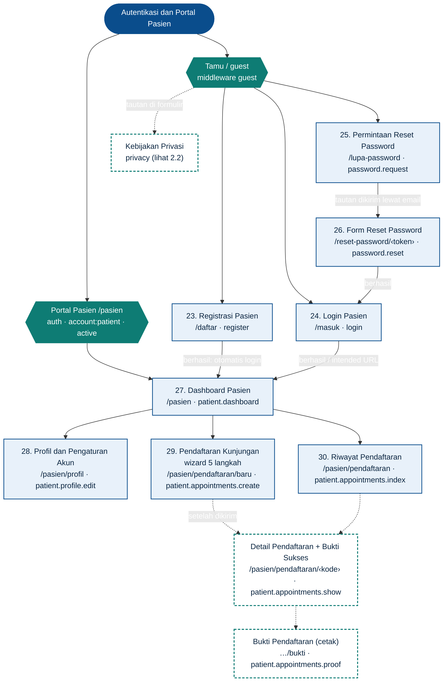
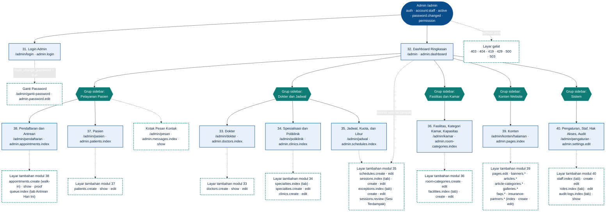

# 05 — Sitemap dan Matriks Halaman

## Tujuan bagian

Bagian ini memetakan seluruh layar website **UNPAM HOSPITAL** dalam bentuk sitemap (diagram Mermaid), merinci navigasi (menu desktop, menu mobile, footer, menu portal pasien, sidebar admin), dan memuat **matriks 40 halaman utama** sesuai kebutuhan pemilik (§5 pada [kebutuhan asli](_kebutuhan-asli.md)). Selain itu bagian ini mendaftar **layar tambahan** (tambah/ubah/detail/aksi/galat) yang diperlukan di luar 40 halaman, aturan `<title>` dan meta description untuk SEO, serta breadcrumb setiap halaman internal.

Bagian ini menjadi acuan bagi bagian lain: nama route mengikuti [00 — Keputusan Inti, bagian I](00-keputusan-inti.md), nama komponen Blade mengikuti bagian J.5, kunci `pages.key` mengikuti bagian E.5, dan izin mengikuti bagian G. Bagian terkait: [04 — Peran dan Hak Akses](04-peran-hak-akses.md) (siapa boleh apa), [06 — Alur](06-alur.md) (urutan interaksi antarhalaman), [07 — Wireframe](07-wireframe.md) (tata letak halaman), [11 — Route, Controller, Model, Service](11-route-controller-model-service.md) (implementasi route), [13 — Data Contoh](13-data-contoh.md) (slug seed), dan [15 — Pengujian Penerimaan](15-pengujian-penerimaan.md) (uji akses per halaman).

---

## 1. Ringkasan hitungan

| Area | Rentang no. | Jumlah halaman utama | Sumber kebutuhan |
|---|---|:-:|---|
| Website publik | 1–22 | **22** | §5.A |
| Autentikasi dan portal pasien | 23–30 | **8** | §5.B |
| Dashboard admin | 31–40 | **10** | §5.C |
| **Total halaman utama** | 1–40 | **40** | §5 (minimal 40) |
| Layar tambahan di luar 40 (bagian 6) | — | **68** | “identifikasi layar tambah/edit/detail” |
| **Total layar yang dirancang** | | **108** | |

**Yang tidak dihitung sebagai halaman atau layar** (sesuai §5 kebutuhan asli): modal konfirmasi (`x-confirm-modal`), pagination, perubahan filter/urutan, langkah-langkah dalam wizard pendaftaran (langkah 1–5 berbagi satu route `patient.appointments.create`/`review`), tab client-side tanpa URL sendiri, serta endpoint tanpa tampilan (POST/PATCH/PUT/DELETE, JSON grafik, unduhan PDF/CSV; lihat bagian 9).

**Aturan penghitungan tab modul admin.** Halaman 33–40 adalah *halaman indeks modul*. Bila sebuah modul memiliki beberapa sub-menu atau tab yang masing-masing punya URL sendiri (mis. tab “Sesi per Tanggal” pada modul Jadwal), tab pertama (titik masuk sidebar) dihitung sebagai halaman utama, sedangkan tab lainnya dicatat sebagai **layar tambahan** pada bagian 6.

---

## 2. Sitemap

### 2.1 Legenda diagram

| Gaya | Arti |
|---|---|
| Kotak biru muda bergaris biru (`main`) | Halaman utama bernomor (1–40). Judul node memuat nomor, nama, URL, dan nama route. |
| Heksagon biru tua (`menu`) | Pengelompokan navigasi (dropdown menu, grup sidebar, area akses). Bukan halaman. |
| Kotak putus-putus berwarna toska (`extra`) | **Layar tambahan** di luar 40 halaman utama (garis penghubung juga putus-putus). |
| Garis penuh `-->` | Hubungan hierarki atau navigasi utama. |
| Garis putus-putus `-.->` | Tautan ke layar tambahan atau alur sekunder. |

### 2.2 Area Publik (halaman 1–22)

```mermaid
flowchart TD
    ROOT(["UNPAM HOSPITAL<br/>Area Publik · middleware web"]):::root

    ROOT --> N1["1. Beranda<br/>/ · home"]:::main

    ROOT --> G1{{"Menu: Tentang Kami"}}:::menu
    G1 --> N2["2. Profil<br/>/profil · about"]:::main
    G1 --> N3["3. Visi dan Misi<br/>/visi-misi · vision-mission"]:::main

    ROOT --> N4["4. Daftar Layanan / Poliklinik<br/>/layanan · clinics.index"]:::main
    N4 --> N5["5. Detail Layanan<br/>/layanan/‹slug› · clinics.show"]:::main

    ROOT --> G2{{"Menu: Dokter"}}:::menu
    G2 --> N6["6. Daftar Dokter<br/>/dokter · doctors.index"]:::main
    N6 --> N7["7. Detail Dokter<br/>/dokter/‹slug› · doctors.show"]:::main
    G2 --> N8["8. Jadwal Dokter<br/>/jadwal-dokter · schedules.index"]:::main

    ROOT --> G3{{"Menu: Fasilitas"}}:::menu
    G3 --> N9["9. Daftar Fasilitas<br/>/fasilitas · facilities.index"]:::main
    N9 --> N10["10. Detail Fasilitas<br/>/fasilitas/‹slug› · facilities.show"]:::main
    G3 --> N11["11. Ringkasan Kamar Rawat Inap<br/>/kamar-rawat-inap · rooms.index"]:::main
    N11 --> N12["12. Kamar BPJS Kelas 1<br/>rooms.show · bpjs-kelas-1"]:::main
    N11 --> N13["13. Kamar BPJS Kelas 2<br/>rooms.show · bpjs-kelas-2"]:::main
    N11 --> N14["14. Kamar BPJS Kelas 3<br/>rooms.show · bpjs-kelas-3"]:::main
    N11 --> N15["15. Kamar VIP / Pribadi<br/>rooms.show · vip"]:::main

    ROOT --> G4{{"Menu: Informasi"}}:::menu
    G4 --> N16["16. BPJS dan Asuransi<br/>/bpjs-asuransi · insurance"]:::main
    G4 --> N17["17. Panduan Pendaftaran<br/>/panduan-pendaftaran · registration-guide"]:::main
    G4 --> N18["18. Daftar Artikel<br/>/artikel · articles.index"]:::main
    N18 --> N19["19. Detail Artikel<br/>/artikel/‹slug› · articles.show"]:::main
    G4 --> N20["20. Galeri<br/>/galeri · galleries.index"]:::main
    N20 -.-> X1["Detail Album Galeri<br/>/galeri/‹slug› · galleries.show"]:::extra
    G4 --> N21["21. FAQ<br/>/faq · faq"]:::main

    ROOT --> N22["22. Kontak dan Lokasi<br/>/kontak · contact"]:::main

    ROOT -.->|"footer global"| X2["Kebijakan Privasi<br/>/kebijakan-privasi · privacy"]:::extra
    ROOT -.->|"semua area"| X3["Layar galat<br/>403 · 404 · 419 · 429 · 500 · 503"]:::extra

    N5 -.->|"Daftar Kunjungan"| TO29(["ke halaman 29"]):::link
    N7 -.->|"Daftar (per sesi)"| TO29
    N8 -.->|"Daftar (per sesi)"| TO29
    N1 -.->|"Cari Dokter"| N6
    N1 -.->|"Jadwal Dokter"| N8

    classDef root fill:#0A4D8C,stroke:#0A4D8C,color:#FFFFFF
    classDef main fill:#E8F1FA,stroke:#0A4D8C,stroke-width:1.5px,color:#0A2540
    classDef menu fill:#0E7C74,stroke:#0E7C74,color:#FFFFFF
    classDef extra fill:#FFFFFF,stroke:#0E7C74,stroke-width:2px,stroke-dasharray:5 3,color:#0A2540
    classDef link fill:#F3F7FB,stroke:#6C757D,stroke-dasharray:2 2,color:#212529
```

### 2.3 Area Autentikasi dan Portal Pasien (halaman 23–30)

Catatan diagram 2.3: unduhan PDF bukti (`patient.appointments.proof-pdf`), pembatalan (`patient.appointments.cancel`), dan penandaan notifikasi (`patient.notifications.read`) adalah endpoint tanpa layar sendiri.

### 2.4 Area Admin (halaman 31–40)

Layar tambahan dikelompokkan per modul agar diagram tetap terbaca; rincian per route ada pada bagian 6.

---

## 3. Navigasi

### 3.1 Menu desktop publik (`layouts.public`, lebar ≥ 992 px)

Header dua tingkat: **baris atas** berisi logo + nama situs (tautan ke `home`, sekaligus berfungsi sebagai “Beranda”), nomor IGD (placeholder dari `contact.emergency_phone`), serta tombol aksi; **baris bawah** berisi menu utama. Wireframe: [07 — W-01](07-wireframe.md#w-01-kerangka-global-publik).

| Urutan | Item menu | Jenis | Isi / tujuan (route) | Halaman |
|:-:|---|---|---|:-:|
| 1 | **Tentang Kami** | Dropdown | Profil (`about`) · Visi & Misi (`vision-mission`) | 2, 3 |
| 2 | **Layanan** | Tautan | `clinics.index` (detail layanan diakses dari kartu) | 4 (5) |
| 3 | **Dokter** | Dropdown | Daftar Dokter (`doctors.index`) · Jadwal Dokter (`schedules.index`) | 6, 8 (7) |
| 4 | **Fasilitas** | Dropdown | Fasilitas (`facilities.index`) · Kamar Rawat Inap (`rooms.index`) | 9, 11 (10, 12–15) |
| 5 | **Informasi** | Dropdown | BPJS & Asuransi (`insurance`) · Panduan Pendaftaran (`registration-guide`) · Artikel (`articles.index`) · Galeri (`galleries.index`) · FAQ (`faq`) | 16, 17, 18, 20, 21 (19) |
| 6 | **Kontak** | Tautan | `contact` | 22 |
| Aksi | **Daftar Kunjungan** (tombol utama, warna `$primary`) | Tombol | `patient.appointments.create` (tamu diarahkan ke `login`, lalu kembali lewat *intended URL*) | 29 |
| Aksi | **Masuk** (tombol outline) | Tombol | `login` | 24 |

Aturan perilaku:

- Induk dropdown adalah `<button>` (bukan tautan) dengan `aria-expanded`; terbuka dengan klik/Enter/Spasi, tertutup dengan Esc atau klik di luar (perilaku dropdown Bootstrap 5). Hover **tidak** dijadikan satu-satunya pemicu agar setara dengan keyboard dan layar sentuh **[ASUMSI]**.
- Item aktif: `aria-current="page"` + garis bawah warna `$teal-light` (dekoratif; penanda utama tetap teks tebal). Induk dropdown ikut ditandai bila halaman aktif berada di dalamnya.
- Menu bersifat statis (tidak dikelola admin); label dan URL berasal dari konfigurasi kode. Nama situs, logo, dan nomor IGD berasal dari `website_settings`.
- Tiga tombol utama “**Cari Dokter**”, “**Jadwal Dokter**”, “**Daftar Kunjungan**” ditempatkan pada hero Beranda (halaman 1); “Daftar Kunjungan” juga ada di header global. “Cari Dokter” menaut ke `doctors.index`, “Jadwal Dokter” ke `schedules.index`.

Varian tombol aksi menurut status login:

| Status pengunjung | Tombol “Daftar Kunjungan” | Tombol “Masuk” |
|---|---|---|
| Tamu | `patient.appointments.create` (→ login lalu kembali) | “Masuk” → `login` |
| Pasien login | `patient.appointments.create` | Diganti dropdown “Akun Saya (nama pasien)”: Dashboard (`patient.dashboard`) · Riwayat Pendaftaran (`patient.appointments.index`) · Profil dan Akun (`patient.profile.edit`) · Keluar (POST `logout`) |
| Staf login (membuka halaman publik) | Diganti “Buka Panel Admin” → `admin.dashboard` **[ASUMSI]** (route pasien menolak akun staf lewat `account:patient`) | Diganti “Keluar” (POST `admin.logout`) |

### 3.2 Menu mobile (offcanvas, lebar < 992 px)

Header ringkas: tombol hamburger (`aria-controls`, `aria-label="Buka menu"`), logo + nama situs, dan tautan “Masuk” (ikon + teks; pada pasien login berubah menjadi ikon akun). Menu dibuka sebagai `offcanvas offcanvas-end` Bootstrap 5.

Urutan isi offcanvas: judul “Menu” + tombol tutup · **Beranda** · **Tentang Kami** (accordion: Profil, Visi & Misi) · **Layanan** · **Dokter** (accordion: Daftar Dokter, Jadwal Dokter) · **Fasilitas** (accordion: Fasilitas, Kamar Rawat Inap) · **Informasi** (accordion: BPJS & Asuransi, Panduan Pendaftaran, Artikel, Galeri, FAQ) · **Kontak** · pemisah · tombol penuh-lebar **Daftar Kunjungan** dan **Masuk** (atau “Akun Saya” beserta subitemnya bila sudah login) · baris IGD (`tel:` dari `contact.emergency_phone`, label “placeholder” selama nilai seed).

Fokus berpindah ke offcanvas saat dibuka dan kembali ke tombol hamburger saat ditutup (perilaku bawaan Bootstrap); Esc menutup.

### 3.3 Footer (`layouts.public`)

| Blok | Isi | Sumber data |
|---|---|---|
| Identitas | Logo, `site.name`, `site.tagline`, **alamat teks lengkap** (selalu tampil, tanpa bergantung pada peta) | `website_settings`: `site.name`, `site.tagline`, `contact.address` |
| Kontak | Telepon, IGD, WhatsApp (tautan `https://wa.me/{nomor}`, dibuka manual; bukan pengiriman otomatis), email, jam operasional. Setiap nilai seed diberi label “(placeholder)”. | `contact.phone`, `contact.emergency_phone`, `contact.whatsapp`, `contact.email`, `contact.operational_hours` |
| Tautan cepat | Cari Dokter (`doctors.index`) · Jadwal Dokter (`schedules.index`) · Layanan (`clinics.index`) · Kamar Rawat Inap (`rooms.index`) · BPJS & Asuransi (`insurance`) · Panduan Pendaftaran (`registration-guide`) · Artikel (`articles.index`) · Galeri (`galleries.index`) · FAQ (`faq`) · Kontak (`contact`) | Statis |
| Bilah bawah | “© {tahun} UNPAM HOSPITAL” · tautan **Kebijakan Privasi** (`privacy`) · catatan tetap: “Situs prototipe: nama dokter, foto, tarif, kontak, dan layanan adalah data contoh.” | Statis + `site.name` |

Pada layar < 768 px kolom footer ditumpuk satu kolom dengan urutan: identitas → kontak → tautan cepat → bilah bawah. Catatan prototipe **tidak boleh disembunyikan** admin (bagian dari templat, bukan pengaturan).

### 3.4 Menu portal pasien (`layouts.patient`)

Header publik tetap tampil (agar pasien bisa kembali mencari dokter). Di bawah judul halaman terdapat navigasi portal:

| Urutan | Item | Route | Halaman | Catatan |
|:-:|---|---|:-:|---|
| 1 | Dashboard | `patient.dashboard` | 27 | |
| 2 | Daftar Kunjungan | `patient.appointments.create` | 29 | Tombol menonjol (`$primary`) |
| 3 | Riwayat Pendaftaran | `patient.appointments.index` | 30 | Termasuk detail dan bukti |
| 4 | Profil dan Akun | `patient.profile.edit` | 28 | Profil + ganti password |
| 5 | Keluar | POST `logout` | — | Berupa `<form>` + tombol (bukan tautan GET) |

Tampilan: ≥ 992 px sebagai daftar vertikal (`list-group`) di kolom kiri; < 992 px sebagai `nav-pills` horizontal yang dapat digulir di atas konten. Item aktif memakai `aria-current="page"`. Banner notifikasi belum dibaca (perubahan jadwal/status) tampil di dashboard (lihat [07 — W-10](07-wireframe.md#w-10-dashboard-pasien)).

### 3.5 Sidebar admin (`layouts.admin`)

Sidebar dikelompokkan; setiap item dibungkus `@can`/`@canany` dan **grup tanpa item terlihat disembunyikan seluruhnya**. Penyembunyian hanya kenyamanan: penegakan sesungguhnya oleh middleware `permission:*`, Policy, dan Form Request (00 bagian G).

| Grup | Item | Route | Ikon (bootstrap-icons) | Syarat tampil (`@can`) | Halaman |
|---|---|---|---|---|:-:|
| — | Dashboard | `admin.dashboard` | `bi-speedometer2` | `dashboard.view` | 32 |
| **Pelayanan Pasien** | Pendaftaran | `admin.appointments.index` | `bi-journal-check` | `appointments.view` | 38 |
| | Antrean Hari Ini | `admin.queue.index` | `bi-people` | `appointments.view` | 38 (tab) |
| | Pasien | `admin.patients.index` | `bi-person-lines-fill` | `patients.view` | 37 |
| | Pesan Kontak (lencana jumlah “Baru”) | `admin.messages.index` | `bi-envelope` | `messages.manage` | tambahan |
| **Dokter dan Jadwal** | Dokter | `admin.doctors.index` | `bi-person-badge` | `doctors.view` | 33 |
| | Poliklinik dan Spesialisasi | `admin.clinics.index` | `bi-hospital` | `clinics.manage` | 34 |
| | Jadwal Praktik | `admin.schedules.index` | `bi-calendar-week` | `schedules.view` | 35 |
| | Sesi Terdampak (lencana jumlah sesi `needs_review`) | `admin.sessions.review` | `bi-exclamation-triangle` | `sessions.review` | tambahan |
| **Fasilitas dan Kamar** | Kamar dan Kapasitas | `admin.room-categories.index` | `bi-building` | `@canany(['facilities.manage','rooms.update-availability'])` | 36 |
| | Fasilitas | `admin.facilities.index` | `bi-heart-pulse` | `facilities.manage` | 36 (tab) |
| **Konten Website** | Halaman | `admin.pages.index` | `bi-file-earmark-text` | `content.manage` | 39 |
| | Banner | `admin.banners.index` | `bi-images` | `content.manage` | 39 (sub-menu) |
| | Artikel | `admin.articles.index` | `bi-newspaper` | `content.manage` | 39 (sub-menu) |
| | Kategori Artikel | `admin.article-categories.index` | `bi-tags` | `content.manage` | 39 (sub-menu) |
| | Galeri | `admin.galleries.index` | `bi-image` | `content.manage` | 39 (sub-menu) |
| | FAQ | `admin.faqs.index` | `bi-question-circle` | `content.manage` | 39 (sub-menu) |
| | Mitra Asuransi | `admin.insurance-partners.index` | `bi-shield-check` | `content.manage` | 39 (sub-menu) |
| **Sistem** | Pengaturan Website | `admin.settings.edit` | `bi-gear` | `settings.manage` | 40 |
| | Akun Staf | `admin.staff.index` | `bi-people-fill` | `staff.manage` | 40 (tab) |
| | Hak Akses | `admin.roles.index` | `bi-key` | `staff.manage` | 40 (tab) |
| | Audit Log | `admin.audit-logs.index` | `bi-clipboard-data` | `audit.view` | 40 (tab) |

Aturan tambahan:

- Item aktif ditandai `aria-current="page"` dan latar `$light`; sidebar berlatar `$primary` gelap dengan teks putih (kontras ±8,6:1).
- Lencana “Sesi Terdampak” dan “Pesan Kontak” hanya menampilkan **angka agregat**, bukan nama pasien/pengirim.
- Landing tab: sesuai 00 bagian I.4, `admin.room-categories.index` dapat dibuka dengan `facilities.manage` **atau** `rooms.update-availability` (middleware `permission:facilities.manage|rooms.update-availability`); pemegang `rooms.update-availability` saja hanya melihat daftar dan form ketersediaan (17 D-12). Karena itu halaman 36 memakai “Kamar dan Kapasitas” sebagai titik masuk dan tab “Fasilitas” hanya muncul bila `facilities.manage`.
- Topbar admin: tombol hamburger (< 992 px), breadcrumb, tautan “Lihat Situs” (tab baru, `rel="noopener"`), dan dropdown pengguna (nama staf, nama peran, “Ganti Password” → `admin.password.edit`, “Keluar” → POST `admin.logout`). Wireframe: [07 — W-13](07-wireframe.md#w-13-kerangka-admin).
- Pada < 992 px sidebar menjadi offcanvas sisi kiri dengan urutan, ikon, dan filter `@can` yang sama.

Item sidebar yang terlihat per peran bawaan (00 bagian G):

| Item | Super Admin | Admin Konten | Petugas Pendaftaran |
|---|:-:|:-:|:-:|
| Dashboard | ✔ | ✔ | ✔ |
| Pendaftaran, Antrean Hari Ini | ✔ | — | ✔ |
| Pasien | ✔ | — | ✔ |
| Pesan Kontak | ✔ | — | ✔ |
| Dokter | ✔ | ✔ | ✔ (hanya lihat) |
| Poliklinik dan Spesialisasi | ✔ | ✔ | — |
| Jadwal Praktik | ✔ | ✔ | ✔ (hanya lihat) |
| Sesi Terdampak | ✔ | — | ✔ |
| Kamar dan Kapasitas | ✔ | ✔ | ✔ (hanya perbarui ketersediaan) |
| Fasilitas | ✔ | ✔ | — |
| Konten Website (7 item) | ✔ | ✔ | — |
| Pengaturan Website | ✔ | — | — |
| Akun Staf, Hak Akses | ✔ | — | — |
| Audit Log | ✔ | — | — |

Karena izin dapat diubah di halaman Hak Akses, tabel di atas hanyalah kondisi **seed**; tampilan sesungguhnya selalu mengikuti `@can`.

---

## 4. Matriks 40 halaman utama

**Cara membaca.**

- *Pengguna yang boleh mengakses*: **Publik** = siapa saja tanpa login (tamu, pasien, staf). **Tamu** = hanya yang belum login (middleware `guest`; yang sudah login dialihkan ke `patient.dashboard` atau `admin.dashboard` menurut `account_type`). **Pasien** = `auth` + `account:patient` + `active`. **Staf** = `auth` + `account:staff` + `active` + `password.changed`, lalu `permission:*` sebagaimana tertulis.
- *Komponen utama* memakai nama komponen Blade pada 00 bagian J.5 (selalu dengan awalan `x-`). Semua halaman publik memakai `x-layouts.public`, portal pasien `x-layouts.patient`, halaman auth `x-layouts.auth`, dan admin `x-layouts.admin`; kolom hanya memuat komponen pembeda. `x-breadcrumb`, `x-flash-alert`, dan `x-page-header` terpasang di semua halaman internal.
- *Sumber data* menyebut tabel (00 bagian E) dan service (00 bagian J.1).
- *Kondisi khusus* merinci loading / kosong / gagal sesuai pola 00 bagian M. Pada halaman yang dirender server tanpa JavaScript, “loading” berarti indikator pada tombol submit dan `aria-busy`, serta gambar `loading="lazy"` dengan ukuran tetap.

### 4.1 Website publik (22 halaman)

| No | Nama halaman | URL | Nama route | Pengguna yang boleh mengakses | Komponen utama | Sumber data | Aksi utama | Kondisi khusus |
|:-:|---|---|---|---|---|---|---|---|
| 1 | Beranda | `/` | `home` | Publik | `x-layouts.public`, `x-image` (carousel banner), `x-doctor-card`, `x-availability-badge`, `x-status-badge`, `x-empty-state` | `banners` (aktif, dalam `starts_at`–`ends_at`, + `media` `image`); `pages` (`home`); `clinics` (6 aktif teratas `sort_order`); `doctors` + `DoctorAvailabilityQuery`; `room_categories`; `articles` (3 terbit terbaru); `website_settings` | **Cari Dokter**, **Jadwal Dokter**, **Daftar Kunjungan**; kotak pencarian dokter cepat; telepon/WhatsApp IGD | Tanpa banner aktif → hero statis bawaan; tanpa dokter/artikel → blok disembunyikan atau `x-empty-state`; `availability_updated_at` kosong → “Belum diperbarui”; kamar selalu berlabel “Diperbarui: …”, bukan real-time |
| 2 | Profil rumah sakit | `/profil` | `about` | Publik | `x-page-header`, `x-image` | `pages` (key `about`: `title`, `subtitle`, `body`) | Membaca; tautan ke Visi & Misi, Kontak | `body` kosong → `x-empty-state` “Konten sedang disiapkan”; HTML tersanitasi (`HtmlSanitizer`) |
| 3 | Visi dan misi | `/visi-misi` | `vision-mission` | Publik | `x-page-header` | `pages` (key `vision-mission`) | Membaca | Sama seperti halaman 2 |
| 4 | Daftar layanan/poliklinik | `/layanan` | `clinics.index` | Publik | `x-page-header`, `x-image`, `x-empty-state` | `clinics` (`is_active`, dikelompokkan per `type`: `poliklinik` / `penunjang`); `pages` (key `clinics-index`) | Membuka detail layanan; label “Dapat didaftar online” bila `is_bookable` | Tidak ada layanan aktif → `x-empty-state`; gambar `cover` hilang → placeholder `clinic.svg` |
| 5 | Detail layanan/poliklinik | `/layanan/{clinic:slug}` | `clinics.show` | Publik | `x-breadcrumb`, `x-image` (cover + galeri), `x-doctor-card`, `x-availability-badge`, `x-empty-state` | `clinics` (+ `media` `cover`, `gallery`); `doctors` pada poliklinik; `DoctorAvailabilityQuery` | **Daftar Kunjungan** (`patient.appointments.create?poli={clinics.slug}`); membuka detail dokter | Slug tidak ada atau `is_active = false` → 404; `is_bookable = false` → tombol Daftar diganti catatan “layanan penunjang, hubungi kami”; tanpa dokter terjadwal → “Belum ada dokter terjadwal” |
| 6 | Daftar dokter | `/dokter` (query `q`, `spesialisasi`, `poli`, `tanggal`) | `doctors.index` | Publik | `x-page-header`, `x-form.input`, `x-form.select`, `x-doctor-card`, `x-availability-badge`, `x-empty-state`, `x-loading-button` | `doctors` (`status = active`) + `doctor_specialties` + `specialties` + `clinics` + `media` `photo`; `DoctorAvailabilityQuery` bila `tanggal` terisi; `pages` (key `doctors-index`) | Mencari/memfilter (nama, spesialisasi, poliklinik, tanggal praktik); **Lihat Jadwal** | Hasil kosong → “Dokter tidak ditemukan” + tombol **Reset filter**; `tanggal` di luar jendela `booking.window_days` atau format salah → pesan validasi inline; submit filter → tombol ber-spinner; foto hilang → placeholder `doctor.svg` |
| 7 | Detail dokter | `/dokter/{doctor:slug}` | `doctors.show` | Publik | `x-breadcrumb`, `x-image`, `x-schedule-table`, `x-availability-badge`, `x-empty-state` | `doctors` (+ `media` `photo`), `doctor_specialties`, `clinics`; `DoctorAvailabilityQuery` (14 hari ke depan) | **Daftar** per sesi (`patient.appointments.create?sesi={id}`); kembali ke daftar | Dokter `inactive`/`archived` atau slug salah → 404 (arsip: 00 F.4; nonaktif: A-42); tanpa sesi 14 hari → “Belum ada jadwal praktik dua minggu ke depan”; sesi dengan label `Availability` selain `available` (`leave`, `holiday`, `full`, `booking_closed`, `under_review`, `closed`, `cancelled`) tampil sebagai teks status tanpa tombol Daftar; urutan prioritas label mengikuti 00 F.3 |
| 8 | Jadwal dokter | `/jadwal-dokter` (query `minggu`, `poli`, `dokter`) | `schedules.index` | Publik | `x-schedule-table`, `x-availability-badge`, `x-form.select`, `x-empty-state`, `x-loading-button` | `DoctorAvailabilityQuery` (rentang satu minggu); memicu `PracticeSessionGenerator::ensureDailyHorizon()`; `pages` (key `schedules-index`) | Memilih minggu, poliklinik, dokter; **Daftar** per sesi | `minggu` di luar jendela → pesan + minggu terdekat yang valid; hasil kosong → `x-empty-state` + reset filter; tampilan desktop berupa grid mingguan, mobile bertumpuk per hari; legenda status teks+warna selalu tampil |
| 9 | Daftar fasilitas | `/fasilitas` | `facilities.index` | Publik | `x-page-header`, `x-image`, `x-empty-state` | `facilities` (`is_active`, dikelompokkan per `category`: `medis`, `penunjang`, `umum`); `pages` (key `facilities-index`) | Membuka detail fasilitas | Tanpa fasilitas → `x-empty-state`; kategori tanpa isi tidak ditampilkan |
| 10 | Detail fasilitas | `/fasilitas/{facility:slug}` | `facilities.show` | Publik | `x-breadcrumb`, `x-image` (cover + galeri), `x-empty-state` | `facilities` (+ `media` `cover`, `gallery`) | Membaca; tautan ke Kamar Rawat Inap / Kontak | Slug salah atau nonaktif → 404; galeri kosong → hanya cover/placeholder `facility.svg` |
| 11 | Ringkasan kamar rawat inap | `/kamar-rawat-inap` | `rooms.index` | Publik | `x-page-header`, `x-image`, `x-status-badge`, `x-empty-state` | `room_categories` (`is_active`: `bed_capacity`, `beds_available`, `sample_rate`, `availability_updated_at`); `pages` (key `rooms-index`) | Membuka detail kategori (halaman 12–15); membandingkan kapasitas | Setiap kartu menampilkan “Diperbarui: {tanggal-jam}” + catatan “diperbarui manual oleh petugas, bukan data real-time”; `availability_updated_at` kosong → “Belum diperbarui”; `beds_available = 0` → badge “Penuh”; tarif kosong → “Hubungi kami”; tanpa kategori aktif → `x-empty-state` |
| 12 | Kamar BPJS Kelas 1 | `/kamar-rawat-inap/bpjs-kelas-1` | `rooms.show` (slug seed `bpjs-kelas-1`) | Publik | `x-breadcrumb`, `x-image` (galeri), `x-status-badge`, `x-empty-state` | `room_categories` (+ `media` `cover`, `gallery`); `website_settings` (`contact.*`) | Menghubungi RS untuk memastikan ketersediaan (`contact`, tautan WhatsApp) | Lihat 5.1: slug salah/nonaktif → 404; galeri kosong → placeholder `room.svg`; `amenities` kosong → blok disembunyikan; catatan: klasifikasi kategori adalah kebutuhan prototipe, bukan ketentuan BPJS terverifikasi |
| 13 | Kamar BPJS Kelas 2 | `/kamar-rawat-inap/bpjs-kelas-2` | `rooms.show` (slug seed `bpjs-kelas-2`) | Publik | Sama dengan No. 12 | Sama dengan No. 12 | Sama dengan No. 12 | Sama dengan No. 12 |
| 14 | Kamar BPJS Kelas 3 | `/kamar-rawat-inap/bpjs-kelas-3` | `rooms.show` (slug seed `bpjs-kelas-3`) | Publik | Sama dengan No. 12 | Sama dengan No. 12 | Sama dengan No. 12 | Sama dengan No. 12 |
| 15 | Kamar VIP/Pribadi | `/kamar-rawat-inap/vip` | `rooms.show` (slug seed `vip`) | Publik | Sama dengan No. 12 | Sama dengan No. 12 | Sama dengan No. 12 | Sama dengan No. 12 |
| 16 | Informasi BPJS dan asuransi | `/bpjs-asuransi` | `insurance` | Publik | `x-page-header`, `x-image` (logo mitra), `x-empty-state` | `pages` (key `insurance-info`: info BPJS, persyaratan, tarif — rich text); `insurance_partners` (`is_active`, berlabel “Contoh”) | Membaca; tautan ke Panduan Pendaftaran dan Kontak | Tanpa mitra aktif → daftar mitra disembunyikan; teks wajib menyatakan data mitra adalah contoh dan bukan klaim kerja sama; logo hilang → placeholder `logo.svg` |
| 17 | Panduan pendaftaran pasien | `/panduan-pendaftaran` | `registration-guide` | Publik | `x-page-header` | `pages` (key `registration-guide`); `website_settings` (`booking.*` untuk angka batas ditampilkan dalam teks) | Membaca; **Daftar Kunjungan**, **Daftar Akun** | `body` kosong → `x-empty-state` |
| 18 | Daftar artikel kesehatan | `/artikel` (query `kategori`, `q`) | `articles.index` | Publik | `x-page-header`, `x-form.input`, `x-form.select`, `x-image`, `x-empty-state` | `articles` (`status = published`, `published_at <= now`, tidak soft-deleted) + `article_categories`; `pages` (key `articles-index`) | Mencari dan memfilter kategori; membuka artikel | Hasil kosong → “Artikel tidak ditemukan” + reset filter; `cover` hilang → placeholder `article.svg` |
| 19 | Detail artikel | `/artikel/{article:slug}` | `articles.show` | Publik | `x-breadcrumb`, `x-image`, `x-page-header` | `articles` (+ `media` `cover`, penulis dari `users.name`, kategori) | Membaca; artikel terkait (kategori sama, maks 3) | Artikel `draft`, belum waktunya terbit, atau soft-deleted → 404; `body` dirender dengan `{!! !!}` karena sudah disanitasi saat disimpan |
| 20 | Galeri | `/galeri` | `galleries.index` | Publik | `x-page-header`, `x-image`, `x-empty-state` | `galleries` (`is_published`) + `media` `photos` (foto pertama sebagai sampul); `pages` (key `galleries-index`) | Membuka album (layar tambahan `galleries.show`) | Tanpa album → `x-empty-state`; album tanpa foto → sampul placeholder `gallery.svg` |
| 21 | FAQ | `/faq` | `faq` | Publik | `x-page-header`, `x-empty-state` | `faqs` (`is_published`, dikelompokkan per `category`: `pendaftaran`, `bpjs`, `layanan`, `umum`, urut `sort_order`); `pages` (key `faq`) | Membuka/menutup pertanyaan (accordion); tautan ke Kontak | Tanpa FAQ terbit → `x-empty-state`; jawaban teks biasa (di-escape) |
| 22 | Kontak dan lokasi | `/kontak` (GET); `/kontak` (POST) | `contact` / `contact.store` | Publik | `x-page-header`, `x-map-embed`, `x-form.input`, `x-form.textarea`, `x-form.checkbox`, `x-form.errors-summary`, `x-loading-button`, `x-flash-alert` | `website_settings` (`contact.*`, `map.*`); `pages` (key `contact`); menyimpan ke `contact_messages` | **Petunjuk Arah** (`map.directions_url`); tombol WhatsApp (tautan `wa.me`); **Kirim Pesan** | Alamat teks selalu tampil; peta memuat → teks “Memuat peta…”, gagal/offline → kotak pengganti dengan alamat + tombol Petunjuk Arah; validasi gagal → ringkasan galat + pesan per field; throttle `contact` (3/10 menit) → pesan “Terlalu banyak pengiriman, coba lagi nanti”; sukses → `x-flash-alert` hijau; persetujuan privasi wajib dicentang |

### 4.2 Autentikasi dan portal pasien (8 halaman)

| No | Nama halaman | URL | Nama route | Pengguna yang boleh mengakses | Komponen utama | Sumber data | Aksi utama | Kondisi khusus |
|:-:|---|---|---|---|---|---|---|---|
| 23 | Registrasi pasien | `/daftar` | `register` / `register.store` | Tamu | `x-layouts.auth`, `x-form.input`, `x-form.radio-group`, `x-form.textarea`, `x-form.checkbox`, `x-form.errors-summary`, `x-loading-button` | Menulis `users` (`account_type = patient`) + `patient_profiles` (`registration_channel = online`, `consent_at`, `consent_version`) dalam satu transaksi; `website_settings` (`privacy.consent_version`) | **Daftar** (otomatis login lalu ke dashboard) | Validasi gagal → ringkasan galat; email sudah dipakai → galat pada field email; password: min 8, huruf + angka; throttle `register` (5/jam/IP) → pesan; submit → tombol ber-spinner; NIK **tidak** diminta |
| 24 | Login pasien | `/masuk` | `login` / `login.store` | Tamu (hanya akun `patient`; akun staf ditolak dengan pesan generik) | `x-layouts.auth`, `x-form.input`, `x-form.checkbox`, `x-form.errors-summary`, `x-loading-button`, `x-flash-alert` | `users` (`account_type`, `is_active`) | **Masuk**; tautan Lupa password dan Daftar | Pesan galat generik “Email atau password salah” (tanpa membedakan penyebab); throttle `login` (5/menit per email+IP) → alert dengan sisa waktu dan tombol dinonaktifkan sementara; akun nonaktif → dikeluarkan dengan pesan “Akun dinonaktifkan, hubungi rumah sakit”; sukses → regenerasi session lalu ke *intended URL* atau `patient.dashboard` |
| 25 | Permintaan reset password | `/lupa-password` | `password.request` / `password.email` | Tamu | `x-layouts.auth`, `x-form.input`, `x-loading-button`, `x-flash-alert` | `users`, `password_reset_tokens`; surat lewat mail (lokal: `storage/logs/laravel-YYYY-MM-DD.log` atau Mailpit) | **Kirim tautan reset** | Respons selalu generik (“Jika email terdaftar, tautan telah dikirim”), tautan **tidak pernah** ditampilkan di halaman; throttle `password-reset` (3/10 menit) → pesan; akun staf tidak memakai alur ini (reset oleh Super Admin lewat `admin.staff.reset-password`) **[ASUMSI]** |
| 26 | Form reset password | `/reset-password/{token}` (GET); `/reset-password` (POST) | `password.reset` / `password.update` | Tamu | `x-layouts.auth`, `x-form.input`, `x-form.errors-summary`, `x-loading-button` | `password_reset_tokens`, `users` | **Simpan password baru** | Token tidak valid/kedaluwarsa → galat jelas + tautan “Minta tautan baru” (`password.request`); password baru tidak memenuhi aturan → galat per field; sukses → ke `login` dengan flash hijau |
| 27 | Dashboard pasien | `/pasien` | `patient.dashboard` | Pasien | `x-layouts.patient`, `x-status-badge`, `x-flash-alert` (banner notifikasi), `x-empty-state`, `x-loading-button` | `appointments` milik `patient_profiles` pengguna (mendatang + riwayat singkat) + `practice_sessions`, `doctors`, `clinics`; `notifications` (UUID, `database`) | **Daftar Kunjungan**; membuka detail/bukti; menandai notifikasi dibaca (`patient.notifications.read`) | Tanpa kunjungan mendatang → `x-empty-state` + tombol Daftar Kunjungan; notifikasi `AppointmentScheduleChangedNotification` belum dibaca → banner kuning dengan tautan ke detail; kunjungan dengan `schedule_changed_at` diberi penanda “Jadwal berubah” |
| 28 | Profil dan pengaturan akun | `/pasien/profil` (GET); `/pasien/profil` (PUT); `/pasien/password` (PUT) | `patient.profile.edit` / `patient.profile.update` / `patient.password.update` | Pasien (hanya data miliknya) | `x-layouts.patient`, `x-form.input`, `x-form.radio-group`, `x-form.textarea`, `x-form.errors-summary`, `x-loading-button`, `x-flash-alert` | `patient_profiles` (nama, tanggal lahir, jenis kelamin, telepon, email, alamat), `users` (email login, password); pada pasien berakun `patient_profiles.email` selalu disinkronkan dengan `users.email` (00 bagian E.1) | **Simpan profil**; **Ganti password** | Dua formulir terpisah pada satu halaman (profil dan password) masing-masing dengan ringkasan galat sendiri; ganti password meminta password saat ini; sukses → flash hijau; perubahan email memperbarui `users.email` dan `patient_profiles.email` sekaligus (validasi unik); nomor BPJS tersimpan hanya tampil 4 digit terakhir **[ASUMSI]** (lihat bagian Asumsi) |
| 29 | Pendaftaran kunjungan (wizard) | `/pasien/pendaftaran/baru` (query `poli`, `dokter`, `sesi`); POST `/pasien/pendaftaran/tinjau`; POST `/pasien/pendaftaran` | `patient.appointments.create` / `patient.appointments.review` / `patient.appointments.store` | Pasien | `x-layouts.patient`, `x-form.radio-group`, `x-form.select`, `x-form.input`, `x-form.textarea`, `x-form.errors-summary`, `x-availability-badge`, `x-loading-button`, `x-flash-alert`, `x-empty-state` | `clinics` (`is_bookable`), `doctors`, `DoctorAvailabilityQuery` (kuota dan status sesi), `insurance_partners`, `patient_profiles`; `BookingService::book()` | Memilih poliklinik → dokter → tanggal/sesi → mengisi data → **Kirim Pendaftaran** | Sesi nonaktif/penuh/ditutup ditampilkan beserta alasan dan tidak dapat dipilih; sisa kuota “Sisa 5 dari 20”; kuota habis saat submit → kembali ke langkah 3 dengan pesan `QUOTA_FULL`; galat `BookingException` lain (`DUPLICATE_BOOKING`, `OVERLAPPING_BOOKING`, `ACTIVE_LIMIT_REACHED`, `CUTOFF_PASSED`, `OUTSIDE_WINDOW`, `INVALID_PAYMENT`, `SESSION_UNAVAILABLE`, `SYSTEM_BUSY`) → alert merah berbahasa Indonesia (`SYSTEM_BUSY`: “Sistem sedang sibuk, silakan coba lagi beberapa saat.”, tanpa data tersimpan sebagian); halaman konfirmasi adalah hasil `POST review` sehingga kegagalan validasi pada `review` maupun `store` dialihkan ke `patient.appointments.create` dengan query langkah terakhir + `withInput()`, tidak pernah `back()`; field BPJS hanya muncul bila BPJS dipilih; throttle `booking` (10/menit); tombol kirim dinonaktifkan saat submit; berjalan tanpa JavaScript |
| 30 | Riwayat dan detail pendaftaran (termasuk bukti) | `/pasien/pendaftaran` (indeks); `/pasien/pendaftaran/{kode}` (detail); `…/bukti`; `…/bukti.pdf`; POST `…/batal` | `patient.appointments.index` (+ `.show`, `.proof`, `.proof-pdf`, `.cancel`) | Pasien pemilik (`AppointmentPolicy::view`); non-pemilik atau kode tidak ada → 404 (D4 di [04](04-peran-hak-akses.md)) | `x-layouts.patient`, `x-data-table`, `x-status-badge`, `x-confirm-modal`, `x-empty-state`, `x-loading-button`, `x-flash-alert` | `appointments` + `appointment_status_histories` + `practice_sessions`, `doctors`, `clinics`; QR via `chillerlan/php-qrcode` (isi: kode booking saja) | Melihat daftar/detail; **Batalkan**; **Cetak** atau **Unduh PDF** bukti | Daftar kosong → `x-empty-state`; melewati batas pembatalan (`booking.cancel_cutoff_minutes`) → tombol Batal diganti info “hubungi RS” (telepon/WhatsApp); status final → tanpa tombol Batal; bukti hanya menampilkan 4 digit terakhir BPJS/polis; gagal membuat PDF → pesan + saran memakai tombol Cetak |

### 4.3 Dashboard admin (10 halaman)

| No | Nama halaman | URL | Nama route | Pengguna yang boleh mengakses | Komponen utama | Sumber data | Aksi utama | Kondisi khusus |
|:-:|---|---|---|---|---|---|---|---|
| 31 | Login admin | `/admin/login` | `admin.login` / `admin.login.store` | Tamu (hanya akun `staff`; akun pasien ditolak dengan pesan generik) | `x-layouts.auth`, `x-form.input`, `x-form.errors-summary`, `x-loading-button`, `x-flash-alert` | `users` (`account_type = staff`, `is_active`, `must_change_password`) | **Masuk** | Pesan galat generik “Email atau password salah”; throttle `login` → alert + hitung mundur; `must_change_password = true` → dialihkan ke `admin.password.edit` sebelum bisa membuka halaman lain; tanpa tautan “Lupa password” (reset oleh Super Admin) **[ASUMSI]** |
| 32 | Dashboard ringkasan | `/admin` (+ JSON `/admin/dashboard/grafik`) | `admin.dashboard` (+ `admin.dashboard.chart`) | Staf dengan `dashboard.view`; widget difilter per izin (angka agregat: semua; daftar bernama pasien: `appointments.view`; “Sesi terdampak”: `sessions.review`) | `x-stat-card`, `x-status-badge`, `x-data-table` (ringkas), `x-empty-state`, `x-flash-alert`, grafik Chart.js | `DashboardMetrics` (dokter aktif, pasien terdaftar, pendaftaran hari ini, per status, grafik per `session_date`); `room_categories`; `practice_sessions` (`needs_review`) | Mengubah periode grafik (7/30/90 hari atau rentang kustom); membuka Sesi Terdampak | Grafik memuat → kerangka `placeholder-glow` + `aria-busy`; permintaan JSON gagal → pesan “Grafik tidak dapat dimuat” + tombol Coba lagi; tanpa data periode → `x-empty-state`; ringkasan kamar menampilkan “Diperbarui: …” per kategori; rentang kustom tidak valid → galat inline |
| 33 | Pengelolaan dokter | `/admin/dokter` | `admin.doctors.index` (indeks modul; lihat 5.2) | Lihat: `doctors.view` (Super Admin, Admin Konten, Petugas Pendaftaran). Kelola: `doctors.manage` (Super Admin, Admin Konten) | `x-data-table`, `x-status-badge`, `x-image`, `x-confirm-modal`, `x-empty-state`, `x-flash-alert` | `doctors`, `doctor_specialties`, `specialties`, `clinics`, `media` `photo`; `MediaService` | Mencari/memfilter; **Tambah Dokter**; ubah; nonaktifkan; arsipkan (`admin.doctors.status`, `admin.doctors.archive`); unggah/ganti foto (`admin.doctors.photo`) | Kosong → `x-empty-state` + tombol Tambah (bila `doctors.manage`); filter status default “Aktif”; Petugas Pendaftaran tidak melihat tombol kelola; mengarsipkan dokter memakai `x-confirm-modal`. Menonaktifkan dokter yang punya sesi mendatang: sesi tanpa booking aktif → `cancelled`, sesi dengan booking aktif → `needs_review` (sumber `doctor_inactive`) dan flash “N sesi perlu ditindaklanjuti petugas pendaftaran”; mengarsipkan hanya bila tidak ada booking aktif mendatang (tombol Arsipkan menampilkan alasan “selesaikan sesi terdampak dahulu”); dokter arsip tidak tampil di publik dan tidak bisa diberi jadwal (00 F.4; 17 D-01, D-02) |
| 34 | Pengelolaan spesialisasi dan poliklinik | `/admin/poliklinik` (tab Poliklinik); `/admin/spesialisasi` (tab Spesialisasi) | `admin.clinics.index` (+ `admin.specialties.index` sebagai tab) | `clinics.manage` (Super Admin, Admin Konten) | `x-data-table`, `x-status-badge`, `x-confirm-modal`, `x-empty-state`, `x-flash-alert` | `clinics`, `specialties`, `doctors` (jumlah terkait) | Tambah/ubah poliklinik dan spesialisasi; aktif/nonaktif; urutan tampil | Hapus hanya bila tidak dirujuk; bila dirujuk (FK `RESTRICT`) tombol hapus diganti “Nonaktifkan” dengan penjelasan (00 C); `code` poliklinik (awalan antrean, maks 5 karakter) harus unik → galat validasi; kosong → `x-empty-state` |
| 35 | Pengelolaan jadwal, kuota, dan hari libur dokter | `/admin/jadwal` (tab Templat Mingguan); tab lain pada bagian 5.2 | `admin.schedules.index` (+ `admin.sessions.index`, `admin.exceptions.index`, `admin.sessions.review`) | Lihat: `schedules.view`; kelola: `schedules.manage` (Super Admin, Admin Konten); tindak lanjut sesi: `sessions.review` (Super Admin, Petugas Pendaftaran) | `x-data-table`, `x-status-badge`, `x-confirm-modal`, `x-form.input`, `x-form.select`, `x-form.checkbox`, `x-form.errors-summary`, `x-flash-alert`, `x-empty-state` | `doctor_schedules`, `schedule_exceptions`, `practice_sessions`, `doctors`, `clinics`; `PracticeSessionGenerator`, `ScheduleChangeService` | Tambah/ubah templat mingguan, kuota, tanggal berlaku; aktif/nonaktif; tambah pengecualian (cuti/libur); ubah/tutup sesi per tanggal | Setelah simpan: flash “N sesi perlu ditindaklanjuti petugas pendaftaran” (Admin Konten tidak melihat nama pasien, hanya jumlah booking per sesi); templat beririsan → galat validasi; kuota sesi tidak bisa turun di bawah `booked_count`; edit manual sesi yang punya booking aktif: kuota langsung berlaku, geser jam → `needs_review` sumber `manual_time`, pembatalan sesi → sumber `manual_cancel` (00 F.4; 17 D-03); mengganti poliklinik templat yang punya booking aktif mendatang ditolak; templat dihapus hanya bila tidak ada sesi ber-appointment, selain itu dinonaktifkan; pengecualian `doctor_leave` wajib memilih dokter, libur RS/nasional tanpa dokter; hapus pengecualian = `removeException`; `start_date` pengecualian di masa lalu ditolak; proses generate panjang → tombol ber-spinner |
| 36 | Pengelolaan fasilitas, kategori kamar, dan kapasitas | `/admin/kamar` (tab Kamar dan Kapasitas); `/admin/fasilitas` (tab Fasilitas) | `admin.room-categories.index` (+ `admin.facilities.index` sebagai tab) | `facilities.manage` (Super Admin, Admin Konten) atau `rooms.update-availability` (+ Petugas Pendaftaran, hanya memperbarui `beds_available`) | `x-data-table`, `x-status-badge`, `x-image`, `x-form.input`, `x-confirm-modal`, `x-empty-state`, `x-flash-alert` | `room_categories`, `facilities`, `media`; `MediaService`; `AuditLogger` | Perbarui ketersediaan (`admin.room-categories.availability`); tambah/ubah kategori dan fasilitas; aktif/nonaktif | Menyimpan ketersediaan mengisi `availability_updated_at` dan `availability_updated_by`; `beds_available` di luar 0–`bed_capacity` → galat validasi; fasilitas dihapus permanen (media ikut dibersihkan), kategori kamar hanya dihapus bila tidak dirujuk, selain itu “Nonaktifkan”; pemegang `rooms.update-availability` saja hanya melihat daftar + form ketersediaan (00 I.4; 17 D-12); kolom “Diperbarui” menampilkan waktu dan nama petugas; kosong → `x-empty-state` |
| 37 | Pengelolaan pasien | `/admin/pasien` | `admin.patients.index` | Lihat: `patients.view`; kelola: `patients.manage` (Super Admin, Petugas Pendaftaran). **Admin Konten tidak dapat mengakses.** | `x-data-table`, `x-status-badge`, `x-confirm-modal`, `x-empty-state`, `x-flash-alert` | `patient_profiles` (nomor BPJS tersamar 4 digit terakhir), `users`; `PatientNumberGenerator`, `PatientAccountLinker` | Mencari (nama/no. pasien/telepon/tanggal lahir); **Tambah Pasien (walk-in)**; ubah; nonaktifkan; hubungkan akun (`admin.patients.link-account`) | Pencarian kosong → “Pasien tidak ditemukan” + tombol Buat profil baru; tidak menyimpan/menampilkan NIK; hubungkan akun hanya bila profil akun belum punya appointment; setiap perubahan dicatat di audit log |
| 38 | Pengelolaan pendaftaran dan antrean | `/admin/pendaftaran` (tab Pendaftaran); `/admin/antrean` (tab Antrean Hari Ini) | `admin.appointments.index` (+ `admin.queue.index` sebagai tab) | Lihat: `appointments.view`; kelola: `appointments.manage` (Super Admin, Petugas Pendaftaran); ekspor: `reports.export` | `x-data-table`, `x-status-badge`, `x-confirm-modal`, `x-form.input`, `x-form.select`, `x-loading-button`, `x-empty-state`, `x-flash-alert` | `appointments`, `appointment_status_histories`, `practice_sessions`, `patient_profiles`; `AppointmentStatusService`, `BookingService`, `AppointmentCsvExporter` | Memfilter (tanggal kunjungan, poliklinik, dokter, status, kanal); transisi status; **Pendaftaran Walk-in**; **Ekspor CSV**; di tab antrean: cari/pindai kode booking, Konfirmasi/Check-in/Selesai/Batal, “Tandai tidak hadir” massal | Transisi tidak valid → pesan jelas (mis. check-in belum dibuka); alasan wajib untuk batal/koreksi; kosong → `x-empty-state`; ekspor tanpa hasil → pesan “Tidak ada data pada filter ini”; setiap ekspor dicatat di audit log; aksi massal tidak hadir hanya aktif setelah `end_time` sesi lewat |
| 39 | Pengelolaan konten (profil, banner, artikel, galeri, FAQ, informasi asuransi) | `/admin/konten/halaman` (sub-menu Halaman); sub-menu lain pada bagian 5.2 | `admin.pages.index` (+ `admin.banners.index`, `admin.articles.index`, `admin.article-categories.index`, `admin.galleries.index`, `admin.faqs.index`, `admin.insurance-partners.index`) | `content.manage` (Super Admin, Admin Konten) | `x-data-table`, `x-status-badge`, `x-image`, `x-form.input`, `x-form.textarea`, `x-form.file`, `x-form.checkbox`, `x-confirm-modal`, `x-empty-state`, `x-flash-alert` | `pages`, `banners`, `articles`, `article_categories`, `galleries`, `faqs`, `insurance_partners`, `media`; `HtmlSanitizer`, `MediaService` | Ubah teks halaman (judul, isi, meta); kelola banner, artikel (draf/terbit), galeri, FAQ, mitra asuransi; unggah gambar | Halaman sistem (`is_system = true`) tidak punya aksi tambah/hapus; banner dan FAQ dihapus permanen, galeri dihapus beserta fotonya, artikel soft delete, kategori artikel dihapus permanen (artikel menjadi tanpa kategori), mitra asuransi dihapus hanya bila belum dirujuk (selain itu “Nonaktifkan”) (00 C); rich text disanitasi saat disimpan; alt text wajib pada unggahan publik; unggahan gagal validasi → pesan jelas (jenis/ukuran/dimensi); kosong → `x-empty-state`; artikel dihapus = soft delete |
| 40 | Pengaturan website, akun admin, hak akses, dan audit log | `/admin/pengaturan` (tab Pengaturan Website); tab lain pada bagian 5.2 | `admin.settings.edit` (+ `admin.staff.index`, `admin.roles.index`, `admin.audit-logs.index`) | Pengaturan: `settings.manage`; staf dan hak akses: `staff.manage`; audit: `audit.view` (seed: hanya Super Admin) | `x-form.input`, `x-form.textarea`, `x-form.checkbox`, `x-form.file`, `x-form.errors-summary`, `x-data-table`, `x-status-badge`, `x-confirm-modal`, `x-flash-alert` | `website_settings` via `SettingsService`; `users`, `roles`, `permissions` (Spatie); `audit_logs`; `AuditLogger` | Menyimpan pengaturan (grup identitas, kontak, booking, SEO, privasi); tambah/ubah/nonaktifkan staf, reset password; mengubah izin peran; menelusuri audit log | Peran `super-admin` terkunci (tidak bisa diubah/dihapus); tidak boleh menonaktifkan/menurunkan Super Admin terakhir, dan staf tidak dapat menonaktifkan atau mengubah peran akunnya sendiri (ditegakkan `StaffAccountService` dan Form Request, 00 bagian G); password sementara staf hanya tampil sekali saat dibuat/direset; audit log hanya-baca, nilai sensitif tampil `[disamarkan]`; cache pengaturan dibersihkan saat simpan |

Pemeriksaan hitungan: tabel 4.1 berisi **22** baris (No. 1–22), tabel 4.2 berisi **8** baris (No. 23–30), dan tabel 4.3 berisi **10** baris (No. 31–40); total **40** baris.

---

## 5. Penjelasan khusus

### 5.1 Halaman 12–15 memakai route yang sama (`rooms.show`) tetapi tetap dihitung 4 halaman

Keempat halaman memakai satu route (`GET /kamar-rawat-inap/{roomCategory:slug}`), satu controller, dan satu view, dibedakan oleh slug seed `bpjs-kelas-1`, `bpjs-kelas-2`, `bpjs-kelas-3`, dan `vip`. Meskipun begitu, tetap dihitung **4 halaman** karena:

1. **Diminta eksplisit oleh pemilik** sebagai empat halaman bernomor 12–15 (kebutuhan §5.A) dan dipertegas pada §7 bahwa *setiap* kategori kamar memiliki nama, deskripsi, galeri foto, daftar fasilitas, kapasitas tempat tidur, jumlah tersedia, tarif contoh, status aktif/nonaktif, dan waktu pembaruan terakhir.
2. **Kontennya berbeda per kategori**: deskripsi rich text, galeri foto, daftar `amenities`, `bed_capacity`, `beds_available`, `sample_rate`/`rate_unit`/`rate_note`, dan `availability_updated_at` semuanya milik masing-masing baris `room_categories`. Setiap URL juga memiliki `<title>`, meta description, breadcrumb, dan gambar Open Graph sendiri (bagian 7).
3. **Fungsi bagi pengunjung berbeda**: pengunjung memilih kelas yang sesuai kebutuhan dan membandingkannya melalui ringkasan (halaman 11); masing-masing diuji secara terpisah pada [15 — Pengujian Penerimaan](15-pengujian-penerimaan.md) (isi, galeri, tarif berlabel “contoh”, waktu pembaruan).

Aturan lanjutan:

- **Nama kategori dapat diubah admin** (modul 36, `admin.room-categories.edit`). Nama dan slug seed adalah *nilai awal*, bukan konstanta kode; tidak ada logika aplikasi yang bergantung pada nama atau slug tertentu. Kategori baru yang ditambah admin otomatis memiliki halaman `rooms.show`, tetapi tidak menambah hitungan 40 (hitungan mengacu pada data seed: 4 kategori).
- Slug dibuat otomatis dari nama saat kategori dibuat dan **tidak** berubah ketika nama diedit, kecuali admin mengubah slug secara eksplisit; mengubah slug membuat URL lama menjadi 404 (tanpa pengalihan) sehingga formulir menampilkan peringatan **[ASUMSI]**.
- Setiap halaman kategori dan ringkasan (halaman 11) harus memuat catatan: *nama dan klasifikasi kategori adalah kebutuhan prototipe, bukan ketentuan BPJS yang sudah diverifikasi*; tarif tampil dengan label “contoh”; ketersediaan tampil dengan “Diperbarui: …” dan **tidak** disebut real-time.
- Kategori `is_active = false` → 404 pada `rooms.show` dan tidak tampil di halaman 11, tetapi tetap muncul di modul admin 36.

### 5.2 Halaman indeks modul admin 33–40 (tab/sub-menu)

Setiap halaman 33–40 adalah **halaman indeks modul** yang menjadi titik masuk dari sidebar. Tab ditampilkan sebagai `nav-tabs` dengan `aria-current`; tab yang tidak boleh diakses pengguna (tanpa izin) **tidak ditampilkan**. Setiap tab memiliki URL dan route sendiri.

| No | Modul (indeks) | Tab / sub-menu | Route tab | Isi tab (kolom utama) | Aksi di tab | Izin tab |
|:-:|---|---|---|---|---|---|
| 33 | Dokter (`/admin/dokter`) | *(tanpa tab; satu daftar)* chip filter status: Aktif · Nonaktif · Diarsipkan · Semua | `admin.doctors.index` | Foto kecil, nama tampilan, spesialisasi (primer ditandai), poliklinik, status | Tambah, Lihat (`show`), Ubah, nonaktifkan/aktifkan, arsipkan | `doctors.view`; kelola `doctors.manage` |
| 34 | Spesialisasi dan poliklinik | **Poliklinik** (tab pertama, titik masuk) | `admin.clinics.index` | Nama, `code`, tipe (`poliklinik`/`penunjang`), dapat didaftar (`is_bookable`), spesialisasi, lokasi, status, urutan | Tambah, ubah, aktif/nonaktif, hapus (hanya bila tidak dirujuk) | `clinics.manage` |
| | | **Spesialisasi** | `admin.specialties.index` | Nama, jumlah dokter, status, urutan | Tambah, ubah, aktif/nonaktif, hapus (hanya bila tidak dirujuk) | `clinics.manage` |
| 35 | Jadwal, kuota, libur | **Templat Mingguan** (titik masuk) | `admin.schedules.index` | Dokter, poliklinik, hari, jam, kuota, berlaku dari–sampai, status aktif | Tambah, ubah, aktif/nonaktif, hapus (hanya bila tidak pernah menghasilkan sesi ber-appointment) | `schedules.view`; kelola `schedules.manage` |
| | | **Sesi per Tanggal** | `admin.sessions.index` | Tanggal, dokter, poliklinik, jam, kuota/terisi (jumlah saja), status sesi + alasan | Tambah sesi manual, ubah (jam/kuota), tutup/buka/batalkan (tanpa hapus; sesi ber-appointment aktif yang digeser jamnya atau dibatalkan → Sesi terdampak) | `schedules.view`; kelola `schedules.manage` |
| | | **Pengecualian (Cuti dan Libur)** | `admin.exceptions.index` | Jenis, dokter (atau “Seluruh RS”), tanggal mulai–selesai, alasan | Tambah, ubah, hapus (= cabut pengecualian; hanya sesi yang belum lewat dibuka kembali) | `schedules.view`; kelola `schedules.manage` |
| | | *Pintasan:* banner “N sesi perlu ditindaklanjuti” | `admin.sessions.review` | Lihat layar tambahan | Tindak lanjut | `sessions.review` |
| 36 | Fasilitas, kamar, kapasitas | **Kamar dan Kapasitas** (titik masuk) | `admin.room-categories.index` | Nama, kapasitas, tersedia (input cepat), tarif contoh, diperbarui (waktu + petugas), status | Perbarui ketersediaan (inline), tambah, ubah, hapus (hanya bila tidak dirujuk) | `facilities.manage` **atau** `rooms.update-availability` |
| | | **Fasilitas** | `admin.facilities.index` | Nama, kategori (`medis`/`penunjang`/`umum`), status, urutan | Tambah, ubah, aktif/nonaktif, hapus permanen | `facilities.manage` |
| 37 | Pasien (`/admin/pasien`) | *(tanpa tab; satu daftar)* | `admin.patients.index` | No. pasien, nama, telepon, tanggal lahir, kanal registrasi (`online`/`loket`), akun terhubung, status | Cari, tambah (walk-in), lihat, ubah, nonaktifkan | `patients.view`; kelola `patients.manage` |
| 38 | Pendaftaran dan antrean | **Pendaftaran** (titik masuk) | `admin.appointments.index` | Kode booking, tanggal kunjungan, jam, poliklinik, dokter, antrean, pasien, pembayaran, status, kanal | Filter, lihat, transisi status, Pendaftaran Walk-in, Ekspor CSV | `appointments.view`; kelola `appointments.manage`; ekspor `reports.export` |
| | | **Antrean Hari Ini** | `admin.queue.index` | Pilih sesi; daftar antrean urut nomor | Konfirmasi, Check-in, Selesai, Batal, Tandai tidak hadir massal | `appointments.view`; aksi `appointments.manage` |
| 39 | Konten | **Halaman** (titik masuk) | `admin.pages.index` | 15 halaman tetap (kunci `pages.key`), judul, terakhir diubah | Ubah | `content.manage` |
| | | **Banner** | `admin.banners.index` | Judul, urutan, periode tayang, status | Tambah, ubah, aktif/nonaktif, hapus permanen | `content.manage` |
| | | **Artikel** | `admin.articles.index` | Judul, kategori, status (draf/terbit), tanggal terbit, penulis | Tambah, ubah, hapus (soft delete) | `content.manage` |
| | | **Kategori Artikel** | `admin.article-categories.index` | Nama, jumlah artikel, urutan | Tambah, ubah, hapus (artikel menjadi tanpa kategori) | `content.manage` |
| | | **Galeri** | `admin.galleries.index` | Judul album, jumlah foto, terbit, urutan | Tambah, ubah, kelola foto, hapus (beserta fotonya) | `content.manage` |
| | | **FAQ** | `admin.faqs.index` | Kategori, pertanyaan, urutan, terbit | Tambah, ubah, urutkan, hapus permanen | `content.manage` |
| | | **Mitra Asuransi** | `admin.insurance-partners.index` | Nama, tipe (`asuransi`/`perusahaan`), logo, status | Tambah, ubah, aktif/nonaktif, hapus (hanya bila belum dirujuk; data seed berlabel “Contoh”) | `content.manage` |
| 40 | Pengaturan, staf, hak akses, audit | **Pengaturan Website** (titik masuk) | `admin.settings.edit` | Lima grup: identitas, kontak, booking, SEO, privasi (`website_settings`; `privacy.consent_version` berada pada grup privasi) | Simpan | `settings.manage` |
| | | **Akun Staf** | `admin.staff.index` | Nama, email, peran, status, login terakhir | Tambah, ubah, aktif/nonaktif, reset password | `staff.manage` |
| | | **Hak Akses** | `admin.roles.index` | Matriks centang izin per peran (Super Admin terkunci) | Ubah izin satu peran | `staff.manage` |
| | | **Audit Log** | `admin.audit-logs.index` | Waktu, pelaku, aksi, objek, ringkasan | Filter, lihat detail | `audit.view` |

Halaman 32 (Dashboard) dan 31 (Login) tidak memiliki tab.

### 5.3 Wizard pendaftaran (halaman 29): satu halaman, lima langkah

Langkah berjalan lewat query string pada route yang sama: langkah 1 `…/baru`; langkah 2 `…/baru?poli={slug}`; langkah 3 `…/baru?poli={slug}&dokter={slug}` (tanggal terpilih dibawa parameter `tanggal={YYYY-MM-DD}`); langkah 4 `…/baru?poli={slug}&dokter={slug}&sesi={id}`; langkah 5 adalah respons `POST patient.appointments.review` yang **merender** halaman konfirmasi (tidak menyimpan apa pun; tombol “Ubah” berupa tautan GET ke `patient.appointments.create` dengan query `poli`/`dokter`/`sesi`); pengiriman akhir `POST patient.appointments.store` lalu dialihkan ke `patient.appointments.show` dengan pesan sukses dan tautan bukti. Kegagalan validasi pada `review` maupun `store` dialihkan ke `patient.appointments.create` dengan query langkah terakhir + `withInput()`, tidak pernah `back()` (00 I.3). Tautan “Daftar” pada jadwal publik langsung memuat `?sesi={id}` (poliklinik dan dokter diturunkan dari sesi). Nilai `poli` = `clinics.slug`, `dokter` = `doctors.slug`, `sesi` = `practice_sessions.id` (numerik), `tanggal` = `YYYY-MM-DD` (00 I.5; 17 D-14); parameter tidak valid diabaikan tanpa galat 500. Karena langkah bukan halaman terpisah, tidak ada layar tambahan untuk langkah wizard.

### 5.4 Halaman 30: tiga tampilan, satu induk

Daftar riwayat (`patient.appointments.index`) adalah halaman utama bernomor 30. Detail (`patient.appointments.show`) dan bukti cetak (`patient.appointments.proof`) dicatat sebagai layar tambahan pada bagian 6.2; unduhan PDF (`proof-pdf`) bukan layar. Bukti yang sama versi staf adalah `admin.appointments.proof` (bagian 6.3).

---

## 6. Layar tambahan (di luar 40 halaman utama)

Kolom **Induk** memuat nomor halaman utama tempat layar ini dijangkau. “Akses” memakai izin 00 bagian G; semua layar admin juga mensyaratkan `auth`, `account:staff`, `active`, `password.changed` kecuali dinyatakan lain.

### 6.1 Publik

| Layar | Route | Induk (no. halaman) | Akses | Tujuan |
|---|---|:-:|---|---|
| Detail album galeri | `galleries.show` (`/galeri/{gallery:slug}`) | 20 | Publik | Menampilkan seluruh foto satu album (grid + lightbox Bootstrap) dengan alt text dan keterangan; album tidak terbit → 404. |
| Kebijakan privasi | `privacy` (`/kebijakan-privasi`) | Footer global; dirujuk 22, 23, 29 | Publik | Menjelaskan data yang dikumpulkan, tujuan, retensi, hak pengguna; sumber `pages` key `privacy-policy` (rich text). Wajib ada karena formulir meminta persetujuan. |

### 6.2 Autentikasi dan portal pasien

| Layar | Route | Induk (no. halaman) | Akses | Tujuan |
|---|---|:-:|---|---|
| Detail pendaftaran (juga halaman sukses setelah kirim) | `patient.appointments.show` (`/pasien/pendaftaran/{appointment:booking_code}`) | 30 (juga 29 setelah kirim) | Pasien pemilik (`AppointmentPolicy::view`) | Menampilkan kode booking + QR, nomor antrean (`ANK-007`), jadwal, status, riwayat status, pembayaran (4 digit terakhir), tombol Batalkan/Cetak/Unduh PDF. |
| Bukti pendaftaran (tampilan cetak) | `patient.appointments.proof` (`…/{kode}/bukti`) | 30 | Pasien pemilik | Halaman ramah-cetak (CSS print A5, dapat dicetak ke A4) berisi data bukti sesuai 00 bagian F.10. |

### 6.3 Admin

| Layar | Route | Induk (no. halaman) | Akses | Tujuan |
|---|---|:-:|---|---|
| Ganti password staf | `admin.password.edit` (`/admin/ganti-password`; simpan: `admin.password.update`) | 31 | Staf login (`auth`, `account:staff`, `active`; **tanpa** `password.changed` agar tidak terjadi pengalihan berulang) | Wajib dipakai saat `must_change_password = true`; juga dapat dibuka dari menu pengguna. |
| Tambah dokter | `admin.doctors.create` | 33 | `doctors.manage` | Mengisi data dokter baru: nama, gelar, jenis kelamin, poliklinik utama, spesialisasi (multi-pilih + primer), profil, foto, status. |
| Detail dokter (admin) | `admin.doctors.show` | 33 | `doctors.view` | Ringkasan profil, foto, spesialisasi, templat jadwal terkait, jumlah sesi mendatang (tanpa nama pasien); tombol ubah/nonaktifkan/arsipkan bila berizin (arsip hanya bila tanpa booking aktif mendatang, 00 F.4). |
| Ubah dokter | `admin.doctors.edit` | 33 | `doctors.manage` | Mengubah data, mengganti foto + alt text (`admin.doctors.photo`), mengubah status (nonaktif memicu `applyDoctorInactive()`: sesi tanpa booking aktif dibatalkan, sesi dengan booking aktif menjadi Sesi terdampak sumber `doctor_inactive`). |
| Daftar spesialisasi (tab) | `admin.specialties.index` | 34 | `clinics.manage` | Tab kedua modul 34; daftar spesialisasi. |
| Tambah spesialisasi | `admin.specialties.create` | 34 | `clinics.manage` | Membuat spesialisasi (nama, slug, deskripsi, urutan, aktif). |
| Ubah spesialisasi | `admin.specialties.edit` | 34 | `clinics.manage` | Mengubah atau menonaktifkan spesialisasi. |
| Tambah poliklinik | `admin.clinics.create` | 34 | `clinics.manage` | Membuat layanan/poliklinik (nama, `code`, tipe, `is_bookable`, spesialisasi, lokasi, deskripsi rich text, cover/galeri, SEO). |
| Ubah poliklinik | `admin.clinics.edit` | 34 | `clinics.manage` | Mengubah data poliklinik dan gambarnya. |
| Tambah templat jadwal | `admin.schedules.create` | 35 | `schedules.manage` | Membuat templat mingguan (dokter, poliklinik, hari, jam, kuota, tanggal berlaku, aktif). |
| Ubah templat jadwal | `admin.schedules.edit` | 35 | `schedules.manage` | Mengubah templat; memicu `ScheduleChangeService` dan menampilkan ringkasan dampak pada sesi. |
| Sesi per tanggal (tab) | `admin.sessions.index` | 35 | `schedules.view` | Daftar sesi konkret per tanggal; Admin Konten hanya melihat jumlah booking. |
| Tambah sesi manual | `admin.sessions.create` | 35 | `schedules.manage` | Membuat sesi tambahan tanpa templat (`doctor_schedule_id` NULL). |
| Ubah sesi | `admin.sessions.edit` | 35 | `schedules.manage` | Menggeser jam, mengubah kuota (tidak di bawah `booked_count`), atau menutup/membuka/membatalkan sesi (`admin.sessions.status`); menyetel `is_manually_modified`. Pada sesi dengan booking aktif: kuota langsung berlaku, geser jam → `needs_review` sumber `manual_time`, pembatalan → sumber `manual_cancel` (00 F.4). |
| Pengecualian jadwal (tab) | `admin.exceptions.index` | 35 | `schedules.view` | Daftar cuti dokter, libur RS, libur nasional, lainnya. |
| Tambah pengecualian | `admin.exceptions.create` | 35 | `schedules.manage` | Membuat cuti/libur satu hari penuh per rentang tanggal (`doctor_leave` wajib dokter; `hospital_holiday`/`national_holiday` tanpa dokter; `other` bebas); sesi dalam rentang dibatalkan atau ditandai `needs_review`. |
| Ubah pengecualian | `admin.exceptions.edit` | 35 | `schedules.manage` | Mengubah/mempersempit rentang; sesi yang dibatalkan olehnya dibuka kembali bila belum lewat. |
| Sesi terdampak | `admin.sessions.review` (aksi: `admin.sessions.resolve`) | 35 (juga 32) | `sessions.review` | Menyelesaikan sesi `needs_review`: pilih `keep`/`apply`/`cancel` sesuai enam sumber (`exception`, `template_time`, `template_removed`, `manual_time`, `manual_cancel`, `doctor_inactive`), alasan wajib, peringatan benturan; `doctor_inactive`: `keep` hanya bila dokter aktif kembali. |
| Daftar fasilitas (tab) | `admin.facilities.index` | 36 | `facilities.manage` | Tab kedua modul 36; daftar fasilitas. |
| Tambah fasilitas | `admin.facilities.create` | 36 | `facilities.manage` | Membuat fasilitas (nama, kategori, deskripsi rich text, cover/galeri, SEO). |
| Ubah fasilitas | `admin.facilities.edit` | 36 | `facilities.manage` | Mengubah fasilitas dan gambarnya. |
| Tambah kategori kamar | `admin.room-categories.create` | 36 | `facilities.manage` | Membuat kategori kamar (nama, deskripsi, `amenities`, kapasitas, tarif contoh, galeri). |
| Ubah kategori kamar | `admin.room-categories.edit` | 36 | `facilities.manage` | Mengubah kategori, galeri, dan status; ketersediaan harian diubah dari indeks. |
| Tambah pasien (walk-in) | `admin.patients.create` | 37 | `patients.manage` | Membuat profil pasien tanpa akun login (persetujuan privasi lisan dicentang petugas). |
| Detail pasien | `admin.patients.show` | 37 | `patients.view` | Data profil (BPJS tersamar), riwayat pendaftaran, status akun terhubung; tombol Hubungkan Akun, Nonaktifkan, Daftarkan Kunjungan. |
| Ubah pasien | `admin.patients.edit` | 37 | `patients.manage` | Memperbaiki data profil pasien. |
| Walk-in / pendaftaran baru oleh petugas | `admin.appointments.create` (simpan: `admin.appointments.store`) | 38 | `appointments.manage` | Mencari/memilih profil → memilih sesi (via `DoctorAvailabilityQuery`) → data pembayaran; kanal `loket`, status awal `confirmed`. |
| Detail pendaftaran (admin) | `admin.appointments.show` | 38 | `appointments.view` | Detail booking, riwayat status, tombol transisi (`admin.appointments.transition`), tombol cetak bukti. |
| Bukti pendaftaran (admin) | `admin.appointments.proof` | 38 | `appointments.view` | Versi cetak bukti untuk petugas. |
| Antrean hari ini (tab) | `admin.queue.index` | 38 | `appointments.view` (aksi: `appointments.manage`) | Operasional loket: pilih sesi, cari/pindai kode booking, Konfirmasi/Check-in/Selesai/Batal, tandai tidak hadir massal. |
| Ubah halaman statis | `admin.pages.edit` (simpan: `admin.pages.update`) | 39 | `content.manage` | Mengubah judul, subjudul, isi rich text (bila punya `body`), meta title, meta description. |
| Daftar banner (sub-menu) | `admin.banners.index` | 39 | `content.manage` | Daftar banner beranda. |
| Tambah banner | `admin.banners.create` | 39 | `content.manage` | Membuat banner (judul, subjudul, tombol, URL internal/https, gambar, periode tayang). |
| Ubah banner | `admin.banners.edit` | 39 | `content.manage` | Mengubah banner dan gambarnya. |
| Daftar artikel (sub-menu) | `admin.articles.index` | 39 | `content.manage` | Daftar artikel kesehatan (aktif dan draf). |
| Tambah artikel | `admin.articles.create` | 39 | `content.manage` | Menulis artikel (kategori, ringkasan, isi rich text, cover, status, SEO). |
| Ubah artikel | `admin.articles.edit` | 39 | `content.manage` | Mengubah, menerbitkan, atau menarik artikel. |
| Daftar kategori artikel (sub-menu) | `admin.article-categories.index` | 39 | `content.manage` | Daftar kategori artikel. |
| Tambah kategori artikel | `admin.article-categories.create` | 39 | `content.manage` | Membuat kategori artikel. |
| Ubah kategori artikel | `admin.article-categories.edit` | 39 | `content.manage` | Mengubah kategori artikel. |
| Daftar galeri (sub-menu) | `admin.galleries.index` | 39 | `content.manage` | Daftar album galeri. |
| Tambah album | `admin.galleries.create` | 39 | `content.manage` | Membuat album (judul, deskripsi, terbit, urutan). |
| Ubah album dan kelola foto | `admin.galleries.edit` (unggah foto: `admin.galleries.photos.store`) | 39 | `content.manage` | Mengubah album, mengunggah foto (alt text wajib), mengurutkan, menghapus foto. |
| Daftar FAQ (sub-menu) | `admin.faqs.index` | 39 | `content.manage` | Daftar pertanyaan per kategori. |
| Tambah FAQ | `admin.faqs.create` | 39 | `content.manage` | Membuat FAQ (kategori, pertanyaan, jawaban teks biasa, urutan, terbit). |
| Ubah FAQ | `admin.faqs.edit` | 39 | `content.manage` | Mengubah FAQ. |
| Daftar mitra asuransi (sub-menu) | `admin.insurance-partners.index` | 39 | `content.manage` | Daftar mitra (data seed berlabel “Contoh”). |
| Tambah mitra asuransi | `admin.insurance-partners.create` | 39 | `content.manage` | Membuat mitra (nama, tipe, deskripsi, tautan situs, logo). |
| Ubah mitra asuransi | `admin.insurance-partners.edit` | 39 | `content.manage` | Mengubah atau menonaktifkan mitra. |
| Daftar akun staf (tab) | `admin.staff.index` | 40 | `staff.manage` | Daftar akun staf beserta peran dan status. |
| Tambah akun staf | `admin.staff.create` | 40 | `staff.manage` | Membuat akun staf dengan password sementara (`must_change_password = true`) dan peran. |
| Ubah akun staf | `admin.staff.edit` | 40 | `staff.manage` | Mengubah data/peran, nonaktifkan (`admin.staff.status`), reset password (`admin.staff.reset-password`). |
| Hak akses (tab) | `admin.roles.index` | 40 | `staff.manage` | Matriks hanya-baca izin per peran; Super Admin ditandai terkunci. |
| Ubah hak akses peran | `admin.roles.edit` (simpan: `admin.roles.update`) | 40 | `staff.manage` | Mengubah izin satu peran; peran `super-admin` tidak dapat diubah. |
| Audit log (tab) | `admin.audit-logs.index` | 40 | `audit.view` | Daftar log dengan filter tanggal, pelaku, aksi. |
| Detail audit log | `admin.audit-logs.show` | 40 | `audit.view` | Rincian satu entri (nilai lama/baru yang sudah disamarkan, IP, user agent). |
| Kotak pesan kontak | `admin.messages.index` | Sidebar “Pelayanan Pasien” | `messages.manage` | Daftar pesan dari formulir kontak dengan filter status. |
| Detail pesan kontak | `admin.messages.show` (ubah status: `admin.messages.status`) | Sidebar “Pelayanan Pasien” | `messages.manage` | Membaca pesan, menandai dibaca/dibalas/diarsipkan. |
| Galat 403 — Akses ditolak | *(view `errors.403`)* | Semua area | Siapa saja | Izin tidak cukup; tombol kembali dan (bila login) ke dashboard sesuai tipe akun. |
| Galat 404 — Halaman tidak ditemukan | *(view `errors.404`)* | Semua area | Siapa saja | URL/slug tidak ada atau entitas nonaktif; tautan ke Beranda dan pencarian dokter. |
| Galat 419 — Sesi kedaluwarsa | *(view `errors.419`)* | Semua area | Siapa saja | Token CSRF/session habis; tombol “Muat ulang formulir”; data yang diketik tidak dipulihkan kecuali oleh browser. |
| Galat 429 — Terlalu banyak permintaan | *(view `errors.429`)* | Semua area | Siapa saja | Throttle terlampaui; menampilkan perkiraan waktu tunggu dari header `Retry-After`. |
| Galat 500 — Kesalahan server | *(view `errors.500`)* | Semua area | Siapa saja | Pesan umum tanpa jejak teknis; saran mencoba lagi atau menghubungi RS. |
| Galat 503 — Pemeliharaan | *(view `errors.503`)* | Semua area | Siapa saja | Tampilan saat `php artisan down`; berdiri sendiri (tanpa akses database). |

### 6.4 Rekap hitungan layar tambahan

| Kelompok | Jumlah |
|---|:-:|
| Publik (6.1) | 2 |
| Portal pasien (6.2) | 2 |
| Admin: akun (ganti password) | 1 |
| Admin: dokter | 3 |
| Admin: spesialisasi (3) dan poliklinik (2) | 5 |
| Admin: jadwal (templat 2, sesi 3, pengecualian 3, sesi terdampak 1) | 9 |
| Admin: fasilitas (3) dan kategori kamar (2) | 5 |
| Admin: pasien | 3 |
| Admin: pendaftaran dan antrean (create, show, proof, queue) | 4 |
| Admin: konten (pages.edit 1; banner, artikel, kategori artikel, galeri, FAQ, mitra asuransi masing-masing 3) | 19 |
| Admin: staf (3), hak akses (2), audit log (2) | 7 |
| Admin: pesan kontak | 2 |
| Layar galat (403, 404, 419, 429, 500, 503) | 6 |
| **Total layar tambahan** | **68** |

---

## 7. SEO: sumber `<title>` dan meta description

Aturan umum:

- **Format `<title>`:** `{judul halaman} — {site.name}`; untuk Beranda: `pages.home.meta_title` atau, bila kosong, `{site.name} — {site.tagline}`. Panjang disarankan ≤ 60 karakter untuk title dan ≤ 160 karakter untuk description; formulir admin menampilkan penghitung karakter (tidak memblokir penyimpanan).
- **Halaman bernomor tetap** memakai baris `pages` dengan kunci pada 00 bagian E.5: `<title>` dari `pages.meta_title`; bila kosong → `pages.title`. Meta description dari `pages.meta_description`; bila kosong → `pages.subtitle`; bila kosong → `website_settings` `seo.default_meta_description`.
- **Halaman detail entitas** memakai `meta_title`/`meta_description` miliknya; fallback ke nama + ringkasan (00 bagian E.5).
- Semua nilai di-escape (`{{ }}`). Open Graph (`og:title`, `og:description`, `og:image`) mengikuti nilai yang sama; `og:image` memakai media `cover`/`photo` entitas bila ada, selain itu logo placeholder.
- Halaman berparameter (filter, `?page=`): `<link rel="canonical">` menunjuk URL tanpa parameter filter; halaman ≥ 2 menambah “— Halaman N” pada title **[ASUMSI]**.
- Hasil pencarian kosong dan halaman 404 memakai `<meta name="robots" content="noindex">`.

| No | Halaman | Route | Sumber `<title>` | Sumber meta description | Fallback |
|:-:|---|---|---|---|---|
| 1 | Beranda | `home` | `pages` key `home` → `meta_title` | `pages` key `home` → `meta_description` | Title: `site.name — site.tagline`; deskripsi: `seo.default_meta_description` |
| 2 | Profil | `about` | `pages` key `about` → `meta_title` | `pages` key `about` → `meta_description` | Title: `pages.title`; deskripsi: `pages.subtitle` lalu `seo.default_meta_description` |
| 3 | Visi dan misi | `vision-mission` | `pages` key `vision-mission` → `meta_title` | `pages.meta_description` | Sama seperti No. 2 |
| 4 | Daftar layanan | `clinics.index` | `pages` key `clinics-index` | `pages.meta_description` | Sama seperti No. 2 |
| 5 | Detail layanan | `clinics.show` | `clinics.meta_title` | `clinics.meta_description` | Title: `{clinics.name} — {site.name}`; deskripsi: `clinics.short_description` (dipotong 160) lalu `seo.default_meta_description` |
| 6 | Daftar dokter | `doctors.index` | `pages` key `doctors-index` | `pages.meta_description` | Sama seperti No. 2 |
| 7 | Detail dokter | `doctors.show` | `doctors.meta_title` | `doctors.meta_description` | Title: `{nama tampilan} — {spesialisasi primer} — {site.name}`; deskripsi: `doctors.short_bio` (dipotong 160) lalu `seo.default_meta_description` |
| 8 | Jadwal dokter | `schedules.index` | `pages` key `schedules-index` | `pages.meta_description` | Sama seperti No. 2 |
| 9 | Daftar fasilitas | `facilities.index` | `pages` key `facilities-index` | `pages.meta_description` | Sama seperti No. 2 |
| 10 | Detail fasilitas | `facilities.show` | `facilities.meta_title` | `facilities.meta_description` | Title: `{facilities.name} — {site.name}`; deskripsi: `facilities.short_description` |
| 11 | Ringkasan kamar | `rooms.index` | `pages` key `rooms-index` | `pages.meta_description` | Sama seperti No. 2 |
| 12–15 | Detail kategori kamar (4 slug seed) | `rooms.show` | `room_categories.meta_title` | `room_categories.meta_description` | Title: `{room_categories.name} — {site.name}`; deskripsi: `room_categories.short_description`. Setiap kategori memiliki nilai sendiri. |
| 16 | BPJS dan asuransi | `insurance` | `pages` key `insurance-info` | `pages.meta_description` | Sama seperti No. 2 |
| 17 | Panduan pendaftaran | `registration-guide` | `pages` key `registration-guide` | `pages.meta_description` | Sama seperti No. 2 |
| 18 | Daftar artikel | `articles.index` | `pages` key `articles-index` | `pages.meta_description` | Sama seperti No. 2; dengan `?kategori=` title ditambah nama kategori |
| 19 | Detail artikel | `articles.show` | `articles.meta_title` | `articles.meta_description` | Title: `{articles.title} — {site.name}`; deskripsi: `articles.excerpt` |
| 20 | Galeri | `galleries.index` | `pages` key `galleries-index` | `pages.meta_description` | Sama seperti No. 2 |
| 21 | FAQ | `faq` | `pages` key `faq` | `pages.meta_description` | Sama seperti No. 2 |
| 22 | Kontak dan lokasi | `contact` | `pages` key `contact` | `pages.meta_description` | Sama seperti No. 2 |
| — | Detail album galeri (tambahan) | `galleries.show` | Tidak ada kolom meta pada `galleries` | — | Title: `{galleries.title} — Galeri — {site.name}`; deskripsi: `galleries.description` (dipotong 160) lalu `pages` key `galleries-index` → `meta_description` |
| — | Kebijakan privasi (tambahan) | `privacy` | `pages` key `privacy-policy` | `pages.meta_description` | Sama seperti No. 2 |

Halaman non-publik dan galat memakai judul tetap dari view (bukan data admin) dan `<meta name="robots" content="noindex, nofollow">`:

| Kelompok | Contoh `<title>` | Catatan |
|---|---|---|
| Auth pasien (23–26) | `Daftar Akun Pasien — UNPAM HOSPITAL`, `Masuk — UNPAM HOSPITAL`, `Lupa Password — UNPAM HOSPITAL`, `Reset Password — UNPAM HOSPITAL` | `noindex`; tidak ada meta description khusus. |
| Portal pasien (27–30 dan tambahan) | `Dashboard Pasien — UNPAM HOSPITAL`, `Pendaftaran Kunjungan — UNPAM HOSPITAL` | `noindex, nofollow`. |
| Admin (31–40 dan tambahan) | `{Nama layar} — Admin UNPAM HOSPITAL` | `noindex, nofollow`. |
| Galat (403, 404, 419, 429, 500, 503) | `{Kode} — {judul galat} — UNPAM HOSPITAL` | `noindex`. |

---

## 8. Breadcrumb halaman internal

Aturan: komponen `x-breadcrumb` (`<nav aria-label="Breadcrumb">` + `<ol class="breadcrumb">`); item terakhir bukan tautan dan ditandai `aria-current="page"`; label item dinamis (nama dokter, kode booking, dsb.) di-escape dan dipotong dengan elipsis visual bila panjang. Tingkat induk berupa **halaman nyata**; pengelompokan menu (mis. “Tentang Kami”) tidak dijadikan item breadcrumb karena bukan halaman. Akar breadcrumb: `Beranda` (publik), `Portal Pasien` (portal pasien), `Dasbor` (admin). Halaman 1, 23–27, 31, 32, dan layar galat **tidak** menampilkan breadcrumb (Beranda dan dashboard adalah akar; halaman auth memakai layout terpusat dengan tautan “Kembali ke beranda”).

### 8.1 Publik

| No / layar | Route | Breadcrumb |
|:-:|---|---|
| 2 | `about` | Beranda › Profil |
| 3 | `vision-mission` | Beranda › Visi dan Misi |
| 4 | `clinics.index` | Beranda › Layanan |
| 5 | `clinics.show` | Beranda › Layanan › {nama poliklinik} |
| 6 | `doctors.index` | Beranda › Dokter |
| 7 | `doctors.show` | Beranda › Dokter › {nama tampilan dokter} |
| 8 | `schedules.index` | Beranda › Jadwal Dokter |
| 9 | `facilities.index` | Beranda › Fasilitas |
| 10 | `facilities.show` | Beranda › Fasilitas › {nama fasilitas} |
| 11 | `rooms.index` | Beranda › Kamar Rawat Inap |
| 12–15 | `rooms.show` | Beranda › Kamar Rawat Inap › {nama kategori} |
| 16 | `insurance` | Beranda › BPJS dan Asuransi |
| 17 | `registration-guide` | Beranda › Panduan Pendaftaran |
| 18 | `articles.index` | Beranda › Artikel |
| 19 | `articles.show` | Beranda › Artikel › {judul artikel} |
| 20 | `galleries.index` | Beranda › Galeri |
| — | `galleries.show` | Beranda › Galeri › {judul album} |
| 21 | `faq` | Beranda › FAQ |
| 22 | `contact` | Beranda › Kontak dan Lokasi |
| — | `privacy` | Beranda › Kebijakan Privasi |

### 8.2 Portal pasien

| No / layar | Route | Breadcrumb |
|:-:|---|---|
| 27 | `patient.dashboard` | *(tanpa breadcrumb; judul “Halo, {nama}”)* |
| 28 | `patient.profile.edit` | Portal Pasien › Profil dan Akun |
| 29 | `patient.appointments.create` / `review` | Portal Pasien › Pendaftaran Kunjungan (langkah tampil pada indikator langkah, bukan breadcrumb) |
| 30 | `patient.appointments.index` | Portal Pasien › Riwayat Pendaftaran |
| — | `patient.appointments.show` | Portal Pasien › Riwayat Pendaftaran › {kode booking} |
| — | `patient.appointments.proof` | Portal Pasien › Riwayat Pendaftaran › {kode booking} › Bukti Pendaftaran *(disembunyikan saat dicetak)* |

### 8.3 Admin

| No / layar | Route | Breadcrumb |
|:-:|---|---|
| 32 | `admin.dashboard` | *(tanpa breadcrumb; judul “Dashboard”)* |
| — | `admin.password.edit` | Dasbor › Ganti Password |
| 33 | `admin.doctors.index` | Dasbor › Dokter |
| — | `admin.doctors.create` | Dasbor › Dokter › Tambah Dokter |
| — | `admin.doctors.show` | Dasbor › Dokter › {nama tampilan} |
| — | `admin.doctors.edit` | Dasbor › Dokter › {nama tampilan} › Ubah |
| 34 | `admin.clinics.index` | Dasbor › Poliklinik dan Spesialisasi › Poliklinik |
| — | `admin.clinics.create` / `edit` | Dasbor › Poliklinik dan Spesialisasi › Poliklinik › Tambah / Ubah {nama} |
| — | `admin.specialties.index` | Dasbor › Poliklinik dan Spesialisasi › Spesialisasi |
| — | `admin.specialties.create` / `edit` | Dasbor › Poliklinik dan Spesialisasi › Spesialisasi › Tambah / Ubah {nama} |
| 35 | `admin.schedules.index` | Dasbor › Jadwal Praktik › Templat Mingguan |
| — | `admin.schedules.create` / `edit` | Dasbor › Jadwal Praktik › Templat Mingguan › Tambah / Ubah Templat |
| — | `admin.sessions.index` | Dasbor › Jadwal Praktik › Sesi per Tanggal |
| — | `admin.sessions.create` / `edit` | Dasbor › Jadwal Praktik › Sesi per Tanggal › Tambah Sesi / Ubah Sesi |
| — | `admin.exceptions.index` | Dasbor › Jadwal Praktik › Pengecualian |
| — | `admin.exceptions.create` / `edit` | Dasbor › Jadwal Praktik › Pengecualian › Tambah / Ubah Pengecualian |
| — | `admin.sessions.review` | Dasbor › Jadwal Praktik › Sesi Terdampak |
| 36 | `admin.room-categories.index` | Dasbor › Fasilitas dan Kamar › Kamar dan Kapasitas |
| — | `admin.room-categories.create` / `edit` | Dasbor › Fasilitas dan Kamar › Kamar dan Kapasitas › Tambah / Ubah {nama} |
| — | `admin.facilities.index` | Dasbor › Fasilitas dan Kamar › Fasilitas |
| — | `admin.facilities.create` / `edit` | Dasbor › Fasilitas dan Kamar › Fasilitas › Tambah / Ubah {nama} |
| 37 | `admin.patients.index` | Dasbor › Pasien |
| — | `admin.patients.create` | Dasbor › Pasien › Tambah Pasien |
| — | `admin.patients.show` | Dasbor › Pasien › {nama pasien} (`P000123`) |
| — | `admin.patients.edit` | Dasbor › Pasien › {nama pasien} › Ubah |
| 38 | `admin.appointments.index` | Dasbor › Pendaftaran |
| — | `admin.appointments.create` | Dasbor › Pendaftaran › Pendaftaran Walk-in |
| — | `admin.appointments.show` | Dasbor › Pendaftaran › {kode booking} |
| — | `admin.appointments.proof` | Dasbor › Pendaftaran › {kode booking} › Bukti *(disembunyikan saat dicetak)* |
| — | `admin.queue.index` | Dasbor › Pendaftaran › Antrean Hari Ini |
| 39 | `admin.pages.index` | Dasbor › Konten › Halaman |
| — | `admin.pages.edit` | Dasbor › Konten › Halaman › Ubah {judul halaman} |
| — | `admin.banners.index` / `create` / `edit` | Dasbor › Konten › Banner › (daftar) / Tambah Banner / Ubah {judul} |
| — | `admin.articles.index` / `create` / `edit` | Dasbor › Konten › Artikel › (daftar) / Tambah Artikel / Ubah {judul} |
| — | `admin.article-categories.index` / `create` / `edit` | Dasbor › Konten › Kategori Artikel › (daftar) / Tambah Kategori / Ubah {nama} |
| — | `admin.galleries.index` / `create` / `edit` | Dasbor › Konten › Galeri › (daftar) / Tambah Album / Ubah Album {judul} |
| — | `admin.faqs.index` / `create` / `edit` | Dasbor › Konten › FAQ › (daftar) / Tambah FAQ / Ubah FAQ |
| — | `admin.insurance-partners.index` / `create` / `edit` | Dasbor › Konten › Mitra Asuransi › (daftar) / Tambah Mitra / Ubah {nama} |
| 40 | `admin.settings.edit` | Dasbor › Sistem › Pengaturan Website |
| — | `admin.staff.index` | Dasbor › Sistem › Akun Staf |
| — | `admin.staff.create` / `edit` | Dasbor › Sistem › Akun Staf › Tambah Staf / Ubah {nama} |
| — | `admin.roles.index` | Dasbor › Sistem › Hak Akses |
| — | `admin.roles.edit` | Dasbor › Sistem › Hak Akses › Ubah Peran {nama peran} |
| — | `admin.audit-logs.index` | Dasbor › Sistem › Audit Log |
| — | `admin.audit-logs.show` | Dasbor › Sistem › Audit Log › Entri #{id} |
| — | `admin.messages.index` | Dasbor › Pesan Kontak |
| — | `admin.messages.show` | Dasbor › Pesan Kontak › {subjek pesan} |

Pada baris yang berisi “(daftar)”, breadcrumb halaman indeks berhenti pada nama modul (item terakhir bukan tautan).

---

## 9. Endpoint pendukung yang bukan layar

Berikut endpoint yang ada di 00 bagian I tetapi **tidak memiliki tampilan sendiri** sehingga tidak dihitung sebagai halaman/layar: `register.store`, `login.store`, `logout`, `password.email`, `password.update`, `contact.store`, `patient.profile.update`, `patient.password.update`, `patient.appointments.review` (respons langkah 5 wizard), `patient.appointments.store`, `patient.appointments.cancel`, `patient.appointments.proof-pdf` (unduhan), `patient.notifications.read`, `admin.login.store`, `admin.logout`, `admin.password.update`, `admin.dashboard.chart` (JSON), `admin.doctors.store/update/status/archive/photo`, `admin.specialties.store/update/destroy`, `admin.clinics.store/update/destroy`, `admin.schedules.store/update/destroy`, `admin.sessions.store/update/status/resolve` (sesi tidak memiliki `destroy`), `admin.exceptions.store/update/destroy`, `admin.room-categories.store/update/destroy/availability`, `admin.facilities.store/update/destroy` (aksi `destroy` mengikuti aturan hapus 00 C: hanya bila tidak dirujuk, selain itu "Nonaktifkan"), `admin.patients.store/update/status/link-account`, `admin.appointments.store/transition/export` (unduhan CSV), `admin.queue.mark-no-show`, `admin.pages.update`, endpoint simpan/ubah/hapus konten (`admin.banners.*`, `admin.articles.*`, `admin.article-categories.*`, `admin.galleries.*` termasuk `admin.galleries.photos.store`, `admin.faqs.*`, `admin.insurance-partners.*`), `admin.settings.update`, `admin.staff.store/update/status/reset-password`, `admin.roles.update`, `admin.messages.status`, serta `admin.media.editor-upload/update/destroy/reorder`. Daftar lengkap method dan middleware dipelihara di [11 — Route, Controller, Model, Service](11-route-controller-model-service.md).

---

## Asumsi di bagian ini

1. Resource admin (`banners`, `articles`, `article-categories`, `galleries`, `faqs`, `insurance-partners`, `specialties`, `clinics`, `facilities`, `room-categories`, `schedules`, `sessions`, `exceptions`, `staff`) tidak memakai route `show`; layar detail hanya ada pada `doctors`, `patients`, `appointments`, `messages`, dan `audit-logs` → diputuskan di 00 I.6. Pratinjau artikel dilakukan dengan menautkan ke halaman publik setelah terbit **[ASUMSI]**.
2. Pembuatan/ubah kategori kamar dan seluruh fasilitas tetap `facilities.manage`; hanya perubahan `beds_available` memakai `rooms.update-availability`; indeks kamar dapat dibuka dengan salah satu izin → diputuskan di 00 I.4 / 17 D-12. Titik masuk halaman 36 adalah tab “Kamar dan Kapasitas” **[ASUMSI]**.
3. **[ASUMSI]** Titik masuk halaman 34 adalah tab “Poliklinik”, halaman 35 tab “Templat Mingguan”, halaman 38 tab “Pendaftaran”, halaman 39 sub-menu “Halaman”, dan halaman 40 tab “Pengaturan Website”; tab lain dicatat sebagai layar tambahan.
4. Parameter query: `poli`, `dokter`, `spesialisasi`, `kategori` berisi slug; `sesi` berisi `practice_sessions.id`; `tanggal` dan `minggu` berisi `YYYY-MM-DD` (`minggu` dinormalisasi ke Senin; default minggu berjalan); `urut` menentukan urutan daftar admin → diputuskan di 00 I.5 / 17 D-14.
5. Dokter berstatus `archived` tidak tampil di situs publik dan tidak dapat diberi jadwal (00 F.4); dokter `inactive` tidak dapat dipesan (00 F.3). Halaman publik `doctors.show` menjawab 404 untuk keduanya **[ASUMSI]** untuk status `inactive` (A-42).
6. **[ASUMSI]** Dokter unggulan di Beranda adalah enam dokter aktif dengan `sort_order` terkecil; layanan unggulan adalah enam poliklinik aktif dengan `sort_order` terkecil (00 tidak memiliki kolom “unggulan”).
7. **[ASUMSI]** Staf yang sedang login dan membuka halaman publik melihat tombol “Buka Panel Admin” sebagai pengganti “Daftar Kunjungan”; akun staf tidak memakai alur lupa password (reset oleh Super Admin).
8. **[ASUMSI]** Nomor BPJS pada profil pasien (`patient_profiles.bpjs_number`) bersifat opsional, tampil hanya 4 digit terakhir, dan dipakai untuk mengisi awal langkah 4 wizard (00 menetapkan kolomnya tetapi tidak antarmukanya). Perubahan email pada profil memperbarui `users.email` (sinkron, 00 bagian E.1) dan meminta password saat ini **[ASUMSI]**.
9. Perilaku booking aktif mendatang saat dokter dinonaktifkan atau diarsipkan → diputuskan di 00 F.4 / 17 D-01, D-02: nonaktif membatalkan sesi tanpa booking aktif dan mengirim sesi berbooking ke Sesi Terdampak (sumber `doctor_inactive`); arsip hanya bila tidak ada booking aktif mendatang.
10. **[ASUMSI]** Slug kategori kamar tidak berubah otomatis saat nama diedit; perubahan slug manual memunculkan peringatan karena URL lama menjadi 404.
11. **[ASUMSI]** Error view memakai layout sesuai area (publik/portal/admin bila sudah login), kecuali 503 yang berdiri sendiri; 419 tidak memulihkan isian formulir.
12. **[ASUMSI]** Format title halaman ≥ 2 pada daftar berpagination menambah “— Halaman N”, dan canonical menunjuk URL tanpa parameter filter.

## Nama baru yang diusulkan

Tidak ada nama tabel, kolom, enum, route, izin, kunci pengaturan, service, middleware, atau policy baru. Usulan untuk direkonsiliasi ke 00:

- **Komponen Blade:** `x-wizard-steps` (indikator langkah wizard halaman 29) dan `x-module-tabs` (tab modul admin 34, 35, 36, 38, 39, 40; lihat bagian 5.2) → **diterima (00 J.5)**. Rincian pemakaian pada [07 — Nama baru yang diusulkan](07-wireframe.md#nama-baru-yang-diusulkan); matriks bagian 4 tidak memakainya sebagai komponen utama.
- **Parameter query:** `tanggal`, `urut`, `pasien`, `kembali`, `sesi`, dan `kode` → **diterima (00 I.5)** (pemakaian: pemilih tanggal wizard dan `admin.queue.index`, kolom urutan daftar admin, pilih profil dan kembali dari `admin.patients.create` pada alur walk-in, lihat [07 — W-20](07-wireframe.md#w-20-form-walk-in), serta pencarian kode pada `admin.queue.index`).
