# 06 — Alur Pasien, Admin, Pendaftaran, dan Antrean

**Tujuan bagian.** Bagian ini menggambarkan, langkah demi langkah, bagaimana pengguna dan sistem bergerak melalui fitur inti UNPAM HOSPITAL: registrasi dan login pasien, reset password, pendaftaran kunjungan, pembatalan, walk-in di loket, konfirmasi, antrean dan check-in, siklus status pendaftaran dan sesi, pembangkitan serta perubahan jadwal, pengelolaan konten, kamar, akun staf, ekspor laporan, penghubungan profil walk-in ke akun online, kotak pesan kontak, profil dan password pasien, serta pengaturan website. Setiap alur memuat diagram Mermaid, langkah bernomor, cabang galat berpesan Bahasa Indonesia, serta daftar route, service, tabel, izin, notifikasi, dan audit yang terlibat. Semua nama (tabel, kolom, enum, route, izin, kunci pengaturan, service) mengikuti [00 — Keputusan Inti](00-keputusan-inti.md) secara persis; aturan validasi per form dan katalog audit ada di [12 — Aturan Bisnis, Validasi, dan Keamanan](12-aturan-bisnis-validasi-keamanan.md).

**Bagian terkait:** [01 — Ringkasan dan Asumsi](01-ringkasan-asumsi.md) · [02 — Ruang Lingkup](02-ruang-lingkup.md) · [03 — Arsitektur](03-arsitektur.md) · [04 — Peran dan Hak Akses](04-peran-hak-akses.md) · [05 — Sitemap dan Matriks Halaman](05-sitemap-matriks-halaman.md) · [07 — Wireframe](07-wireframe.md) · [08 — ERD](08-erd.md) · [09 — Data Dictionary](09-data-dictionary.md) · [11 — Route, Controller, Model, Service](11-route-controller-model-service.md) · [12 — Aturan Bisnis, Validasi, Keamanan](12-aturan-bisnis-validasi-keamanan.md) · [15 — Pengujian dan Penerimaan](15-pengujian-penerimaan.md) · [17 — Keputusan dan Konfirmasi](17-keputusan-konfirmasi.md)

---

## 0. Konvensi yang Dipakai di Seluruh Alur

### 0.1 Pelaku

| Pelaku | Identitas di sistem | Catatan |
|---|---|---|
| Tamu | belum login | Mengakses website publik, registrasi, login, reset password, form kontak. |
| Pasien | `users.account_type = patient` + satu `patient_profiles` | Hanya melihat dan mengubah data miliknya. |
| Admin Konten | peran `content-admin` | Mengelola dokter, jadwal, fasilitas, konten. **Tidak** melihat data pribadi pasien. |
| Petugas Pendaftaran | peran `registration-officer` | Mengelola pasien, booking, check-in, antrean, penyelesaian sesi terdampak. |
| Super Admin | peran `super-admin` | Melewati semua pemeriksaan izin (`Gate::before`); satu-satunya pengelola staf, hak akses, pengaturan, audit. |
| Sistem | `ActorType::system` | Perintah Artisan (`appointments:mark-no-show`, `sessions:generate`, `media:prune`) dan pemicu internal. |

### 0.2 Aturan waktu

- Seluruh waktu memakai zona `Asia/Jakarta`. `start` sebuah sesi adalah `session_date` + `start_time`; `end` adalah `session_date` + `end_time`.
- Jam ditampilkan dengan format `08.00` (titik) dan tanggal `Senin, 12 Oktober 2026`.
- Contoh angka dalam dokumen ini memakai nilai bawaan pengaturan: `booking.window_days = 30`, `booking.online_cutoff_minutes = 60`, `booking.cancel_cutoff_minutes = 120`, `booking.checkin_open_minutes = 60`, `booking.max_active_per_patient = 3`, `booking.auto_confirm = false`.

### 0.3 Urutan kunci baku (anti-deadlock)

Semua operasi yang mengubah kuota atau status (booking, pembatalan, transisi status, resolusi sesi, penghubungan akun) mengunci baris dengan urutan tetap: `patient_profiles` → `practice_sessions` → `appointments`. Bila sebuah operasi menyentuh banyak profil (resolusi sesi dengan banyak pendaftaran), profil dikunci terurut menurut `id` menaik, lalu sesi, lalu appointment terurut menurut `id` menaik. Operasi yang menyentuh dua profil sekaligus (penghubungan akun) mengunci keduanya menurut `id` menaik.

### 0.4 Pesan sistem umum (dipakai semua alur kecuali dinyatakan lain)

| Situasi | Kode HTTP | Pesan Indonesia |
|---|---|---|
| Belum login mengakses halaman terproteksi | 302 | Dialihkan ke `/masuk` (portal pasien) atau `/admin/login` (admin); tanpa pesan galat. |
| Tidak punya izin / salah tipe akun | 403 | "Anda tidak memiliki izin untuk mengakses halaman ini." |
| Data milik pasien lain, atau URL tidak ada | 404 | "Halaman yang Anda cari tidak ditemukan." |
| Token CSRF/sesi kedaluwarsa | 419 | "Sesi Anda telah berakhir. Muat ulang halaman, lalu coba lagi." |
| Validasi gagal | 422 (redirect kembali) | Ringkasan: "Periksa kembali isian Anda. Terdapat :jumlah kesalahan pada formulir." + pesan per field. |
| Melewati batas laju (throttle) | 429 | "Terlalu banyak percobaan. Silakan coba lagi dalam :detik detik." |
| Galat tak terduga | 500 | "Terjadi kesalahan pada sistem. Silakan coba lagi. Jika berlanjut, hubungi rumah sakit." (rincian hanya di `storage/logs`, tidak di layar). |
| Aksi berhasil | — | Flash hijau (`x-flash-alert`) dengan kalimat sukses spesifik per alur. |

### 0.5 Cara membaca diagram

Persegi = langkah sistem atau pengguna; belah ketupat = keputusan; stadium (`([...])`) = awal/akhir. Dalam `sequenceDiagram`, `alt/else` menandai cabang; dalam `stateDiagram-v2`, label transisi ditulis sebagai `pelaku — syarat`. Seluruh label diagram yang memuat tanda baca khusus ditulis di dalam tanda kutip agar valid di Mermaid.

---

## 1. Registrasi Pasien, Login, dan Logout

Mencakup kebutuhan §8 (registrasi, login, logout) dan §12 (hash password, CSRF, regenerasi session, throttle).

### 1.1 Registrasi pasien

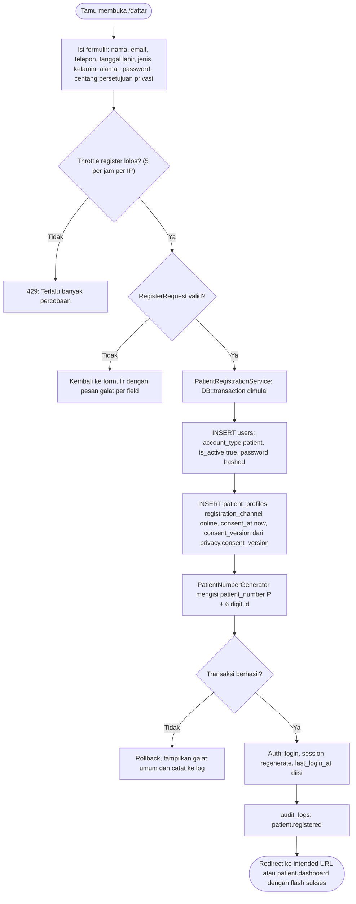

**Langkah**

1. Tamu membuka `GET /daftar` (`register`, middleware `guest`). Pengguna yang sudah login dialihkan: akun pasien ke `patient.dashboard`, akun staf ke `admin.dashboard`.
2. Formulir meminta: nama lengkap, email, nomor telepon, tanggal lahir, jenis kelamin, alamat, password dan konfirmasinya, serta kotak centang "Saya telah membaca dan menyetujui Kebijakan Privasi" dengan tautan ke `privacy`. **NIK tidak diminta.** Nomor BPJS tidak diminta saat registrasi (hanya saat memilih pembayaran BPJS, lihat Alur 3).
3. Submit `POST /daftar` (`register.store`) melewati throttle `register` (5/jam per IP), lalu `RegisterRequest` (aturan di 12 §V-01).
4. `PatientRegistrationService` menjalankan satu `DB::transaction`: buat `users` (`name`, `email`, `phone`, `password` melalui cast `hashed`, `account_type = patient`, `is_active = true`, `must_change_password = false`, `email_verified_at = NULL`), lalu `patient_profiles` (`user_id`, `full_name` = nama, `birth_date`, `gender`, `phone`, `email` = email akun, `address`, `registration_channel = online`, `created_by_user_id = NULL`, `consent_at = now()`, `consent_version` = nilai `privacy.consent_version`, `is_active = true`). Setelah `id` profil diketahui, `PatientNumberGenerator` mengisi `patient_number` (`P` + 6 digit, mis. `P000123`) dalam transaksi yang sama.
5. Setelah commit: `Auth::login($user)`, `session()->regenerate()`, `users.last_login_at = now()`.
6. `AuditLogger` menulis `patient.registered` (aktor pasien; tanpa password).
7. Redirect `redirect()->intended(route('patient.dashboard'))` dengan flash "Registrasi berhasil. Selamat datang, {nama}." Bila pasien berasal dari tombol "Daftar" di jadwal publik (Alur 3.C), *intended URL* mengembalikannya ke wizard dengan `?sesi=`.

**Cabang galat**

| Kondisi | Perilaku | Pesan Indonesia |
|---|---|---|
| Email sudah dipakai (`users.email` unik, termasuk email staf) | Kembali ke form, input dipertahankan kecuali password | "Email ini sudah terdaftar. Silakan masuk atau gunakan email lain." |
| Password tidak memenuhi aturan | Kembali ke form | "Password minimal 8 karakter." / "Password harus mengandung huruf." / "Password harus mengandung angka." |
| Konfirmasi password tidak cocok | Kembali ke form | "Konfirmasi password tidak cocok." |
| Persetujuan privasi tidak dicentang | Kembali ke form | "Anda harus menyetujui Kebijakan Privasi untuk melanjutkan." |
| Tanggal lahir hari ini/masa depan atau > 120 tahun lalu | Kembali ke form | "Tanggal lahir harus sebelum hari ini." / "Tanggal lahir tidak boleh lebih dari 120 tahun yang lalu." |
| Nomor telepon tidak sesuai pola | Kembali ke form | "Nomor telepon tidak valid. Gunakan nomor seluler Indonesia, mis. 081234567890." |
| Throttle `register` terlampaui | 429 | "Terlalu banyak percobaan registrasi. Silakan coba lagi dalam :detik detik." |
| Transaksi gagal (DB mati, constraint) | Rollback total, tidak ada baris yatim | "Registrasi belum berhasil karena gangguan sistem. Silakan coba lagi." |
| Token CSRF kedaluwarsa | 419 | "Sesi Anda telah berakhir. Muat ulang halaman, lalu coba lagi." |

**Keterlibatan**

- Route: `register`, `register.store`, `privacy`, `patient.dashboard`.
- Middleware: `guest`, `throttle:register`.
- Form Request: `RegisterRequest`.
- Service: `PatientRegistrationService`, `PatientNumberGenerator`, `AuditLogger`, `SettingsService` (membaca `privacy.consent_version`).
- Tabel: `users`, `patient_profiles`, `sessions`, `audit_logs`, `website_settings`.

### 1.2 Login pasien dan logout

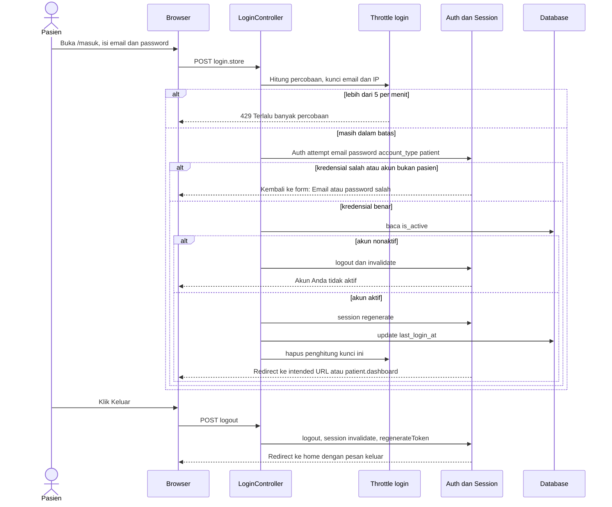

**Langkah login**

1. `GET /masuk` (`login`, middleware `guest`) menampilkan form email, password, dan "Ingat saya" **[ASUMSI]** (hanya untuk pasien; staf tidak memiliki "ingat saya").
2. `POST /masuk` (`login.store`) melewati throttle `login` (5/menit, kunci `lower(email)|IP`) lalu `LoginRequest`.
3. `Auth::attempt(['email' => ..., 'password' => ..., 'account_type' => 'patient'], $remember)`. Akun staf yang mencoba masuk lewat `/masuk` gagal dengan **pesan generik yang sama** (tidak membocorkan keberadaan akun).
4. Bila berhasil, periksa `users.is_active`. Akun nonaktif (hanya diketahui setelah password benar) langsung di-logout.
5. `session()->regenerate()`, `last_login_at = now()`, `RateLimiter::clear` untuk kunci tersebut.
6. `redirect()->intended(route('patient.dashboard'))`. *Intended URL* disimpan oleh middleware `auth` di sisi server (hanya permintaan GET) dan bukan dari parameter query, sehingga tidak ada celah *open redirect*.
7. Selama sesi berjalan, middleware `active` memeriksa `is_active` di setiap permintaan: bila akun dinonaktifkan petugas saat pasien masih login, pasien di-logout pada permintaan berikutnya dan diarahkan ke `/masuk` dengan pesan "Akun Anda tidak aktif. Silakan hubungi rumah sakit."

**Langkah logout**

1. Tombol "Keluar" adalah form `POST /keluar` (`logout`, middleware `auth`); logout lewat GET tidak tersedia (mencegah logout paksa lewat tautan).
2. `Auth::logout()`, `session()->invalidate()`, `session()->regenerateToken()`.
3. Redirect ke `home` dengan flash "Anda telah keluar."

**Cabang galat**

| Kondisi | Perilaku | Pesan Indonesia |
|---|---|---|
| Email tidak terdaftar, password salah, atau akun adalah staf | Kembali ke form, email dipertahankan | "Email atau password salah." |
| Akun dinonaktifkan | Logout otomatis | "Akun Anda tidak aktif. Silakan hubungi rumah sakit." |
| Lebih dari 5 percobaan/menit untuk email+IP yang sama | 429, form menampilkan hitung mundur | "Terlalu banyak percobaan masuk. Silakan coba lagi dalam :detik detik." |
| Email/password kosong atau format email salah | Kembali ke form | "Email wajib diisi." / "Format email tidak valid." / "Password wajib diisi." |
| Sesi/CSRF kedaluwarsa | 419 | "Sesi Anda telah berakhir. Muat ulang halaman, lalu coba lagi." |

**Keterlibatan**

- Route: `login`, `login.store`, `logout`, `patient.dashboard`.
- Middleware: `guest`, `throttle:login`, `auth`, `active`, `account:patient`.
- Form Request: `LoginRequest`. Service: `RateLimiter`.
- Tabel: `users` (`last_login_at`, `is_active`), `sessions`.
- Audit: tidak ada untuk login pasien (hanya login staf, lihat Alur 14 dan 12 §Katalog Audit).

---

## 2. Reset Password Lokal

Mencakup §12: "reset password dapat diuji melalui mail log atau mail catcher; jangan menampilkan tautan reset di halaman publik."

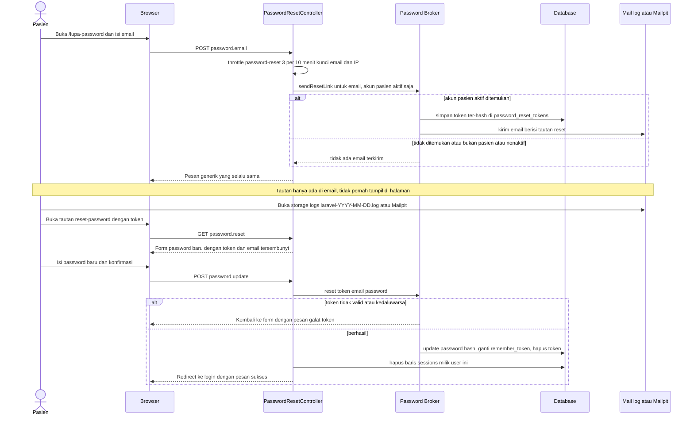

**Langkah**

1. `GET /lupa-password` (`password.request`, `guest`) menampilkan satu kolom email.
2. `POST /lupa-password` (`password.email`) melewati throttle `password-reset` (3 per 10 menit, kunci `lower(email)|IP`) dan `ForgotPasswordRequest`.
3. Controller memanggil `Password::sendResetLink(['email' => $email, 'account_type' => 'patient', 'is_active' => true])`. Akun staf tidak dapat meminta reset dari halaman publik; staf memakai reset oleh Super Admin (Alur 14).
4. **Respons selalu sama**, apa pun hasil broker (terkirim, email tidak ada, akun staf, akun nonaktif, atau dibatasi per-email oleh broker): "Jika email terdaftar, tautan untuk mengatur ulang password telah dikirim. Periksa kotak masuk Anda." Hanya throttle tingkat route yang menghasilkan 429, dan itu berlaku seragam untuk semua email.
5. Token disimpan ter-hash di `password_reset_tokens`; masa berlaku `config('auth.passwords.users.expire') = 60` menit **[ASUMSI]**, jeda antar-permintaan broker `throttle = 60` detik.
6. Email berisi tautan `route('password.reset', ['token' => ..., 'email' => ...])`. Pada lokal: `MAIL_MAILER=log` menulis seluruh isi email (termasuk tautan) ke `storage/logs/laravel-YYYY-MM-DD.log` (karena `LOG_CHANNEL=daily`); alternatif `smtp` ke Mailpit `127.0.0.1:1025`. **Tautan tidak pernah dirender di halaman, flash, atau respons JSON.**
7. `GET /reset-password/{token}` (`password.reset`) menampilkan form password baru + konfirmasi; token dan email dikirim sebagai field tersembunyi.
8. `POST /reset-password` (`password.update`) divalidasi `ResetPasswordRequest` (aturan password sama dengan registrasi). Broker memverifikasi token, mengubah password (cast `hashed`), mengganti `remember_token`, menghapus token.
9. Seluruh sesi aktif milik pengguna dihapus (`DELETE FROM sessions WHERE user_id = ?`, driver `database`) agar sesi yang mungkin dibajak ikut berakhir. Event `PasswordReset` memicu audit `auth.password_reset`.
10. Redirect ke `login` dengan flash "Password berhasil diubah. Silakan masuk dengan password baru." Pasien **tidak** otomatis login.

**Cara menguji di lokal (ringkas; rincian di 16):** kirim permintaan, buka `storage/logs/laravel-YYYY-MM-DD.log` (berkas hari ini), cari baris `reset-password/`, salin tautan ke peramban.

**Cabang galat**

| Kondisi | Perilaku | Pesan Indonesia |
|---|---|---|
| Email kosong / format salah | Kembali ke form | "Email wajib diisi." / "Format email tidak valid." |
| Email tidak terdaftar / akun staf / nonaktif | Tampil respons generik, tidak ada email | "Jika email terdaftar, tautan untuk mengatur ulang password telah dikirim. Periksa kotak masuk Anda." |
| Throttle `password-reset` terlampaui | 429 | "Terlalu banyak permintaan reset password. Silakan coba lagi dalam :detik detik." |
| Token salah/kedaluwarsa/sudah dipakai | Kembali ke form reset | "Tautan pengaturan ulang password tidak valid atau sudah kedaluwarsa. Silakan ajukan permintaan baru." |
| Password baru tidak memenuhi aturan / konfirmasi tidak cocok | Kembali ke form reset (token dipertahankan) | "Password minimal 8 karakter." / "Password harus mengandung huruf." / "Password harus mengandung angka." / "Konfirmasi password tidak cocok." |
| Pengiriman email gagal (SMTP produksi mati) | Respons tetap generik; galat dicatat ke log | (tidak ada pesan tambahan ke pengguna) |

**Keterlibatan**

- Route: `password.request`, `password.email`, `password.reset`, `password.update`, `login`.
- Middleware: `guest`, `throttle:password-reset`.
- Form Request: `ForgotPasswordRequest`, `ResetPasswordRequest`.
- Service: Password Broker bawaan Laravel, `AuditLogger`.
- Tabel: `users`, `password_reset_tokens`, `sessions`, `audit_logs`.
- Konfigurasi: `MAIL_MAILER`, `config/auth.php` (`passwords.users`).

---

## 3. Pendaftaran Kunjungan End-to-End

Alur utama §9: Login → pilih poliklinik → pilih dokter → pilih tanggal/sesi → periksa kuota → isi data pendaftaran → konfirmasi → terbitkan bukti. Wizard berjalan tanpa JavaScript: setiap langkah adalah halaman GET yang dirender server dengan query `poli`, `dokter`, `sesi`; JavaScript hanya memperhalus tampilan (indikator loading, menampilkan/menyembunyikan field BPJS/asuransi). Sumber jadwal di wizard **sama** dengan halaman publik: `DoctorAvailabilityQuery`.

### 3.A Diagram alur wizard

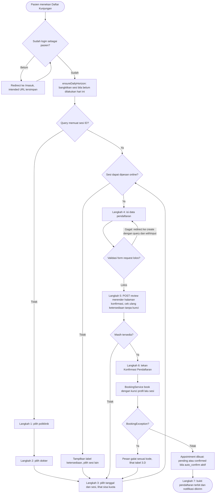

### 3.B Diagram urutan penyimpanan (`BookingService::book`)

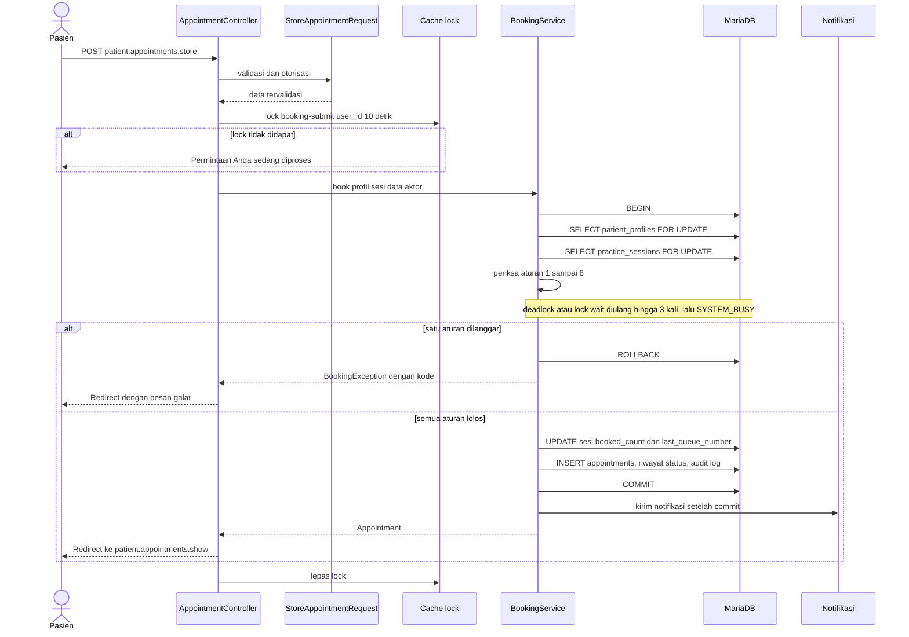

### 3.C Masuk dari tombol "Daftar" pada jadwal publik

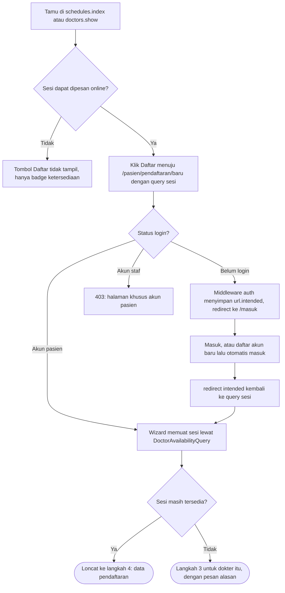

### 3.D Langkah

0. **Prasyarat.** Pasien login (`account:patient`, `active`), profil `is_active`. Saat halaman wizard dibuka, controller memanggil `PracticeSessionGenerator::ensureDailyHorizon()` (maksimal sekali per hari, lihat Alur 10).
1. **Pilih poliklinik** — `GET /pasien/pendaftaran/baru` (`patient.appointments.create`) tanpa query. Daftar poliklinik `is_active`, `is_bookable`, `type = poliklinik` yang memiliki sesi dalam jendela; poliklinik tanpa sesi ditampilkan redup dengan keterangan "Belum ada jadwal".
2. **Pilih dokter** — `?poli={clinics.slug}`. Dokter berstatus `active` yang memiliki sesi di poliklinik itu dalam jendela (berdasarkan `practice_sessions.clinic_id`), ditampilkan sebagai `x-doctor-card` (foto, nama tampilan, spesialisasi). Nilai query mengikuti 00 I.5 (17 D-14): `poli` = `clinics.slug`, `dokter` = `doctors.slug`, `sesi` = `practice_sessions.id`, `tanggal` = `YYYY-MM-DD`.
3. **Pilih tanggal/sesi dan periksa kuota** — `?poli=&dokter={doctors.slug}`. Sesi dikelompokkan per tanggal; setiap baris memuat jam, "Sisa kuota: N dari M" (`remaining = quota - booked_count`), dan `x-availability-badge` (`Availability`). Sesi dengan `is_bookable_online = true` memiliki tombol "Pilih" (menuju `?sesi={id}`); sesi lain tampil nonaktif dengan label: Penuh, Pendaftaran online ditutup, Ditutup, Cuti, Libur, Dibatalkan, Sedang diperbarui, atau Sudah lewat. Sesi yang sudah lewat atau tidak aktif tidak dapat dipilih.
4. **Isi data pendaftaran** — `?sesi={id}`. Ringkasan sesi (poliklinik, dokter, tanggal, jam, sisa kuota) bersifat baca-saja. Isian: jenis pembayaran (`umum`/`bpjs`/`asuransi`); **nomor BPJS (13 digit) hanya muncul dan wajib bila `bpjs`**; mitra asuransi (wajib) dan nomor polis (opsional) hanya bila `asuransi`; keluhan singkat (opsional, maks. 500 karakter); kotak centang "Simpan nomor BPJS ke profil saya" **[ASUMSI]** (bawaan tidak dicentang). Bila profil sudah menyimpan nomor BPJS, kolom nomor diisi dari profil (hanya terlihat oleh pemiliknya, halaman `Cache-Control: no-store`). Tanpa JavaScript, semua kolom bersyarat tetap tampil dengan keterangan "khusus pembayaran BPJS", dan server menolak isian yang tidak sesuai jenis pembayaran.
5. **Tinjau dan cek ulang** — `POST /pasien/pendaftaran/tinjau` (`patient.appointments.review`) divalidasi `ReviewAppointmentRequest`, lalu `BookingService::precheck()` (cek aturan F.5 **tanpa kunci**) memastikan sesi masih tersedia. Bila lolos, respons POST ini **langsung merender** halaman konfirmasi (tidak menyimpan apa pun); tombol "Ubah" adalah tautan GET ke `patient.appointments.create` dengan query `poli`/`dokter`/`sesi`. Kegagalan validasi atau `precheck` pada `review` maupun `store` dialihkan ke `patient.appointments.create` dengan query langkah terakhir + `withInput()`, **tidak pernah `back()`** (hasil POST tidak dapat di-GET ulang; 00 I.3). Halaman tinjauan menampilkan poliklinik, dokter, tanggal, jam, jenis pembayaran (BPJS/polis hanya 4 digit terakhir), keluhan, dan catatan "Nomor antrean diberikan setelah Anda menekan Konfirmasi; sisa kuota dapat berubah sebelum itu." Data dibawa ke langkah berikut sebagai field tersembunyi dan **divalidasi ulang sepenuhnya** pada penyimpanan (tidak dipercaya).
6. **Simpan** — `POST /pasien/pendaftaran` (`patient.appointments.store`), throttle `booking` (10/menit per user id), `StoreAppointmentRequest`, `Cache::lock("booking-submit:{user_id}", 10)`, tombol dinonaktifkan saat submit. `BookingService::book(PatientProfile, PracticeSession, BookingData, Actor)` berjalan di dalam `DB::transaction(..., attempts: 3)` dengan kunci `patient_profiles` → `practice_sessions` (urutan baku 0.3), memeriksa aturan F.5 nomor 1–8, lalu:
   1. `last_queue_number += 1`, `booked_count += 1` pada sesi;
   2. `INSERT appointments`: `booking_code` dari `BookingCodeGenerator` (`UPH-XXXX-XXXX`), `queue_number = last_queue_number`, `channel = online`, `session_date`/`doctor_id`/`clinic_id` didenormalisasi dari sesi, `status = pending` (atau `confirmed` + `confirmed_at` bila `booking.auto_confirm = true`), `payment_reference` terenkripsi + `payment_reference_last4`, `created_by_user_id = user pasien`;
   3. `INSERT appointment_status_histories` (`from_status = NULL`, `to_status`, `actor_type = patient`; bila auto-confirm, `reason` = "Konfirmasi otomatis");
   4. `audit_logs`: `appointment.created`;
   5. bila `save_bpjs` dicentang dan pembayaran BPJS: `patient_profiles.bpjs_number` (terenkripsi) + `bpjs_number_last4` diperbarui;
   6. setelah commit (`DB::afterCommit`): notifikasi ke pasien kanal `database`; kanal `mail` hanya bila status awal `confirmed` (auto-confirm), sesuai 00 F.8 dan default K-13. Kegagalan kirim notifikasi **tidak** menggagalkan pendaftaran (ditangkap dan dicatat ke log).
7. **Terbitkan bukti** — redirect ke `patient.appointments.show` dengan flash "Pendaftaran berhasil. Simpan kode booking Anda: UPH-XXXX-XXXX." Halaman memuat kode booking, QR (SVG; hanya berisi kode booking), nomor antrean `ANK-007`, jadwal, status, dan tombol "Cetak bukti" (`patient.appointments.proof`, CSS print) serta "Unduh PDF" (`patient.appointments.proof-pdf`, dompdf). Akses bukti dibatasi `AppointmentPolicy::view` (pemilik atau staf `appointments.view`).

### 3.E Cabang galat tahap wizard (di luar `BookingException`)

| Kondisi | Perilaku | Pesan Indonesia |
|---|---|---|
| Query `poli`/`dokter`/`sesi` tidak valid atau tidak ditemukan | Redirect ke langkah 1 | "Poliklinik, dokter, atau sesi yang dipilih tidak tersedia. Silakan pilih kembali." |
| Dokter dipilih tanpa poliklinik | Redirect ke langkah 1 | "Pilih poliklinik terlebih dahulu." |
| Akun staf membuka wizard | 403 | "Anda tidak memiliki izin untuk mengakses halaman ini." |
| Jenis pembayaran belum dipilih | Kembali ke langkah 4 | "Jenis pembayaran wajib dipilih." |
| BPJS dipilih tetapi nomor kosong/bukan 13 digit | Kembali ke langkah 4 | "Nomor BPJS wajib diisi untuk pembayaran BPJS." / "Nomor BPJS harus terdiri dari 13 digit angka." |
| Nomor BPJS diisi padahal pembayaran bukan BPJS | Kembali ke langkah 4 | "Nomor BPJS hanya boleh diisi bila jenis pembayaran adalah BPJS." |
| Asuransi dipilih tanpa mitra | Kembali ke langkah 4 | "Mitra asuransi wajib dipilih untuk pembayaran asuransi." |
| Keluhan lebih dari 500 karakter | Kembali ke langkah 4 | "Keluhan maksimal 500 karakter." |
| Tombol Konfirmasi ditekan dua kali / dua tab | `Cache::lock` gagal | "Permintaan Anda sedang diproses. Mohon tunggu sebentar dan jangan menekan tombol berulang kali." |
| Throttle `booking` terlampaui (10/menit) | 429 | "Terlalu banyak percobaan pendaftaran. Silakan coba lagi dalam :detik detik." |
| Lock wait timeout (errno 1205) atau deadlock (errno 1213) masih terjadi setelah `attempts: 3` | `BookingException` `SYSTEM_BUSY`; tidak ada data tersimpan sebagian; redirect ke `patient.appointments.create` dengan query dan `withInput()` | "Sistem sedang sibuk, silakan coba lagi beberapa saat." |
| Sesi/CSRF kedaluwarsa | 419 | "Sesi Anda telah berakhir. Muat ulang halaman, lalu coba lagi." |

### 3.F Cabang galat `BookingException` (00 F.5)

Setiap kode dilempar dari dalam transaksi (setelah penguncian), menggulung balik transaksi, dan diterjemahkan controller menjadi flash merah + pengalihan. Pesan memakai penanda `{subjek}` = "Anda" (kanal online) atau "Pasien ini" (kanal loket).

| Kode | Pemicu (aturan F.5) | Pesan Indonesia | Perilaku UI (online) |
|---|---|---|---|
| `SESSION_UNAVAILABLE` | (1) sesi bukan `open`, atau dokter bukan `active`, atau poliklinik tidak aktif/bukan `is_bookable` | "Sesi praktik ini tidak tersedia untuk pendaftaran. Silakan pilih sesi lain." | Redirect ke langkah 3 dokter yang sama. |
| `OUTSIDE_WINDOW` | (2) `session_date` sebelum hari ini atau melewati hari ini + `booking.window_days` | "Pendaftaran hanya dapat dilakukan untuk tanggal mulai hari ini sampai {N} hari ke depan." | Redirect ke langkah 3. |
| `CUTOFF_PASSED` | (3) online: `now >= start - booking.online_cutoff_minutes`; loket: `now >= end_time` | Online: "Pendaftaran online untuk sesi ini sudah ditutup ({N} menit sebelum sesi dimulai). Silakan datang ke loket pendaftaran atau hubungi rumah sakit." Loket: "Sesi ini sudah berakhir." | Redirect ke langkah 3, sesi tampil berlabel "Pendaftaran online ditutup". |
| `QUOTA_FULL` | (4) `booked_count >= quota` (juga bila CHECK `booked_count <= quota` melanggar) | "Kuota sesi ini sudah penuh. Silakan pilih tanggal atau sesi lain." | Redirect ke langkah 3, sisa kuota dimuat ulang. |
| `DUPLICATE_BOOKING` | (5) sudah ada appointment aktif pasien di sesi yang sama (juga bila UNIQUE `patient_profile_id, practice_session_id, active_flag` melanggar) | "{subjek} sudah memiliki pendaftaran aktif pada sesi dokter ini." | Redirect ke `patient.appointments.show` pendaftaran yang sudah ada. |
| `OVERLAPPING_BOOKING` | (6) ada appointment aktif pada tanggal yang sama di sesi lain dengan jam beririsan (`start1 < end2 AND start2 < end1`) | "Jadwal ini bertabrakan dengan pendaftaran lain {subjek} pada tanggal yang sama ({dokter}, {jam mulai}–{jam selesai})." | Redirect ke langkah 3 dengan rincian pendaftaran yang bertabrakan. |
| `ACTIVE_LIMIT_REACHED` | (7) jumlah appointment aktif mendatang ≥ `booking.max_active_per_patient` (online saja) | "{subjek} sudah memiliki {N} pendaftaran aktif yang akan datang (batas maksimum). Selesaikan atau batalkan salah satunya terlebih dahulu." | Redirect ke `patient.appointments.index`. |
| `INVALID_PAYMENT` | (8) `bpjs` tanpa 13 digit; `asuransi` tanpa mitra; `umum` dengan isian pembayaran | "Data pembayaran tidak sesuai: nomor BPJS (13 digit) wajib untuk pembayaran BPJS dan mitra asuransi wajib untuk pembayaran asuransi." | Redirect ke langkah 4 (`patient.appointments.create` dengan query dan `withInput()`; pertahanan berlapis, biasanya sudah ditangkap Form Request). |
| `SYSTEM_BUSY` | Lock wait timeout (errno 1205) atau deadlock (errno 1213) masih terjadi setelah `attempts: 3`; bukan pelanggaran aturan F.5 | "Sistem sedang sibuk, silakan coba lagi beberapa saat." | Redirect ke langkah 4 dengan input terisi ulang; tidak ada data tersimpan sebagian; pasien boleh mengirim ulang. |

Pelanggaran constraint diterjemahkan dengan memeriksa `errorInfo[1]` dan nama constraint (bukan hanya SQLSTATE; nama final dari 09): duplikat UNIQUE = SQLSTATE 23000 / errno 1062 — pada `appointments_patient_session_active_unique` → `DUPLICATE_BOOKING`, pada `appointments_booking_code_unique` → buat kode baru dan ulangi, pada `appointments_practice_session_id_queue_number_unique` → ulangi transaksi (dihitung dalam `attempts: 3`); pelanggaran CHECK `chk_sessions_quota` (`booked_count <= quota`) = errno 4025 di MariaDB (3819 di MySQL 8) → `QUOTA_FULL`; errno 1205/1213 setelah `attempts: 3` → `SYSTEM_BUSY`.

### 3.G Keterlibatan

- Route: `patient.appointments.create`, `patient.appointments.review`, `patient.appointments.store`, `patient.appointments.show`, `patient.appointments.proof`, `patient.appointments.proof-pdf`, `schedules.index`, `doctors.show`, `login`, `register`.
- Middleware: `auth`, `account:patient`, `active`, `throttle:booking`.
- Form Request: `BookingWizardQueryRequest`, `ReviewAppointmentRequest`, `StoreAppointmentRequest`.
- Service: `PracticeSessionGenerator`, `DoctorAvailabilityQuery`, `BookingService` (`precheck`, `book`), `BookingCodeGenerator`, `QueueNumberFormatter`, `AuditLogger`, `MediaService` (foto dokter pada kartu).
- Tabel: `clinics`, `doctors`, `practice_sessions`, `patient_profiles`, `appointments`, `appointment_status_histories`, `insurance_partners`, `audit_logs`, `notifications`.
- Notifikasi: `AppointmentStatusChangedNotification` (kanal `database`; kanal `mail` hanya bila `confirmed`).
- Policy: `AppointmentPolicy::view` untuk bukti.

---

## 4. Pembatalan oleh Pasien

Mencakup §9 (pembatalan sesuai aturan, kuota dibuka kembali, nomor antrean tidak dipakai ulang) dan 00 F.8.

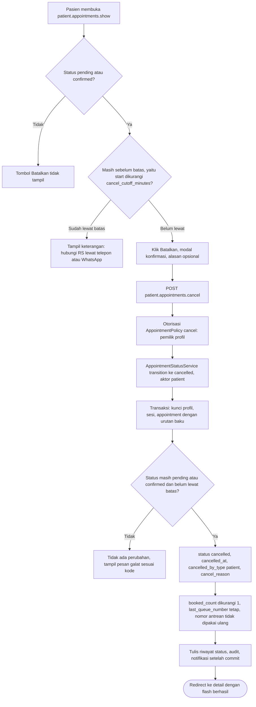

**Langkah**

1. Pasien membuka detail pendaftaran miliknya (`patient.appointments.show`, binding `{appointment:booking_code}`; milik pasien lain → 404).
2. Tombol "Batalkan pendaftaran" tampil hanya bila status `pending`/`confirmed` **dan** `now <= start - booking.cancel_cutoff_minutes`. Contoh: sesi 09.00 dengan batas 120 menit → pembatalan dibuka sampai 07.00.00 tepat (inklusif).
3. Setelah batas terlewati (atau status `checked_in`/final), tombol diganti keterangan: "Batas pembatalan online telah lewat. Untuk membatalkan atau mengubah pendaftaran, hubungi rumah sakit di {contact.phone} atau melalui WhatsApp." (tautan `https://wa.me/{contact.whatsapp}` yang dibuka manual; **bukan** pengiriman otomatis).
4. Klik tombol membuka `x-confirm-modal` dengan kolom alasan opsional (maks. 255 karakter) dan peringatan "Kuota akan dilepas dan nomor antrean Anda tidak dapat dipakai kembali."
5. `POST /pasien/pendaftaran/{kode}/batal` (`patient.appointments.cancel`) → `CancelAppointmentRequest` → `AppointmentPolicy::cancel` (pemilik) → `AppointmentStatusService::transition($appointment, Cancelled, Actor::patient, $reason)`.
6. Dalam transaksi (urutan kunci baku): baca ulang appointment di bawah kunci; bila status sudah berubah (mis. petugas baru saja check-in) atau batas terlewati sejak halaman dimuat, lempar `InvalidTransitionException`.
7. Bila sah: `status = cancelled`, `cancelled_at = now()`, `cancelled_by_type = patient`, `cancelled_by_user_id = user pasien`, `cancel_reason`; `practice_sessions.booked_count - 1`. `last_queue_number` **tidak** dikurangi, jadi nomor antrean yang dibatalkan tidak pernah dipakai lagi. `active_flag` otomatis menjadi NULL sehingga pasien boleh mendaftar lagi pada sesi yang sama (mendapat nomor antrean baru) selama aturan booking terpenuhi.
8. Tulis `appointment_status_histories`, `audit_logs` (`appointment.status_changed`, aktor pasien), kirim notifikasi (kanal `database`; kanal `mail` karena `cancelled` termasuk transisi yang dikirim lewat mail, 00 F.8 / K-13) setelah commit.
9. Redirect ke detail dengan flash "Pendaftaran berhasil dibatalkan. Kuota telah dilepas."

**Cabang galat**

| Kondisi | Kode `InvalidTransitionException` | Pesan Indonesia |
|---|---|---|
| Lewat batas pembatalan | `CANCEL_CUTOFF_PASSED` | "Batas pembatalan online telah lewat (maksimal {N} menit sebelum sesi dimulai). Silakan hubungi rumah sakit di {telepon} atau melalui WhatsApp." |
| Status sudah `checked_in` | `INVALID_TRANSITION` | "Pendaftaran yang sudah check-in tidak dapat dibatalkan. Silakan hubungi petugas pendaftaran." |
| Status sudah final (`completed`/`cancelled`/`no_show`) | `ALREADY_FINAL` | "Pendaftaran ini sudah berstatus {status} dan tidak dapat diubah lagi." |
| Status berubah di antara dua klik | `STALE_STATUS` | "Status pendaftaran sudah berubah. Muat ulang halaman untuk melihat status terbaru." |
| Pendaftaran milik pasien lain / kode tidak ada | 404 | "Halaman yang Anda cari tidak ditemukan." |
| Alasan > 255 karakter | validasi | "Alasan maksimal 255 karakter." |

**Keterlibatan**

- Route: `patient.appointments.show`, `patient.appointments.cancel`, `patient.appointments.index`.
- Middleware: `auth`, `account:patient`, `active`.
- Form Request: `CancelAppointmentRequest`. Policy: `AppointmentPolicy::cancel`.
- Service: `AppointmentStatusService::transition`, `AuditLogger`, `SettingsService` (`booking.cancel_cutoff_minutes`, `contact.phone`, `contact.whatsapp`).
- Tabel: `appointments`, `practice_sessions`, `appointment_status_histories`, `audit_logs`, `notifications`.
- Notifikasi: `AppointmentStatusChangedNotification`.

---

## 5. Walk-in oleh Petugas Pendaftaran

Mencakup keputusan K1 (pasien walk-in tanpa akun) dan 00 F.9: petugas mencari atau membuat profil, mencatat persetujuan privasi lisan, memilih sesi dari sumber yang sama dengan portal pasien, lalu mendaftarkan lewat `BookingService::book()` berkanal `loket` dengan status awal `confirmed`. Kuota dibagi dengan booking online karena keduanya mengunci baris `practice_sessions` yang sama.

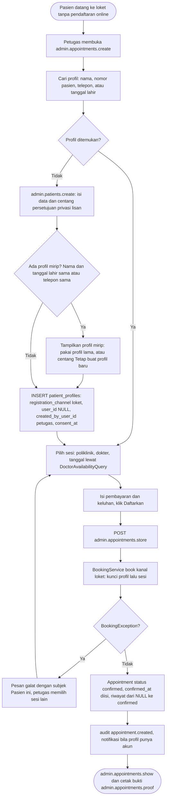

**Langkah**

1. Petugas (izin `appointments.manage`; pencarian profil memerlukan `patients.view`) membuka `admin.appointments.create`. Layar terdiri dari tiga bagian: **A. Pasien**, **B. Sesi**, **C. Pembayaran**.
2. **Cari profil.** Kolom pencarian menerima nama (sebagian), `patient_number` (mis. `P000123`), nomor telepon (dinormalisasi ke format `08…`), atau tanggal lahir. Hasil memperlihatkan nama, nomor pasien, tanggal lahir, dan telepon tersamar. Profil nonaktif (`is_active = false`) tampil tetapi tidak dapat dipilih.
3. **Buat profil baru** bila tidak ditemukan (izin `patients.manage`): `admin.patients.create` → `admin.patients.store`. Isian: nama lengkap, tanggal lahir, jenis kelamin, telepon (**wajib**, dipakai bila jadwal berubah), email (opsional), alamat, dan kotak centang **"Pasien telah diberi tahu mengenai Kebijakan Privasi dan menyetujui pengolahan datanya (persetujuan lisan)"** yang wajib dicentang. NIK tidak diminta. Sistem menyimpan `registration_channel = loket`, `user_id = NULL`, `created_by_user_id = petugas`, `consent_at = now()`, `consent_version = privacy.consent_version`, `patient_number` dari `PatientNumberGenerator`. Audit `patient.created`.
4. **Deteksi profil mirip (anti-duplikat).** Sebelum menyimpan, sistem mencari profil aktif dengan (`full_name` sama **dan** `birth_date` sama) atau `phone` sama. Bila ada, petugas melihat daftar dan memilih profil lama, atau mencentang "Tetap buat profil baru" **[ASUMSI]**. Pencocokan tidak otomatis dan tidak pernah menggabungkan profil.
5. **Pilih sesi.** Poliklinik → dokter → tanggal → sesi, memakai `DoctorAvailabilityQuery` (sumber yang sama dengan portal pasien dan halaman publik). Untuk kanal loket, sesi dapat dipilih bila `is_bookable_counter` benar (00 F.3): `now < end_time` pada tanggal sesi (sesi hari ini yang sudah berjalan masih bisa dipilih) dan memenuhi aturan F.5 nomor 1–2. Cutoff pendaftaran online tidak berlaku. Sisa kuota ditampilkan; sesi penuh/cuti/libur/dibatalkan/sedang diperbarui tampil nonaktif dengan label.
6. **Pembayaran dan keluhan.** Sama seperti Alur 3 langkah 4: nomor BPJS (13 digit) hanya bila BPJS; mitra asuransi bila asuransi; keluhan opsional. Petugas mengetik nomor BPJS; setelah disimpan nomor tidak pernah ditampilkan lagi secara utuh (hanya 4 digit terakhir).
7. **Simpan.** `POST /admin/pendaftaran` (`admin.appointments.store`) → `StoreWalkInAppointmentRequest` → `BookingService::book($profil, $sesi, $data, Actor::staff($petugas))`. Aturan F.5 yang berlaku: 1, 2, 3 (versi loket), 4, 5, 6, 8. Aturan 7 (batas pendaftaran aktif per pasien) **tidak berlaku** untuk loket. Kunci: `patient_profiles` → `practice_sessions`.
8. Hasil: `channel = loket`, `status = confirmed`, `confirmed_at = now()`, `created_by_user_id = petugas`, riwayat status dari `NULL` ke `confirmed` (aktor staf), `audit_logs` `appointment.created`. Bila profil terhubung ke akun (`user_id` terisi), notifikasi dikirim; bila tidak, petugas memberi tahu langsung dan menyerahkan bukti cetak.
9. Redirect ke `admin.appointments.show` dengan flash "Pendaftaran walk-in berhasil. Kode booking UPH-XXXX-XXXX, nomor antrean ANK-007." Tombol "Cetak bukti" membuka `admin.appointments.proof`. Bila saat itu sudah memasuki jendela check-in, petugas dapat langsung check-in dari halaman detail (Alur 7).

**Cabang galat**

| Kondisi | Perilaku | Pesan Indonesia |
|---|---|---|
| Persetujuan lisan tidak dicentang | Kembali ke form profil | "Persetujuan privasi lisan dari pasien wajib dicentang." |
| Ada profil mirip dan belum dikonfirmasi | Kembali ke form profil dengan daftar profil | "Terdapat profil yang mirip. Pilih profil yang sudah ada atau centang konfirmasi untuk tetap membuat profil baru." |
| Telepon tidak valid | Kembali ke form | "Nomor telepon tidak valid. Gunakan nomor seluler Indonesia, mis. 081234567890." |
| Profil terpilih nonaktif/tidak ada | Kembali ke bagian A | "Profil pasien tidak aktif atau tidak ditemukan." |
| `SESSION_UNAVAILABLE` | Kembali ke bagian B | "Sesi praktik ini tidak tersedia untuk pendaftaran. Silakan pilih sesi lain." |
| `OUTSIDE_WINDOW` | Kembali ke bagian B | "Pendaftaran hanya dapat dilakukan untuk tanggal mulai hari ini sampai {N} hari ke depan." |
| `CUTOFF_PASSED` (loket: sesi sudah berakhir) | Kembali ke bagian B | "Sesi ini sudah berakhir." |
| `QUOTA_FULL` | Kembali ke bagian B | "Kuota sesi ini sudah penuh. Silakan pilih tanggal atau sesi lain." |
| `DUPLICATE_BOOKING` | Tautan ke pendaftaran yang sudah ada | "Pasien ini sudah memiliki pendaftaran aktif pada sesi dokter ini." |
| `OVERLAPPING_BOOKING` | Kembali ke bagian B | "Jadwal ini bertabrakan dengan pendaftaran lain Pasien ini pada tanggal yang sama ({dokter}, {jam mulai}–{jam selesai})." |
| `INVALID_PAYMENT` | Kembali ke bagian C | "Data pembayaran tidak sesuai: nomor BPJS (13 digit) wajib untuk pembayaran BPJS dan mitra asuransi wajib untuk pembayaran asuransi." |
| Petugas tanpa izin `appointments.manage` / `patients.manage` | 403 | "Anda tidak memiliki izin untuk mengakses halaman ini." |

`ACTIVE_LIMIT_REACHED` tidak pernah muncul pada kanal loket.

**Keterlibatan**

- Route: `admin.appointments.create`, `admin.appointments.store`, `admin.appointments.show`, `admin.appointments.proof`, `admin.patients.index`, `admin.patients.create`, `admin.patients.store`.
- Middleware: `auth`, `account:staff`, `active`, `password.changed`, `permission:appointments.manage` (dan `patients.view`/`patients.manage` untuk bagian A).
- Form Request: `StorePatientRequest`, `StoreWalkInAppointmentRequest`. Policy: `PatientProfilePolicy`, `AppointmentPolicy`.
- Service: `DoctorAvailabilityQuery`, `BookingService`, `BookingCodeGenerator`, `PatientNumberGenerator`, `QueueNumberFormatter`, `AuditLogger`.
- Tabel: `patient_profiles`, `practice_sessions`, `appointments`, `appointment_status_histories`, `audit_logs`, `notifications`.
- Izin: `appointments.manage`, `patients.view`, `patients.manage`.

---

## 6. Konfirmasi Booking oleh Petugas dan Auto-Confirm

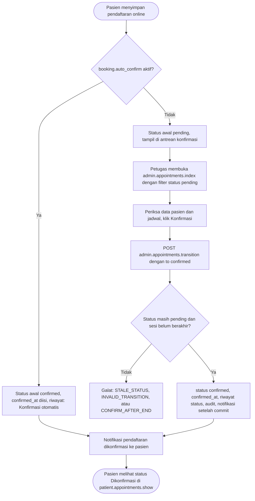

**Langkah**

1. **Auto-confirm (`booking.auto_confirm = true`).** `BookingService::book()` langsung menyimpan `status = confirmed` dan `confirmed_at = now()`; riwayat status `NULL → confirmed` bertanda aktor `patient` dengan alasan "Konfirmasi otomatis". Pengaturan hanya berlaku untuk pendaftaran **baru**; pendaftaran `pending` yang sudah ada tetap `pending` sampai dikonfirmasi petugas.
2. **Konfirmasi manual (`auto_confirm = false`, bawaan).** Petugas membuka `admin.appointments.index`, memfilter status `pending` (urutan bawaan: `session_date` menaik lalu `created_at` menaik), dan dapat membuka `admin.appointments.show` untuk memeriksa data (jenis pembayaran, 4 digit terakhir BPJS/polis, keluhan).
3. Klik "Konfirmasi" mengirim `POST /admin/pendaftaran/{appointment}/status` (`admin.appointments.transition`) dengan `to = confirmed`.
4. `AppointmentStatusService::transition()` mengunci (urutan baku), memastikan status masih `pending` dan sesi belum berakhir (`now < end_time`), lalu mengisi `confirmed_at`, menulis riwayat, `audit_logs` `appointment.status_changed`, dan notifikasi (`database` + `mail`) setelah commit.
5. Konfirmasi tidak mengubah kuota maupun nomor antrean (keduanya sudah ditetapkan saat booking).
6. Petugas yang menolak sebuah pendaftaran `pending` membatalkannya (`to = cancelled`, alasan wajib; lihat Alur 8) dan memberi tahu pasien lewat notifikasi.

**Cabang galat**

| Kondisi | Kode | Pesan Indonesia |
|---|---|---|
| Sesi sudah berakhir | `CONFIRM_AFTER_END` | "Sesi sudah berakhir sehingga pendaftaran tidak dapat dikonfirmasi." |
| Status bukan `pending` | `INVALID_TRANSITION` | "Perubahan status dari ':dari' ke ':ke' tidak diperbolehkan." |
| Pasien membatalkan lebih dahulu / status berubah | `STALE_STATUS` | "Status pendaftaran sudah berubah. Muat ulang halaman untuk melihat status terbaru." |
| Petugas tanpa izin | 403 | "Anda tidak memiliki izin untuk mengakses halaman ini." |

**Keterlibatan:** route `admin.appointments.index`, `admin.appointments.show`, `admin.appointments.transition`; form request `TransitionAppointmentRequest`; service `AppointmentStatusService`, `AuditLogger`, `SettingsService`; tabel `appointments`, `appointment_status_histories`, `audit_logs`, `notifications`; izin `appointments.view`, `appointments.manage`; notifikasi `AppointmentStatusChangedNotification`.

---

## 7. Antrean Harian, Check-in, Selesai, Koreksi, dan Tidak Hadir

Layar `admin.queue.index` adalah meja kerja petugas pada hari praktik. Check-in memakai kolom pencarian yang menerima ketikan manual atau pemindai USB (berperilaku sebagai keyboard) — tidak membutuhkan API kamera.

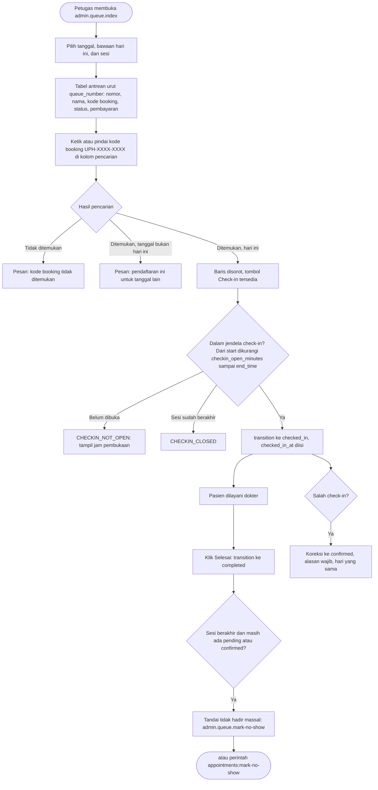

**Langkah**

1. **Buka antrean.** `GET /admin/antrean` (`admin.queue.index`, izin `appointments.view`). Filter: tanggal (bawaan hari ini), poliklinik, dokter, sesi (daftar sesi pada tanggal itu dengan jam dan jumlah terisi), status. Ringkasan sesi: "Terisi {booked_count} dari {quota}", jumlah per status (pending, confirmed, checked_in, completed, no_show, cancelled), dan nomor antrean terakhir.
2. **Daftar antrean.** Urut `queue_number` menaik; kolom: nomor antrean (`QueueNumberFormatter`, mis. `ANK-007`), nama pasien, nomor pasien, kode booking, jenis pembayaran, kanal, status (`x-status-badge`: teks + ikon + warna), dan aksi sesuai status. Pada layar < 768 px tabel menjadi kartu.
3. **Cari/pindai.** Kolom pencarian otomatis fokus. Pemindai USB mengetik kode lalu menekan Enter, yang mengirim `GET` dengan `q`. `q` dapat berisi kode booking (`UPH-XXXX-XXXX`, dinormalisasi huruf besar), nomor pasien, atau sebagian nama. Pencarian kode booking dilakukan lintas sesi pada tanggal terpilih; bila kode milik tanggal lain, petugas diberi tahu tanggal tersebut. **Pemindaian hanya menemukan dan menyorot baris; check-in tetap dilakukan petugas dengan menekan tombol** (mencegah check-in tak sengaja) **[ASUMSI]**.
4. **Check-in** — tombol pada baris berstatus `pending`/`confirmed` → `POST /admin/pendaftaran/{appointment}/status` (`admin.appointments.transition`, `to = checked_in`). Syarat: `session_date = hari ini` dan `start − booking.checkin_open_minutes <= now <= end_time` (mis. sesi 09.00–12.00 → check-in 08.00 sampai 12.00). Mengisi `checked_in_at`.
5. **Selesai** — baris `checked_in` → `to = completed` (mengisi `completed_at`) setelah pasien selesai dilayani.
6. **Koreksi check-in** — bila check-in salah (pasien keliru, salah baris), baris `checked_in` dapat dikembalikan ke `confirmed` pada hari yang sama dengan **alasan wajib**; `checked_in_at` dikosongkan (riwayat tetap menyimpan kejadiannya).
7. **Pembatalan oleh petugas** — baris `pending`/`confirmed` dapat dibatalkan kapan saja sebelum check-in dengan alasan wajib (kuota dilepas; nomor antrean tidak dipakai ulang).
8. **Tandai tidak hadir massal** — tombol "Tandai tidak hadir" per sesi aktif hanya setelah `end_time` sesi lewat. Sebelum dieksekusi, modal menampilkan jumlah dan daftar pendaftaran `pending`/`confirmed` yang akan ditandai dan meminta konfirmasi. `POST /admin/antrean/{session}/tidak-hadir` (`admin.queue.mark-no-show`, izin `appointments.manage`) memproses seluruh sesi dalam satu transaksi dengan urutan kunci baku. Setiap baris diubah lewat `AppointmentStatusService::transition(... NoShow ...)` sehingga riwayat, audit, dan notifikasi tetap tercatat. Status `no_show` **tetap menghitung kuota**. Tidak ada tombol "tidak hadir" per individu; petugas men-check-in pasien yang hadir lebih dulu lalu menandai sisanya.
9. **Perintah Artisan** `php artisan appointments:mark-no-show {--date=}` melakukan hal yang sama oleh `Sistem` untuk semua sesi yang sudah berakhir: tanpa `--date` memproses semua sesi yang waktu selesainya sudah lewat hingga saat ini (00 F.8; 17 D-15), dengan `--date=YYYY-MM-DD` hanya tanggal itu; idempoten (baris yang sudah final tidak disentuh). Ringkasan keluaran: "{N} pendaftaran pada {M} sesi ditandai tidak hadir." Karena fitur inti tidak bergantung pada cron/Task Scheduler (00 B.2), perintah ini dijalankan manual atau dijadwalkan opsional; antrean menampilkan peringatan "{N} pendaftaran dari sesi yang sudah berakhir belum ditandai" bila ada.
10. Antrean tidak diperbarui otomatis; terdapat tombol "Muat ulang" (bukan *real-time*).

**Cabang galat**

| Kondisi | Kode | Pesan Indonesia |
|---|---|---|
| Kode booking tidak dikenal | — | "Kode booking tidak ditemukan." |
| Kode milik tanggal lain | — | "Pendaftaran ini untuk tanggal {tanggal}, bukan hari ini." |
| Check-in bukan pada hari kunjungan | `CHECKIN_NOT_TODAY` | "Check-in hanya dapat dilakukan pada tanggal kunjungan ({tanggal})." |
| Check-in sebelum jendela dibuka | `CHECKIN_NOT_OPEN` | "Check-in belum dibuka. Check-in dibuka pukul {jam}." |
| Check-in setelah sesi berakhir | `CHECKIN_CLOSED` | "Sesi sudah berakhir sehingga check-in tidak dapat dilakukan." |
| Koreksi bukan pada hari yang sama | `CORRECTION_NOT_SAME_DAY` | "Koreksi check-in hanya dapat dilakukan pada hari yang sama." |
| Alasan koreksi/pembatalan kosong | `REASON_REQUIRED` | "Alasan wajib diisi untuk pembatalan atau koreksi check-in." |
| Tandai tidak hadir sebelum sesi berakhir | `SESSION_NOT_ENDED` | "Tandai tidak hadir hanya dapat dilakukan setelah sesi berakhir (pukul {jam})." |
| Selesai pada baris yang bukan `checked_in` | `INVALID_TRANSITION` | "Perubahan status dari ':dari' ke ':ke' tidak diperbolehkan." |
| Baris sudah berubah oleh petugas lain | `STALE_STATUS` | "Status pendaftaran sudah berubah. Muat ulang halaman untuk melihat status terbaru." |
| Status final | `ALREADY_FINAL` | "Pendaftaran ini sudah berstatus {status} dan tidak dapat diubah lagi." |
| Tidak ada baris yang perlu ditandai | — | "Tidak ada pendaftaran yang perlu ditandai tidak hadir pada sesi ini." |
| Percobaan `to = no_show` per individu | validasi | "Status tujuan tidak diperbolehkan. Gunakan aksi Tandai tidak hadir pada antrean sesi." |

**Keterlibatan**

- Route: `admin.queue.index`, `admin.queue.mark-no-show`, `admin.appointments.transition`, `admin.appointments.show`, `admin.appointments.proof`.
- Form Request: `TransitionAppointmentRequest`, `MarkNoShowRequest`. Policy: `AppointmentPolicy`, `PracticeSessionPolicy`.
- Service: `AppointmentStatusService`, `QueueNumberFormatter`, `AuditLogger`; perintah `appointments:mark-no-show`.
- Tabel: `appointments`, `practice_sessions`, `appointment_status_histories`, `audit_logs`, `notifications`, `website_settings` (`booking.checkin_open_minutes`).
- Izin: `appointments.view` (lihat), `appointments.manage` (aksi).
- Notifikasi: `AppointmentStatusChangedNotification` untuk setiap transisi pada pasien berakun (kanal `database` untuk semua transisi; kanal `mail` hanya untuk `confirmed` dan `cancelled`, K-13).

---

## 8. Status Pendaftaran (`AppointmentStatus`) — Diagram, Transisi, dan Kuota

### 8.1 Diagram status

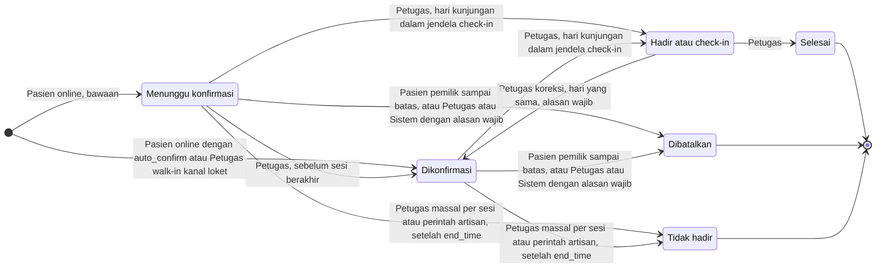

`ACTIVE` = {`pending`, `confirmed`, `checked_in`}; `QUOTA_CONSUMING` = semua status kecuali `cancelled`; status **final** = {`completed`, `cancelled`, `no_show`} (tidak ada transisi keluar).

### 8.2 Tabel transisi (00 F.8) dengan galat

Seluruh transisi lewat `AppointmentStatusService::transition(Appointment, AppointmentStatus, Actor, ?string $reason)`. Pelanggaran melempar `InvalidTransitionException` berkode (00 F.8).

| # | Dari → Ke | Pelaku (izin) | Syarat | Kolom waktu | Efek `booked_count` | Kode galat bila gagal |
|---|---|---|---|---|---|---|
| T1 | (baru) → `pending` | Pasien online (pemilik akun) | Aturan F.5; `booking.auto_confirm = false` | — | +1 | `BookingException` (9 kode, termasuk `SYSTEM_BUSY`) |
| T2 | (baru) → `confirmed` | Pasien online | `booking.auto_confirm = true` | `confirmed_at` | +1 | `BookingException` |
| T3 | (baru) → `confirmed` | Petugas (`appointments.manage`), kanal loket | Aturan F.5 versi loket | `confirmed_at` | +1 | `BookingException` |
| T4 | `pending` → `confirmed` | Petugas (`appointments.manage`) | `now < end_time` sesi | `confirmed_at` | 0 | `CONFIRM_AFTER_END`, `STALE_STATUS` |
| T5 | `pending`/`confirmed` → `checked_in` | Petugas (`appointments.manage`) | `session_date = hari ini` dan `start − checkin_open_minutes <= now <= end_time` | `checked_in_at` | 0 | `CHECKIN_NOT_TODAY`, `CHECKIN_NOT_OPEN`, `CHECKIN_CLOSED` |
| T6 | `checked_in` → `completed` | Petugas (`appointments.manage`) | — | `completed_at` | 0 | `INVALID_TRANSITION` |
| T7 | `checked_in` → `confirmed` | Petugas (`appointments.manage`) | Hari yang sama; alasan wajib | `checked_in_at` dikosongkan | 0 | `CORRECTION_NOT_SAME_DAY`, `REASON_REQUIRED` |
| T8 | `pending`/`confirmed` → `cancelled` | Pasien pemilik | `now <= start − booking.cancel_cutoff_minutes` | `cancelled_at`, `cancelled_by_type = patient` | −1 | `CANCEL_CUTOFF_PASSED` |
| T9 | `pending`/`confirmed` → `cancelled` | Petugas (`appointments.manage`) atau Sistem | Kapan saja sebelum check-in; alasan wajib | `cancelled_at`, `cancelled_by_type = staff` atau `system` | −1 | `REASON_REQUIRED` |
| T10 | `pending`/`confirmed` → `no_show` | Petugas (aksi massal per sesi) atau Sistem (`appointments:mark-no-show`) | `now > end_time` sesi | `no_show_at` | 0 | `SESSION_NOT_ENDED` |

Catatan penerapan:

- Setiap transisi sukses mengisi kolom waktu terkait, menulis `appointment_status_histories` (`from_status`, `to_status`, `actor_type`, `actor_user_id`, `reason`), menulis `audit_logs` (`appointment.status_changed`) untuk aksi staf/sistem (aksi pasien juga dicatat), dan mengirim notifikasi ke pasien berakun: kanal `database` untuk **setiap** transisi, kanal `mail` hanya untuk `confirmed`, `cancelled`, dan perubahan jadwal (`schedule_changed_at`); default K-13 di 17, mail lokal masuk log. Pasien walk-in tanpa akun dihubungi petugas lewat telepon yang tercatat di profil.
- Pada T9, "Sistem" disediakan secara teknis (`ActorType::system`) tetapi **tidak ada pemicu otomatis pembatalan** di prototipe; pembatalan akibat resolusi sesi (`cancel`) dicatat sebagai `staff` sesuai 00 F.4.
- Transisi di luar tabel (mis. `checked_in → cancelled`, `pending → completed`, apa pun dari status final) ditolak dengan `INVALID_TRANSITION`/`ALREADY_FINAL`. Untuk membatalkan pendaftaran yang sudah check-in, petugas terlebih dahulu mengoreksinya ke `confirmed` (T7) lalu membatalkannya (T9).
- Pencegahan transisi ganda: UI menyertakan `expected_status` (status saat halaman dimuat); bila berbeda dengan status di bawah kunci → `STALE_STATUS` **[ASUMSI]**.

### 8.3 Status mana yang mengurangi kuota

| Status | Mengurangi kuota? | Alasan |
|---|---|---|
| `pending` | Ya | Slot sudah dipesan dan menunggu konfirmasi. |
| `confirmed` | Ya | Slot dipesan dan dikonfirmasi. |
| `checked_in` | Ya | Pasien hadir dan menempati slot. |
| `completed` | Ya | Slot terpakai; tetap dihitung agar laporan kuota sesi konsisten. |
| `no_show` | Ya | Slot terbuang; tidak dikembalikan karena sesi sudah berakhir. |
| `cancelled` | **Tidak** | `booked_count` dikurangi 1; kuota terbuka kembali **selama sesi masih bisa dipesan** (open, dalam jendela, sebelum cutoff). Nomor antrean tidak dipakai ulang. |

Invarian yang diuji (lihat [15 — Pengujian dan Penerimaan](15-pengujian-penerimaan.md)): untuk setiap sesi `s`, `booked_count = COUNT(appointments WHERE practice_session_id = s AND status <> 'cancelled')`, `booked_count <= quota`, dan `last_queue_number >= MAX(queue_number)`.

**Contoh berjalan** (kuota 3, poliklinik berkode `ANK`):

| Peristiwa | Status appointment | `booked_count` | `last_queue_number` | Sisa kuota |
|---|---|---|---|---|
| Pasien A mendaftar | A: `pending` (`ANK-001`) | 1 | 1 | 2 |
| Pasien B mendaftar | B: `confirmed` (`ANK-002`) | 2 | 2 | 1 |
| Pasien C mendaftar | C: `pending` (`ANK-003`) | 3 | 3 | 0 (penuh) |
| B membatalkan | B: `cancelled` (nomor 2 hangus) | 2 | 3 | 1 |
| Pasien D mendaftar | D: `pending` (`ANK-004`) | 3 | 4 | 0 |
| Sesi berakhir; C tidak hadir | C: `no_show` | 3 | 4 | 0 |

---

## 9. Status Sesi (`SessionStatus`) — Diagram, Pemicu, dan Turunan Ketersediaan

### 9.1 Diagram status

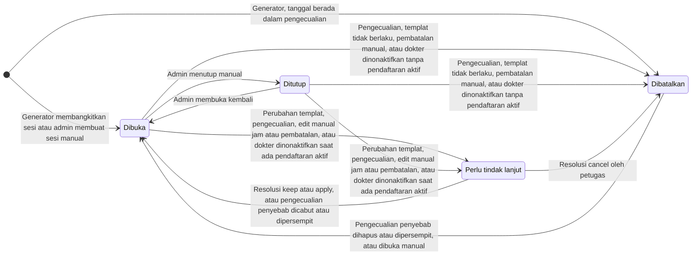

### 9.2 Pemicu dan efek

| Dari → Ke | Pemicu | Pelaku / izin | Syarat | Efek tambahan |
|---|---|---|---|---|
| (baru) → `open` | `PracticeSessionGenerator` (pemicu a/b/c) atau `admin.sessions.store` | Sistem / Admin Konten (`schedules.manage`) | Tanggal ≥ hari ini; di luar pengecualian | `doctor_schedule_id` terisi (hasil templat) atau NULL (sesi manual). |
| (baru) → `cancelled` | Generator membuat sesi pada tanggal dalam `schedule_exceptions` | Sistem | Pengecualian berlaku untuk dokter itu atau seluruh RS | `schedule_exception_id` dan `status_reason` terisi; publik menampilkan "Cuti"/"Libur". |
| `open` → `closed` | `admin.sessions.status` | Admin Konten (`schedules.manage`) | `session_date >= hari ini` | `status_reason` opsional; booking baru ditutup, booking lama berlaku. |
| `closed` → `open` | `admin.sessions.status` | Admin Konten | Sesi belum lewat; tidak sedang tercakup pengecualian | `status_reason` dikosongkan. |
| `open`/`closed` → `needs_review` | Perubahan jam/hari/penonaktifan/penyempitan rentang templat; penambahan pengecualian; pembatalan atau pergeseran jam manual (Alur 11.D); dokter dinonaktifkan (Alur 11.E) | Sistem melalui `ScheduleChangeService` (dipicu Admin Konten) | Sesi memiliki ≥ 1 appointment aktif | `pending_change` JSON diisi; sesi tertutup untuk booking baru. |
| `open`/`closed` → `cancelled` | Pengecualian ditambah; templat tidak lagi valid; admin membatalkan sesi; dokter dinonaktifkan atau diarsipkan | Sistem / Admin Konten | **Tidak ada** appointment aktif | `schedule_exception_id` (bila pengecualian) dan `status_reason` terisi. |
| `needs_review` → `open` | Resolusi `keep` atau `apply`; atau pengecualian penyebabnya dihapus/dipersempit | Petugas (`sessions.review`) / sistem | Resolusi sesuai sumber (Alur 11.C) | `keep`: nilai lama dipertahankan + `is_manually_modified = true`; `apply`: jam diperbarui + `schedule_changed_at` pada appointment aktif + notifikasi; `reviewed_by`, `reviewed_at` diisi; `pending_change = NULL`. |
| `needs_review` → `cancelled` | Resolusi `cancel` | Petugas (`sessions.review`) | Alasan wajib | Seluruh appointment aktif menjadi `cancelled` (`cancelled_by_type = staff`), kuota dilepas, notifikasi dikirim. |
| `cancelled` → `open` | Pengecualian penyebab dihapus/dipersempit; atau admin membuka sesi yang dibatalkan manual | Sistem / Admin Konten | Sesi belum lewat; tidak tercakup pengecualian lain | `schedule_exception_id`, `status_reason` dikosongkan. |

Sesi yang tanggalnya sudah lewat **tidak pernah** diubah statusnya oleh perubahan jadwal; statusnya dibiarkan sebagai arsip.

### 9.3 Turunan `Availability` (tidak disimpan di DB)

`DoctorAvailabilityQuery` menentukan label dengan urutan evaluasi berikut; kondisi pertama yang terpenuhi menang (00 F.3; 17 D-05):

| Urutan | Kondisi | `Availability` | `is_bookable_online` |
|---|---|---|---|
| 1 | `session_date < hari ini` atau `now >= end_time` | `past` | tidak |
| 2 | `status = cancelled` dan pengecualiannya `doctor_leave` | `leave` | tidak |
| 3 | `status = cancelled` dan pengecualiannya `hospital_holiday`/`national_holiday` | `holiday` | tidak |
| 4 | `status = cancelled` (sebab lain atau `other`) | `cancelled` | tidak |
| 5 | `status = needs_review` | `under_review` | tidak |
| 6 | `status = closed` | `closed` | tidak |
| 7 | `quota - booked_count = 0` | `full` | tidak |
| 8 | `now >= start − booking.online_cutoff_minutes` | `booking_closed` | tidak |
| 9 | selain itu | `available` | **ya** bila status `open`, dokter `active`, poliklinik `is_active` dan `is_bookable`, `session_date` dalam jendela, `now < start − booking.online_cutoff_minutes`, dan `remaining > 0` |

Kanal loket memakai flag terpisah `is_bookable_counter` (00 F.3; 17 D-06): syaratnya sama dengan `is_bookable_online` kecuali batas waktu menjadi `now < end_time` pada `session_date`, sehingga sesi berlabel `booking_closed` tetap dapat didaftarkan petugas selama urutan 2–7 tidak terpenuhi. Label dan kedua flag dihitung oleh satu query dan dipakai bersama halaman publik, wizard, dan form walk-in.

### 9.4 Langkah penerapan dan penolakan

1. Perubahan status sesi berlangsung di dalam transaksi (baris `practice_sessions` dikunci; bila menyentuh appointment, profil pasien terkait dikunci lebih dahulu sesuai urutan baku 0.3).
2. Admin Konten hanya dapat mengubah status sesi secara manual lewat `PATCH admin.sessions.status` (di bawah `/admin/jadwal/sesi`) untuk `open` ↔ `closed` dan pembatalan sesi **tanpa** appointment aktif. Status `needs_review` tidak pernah dapat dipilih manual; ia hanya dihasilkan `ScheduleChangeService` (Alur 11) dan hanya diselesaikan petugas dengan `sessions.review`.
3. `BookingService::book()` membaca status sesi di bawah kunci; sesi yang berubah menjadi `closed`, `needs_review`, atau `cancelled` sesaat sebelum pasien menekan Konfirmasi menghasilkan `SESSION_UNAVAILABLE` ([06 §3.F](#3f-cabang-galat-bookingexception-00-f5)).
4. Setiap perubahan dicatat di `audit_logs` (`session.status_changed`, `session.updated`, `session.resolved`).

| Percobaan | Kode / jenis | Pesan Indonesia |
|---|---|---|
| Mengubah status sesi yang tanggalnya sudah lewat | `SESSION_PAST` | "Sesi yang sudah lewat tidak dapat diubah." |
| Membuka kembali sesi yang tercakup pengecualian | validasi | "Sesi ini berada dalam pengecualian jadwal ({alasan}). Hapus atau ubah pengecualian terlebih dahulu." |
| Membatalkan sesi yang memiliki appointment aktif lewat `admin.sessions.status` | dialihkan ke tinjauan | "Sesi memiliki {N} pendaftaran aktif. Perubahan dikirim ke layar Sesi terdampak untuk diselesaikan petugas pendaftaran." |
| Memilih status `needs_review` secara manual | validasi | "Status sesi tidak valid." |
| Membatalkan sesi tanpa mengisi alasan | validasi | "Alasan pembatalan sesi wajib diisi." |
| Memesan sesi yang baru saja ditutup/dibatalkan | `SESSION_UNAVAILABLE` | "Sesi praktik ini tidak tersedia untuk pendaftaran. Silakan pilih sesi lain." |

**Keterlibatan:** tabel `practice_sessions`, `schedule_exceptions`, `doctor_schedules`; service `DoctorAvailabilityQuery`, `ScheduleChangeService`, `PracticeSessionGenerator`; route `admin.sessions.*`; Form Request `UpdateSessionStatusRequest`, `ResolveSessionRequest`; izin `schedules.manage`, `sessions.review`.

---

## 10. Pembangkitan Sesi (`PracticeSessionGenerator`)

Sesi konkret per tanggal (`practice_sessions`) dibangkitkan dari templat mingguan (`doctor_schedules`) dan pengecualian (`schedule_exceptions`). Pembangkit bersifat **idempoten**: dapat dijalankan berulang atau bersamaan tanpa membuat sesi ganda, karena memakai `insertOrIgnore` pada UNIQUE (`doctor_schedule_id`, `session_date`).

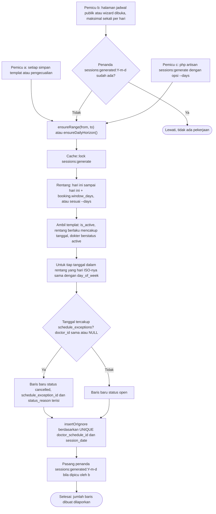

**Langkah**

1. **Pemicu** (00 F.2): (a) setiap kali templat atau pengecualian disimpan (bagian dari transaksi Alur 11); (b) maksimal **sekali per hari** saat halaman jadwal publik (`schedules.index`, `doctors.index` dengan filter tanggal, `doctors.show`) atau wizard (`patient.appointments.create`) dibuka — dijaga penanda cache `sessions:generated:{Y-m-d}` (tanggal zona Asia/Jakarta) dan `Cache::lock`; (c) manual `php artisan sessions:generate {--days=}`. Instalasi baru dan `DemoSeeder` memanggil pemicu (c).
2. **Penguncian.** Pemicu (b) mencoba `Cache::lock('sessions:generate', 30)` **tanpa menunggu**: bila kunci dipegang proses lain, permintaan langsung melanjutkan render (proses lain sedang membangkitkan). Pemicu (a) dan (c) menunggu hingga 10 detik. Kunci kedaluwarsa otomatis setelah 30 detik sehingga tidak dapat macet.
3. **Rentang.** `from = hari ini`, `to = hari ini + booking.window_days` (atau `--days`), keduanya inklusif. Tanggal sebelum hari ini tidak pernah dibangkitkan.
4. **Templat yang dipakai.** `is_active = true`, `valid_from <= tanggal` dan (`valid_until` NULL atau `>= tanggal`), `day_of_week` sama dengan hari ISO tanggal itu (1 = Senin … 7 = Minggu), dokter berstatus `active` (dokter `inactive` dan `archived` dilewati agar tidak lahir sesi baru yang tidak dapat dipesan; selaras 00 F.4 dan 11). Sesi mendatang milik dokter yang dinonaktifkan ditangani `ScheduleChangeService::applyDoctorInactive()` (Alur 11.E); mengaktifkan kembali dokter tidak membuka otomatis sesi yang sudah `cancelled`.
5. **Isi baris baru.** `doctor_id`, `clinic_id`, `doctor_schedule_id`, `session_date`, `start_time`, `end_time`, `quota` disalin dari templat; `booked_count = 0`, `last_queue_number = 0`, `is_manually_modified = false`.
6. **Pengecualian.** Bila tanggal tercakup `schedule_exceptions` dengan `doctor_id` = dokter templat **atau** `doctor_id` NULL (seluruh RS), baris dibuat `status = cancelled` dengan `schedule_exception_id` dan `status_reason` (alasan pengecualian). Bila beberapa pengecualian mencakup tanggal yang sama, dipilih pengecualian khusus dokter terlebih dahulu, lalu `id` terkecil **[ASUMSI]**. Publik menampilkan label "Cuti"/"Libur".
7. **Idempoten.** `insertOrIgnore` melewati pasangan (templat, tanggal) yang sudah ada — termasuk sesi yang sudah `closed`, `needs_review`, `cancelled`, atau dimodifikasi manual. Generator **tidak pernah** memperbarui sesi yang sudah ada; perubahan terhadap sesi yang ada dilakukan oleh `ScheduleChangeService` (Alur 11).
8. **Sesi tambahan manual** (`doctor_schedule_id` NULL) tidak dihasilkan maupun dihapus oleh generator.
9. Pada permintaan pertama setiap hari, jendela bergeser satu hari sehingga tanggal `hari ini + window_days` baru terbentuk. Bila tidak ada yang membuka halaman selama beberapa hari, pemicu berikutnya mengisi seluruh jendela sekaligus (idempoten).

**Kasus tepi dan galat**

| Kondisi | Perilaku | Pesan / keluaran |
|---|---|---|
| `valid_from` di masa depan | Sesi baru hanya dibuat mulai `valid_from` | — |
| Pengecualian menutup sebagian rentang | Hanya tanggal yang tercakup menjadi `cancelled` | — |
| Pemicu (b) tidak mendapat kunci | Lewati, halaman tetap dirender dari sesi yang ada | — |
| Pemicu (a)/(c) tidak mendapat kunci dalam 10 detik | Simpan templat tetap berhasil; sesi dibangkitkan oleh pemicu berikutnya | Admin: "Jadwal tersimpan. Sesi akan dibangkitkan pada permintaan berikutnya." |
| Galat DB di tengah proses | `insertOrIgnore` per templat dalam transaksi; templat lain tidak terpengaruh; galat dicatat ke log | Perintah: "Pembangkitan sesi gagal untuk jadwal #{id}: lihat storage/logs." |
| Perintah dijalankan dua kali | Tidak ada baris tambahan | "Sesi baru dibuat: 0." |

**Keterlibatan:** service `PracticeSessionGenerator` (`ensureRange`, `ensureDailyHorizon`), `SettingsService` (`booking.window_days`); perintah `sessions:generate {--days=}`; tabel `doctor_schedules`, `schedule_exceptions`, `practice_sessions`, `doctors`; cache `sessions:generated:{Y-m-d}` dan kunci `sessions:generate`; route yang memicu: `schedules.index`, `doctors.index`, `doctors.show`, `patient.appointments.create`, `admin.schedules.store/update`, `admin.exceptions.store/update/destroy`.

---

## 11. Perubahan Templat, Pengecualian, Resolusi Sesi, dan Notifikasi

Pembagian peran: **Admin Konten** (`schedules.manage`) mengubah jadwal tanpa melihat data pasien; **Petugas Pendaftaran** (`sessions.review`) menyelesaikan sesi terdampak karena hanya mereka yang berhak melihat dan menghubungi pasien. Super Admin dapat keduanya. Seluruh perubahan dijalankan oleh `ScheduleChangeService` di dalam transaksi bersama penyimpanan templat/pengecualian.

| Tahap | Pelaku | Layar / route | Data pasien terlihat? |
|---|---|---|---|
| Mengubah templat, menambah/mengubah/menghapus pengecualian, mengedit sesi | Admin Konten | `admin.schedules.*`, `admin.exceptions.*`, `admin.sessions.*` | Tidak; hanya **jumlah** booking per sesi dan pesan "N sesi perlu ditindaklanjuti petugas pendaftaran". |
| Menyelesaikan sesi `needs_review` (keep/apply/cancel) | Petugas Pendaftaran | `admin.sessions.review`, `admin.sessions.resolve` | Ya (nama, nomor pasien, kode booking, telepon). |
| Menerima pemberitahuan | Pasien berakun | Notifikasi kanal `database` dan `mail` (perubahan jadwal dan pembatalan termasuk yang dikirim lewat mail, K-13); walk-in dihubungi petugas lewat telepon | — |

### 11.A Mengubah templat jadwal

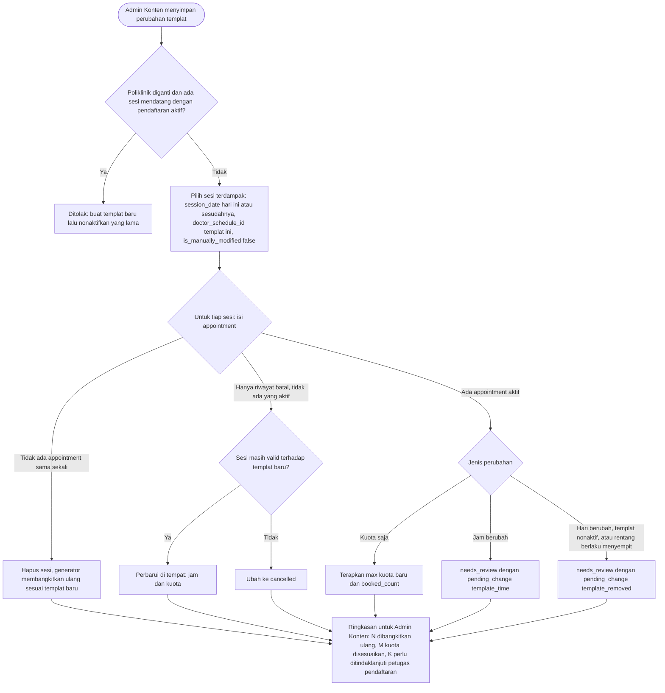

**Langkah**

1. Admin Konten membuka `admin.schedules.edit`, mengubah jam, hari, kuota, rentang berlaku, status aktif, atau poliklinik, lalu menyimpan (`admin.schedules.update`, `DoctorScheduleRequest`).
2. Validasi: `end_time > start_time`, kuota 1–200, `valid_until >= valid_from`, dan **tidak beririsan** dengan templat aktif lain milik dokter yang sama pada hari yang sama dalam rentang berlaku yang beririsan (aturan di 12).
3. Dalam satu transaksi, templat disimpan lalu `ScheduleChangeService` memproses sesi dengan `doctor_schedule_id` templat itu, `session_date >= hari ini`, dan `is_manually_modified = false` (sesi yang sudah diedit manual tidak disentuh):
   - **Tanpa appointment sama sekali** → sesi dihapus; `PracticeSessionGenerator::ensureRange` membangkitkan ulang sesuai templat baru (jam/hari baru terbentuk otomatis).
   - **Tanpa appointment aktif** (hanya riwayat batal) → sesi diperbarui di tempat (karena baris masih dirujuk riwayat appointment dan FK `RESTRICT`), atau `cancelled` bila tidak lagi valid (templat nonaktif/di luar rentang/hari berbeda).
   - **Dengan appointment aktif**:
     - **kuota saja** → `quota = max(kuota_baru, booked_count)`; pesan ke admin: "{N} sesi disesuaikan; kuota tidak diturunkan di bawah jumlah pendaftaran yang ada."
     - **jam berubah** → `needs_review`, `pending_change = {"source":"template_time","schedule_id":3,"new_start_time":"09:00","new_end_time":"12:00"}`.
     - **hari berubah, templat dinonaktifkan, atau rentang berlaku menyempit** → `needs_review`, `pending_change = {"source":"template_removed","schedule_id":3}`.
     - Bila kuota dan jam berubah bersamaan, bagian kuota diterapkan segera dan bagian jam menunggu tinjauan.
   - **Mengganti poliklinik** ditolak bila ada sesi mendatang dengan appointment aktif; admin diminta membuat templat baru lalu menonaktifkan yang lama.
4. Setelah commit, Admin Konten melihat ringkasan, misalnya: "Jadwal tersimpan. 4 sesi dibangkitkan ulang, 1 sesi kuotanya disesuaikan, 2 sesi perlu ditindaklanjuti petugas pendaftaran."
5. Audit `schedule.updated` (nilai lama/baru templat + jumlah sesi per jenis dampak, **tanpa** data pasien).

### 11.B Menambah dan menghapus pengecualian (cuti/libur)

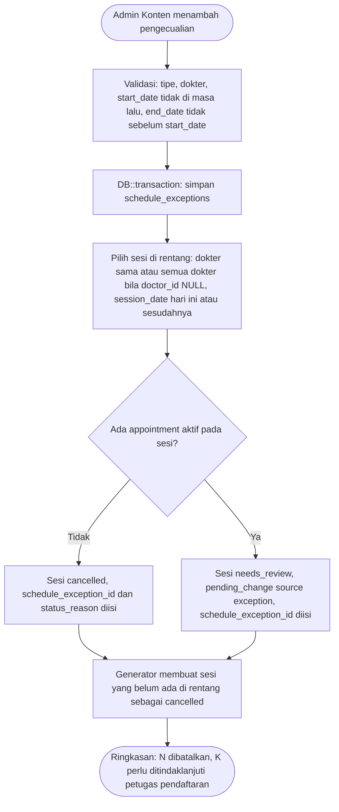

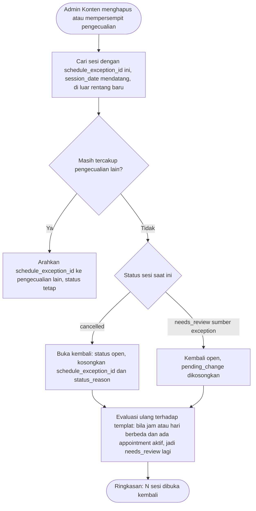

**Langkah**

1. Admin Konten membuka `admin.exceptions.create`: jenis (`doctor_leave` Cuti dokter, `hospital_holiday` Libur rumah sakit, `national_holiday` Libur nasional, `other` Lainnya), dokter (kosong = seluruh dokter/RS), `start_date`, `end_date`, alasan. Granularitas **satu hari penuh** **[ASUMSI]**; untuk perubahan sebagian hari, sesi diedit langsung (11.D).
2. Validasi: `start_date` tidak boleh di masa lalu (hari ini diperbolehkan), `end_date >= start_date`, `doctor_leave` wajib memilih dokter, `hospital_holiday` dan `national_holiday` tidak boleh memilih dokter (berlaku seluruh RS), `other` boleh dengan atau tanpa dokter (00 E.2).
3. Dalam satu transaksi: simpan pengecualian lalu terapkan ke semua sesi dengan `session_date` dalam rentang, `session_date >= hari ini`, dan dokter sesuai (atau semua dokter bila `doctor_id` NULL). Pengecualian berlaku **terlepas dari `is_manually_modified`** karena ketidakhadiran dokter/libur mengalahkan penyesuaian manual **[ASUMSI]**. Sesi `open`/`closed` tanpa appointment aktif → `cancelled`; dengan appointment aktif → `needs_review` dengan `pending_change = {"source":"exception","exception_id":12}`. Bila sesi sudah `needs_review`, berlaku aturan prioritas `pending_change` (Alur 11.F): sumber `exception` (jenis-batal) mengalahkan sumber jenis-jam (`template_time`, `manual_time`); terhadap sumber jenis-batal lain yang terbaru menggantikan yang lama.
4. `PracticeSessionGenerator::ensureRange` membuat sesi yang belum ada pada rentang itu sebagai `cancelled`.
5. **Mengubah pengecualian** diperlakukan sebagai penghapusan rentang lama lalu penambahan rentang baru dalam satu transaksi. `start_date` yang sudah di masa lalu pada pengecualian yang sedang berjalan tidak boleh dipindah ke tanggal masa lalu lain, tetapi `end_date` dan alasan boleh diubah.
6. **Menghapus/mempersempit**: sesi yang dibatalkan olehnya, belum lewat, dan di luar rentang baru dibuka kembali (`open`); bila tanggal itu masih tercakup pengecualian lain, `schedule_exception_id` diarahkan ke pengecualian tersebut. Sesi `needs_review` sumber `exception` itu kembali `open`. Keduanya kemudian dievaluasi ulang terhadap templat (aturan 11.A) sehingga bila templat sudah berubah selagi pengecualian berlaku, sesi menjadi `needs_review` lagi bila ada appointment aktif. Sesi `needs_review` yang pengecualiannya dicabut atau dipersempit sebelum diselesaikan kembali `open` dengan `pending_change` dan `schedule_exception_id` dikosongkan (00 F.4); bila dokter masih nonaktif, evaluasi ulang menjadikannya `needs_review` sumber `doctor_inactive` (Alur 11.E).
7. Audit `exception.created` / `exception.updated` / `exception.deleted` dengan jumlah sesi per dampak.

### 11.C Menyelesaikan sesi terdampak (`needs_review`)

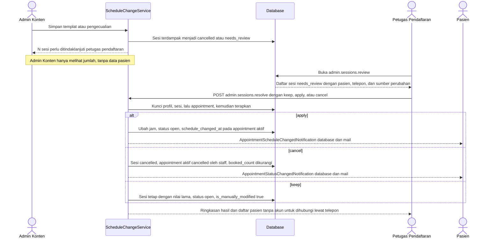

**Layar `admin.sessions.review`** (`GET /admin/jadwal/sesi-terdampak`, izin `sessions.review`): satu kartu per sesi `needs_review` dengan tanggal, dokter, poliklinik, jam lama (dan jam baru bila `template_time`/`manual_time`), sumber perubahan ("Cuti dokter: {alasan}", "Jam jadwal berubah", "Jadwal dihapus, dinonaktifkan, atau berubah hari", "Jam sesi digeser manual", "Sesi dibatalkan manual", "Dokter dinonaktifkan"), jumlah appointment aktif, dan tabel pasien (nama, nomor pasien, kode booking, telepon, tanda "akun online"/"walk-in"). Sesi yang tanggalnya sudah lewat tampil terpisah ("Sudah lewat") dan hanya menawarkan `keep` **[ASUMSI]**. Badge jumlah sesi tertunda muncul di menu dan dashboard bagi pemegang `sessions.review`.

**Pilihan per sumber** (`SessionResolution`):

| `pending_change.source` | Pilihan | `keep` | `apply` | `cancel` |
|---|---|---|---|---|
| `exception` | keep, cancel | Sesi tetap berjalan: `status = open`, nilai lama, `is_manually_modified = true`, `schedule_exception_id = NULL` | tidak tersedia | Sesi `cancelled`; semua appointment aktif dibatalkan |
| `template_time` | keep, apply, cancel | Jam lama dipertahankan, `open`, `is_manually_modified = true` | Jam diperbarui ke `new_start_time`/`new_end_time`, `open`; appointment aktif diberi `schedule_changed_at = now()` + notifikasi | Seperti di atas |
| `template_removed` | keep, cancel | Sesi tetap dengan nilai lama, `open`, `is_manually_modified = true` | tidak tersedia | Seperti di atas |
| `manual_time` | keep, apply, cancel | Jam semula dipertahankan (pergeseran dibatalkan) | Jam baru berlaku + notifikasi | Seperti di atas |
| `manual_cancel` | keep, cancel | Sesi tetap berjalan | tidak tersedia | Seperti di atas |
| `doctor_inactive` | keep, cancel (`keep` hanya bila dokter sudah `active` kembali; selain itu wajib `cancel`) | Sesi tetap berjalan dengan nilai lama, `open`, `is_manually_modified = true` | tidak tersedia | Seperti di atas; alasan wajib dan dikirim kepada pasien |

**Langkah resolusi**

1. Petugas memilih resolusi pada sebuah kartu. Untuk `apply`, layar memperlihatkan **peringatan** bila jam baru berbenturan dengan pendaftaran aktif lain milik pasien yang sama pada tanggal itu (nama pasien dan jam yang bertabrakan); `apply` tetap diizinkan dan petugas dapat menghubungi pasien. Untuk `cancel`, **alasan wajib** (dikirim kepada pasien).
2. `POST /admin/jadwal/sesi-terdampak/{session}` (`admin.sessions.resolve`) → `ResolveSessionRequest` → `ScheduleChangeService::resolve($session, SessionResolution, Actor, ?string $reason)`.
3. Dalam transaksi dengan urutan kunci baku (profil pasien terkait menurut `id` menaik → sesi → appointment aktif menurut `id` menaik): pastikan sesi masih `needs_review` dan pilihan sah untuk sumbernya, lalu terapkan efek pada tabel di atas. Pada `cancel`: tiap appointment aktif → `cancelled` (`cancelled_by_type = staff`, `cancelled_by_user_id = petugas`, `cancel_reason`), `booked_count` berkurang sebanyak itu, sesi `cancelled`. Pada semua pilihan: `reviewed_by = petugas`, `reviewed_at = now()`, `pending_change = NULL`.
4. Audit `session.resolved` (pilihan, sumber, jumlah dan id appointment terdampak) dan, untuk `cancel`, `appointment.status_changed` per appointment.
5. Setelah commit: **pasien berakun** menerima `AppointmentScheduleChangedNotification` (apply) atau `AppointmentStatusChangedNotification` (cancel) lewat `database` + `mail`. **Pasien walk-in tanpa akun** tidak menerima notifikasi; layar hasil menampilkan daftar mereka beserta telepon agar petugas menghubungi. Daftar tetap dapat dibuka kembali lewat `admin.appointments.index` dengan filter "Jadwal berubah" (`schedule_changed_at` terisi) atau filter tanggal + status `cancelled`. Tidak ada pelacakan "sudah dihubungi" per pasien (default K-15 di 17): cukup daftar + telepon pada layar hasil.
6. Untuk `cancel`, tersedia tautan "Buat pendaftaran pengganti" yang membuka `admin.appointments.create` dengan pasien terpilih (walk-in/loket).
7. Pesan sukses: "Sesi diselesaikan: {N} pendaftaran dibatalkan dan {M} pasien perlu dihubungi lewat telepon." atau "Jadwal diperbarui dan {N} pasien diberi tahu."

**Isi notifikasi** (tanpa BPJS/polis/keluhan): kode booking, poliklinik, dokter, jadwal lama → baru atau status baru, alasan (bila dibatalkan), tautan ke `patient.appointments.show`, dan "Jika jadwal baru tidak sesuai, batalkan di portal (sebelum batas) atau hubungi rumah sakit."

### 11.D Perubahan manual pada sesi yang sudah memiliki pendaftaran

Edit sesi satu tanggal (`admin.sessions.edit` → `admin.sessions.update`, status lewat `admin.sessions.status`) selalu menyetel `is_manually_modified = true`. Aturan berikut mengikuti 00 F.4 (17 D-03):

| Perubahan manual | Sesi tanpa appointment aktif | Sesi dengan appointment aktif |
|---|---|---|
| Kuota | Diterapkan langsung; tidak boleh `< booked_count` | Sama |
| Tutup (`closed`) / buka kembali | Langsung | Langsung (booking lama tetap berlaku; booking baru tertutup) |
| Geser jam | Langsung | `needs_review` + `pending_change = {"source":"manual_time","new_start_time":"..","new_end_time":".."}`; jam lama tetap berlaku sampai petugas memilih `apply`/`keep`/`cancel` |
| Batalkan sesi | Langsung `cancelled` | `needs_review` + `pending_change = {"source":"manual_cancel","reason":"…"}` (alasan pembatalan wajib; petugas memilih `keep` atau `cancel`) |
| Sesi tanggal lampau | Tidak dapat diubah | Tidak dapat diubah |

### 11.E Dokter dinonaktifkan atau diarsipkan

Keputusan 00 F.4 (17 D-01, D-02): menonaktifkan dokter **tidak** ditolak karena booking aktif; sesinya ditangani lewat `ScheduleChangeService::applyDoctorInactive()`. Mengarsipkan dokter hanya diizinkan bila tidak ada appointment aktif pada sesi mendatang.

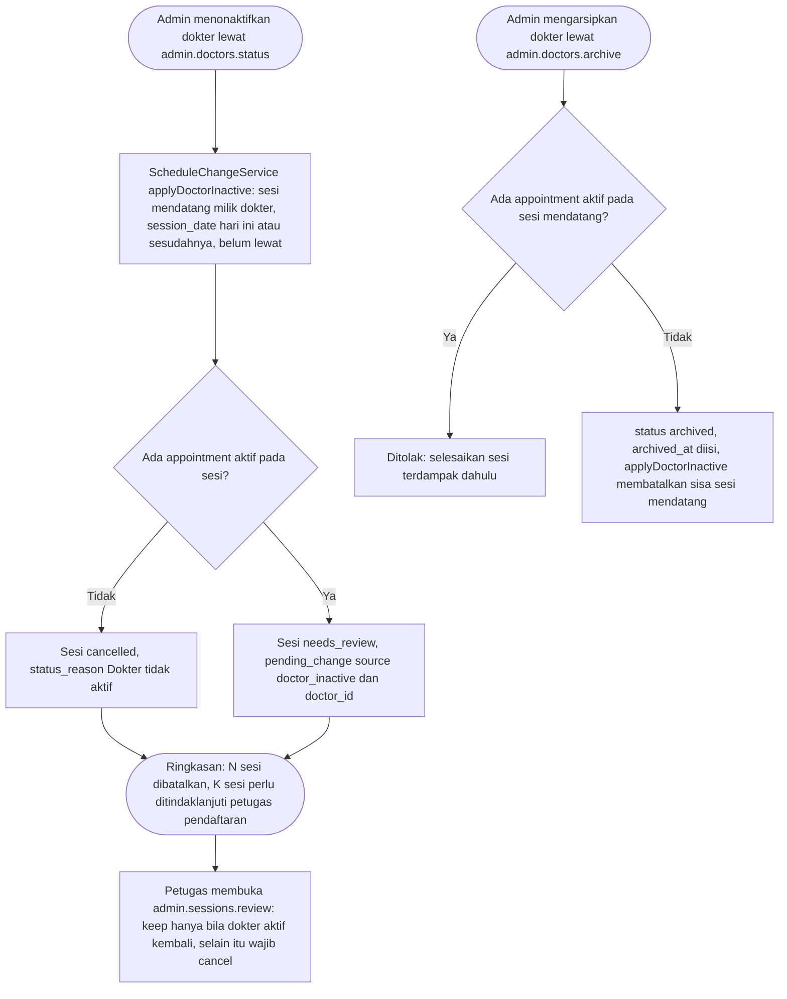

**Langkah**

1. `PATCH /admin/dokter/{doctor}/status` (`doctors.manage`) ke `inactive`: dokter tidak lagi tampil di publik dan tidak dapat dipesan; `ScheduleChangeService::applyDoctorInactive()` memproses sesi mendatang (`session_date >= hari ini`, belum lewat). Tanpa appointment aktif → `cancelled` (`status_reason` "Dokter tidak aktif"); dengan appointment aktif → `needs_review` dengan `pending_change = {"source":"doctor_inactive","doctor_id":7}`.
2. Pelaku (mis. Admin Konten) hanya melihat ringkasan "N sesi perlu ditindaklanjuti petugas pendaftaran" tanpa data pasien. Petugas pendaftaran menyelesaikannya di `admin.sessions.review` (Alur 11.C): `keep` hanya bila dokter sudah `active` kembali, selain itu `cancel` dengan alasan wajib.
3. `PracticeSessionGenerator` tidak membangkitkan sesi baru untuk dokter yang tidak `active` (Alur 10). Mengaktifkan kembali dokter tidak membuka otomatis sesi yang sudah `cancelled`; sesi tersebut dapat dibuka manual lewat `admin.sessions.status` bila belum lewat.
4. `PATCH /admin/dokter/{doctor}/arsip`: ditolak bila ada appointment aktif mendatang (Form Request; pesan "selesaikan sesi terdampak dahulu"). Bila lolos: `status = archived`, `archived_at = now()`, sisa sesi mendatang tanpa appointment aktif dibatalkan lewat `applyDoctorInactive()`. Dokter arsip tidak tampil di publik dan tidak dapat diberi templat jadwal. Dokter tidak pernah dihapus permanen.
5. Audit: `doctor.status_changed` / `doctor.archived`, ditambah `session.resolved` saat petugas menyelesaikan sesi.

### 11.F Satu sesi, satu `pending_change`: aturan prioritas

Sebuah sesi hanya menyimpan satu `pending_change` (00 F.4). Sumber dikelompokkan menjadi dua tingkat:

| Tingkat | Sumber |
|---|---|
| Jenis-batal (lebih kuat) | `exception`, `template_removed`, `manual_cancel`, `doctor_inactive` |
| Jenis-jam | `template_time`, `manual_time` |

1. Bila sumber baru datang saat sesi masih `needs_review`: sumber jenis-batal mengalahkan sumber jenis-jam (sumber jam baru **tidak** menggantikan sumber batal yang sudah ada; sumber batal baru menggantikan sumber jam yang ada).
2. Pada tingkat yang sama, sumber terbaru menggantikan yang lama.
3. Setiap penggantian dicatat di audit log (nilai lama dan baru `pending_change`).
4. Bila pengecualian dicabut atau dipersempit sementara sesi terkait masih `needs_review` (belum diselesaikan), sesi kembali `open` dan `pending_change` serta `schedule_exception_id` dikosongkan, bila sesi belum lewat (00 F.4; 17 D-04).

**Cabang galat (Alur 11 secara keseluruhan)**

| Kondisi | Kode | Pesan Indonesia |
|---|---|---|
| Templat beririsan dengan templat aktif lain dokter itu | validasi | "Jadwal bertabrakan dengan jadwal aktif lain milik dokter ini pada hari yang sama ({hari} {jam}, berlaku {rentang})." |
| Ganti poliklinik saat ada sesi mendatang berpendaftaran aktif | `CLINIC_CHANGE_BLOCKED` | "Poliklinik tidak dapat diganti karena masih ada sesi mendatang dengan pendaftaran aktif. Buat jadwal baru, lalu nonaktifkan jadwal lama." |
| Kuota sesi diturunkan di bawah `booked_count` | `QUOTA_BELOW_BOOKED` | "Kuota tidak boleh kurang dari jumlah pendaftaran yang sudah ada ({booked})." |
| Mengubah sesi yang tanggalnya sudah lewat | `SESSION_PAST` | "Sesi yang sudah lewat tidak dapat diubah." |
| Pengecualian dengan `start_date` masa lalu | validasi | "Tanggal mulai tidak boleh di masa lalu." |
| `end_date` sebelum `start_date` | validasi | "Tanggal selesai tidak boleh sebelum tanggal mulai." |
| Resolusi pada sesi yang sudah diselesaikan petugas lain | `SESSION_ALREADY_RESOLVED` | "Sesi ini sudah diselesaikan oleh petugas lain. Muat ulang halaman." |
| Pilihan tidak tersedia untuk sumber perubahan | `RESOLUTION_NOT_ALLOWED` | "Pilihan penyelesaian tidak tersedia untuk jenis perubahan ini." |
| `cancel` tanpa alasan | validasi | "Alasan pembatalan wajib diisi dan akan dikirim kepada pasien." |
| Admin Konten mencoba menyelesaikan sesi | 403 | "Anda tidak memiliki izin untuk mengakses halaman ini." |
| Admin Konten melihat sesi berpendaftaran | — | Hanya "{N} pendaftaran aktif"; tanpa nama pasien. |
| Mengarsipkan dokter yang masih punya appointment aktif mendatang | validasi (`UpdateDoctorStatusRequest`) | "Dokter masih memiliki {N} pendaftaran aktif pada sesi mendatang. Selesaikan sesi terdampak terlebih dahulu, lalu arsipkan." |
| `keep` pada sumber `doctor_inactive` sementara dokter belum aktif kembali | `RESOLUTION_NOT_ALLOWED` | "Sesi ini hanya dapat dipertahankan bila dokter diaktifkan kembali. Aktifkan dokter atau batalkan sesi." |
| `doctor_leave` tanpa dokter, atau libur RS/nasional dengan dokter | validasi | "Cuti dokter wajib memilih dokter." / "Libur rumah sakit dan libur nasional berlaku untuk seluruh dokter; kosongkan pilihan dokter." |

**Keterlibatan**

- Route: `admin.schedules.*`, `admin.exceptions.*`, `admin.sessions.index/create/store/edit/update/status`, `admin.sessions.review`, `admin.sessions.resolve`, `admin.doctors.status`, `admin.doctors.archive`, `admin.appointments.index`, `admin.appointments.create`.
- Form Request: `DoctorScheduleRequest`, `ScheduleExceptionRequest`, `PracticeSessionRequest`, `UpdateSessionStatusRequest`, `ResolveSessionRequest`.
- Service: `ScheduleChangeService`, `PracticeSessionGenerator`, `AppointmentStatusService`, `AuditLogger`; Policy: `DoctorSchedulePolicy`, `ScheduleExceptionPolicy`, `PracticeSessionPolicy`.
- Tabel: `doctor_schedules`, `schedule_exceptions`, `practice_sessions`, `appointments`, `appointment_status_histories`, `audit_logs`, `notifications`.
- Izin: `schedules.view`, `schedules.manage`, `doctors.manage`, `sessions.review`, `appointments.view`.
- Notifikasi: `AppointmentScheduleChangedNotification`, `AppointmentStatusChangedNotification`.

---

## 12. Admin Konten: CRUD Dokter dan Foto sampai Tampil di Website Publik

Alur dokter dipakai sebagai contoh; pola yang sama berlaku untuk spesialisasi, poliklinik, fasilitas, kategori kamar, halaman, banner, artikel, kategori artikel, galeri, FAQ, dan mitra asuransi (tabel pola di akhir bagian ini).

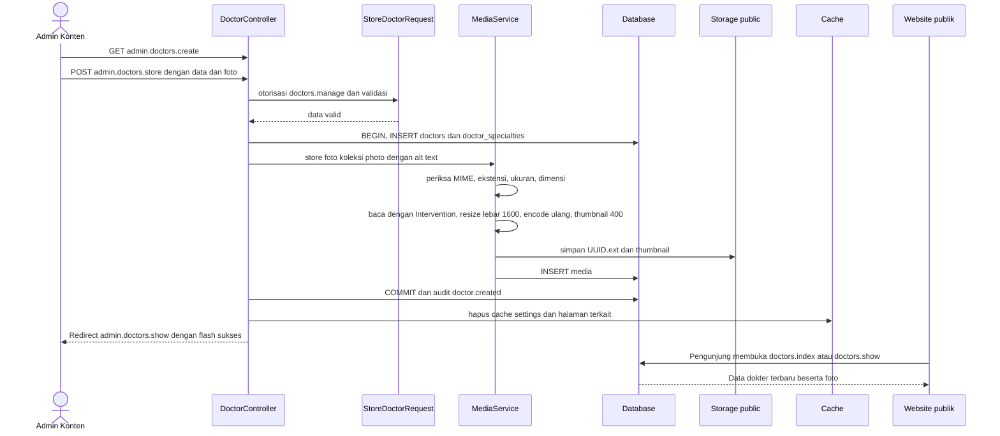

**Langkah — membuat dokter**

1. `GET /admin/dokter/create` (`admin.doctors.create`, izin `doctors.manage`): form nama (tanpa gelar), awalan gelar (mis. `dr.`), akhiran gelar (mis. `Sp.U`), jenis kelamin, poliklinik utama, spesialisasi (≥ 1, satu ditandai utama), profil singkat (maks. 500), profil lengkap (teks biasa), urutan, meta title/description, foto + teks alternatif.
2. `POST /admin/dokter` (`admin.doctors.store`) → `StoreDoctorRequest` (`authorize()` memeriksa izin; aturan di 12 §V-19). `slug` dibuat dari nama (`Str::slug`, sufiks `-2`, `-3` bila bentrok) dan **tidak berubah** saat nama diedit **[ASUMSI]**. Nama tampilan: `"{title_prefix} {name}, {title_suffix}"`; bagian kosong dibuang.
3. Transaksi: `INSERT doctors` (`status = active`), `INSERT doctor_specialties` (`is_primary` untuk satu spesialisasi). Foto diproses `MediaService::store` (00 K): validasi MIME/ekstensi/ukuran/dimensi (maksimal 6000×6000; minimum per koleksi: `photo` 300×300, `cover` 800×450, `gallery`/`photos` 600×400, `image` 1200×400, `logo` 120×40, `editor` 200×100), SVG ditolak, baca dengan Intervention (GD), resize lebar maks 1600 px, encode ulang (membuang EXIF dan muatan tersembunyi), simpan sebagai `storage/app/public/photo/{YYYY}/{MM}/{uuid}.{ext}` + thumbnail 400 px, `INSERT media` (`collection = photo`, `alt_text`, `mime_type`, `size_bytes`, `width`, `height`, `thumb_path`, `uploaded_by`).
4. Audit `doctor.created`. Redirect ke `admin.doctors.show` dengan flash "Dokter berhasil ditambahkan."
5. **Efek ke publik:** dokter `active` langsung tampil di `doctors.index` (filter nama/spesialisasi/poliklinik/tanggal) dan `doctors.show`. Data dokter **tidak** di-cache; yang di-cache hanya `website_settings` (`settings:all`) dan isi `pages` (`pages:{key}`), dan keduanya dibersihkan otomatis saat disimpan sehingga perubahan muncul seketika **[ASUMSI]**. Dokter tanpa foto memakai `public/images/placeholders/doctor.svg`; bila file fisik hilang, `x-image` beralih ke placeholder lewat satu listener JavaScript terdelegasi di `resources/js/app.js` (kompatibel CSP; bukan `onerror` inline, 00 K).

**Langkah — mengubah, mengganti foto, menonaktifkan, mengarsipkan**

1. **Ubah data:** `GET admin.doctors.edit` → `PUT admin.doctors.update` (`UpdateDoctorRequest`); audit `doctor.updated` dengan nilai lama/baru (hanya nama bidang untuk teks panjang `bio`).
2. **Ganti foto:** `POST /admin/dokter/{doctor}/foto` (`admin.doctors.photo`, `UploadDoctorPhotoRequest`). `MediaService::replace`: simpan file baru + baris `media` baru dahulu; setelah transaksi commit (`DB::afterCommit`) hapus file dan baris lama. Bila transaksi gagal, file baru ikut dibersihkan dan foto lama tetap utuh. Audit `media.replaced`.
3. **Nonaktifkan/aktifkan:** `PATCH admin.doctors.status` mengubah `status` antara `active` dan `inactive`. Dokter nonaktif/diarsipkan tidak tampil di daftar publik, halaman detailnya menjawab 404, dan tidak dapat dipesan. Menonaktifkan **tidak** ditolak karena booking aktif: `ScheduleChangeService::applyDoctorInactive()` membatalkan sesi mendatang tanpa appointment aktif dan mengirim sesi berappointment aktif ke Sesi terdampak (sumber `doctor_inactive`), dengan flash kuning "N sesi perlu ditindaklanjuti petugas pendaftaran" (Alur 11.E; 00 F.4; 17 D-01). Audit `doctor.status_changed`.
4. **Arsipkan:** `PATCH admin.doctors.archive` hanya bila tidak ada appointment aktif pada sesi mendatang (selesaikan sesi terdampak dahulu; 17 D-02) → `status = archived`, `archived_at = now()`, lalu `applyDoctorInactive()` membatalkan sisa sesi mendatang tanpa appointment aktif. Dokter arsip tidak tampil di publik dan tidak dapat diberi templat jadwal. Dokter tidak pernah dihapus permanen (FK `RESTRICT`; tidak ada route `destroy`). Audit `doctor.archived`.
5. **Penjagaan arsip:** pengarsipan ditolak bila dokter memiliki appointment aktif pada sesi mendatang; admin menyelesaikan dulu sesi terdampak (Alur 11.C, 11.E). Untuk ketidakhadiran sementara cukup tambahkan pengecualian `doctor_leave` (Alur 11.B), bukan menonaktifkan dokter.

**Cabang galat**

| Kondisi | Perilaku | Pesan Indonesia |
|---|---|---|
| Nama kosong / terlalu pendek | Kembali ke form | "Nama dokter wajib diisi." / "Nama dokter minimal 3 karakter." |
| Spesialisasi belum dipilih | Kembali ke form | "Pilih minimal satu spesialisasi." |
| Spesialisasi utama tidak termasuk pilihan | Kembali ke form | "Spesialisasi utama harus salah satu spesialisasi yang dipilih." |
| Foto bukan JPG/PNG/WebP (termasuk SVG) | Kembali ke form | "File harus berupa gambar JPG, PNG, atau WebP." |
| Foto > 2 MB | Kembali ke form | "Ukuran gambar maksimal 2 MB." |
| Dimensi di luar 300×300 s.d. 6000×6000 piksel | Kembali ke form | "Dimensi gambar minimal 300 x 300 piksel dan maksimal 6000 x 6000 piksel." |
| Foto diunggah tanpa teks alternatif | Kembali ke form | "Teks alternatif foto wajib diisi." |
| File rusak / bukan gambar sungguhan | Kembali ke form | "File tidak dapat diproses sebagai gambar yang valid." |
| Arsip dokter yang masih punya appointment aktif mendatang | Ditolak | "Dokter masih memiliki {N} pendaftaran aktif pada sesi mendatang. Selesaikan sesi terdampak terlebih dahulu, lalu arsipkan." |
| Nonaktif dokter yang punya appointment aktif mendatang | Diizinkan; sesi terdampak dibuat; flash kuning | "Dokter dinonaktifkan. {N} sesi perlu ditindaklanjuti petugas pendaftaran." |
| Tanpa izin `doctors.manage` | 403 | "Anda tidak memiliki izin untuk mengakses halaman ini." |
| Penyimpanan file gagal (disk penuh/izin) | Rollback transaksi | "Foto gagal disimpan. Periksa izin folder penyimpanan, lalu coba lagi." |

**Pola CRUD entitas konten lain**

| Entitas | Route | Izin | Media | Cache dibersihkan | Audit |
|---|---|---|---|---|---|
| Spesialisasi, poliklinik | `admin.specialties.*`, `admin.clinics.*` | `clinics.manage` | `cover` (poliklinik) | — | `specialty.*`, `clinic.*` |
| Fasilitas | `admin.facilities.*` | `facilities.manage` | `cover`, `gallery` | — | `facility.*` |
| Kategori kamar | `admin.room-categories.*` | `facilities.manage` | `cover`, `gallery` | — | `room_category.*` |
| Halaman | `admin.pages.index/edit/update` (tidak ada create/delete) | `content.manage` | `editor` (gambar sisipan) | `pages:{key}` | `page.updated` |
| Banner | `admin.banners.*` | `content.manage` | `image` | — | `banner.*` |
| Artikel, kategori artikel | `admin.articles.*`, `admin.article-categories.*` | `content.manage` | `cover`, `editor` | — | `article.*`, `article_category.*` |
| Galeri | `admin.galleries.*`, `admin.galleries.photos.store` | `content.manage` | `photos` | — | `gallery.*` |
| FAQ, mitra asuransi | `admin.faqs.*`, `admin.insurance-partners.*` | `content.manage` | `logo` (mitra) | — | `faq.*`, `insurance_partner.*` |
| Pengaturan | `admin.settings.edit/update` | `settings.manage` | `logo` situs | `settings:all` | `settings.updated` |

Kolom rich text (`pages.body`, `articles.body`, `clinics.description`, `facilities.description`, `room_categories.description`) disanitasi `HtmlSanitizer` **saat disimpan**; hanya kolom ini yang dirender dengan `{!! !!}`. Aturan `destroy` per tabel mengikuti 00 C: `banners`, `faqs`, `galleries` (beserta fotonya), `article_categories` (artikel menjadi tanpa kategori), `facilities`, dan `media` dapat dihapus permanen (file media ikut dibersihkan); `articles` soft delete; `specialties`, `clinics`, `insurance_partners`, `room_categories`, `doctor_schedules` (tanpa sesi ber-appointment) hanya dapat dihapus bila tidak dirujuk, selain itu tombol hapus diganti "Nonaktifkan" dengan alasan; `schedule_exceptions` dihapus lewat `ScheduleChangeService::removeException`; `doctors`, `users`, `patient_profiles`, `appointments`, `pages`, `contact_messages`, `website_settings`, dan `audit_logs` tidak punya aksi hapus.

**Keterlibatan:** route `admin.doctors.*` (index, create, store, show, edit, update, status, archive, photo), `doctors.index`, `doctors.show`; form request `StoreDoctorRequest`, `UpdateDoctorRequest`, `UploadDoctorPhotoRequest`, `UpdateDoctorStatusRequest` (dipakai `admin.doctors.status` dan `.archive`); service `MediaService`, `ScheduleChangeService` (`applyDoctorInactive`), `SettingsService`, `AuditLogger`; policy `DoctorPolicy`, `MediaPolicy`; tabel `doctors`, `doctor_specialties`, `specialties`, `clinics`, `media`, `audit_logs`; izin `doctors.view`, `doctors.manage`.

---

## 13. Pembaruan Ketersediaan Kamar (Manual)

Model kapasitas adalah agregat per kategori kamar, **diperbarui manual**. Tampilan publik menyebut waktu pembaruan dan tidak menyatakan data sebagai pemantauan langsung.

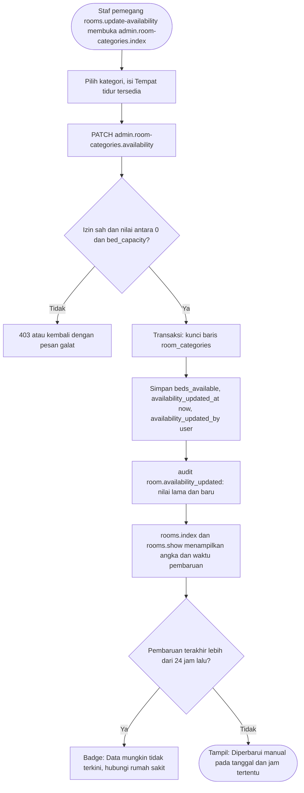

**Langkah**

1. Super Admin, Admin Konten, dan Petugas Pendaftaran (untuk petugas **[ASUMSI]** A-04, sesuai 00 G) memiliki `rooms.update-availability`. Layar `admin.room-categories.index` (dapat dibuka dengan `facilities.manage` atau `rooms.update-availability`; pemegang `rooms.update-availability` saja hanya melihat daftar dan form ketersediaan) menampilkan per kategori: nama, `beds_available` / `bed_capacity`, `availability_updated_at`, pembaru terakhir, dan kolom isian cepat.
2. `PATCH /admin/kamar/{roomCategory}/ketersediaan` (`admin.room-categories.availability`, `UpdateRoomAvailabilityRequest`): `beds_available` bilangan bulat `0 ≤ nilai ≤ bed_capacity`.
3. Dalam transaksi dengan `lockForUpdate` pada baris kategori: simpan `beds_available`, `availability_updated_at = now()`, `availability_updated_by = user`. CHECK DB `beds_available BETWEEN 0 AND bed_capacity` menjadi lapis pengaman.
4. Audit `room.availability_updated` (`old_values`/`new_values`: `beds_available`).
5. Halaman publik `rooms.index` dan `rooms.show` menampilkan "Tersedia {x} dari {y} tempat tidur" dan "Diperbarui manual oleh petugas pada {tanggal} {jam} WIB. Hubungi rumah sakit untuk memastikan ketersediaan." Status ringkas hanya dua badge: `Tersedia` bila `beds_available > 0` dan `Penuh` bila 0, masing-masing berisi teks, ikon, dan warna (status `Terbatas` tidak dibuat, F4B-R9); kalimat "Data mungkin tidak terkini. Hubungi rumah sakit untuk memastikan ketersediaan." tampil bila `availability_updated_at` kosong atau lebih tua dari 24 jam (F4B-R10). Dashboard admin menampilkan ringkasan yang sama dengan waktu pembaruan.
6. Kategori yang `is_active = false` tidak tampil di publik tetapi tetap dapat diperbarui di admin. Mengubah `bed_capacity`/tarif/deskripsi memerlukan `facilities.manage` (`admin.room-categories.update`), dan `bed_capacity` tidak boleh lebih kecil dari `beds_available` saat ini.

**Cabang galat**

| Kondisi | Pesan Indonesia |
|---|---|
| Kosong | "Jumlah tempat tidur tersedia wajib diisi." |
| Bukan bilangan bulat | "Jumlah tempat tidur tersedia harus berupa angka bulat." |
| Negatif | "Jumlah tempat tidur tersedia tidak boleh kurang dari 0." |
| Melebihi kapasitas | "Jumlah tempat tidur tersedia tidak boleh melebihi kapasitas ({kapasitas} tempat tidur)." |
| Kapasitas diturunkan di bawah ketersediaan | "Kapasitas tidak boleh lebih kecil dari tempat tidur tersedia saat ini ({n}). Perbarui ketersediaan terlebih dahulu." |
| Tanpa izin | 403 "Anda tidak memiliki izin untuk mengakses halaman ini." |

**Keterlibatan:** route `admin.room-categories.index`, `admin.room-categories.availability`, `rooms.index`, `rooms.show`; form request `UpdateRoomAvailabilityRequest`; service `AuditLogger`, `DashboardMetrics`; policy `RoomCategoryPolicy`; tabel `room_categories`, `audit_logs`; izin `rooms.update-availability`, `facilities.manage`.

---

## 14. Pengelolaan Akun Staf dan Hak Akses

Hanya Super Admin (`staff.manage`) yang mengelola akun staf dan hak akses. Akun tidak pernah dihapus; hanya dinonaktifkan.

### 14.A Login admin dan ganti password pertama

```mermaid
sequenceDiagram
    actor SA as Super Admin
    participant C as Controller admin
    participant S as StaffAccountService
    participant DB as Database
    actor ST as Staf baru
    participant MW as Middleware password.changed
    SA->>C: POST admin.staff.store dengan nama, email, peran
    C->>S: buat akun staf
    S->>S: Buat password sementara acak 12 karakter
    S->>DB: INSERT users account_type staff, must_change_password true, assignRole
    S->>DB: audit staff.created tanpa password
    S-->>C: akun dan password sementara
    C-->>SA: Tampilkan password sementara satu kali
    SA->>ST: Sampaikan kredensial lewat saluran aman di luar aplikasi
    ST->>C: POST admin.login.store
    C->>DB: Auth attempt, audit auth.staff_login
    ST->>MW: Akses halaman admin apa pun
    MW-->>ST: Redirect ke admin.password.edit
    ST->>C: PUT admin.password.update dengan password baru
    C->>DB: Update password, must_change_password false, audit auth.password_changed
    C-->>ST: Redirect ke admin.dashboard
```

**Langkah — membuat staf dan masuk pertama kali**

1. Super Admin membuka `admin.staff.create`: nama, email (unik di seluruh `users`), telepon (opsional), peran (satu dari `super-admin`, `content-admin`, `registration-officer`; satu staf satu peran **[ASUMSI]**). Memilih `super-admin` menampilkan peringatan "Super Admin memiliki akses penuh".
2. `POST /admin/staf` (`admin.staff.store`, `StaffRequest`): `StaffAccountService` membuat **password sementara acak 12 karakter** (huruf besar-kecil, angka) **[ASUMSI]**, menyimpan `users` (`account_type = staff`, `is_active = true`, `must_change_password = true`), memasang peran Spatie, dan menulis `staff.created` (tanpa password).
3. Password sementara ditampilkan **satu kali** pada halaman hasil (`Cache-Control: no-store`) dan tidak disimpan di log maupun flash berantai; Super Admin menyampaikannya di luar aplikasi. Email tidak digunakan karena SMTP produksi belum ditetapkan.
4. Staf membuka `GET /admin/login` (`admin.login`) → `POST admin.login.store`: throttle `login` (5/menit, email+IP), `AdminLoginRequest`, `Auth::attempt([... 'account_type' => 'staff'])`; kegagalan memberi pesan generik **"Email atau password salah."** (juga untuk akun pasien dan akun nonaktif; alasan `inactive` hanya di audit). Sukses: `session()->regenerate()`, `last_login_at`, audit `auth.staff_login`; kegagalan: audit `auth.staff_login_failed` (alasan internal `bad_credentials`/`inactive`/`not_staff`, tidak ditampilkan ke pengguna).
5. Middleware `password.changed` mengalihkan semua route admin ke `admin.password.edit` selama `must_change_password = true`, kecuali `admin.password.edit`, `admin.password.update`, dan `admin.logout` (00 I.4; mencegah redirect berulang). `PUT admin.password.update` (`UpdatePasswordRequest`): password lama (password sementara) wajib, password baru harus berbeda dan memenuhi `Password::min(8)->letters()->numbers()`. Sukses: `must_change_password = false`, sesi lain milik akun dihapus, audit `auth.password_changed`, redirect ke `admin.dashboard`.
6. **Reset password staf:** `POST admin.staff.reset-password` membuat password sementara baru, `must_change_password = true`, menghapus seluruh sesi akun itu, audit `staff.password_reset`; password ditampilkan sekali kepada Super Admin.

### 14.B Menonaktifkan akun dan mengubah izin peran

```mermaid
flowchart TD
    A(["Super Admin membuka admin.staff.index atau admin.roles.index"]) --> B{"Aksi"}
    B -->|"Nonaktifkan akun"| C{"Akun diri sendiri atau Super Admin aktif terakhir?"}
    C -->|"Ya"| C1["Ditolak dengan pesan"]
    C -->|"Tidak"| D["PATCH admin.staff.status is_active false, hapus baris sessions akun, audit staff.deactivated"]
    B -->|"Aktifkan akun"| D2["PATCH admin.staff.status is_active true, audit staff.activated"]
    B -->|"Reset password"| E["POST admin.staff.reset-password"]
    B -->|"Ubah izin peran"| F{"Peran super-admin?"}
    F -->|"Ya"| F1["Terkunci: tampil baca-saja"]
    F -->|"Tidak"| G["PUT admin.roles.update: sinkronkan izin, bersihkan cache izin Spatie, audit role.permissions_updated"]
    G --> H(["Berlaku pada permintaan berikutnya bagi semua staf peran itu"])
    D --> I(["Staf nonaktif keluar pada permintaan berikutnya lewat middleware active"])
```

**Langkah**

1. **Nonaktifkan:** `PATCH /admin/staf/{user}/status` (`admin.staff.status`, `UpdateStaffStatusRequest`). Penjagaan: tidak boleh menonaktifkan **diri sendiri**, dan tidak boleh menonaktifkan **Super Admin aktif terakhir** (dihitung di dalam transaksi dengan `lockForUpdate`). Aturan mutlak ini ditegakkan oleh `StaffAccountService` dan Form Request, **bukan Policy**, karena `Gate::before` membuat Super Admin melewati seluruh Policy (00 G). Sukses: `is_active = false`, baris `sessions` akun dihapus, audit `staff.deactivated`. Mengaktifkan kembali: `is_active = true`, audit `staff.activated`.
2. **Ubah data/peran:** `PUT admin.staff.update` (`StaffRequest`). Super Admin tidak dapat mengubah peran **dirinya sendiri** dan tidak dapat menurunkan Super Admin aktif terakhir. Audit `staff.updated` (nama bidang yang berubah dan peran lama/baru).
3. **Ubah izin peran:** `GET /admin/hak-akses` (`admin.roles.index`) → `admin.roles.edit` → `PUT admin.roles.update` (`UpdateRolePermissionsRequest`) menampilkan matriks izin 00 G untuk `content-admin` dan `registration-officer`. Peran `super-admin` **terkunci** (baca-saja, tidak dapat diubah atau dihapus; ditolak oleh `StaffAccountService` dan `UpdateRolePermissionsRequest`). Penjagaan **[ASUMSI]**: izin `staff.manage`, `settings.manage`, `audit.view` tidak dapat diberikan kepada peran selain Super Admin (mencegah eskalasi hak); `dashboard.view` selalu wajib; izin `*.manage` otomatis menyertakan pasangan `*.view` (`doctors`, `schedules`, `patients`, `appointments`), dan `reports.export`/`sessions.review` menyertakan `appointments.view`.
4. Setelah pembaruan, cache izin Spatie dibersihkan (`PermissionRegistrar::forgetCachedPermissions`) sehingga perubahan berlaku pada permintaan berikutnya. Menu disembunyikan dengan `@can` hanya sebagai kenyamanan; penegakan tetap di middleware `permission:*`, Policy, dan `authorize()` Form Request.
5. Seluruh perubahan dicatat: `staff.created`, `staff.updated`, `staff.deactivated`, `staff.activated`, `staff.password_reset`, `role.permissions_updated` (daftar izin lama dan baru).

**Cabang galat**

| Kondisi | Pesan Indonesia |
|---|---|
| Email staf sudah dipakai | "Email ini sudah terdaftar. Gunakan email lain." |
| Peran tidak dipilih/tidak valid | "Peran wajib dipilih." / "Peran tidak valid." |
| Menonaktifkan akun sendiri | "Anda tidak dapat menonaktifkan akun Anda sendiri." |
| Menonaktifkan/menurunkan Super Admin aktif terakhir | "Tidak dapat menonaktifkan atau mengubah Super Admin aktif terakhir. Harus selalu ada minimal satu Super Admin aktif." |
| Mengubah peran sendiri | "Anda tidak dapat mengubah peran akun Anda sendiri." |
| Mengubah izin peran `super-admin` | "Peran Super Admin terkunci dan tidak dapat diubah." |
| Memberi izin sensitif ke peran non-Super Admin | "Izin ini hanya dapat dimiliki Super Admin." |
| Menghapus izin `dashboard.view` | "Izin Lihat dashboard wajib dimiliki semua peran staf." |
| Password sementara belum diganti, staf membuka route admin | Redirect ke `admin.password.edit` dengan pesan "Anda harus mengganti password sementara sebelum melanjutkan." |
| Password baru sama dengan yang lama | "Password baru harus berbeda dari password saat ini." |
| Password lama salah | "Password saat ini tidak sesuai." |
| Tanpa izin `staff.manage` | 403 "Anda tidak memiliki izin untuk mengakses halaman ini." |

**Keterlibatan:** route `admin.login`, `admin.login.store`, `admin.logout`, `admin.password.edit`, `admin.password.update`, `admin.staff.*` (tanpa `destroy`), `admin.staff.status`, `admin.staff.reset-password`, `admin.roles.index/edit/update`; middleware `account:staff`, `active`, `password.changed`, `permission:staff.manage`, `throttle:login`; form request `AdminLoginRequest`, `UpdatePasswordRequest`, `StaffRequest`, `UpdateStaffStatusRequest`, `UpdateRolePermissionsRequest`; service `StaffAccountService`, `AuditLogger`; policy `UserPolicy`, `RolePolicy` (hanya otorisasi izin; aturan mutlak di service); tabel `users`, `roles`, `permissions`, `model_has_roles`, `role_has_permissions`, `sessions`, `audit_logs`; izin `staff.manage`; perintah produksi `app:create-super-admin`.

---

## 15. Ekspor CSV Pendaftaran

Memenuhi §10 (filter tanggal dan ekspor CSV sesuai hak akses; audit tanpa data sensitif berlebihan).

```mermaid
sequenceDiagram
    actor PP as Petugas
    participant C as AppointmentController
    participant FR as ExportAppointmentsRequest
    participant AU as AuditLogger
    participant EX as AppointmentCsvExporter
    participant DB as Database
    PP->>C: GET admin.appointments.export dengan filter
    C->>FR: otorisasi reports.export dan validasi filter
    alt filter tidak valid atau tanpa izin
        FR-->>PP: Kembali dengan pesan galat atau 403
    end
    C->>DB: COUNT baris sesuai filter
    alt nol baris
        C-->>PP: Redirect dengan info Tidak ada data
    else ada data
        C->>AU: log report.exported berisi filter dan jumlah baris
        C->>EX: mulai stream CSV
        EX->>DB: baca per potongan 500 baris
        EX-->>PP: Unduhan UTF-8 BOM, pemisah titik koma, sel dinetralkan dari rumus
    end
```

**Langkah**

1. Pemegang `reports.export` (Super Admin, Petugas Pendaftaran) menyetel filter di `admin.appointments.index` lalu menekan "Ekspor CSV (sesuai filter)". Filter (query string): `dari`, `sampai` (tanggal kunjungan = `session_date`, wajib), `poli`, `dokter`, `status`, `kanal`. Bawaan: awal bulan berjalan sampai hari ini.
2. `GET /admin/pendaftaran/ekspor` (`admin.appointments.export`) → `ExportAppointmentsRequest`: tanggal wajib, `sampai >= dari`, rentang maksimal 366 hari **[ASUMSI]**, nilai `poli`/`dokter` harus ada, `status` dan `kanal` anggota enum.
3. Controller menghitung baris. Bila nol: redirect dengan "Tidak ada pendaftaran pada filter yang dipilih."
4. **Audit lebih dahulu** (`report.exported`: filter + `row_count` + daftar kolom) agar setiap upaya ekspor tercatat walau unduhan terputus.
5. `AppointmentCsvExporter` men-*stream* (`response()->streamDownload`, `chunkById(500)`) tanpa memuat semua baris ke memori. Berkas: `pendaftaran_{dari}_{sampai}.csv`, UTF-8 **dengan BOM**, pemisah `;` (Excel lokal Indonesia).
6. Kolom: kode booking, tanggal kunjungan, jam sesi, poliklinik, dokter, nomor antrean (format `ANK-007`), no. pasien, nama pasien, jenis pembayaran, status, kanal, dibuat pada. **Tidak** disertakan: nomor BPJS/polis, alamat, telepon, tanggal lahir, keluhan.
7. **Netralisasi injeksi rumus (CSV injection):** sel teks yang diawali `=`, `+`, `-`, `@`, tab, atau CR diberi awalan `'` sebelum ditulis **[ASUMSI]**.

**Cabang galat**

| Kondisi | Pesan Indonesia |
|---|---|
| Tanpa izin `reports.export` (mis. Admin Konten) | 403 "Anda tidak memiliki izin untuk mengakses halaman ini." |
| Tanggal mulai/selesai kosong | "Tanggal mulai wajib diisi." / "Tanggal selesai wajib diisi." |
| Selesai sebelum mulai | "Tanggal selesai tidak boleh sebelum tanggal mulai." |
| Rentang > 366 hari | "Rentang tanggal ekspor maksimal 366 hari." |
| Status/kanal tidak dikenal | "Status tidak valid." / "Kanal tidak valid." |
| Tidak ada baris | "Tidak ada pendaftaran pada filter yang dipilih." |
| Proses melebihi `max_execution_time` XAMPP | Unduhan terpotong; pesan di log; saran: persempit rentang tanggal |

**Keterlibatan:** route `admin.appointments.index`, `admin.appointments.export`; form request `ExportAppointmentsRequest`; service `AppointmentCsvExporter`, `AuditLogger`; policy `AppointmentPolicy`; tabel `appointments`, `patient_profiles`, `doctors`, `clinics`, `audit_logs`; izin `reports.export` (dan `appointments.view` untuk layar filter).

---

## 16. Menghubungkan Profil Walk-in ke Akun Online

Memenuhi 00 F.9: penghubungan hanya oleh petugas setelah verifikasi identitas di loket, tanpa pencocokan otomatis, dan hanya bila profil milik akun belum memiliki appointment.

```mermaid
flowchart TD
    A(["Pasien walk-in menunjukkan identitas dan ingin memakai akun online"]) --> B["Petugas memverifikasi identitas dan meminta pasien menunjukkan akunnya di ponsel"]
    B --> C["Petugas membuka admin.patients.show profil walk-in"]
    C --> D{"Profil sudah punya user_id?"}
    D -->|"Ya"| D1["Ditolak: profil sudah terhubung"]
    D -->|"Tidak"| E["Isi email akun pasien dan centang identitas telah diverifikasi"]
    E --> F["POST admin.patients.link-account"]
    F --> G["PatientAccountLinker: transaksi, kunci kedua profil menurut id menaik"]
    G --> H{"Akun pasien aktif dengan email itu ada?"}
    H -->|"Tidak"| H1["Ditolak: akun tidak ditemukan atau tidak aktif"]
    H -->|"Ya"| I{"Profil milik akun punya appointment?"}
    I -->|"Ya"| I1["Ditolak: penggabungan dua profil berriwayat belum didukung"]
    I -->|"Tidak"| J["Hapus profil kosong milik akun"]
    J --> K["Set user_id profil walk-in ke akun"]
    K --> L["Audit patient.account_linked"]
    L --> M(["Pasien masuk dan melihat riwayat walk-in di portalnya"])
```

**Langkah**

1. Petugas (izin `patients.manage`) membuka `admin.patients.show` untuk profil walk-in (`user_id` NULL). Kartu "Hubungkan ke akun online" hanya tampil pada profil tanpa akun.
2. **Verifikasi di loket.** Petugas memeriksa identitas pasien dan, sebagai praktik bawaan **[ASUMSI]**, meminta pasien menunjukkan akunnya (nama dan email) di ponsel untuk membuktikan kepemilikan akun. Untuk produksi, kode verifikasi yang dikirim ke email akun disarankan (default prototipe dan opsi: K-14 di 17).
3. Petugas mengisi email akun pasien dan mencentang "Saya telah memverifikasi identitas pasien di loket", lalu `POST /admin/pasien/{patient}/hubungkan-akun` (`admin.patients.link-account`, `LinkPatientAccountRequest`).
4. `PatientAccountLinker` berjalan dalam satu transaksi, mengunci profil walk-in dan profil milik akun target menurut `id` menaik (tidak ada deadlock dengan `BookingService` yang hanya mengunci satu profil), lalu memeriksa: (a) profil walk-in `user_id IS NULL`; (b) akun target `account_type = patient` dan `is_active = true`; (c) profil milik akun target **belum memiliki appointment** (jumlah appointment = 0).
5. Bila lolos: profil kosong milik akun dihapus, lalu `user_id` akun dipasang ke profil walk-in. Nomor pasien dan data profil walk-in (yang diverifikasi di loket) dipertahankan; `consent_at`/`consent_version` walk-in (persetujuan lisan) tetap; data profil kosong yang dihapus (nomor pasien, `consent_at`, `consent_version`) dicatat di `old_values` audit agar bukti persetujuan online tidak hilang. Pasien dapat memperbarui profilnya sendiri sesudahnya (`patient.profile.update`).
6. Audit `patient.account_linked` (id profil, id akun, nomor pasien profil yang dihapus). Setelah login, pasien melihat seluruh riwayat appointment walk-in-nya; notifikasi berikutnya dikirim ke akun.
7. Tidak ada pencocokan otomatis berdasarkan email/telepon (mencegah pengambilalihan profil; 00 F.9). Pelepasan tautan (*unlink*) dan penggabungan dua profil yang sama-sama berriwayat tidak tersedia (pengembangan lanjutan).

**Cabang galat**

| Kondisi | Kunci galat (`ValidationException`, 00 F.5) | Pesan Indonesia |
|---|---|---|
| Profil sudah terhubung | `PROFILE_ALREADY_LINKED` | "Profil ini sudah terhubung ke sebuah akun." |
| Email tidak cocok dengan akun pasien | `ACCOUNT_NOT_FOUND` | "Akun pasien dengan email tersebut tidak ditemukan." |
| Akun nonaktif | `ACCOUNT_INACTIVE` | "Akun pasien tidak aktif." |
| Profil milik akun sudah punya riwayat pendaftaran | `ACCOUNT_HAS_HISTORY` | "Akun ini sudah memiliki riwayat pendaftaran. Penggabungan dua profil berriwayat belum didukung." |
| Verifikasi identitas tidak dicentang | validasi | "Anda harus menegaskan bahwa identitas pasien telah diverifikasi di loket." |
| Email kosong/format salah | validasi | "Email akun wajib diisi." / "Format email tidak valid." |
| Tanpa izin `patients.manage` | 403 | "Anda tidak memiliki izin untuk mengakses halaman ini." |

**Keterlibatan:** route `admin.patients.show`, `admin.patients.link-account`; form request `LinkPatientAccountRequest`; service `PatientAccountLinker`, `AuditLogger`; policy `PatientProfilePolicy`; tabel `patient_profiles`, `users`, `appointments`, `audit_logs`; izin `patients.manage`.

---

## 17. Form Kontak → Kotak Pesan → Status

```mermaid
flowchart TD
    A(["Tamu membuka /kontak"]) --> B["Isi nama, email, telepon opsional, subjek, pesan, centang persetujuan"]
    B --> C{"Throttle contact lolos? 3 per 10 menit per IP"}
    C -->|"Tidak"| C1["302 kembali ke /kontak: Terlalu banyak percobaan (D-127)"]
    C -->|"Ya"| D{"Kolom jebakan website terisi?"}
    D -->|"Ya"| D1["Tampil pesan sukses, tidak disimpan"]
    D -->|"Tidak"| E{"StoreContactMessageRequest valid?"}
    E -->|"Tidak"| E1["Kembali ke form dengan pesan galat"]
    E -->|"Ya"| F["INSERT contact_messages: status new, consent_at, ip_hash SHA-256 dari IP dan APP_KEY"]
    F --> G["Flash: Terima kasih, pesan Anda telah kami terima"]
    G --> H["Petugas atau Super Admin melihat admin.messages.index"]
    H --> I["Buka admin.messages.show: status new otomatis menjadi read"]
    I --> J["Balas manual lewat email atau telepon di luar aplikasi"]
    J --> K(["PATCH admin.messages.status menjadi replied atau archived"])
```

```mermaid
stateDiagram-v2
    direction LR
    state "Baru" as new
    state "Dibaca" as read
    state "Dibalas" as replied
    state "Diarsipkan" as archived
    [*] --> new: Pengunjung mengirim form
    new --> read: Pesan dibuka petugas
    new --> archived: Diarsipkan tanpa dibuka, misalnya spam
    read --> replied: Petugas menandai sudah dibalas
    read --> archived: Petugas mengarsipkan
    replied --> archived: Petugas mengarsipkan
    archived --> read: Petugas memulihkan
```

**Langkah**

1. `GET /kontak` (`contact`) menampilkan alamat teks, tombol "Petunjuk Arah", peta tersemat (`x-map-embed`, tetap menampilkan alamat tanpa internet), dan form. Di bawah kolom pesan tertera: "Jangan menuliskan data medis atau nomor identitas pada pesan ini."
2. `POST /kontak` (`contact.store`) melewati throttle `contact` (3 per 10 menit per IP) lalu `StoreContactMessageRequest`. Kolom jebakan (*honeypot*) tersembunyi `website` (di dalam `<div class="d-none" aria-hidden="true">`, `tabindex="-1"`, `autocomplete="off"`; tidak ada di `rules()`): bila terisi, controller mengalihkan ke `contact` dengan flash sukses yang sama tanpa menyimpan apa pun (F4B-R7).
3. Disimpan ke `contact_messages`: `name`, `email`, `phone` (opsional), `subject`, `message`, `status = new`, `consent_at = now()`, `ip_hash = hash('sha256', IP . APP_KEY)` (**IP mentah tidak disimpan**). Isi pesan hanya dirender dengan `{{ }}` (tanpa HTML).
4. Pemegang `messages.manage` (Super Admin; Petugas Pendaftaran **[ASUMSI]**) membuka `admin.messages.index` (pencarian, filter status, pagination, tampilan kartu di mobile) lalu `admin.messages.show`. Membuka pesan berstatus `new` mengubahnya menjadi `read` otomatis **[ASUMSI]**.
5. Balasan dilakukan manual di luar aplikasi (email/telepon/WhatsApp biasa; **bukan** pengiriman otomatis). Petugas mengubah status lewat `PATCH /admin/pesan/{message}/status` (`admin.messages.status`) ke `replied` atau `archived`; `handled_by` dan `handled_at` diisi saat status menjadi `replied`/`archived`. Status tidak dapat dikembalikan ke `new`.
6. Audit `contact_message.status_changed`.

**Cabang galat**

| Kondisi | Pesan Indonesia |
|---|---|
| Nama/email/subjek/pesan kosong | "Nama wajib diisi." / "Email wajib diisi." / "Subjek wajib diisi." / "Pesan wajib diisi." |
| Format email/telepon salah | "Format email tidak valid." / "Nomor telepon tidak valid. Gunakan nomor seluler Indonesia, mis. 081234567890." |
| Pesan terlalu pendek/panjang | "Pesan minimal 10 karakter." / "Pesan maksimal 2000 karakter." |
| Persetujuan tidak dicentang | "Anda harus menyetujui pengolahan data untuk mengirim pesan." |
| Throttle `contact` terlampaui | Redirect 302 kembali ke `/kontak` dengan flash `error` "Terlalu banyak percobaan. Silakan coba lagi dalam {n} detik.", header `Retry-After`, input lama dipertahankan, tanpa baris tersimpan (D-23, F4B-R6) |
| Sukses | Flash: "Terima kasih. Pesan Anda telah kami terima dan akan ditindaklanjuti oleh petugas kami." |
| Admin tanpa izin `messages.manage` | 403 "Anda tidak memiliki izin untuk mengakses halaman ini." |

**Keterlibatan:** route `contact`, `contact.store`, `admin.messages.index`, `admin.messages.show`, `admin.messages.status`; middleware `throttle:contact`, `permission:messages.manage`; form request `StoreContactMessageRequest`, `UpdateContactMessageStatusRequest`; policy `ContactMessagePolicy`; service `AuditLogger`, `SettingsService` (alamat, peta); tabel `contact_messages`, `audit_logs`; izin `messages.manage`.

---

## 18. Indeks Notifikasi dan Pemicunya

Notifikasi hanya dikirim kepada **pasien berakun**. Kanal `database` dipakai untuk **setiap** transisi status dan perubahan jadwal; kanal `mail` hanya untuk `confirmed`, `cancelled`, dan perubahan jadwal (`schedule_changed_at`) sesuai 00 F.8 dan default K-13 di 17 (mail lokal masuk `storage/logs/laravel-YYYY-MM-DD.log` atau Mailpit). Isi notifikasi tidak memuat nomor BPJS/polis, keluhan, alamat, atau telepon. Pengiriman dijalankan setelah commit (`DB::afterCommit`); kegagalan kirim ditangkap dan dicatat ke log tanpa membatalkan transaksi. Banner notifikasi belum dibaca tampil di `patient.dashboard`; tombol "Tandai dibaca" memakai `patient.notifications.read`.

| Peristiwa | Penerima | Kelas notifikasi | Kanal | Alur |
|---|---|---|---|:-:|
| Pendaftaran online dibuat berstatus `pending` | Pasien berakun | `AppointmentStatusChangedNotification` | `database` | 3 |
| Pendaftaran online dibuat berstatus `confirmed` (`booking.auto_confirm = true`) | Pasien berakun | `AppointmentStatusChangedNotification` | `database` + `mail` | 3 |
| Walk-in dibuat (`confirmed`) pada profil yang terhubung ke akun | Pasien berakun | `AppointmentStatusChangedNotification` | `database` + `mail` | 5 |
| Dikonfirmasi petugas | Pasien berakun | `AppointmentStatusChangedNotification` | `database` + `mail` | 6 |
| Check-in, selesai, koreksi check-in | Pasien berakun | `AppointmentStatusChangedNotification` | `database` | 7 |
| Dibatalkan (pasien, petugas, atau resolusi sesi `cancel`) | Pasien berakun | `AppointmentStatusChangedNotification` (memuat alasan) | `database` + `mail` | 4, 7, 11 |
| Tidak hadir (massal atau perintah artisan) | Pasien berakun | `AppointmentStatusChangedNotification` | `database` | 7 |
| Jam sesi diubah lewat resolusi `apply` (`schedule_changed_at` diisi) | Pasien berakun | `AppointmentScheduleChangedNotification` | `database` + `mail` | 11 |
| Perubahan jadwal/pembatalan untuk pasien walk-in tanpa akun | **Tidak ada notifikasi sistem**; petugas menghubungi telepon di profil (tanpa pelacakan "sudah dihubungi", default K-15) | — | — | 5, 11 |
| Reset password diminta | Pemilik email (hanya akun pasien aktif) | Email reset bawaan Laravel | `mail` | 2 |

---

## 19. Profil dan Password Pasien

Memenuhi F-PAS-02 dan F-PAS-03 (halaman 28): satu halaman dengan dua formulir terpisah. Pasien hanya mengubah data miliknya; `patient_profile_id`, `user_id`, `patient_number`, `is_active`, `registration_channel`, `consent_at`, dan `consent_version` tidak pernah diterima dari request (04 V4).

```mermaid
flowchart TD
    A(["Pasien membuka patient.profile.edit"]) --> B{"Formulir mana?"}
    B -->|"Profil"| C["PUT patient.profile.update dengan UpdatePatientProfileRequest"]
    C --> D{"Email berubah?"}
    D -->|"Ya"| E{"Password saat ini benar dan email unik di users?"}
    E -->|"Tidak"| E1["Kembali ke form dengan galat per field"]
    E -->|"Ya"| F["Transaksi: perbarui users.email dan patient_profiles.email bersama kolom profil lain"]
    D -->|"Tidak"| F
    F --> G["audit patient.updated dan flash sukses"]
    B -->|"Password"| H["PUT patient.password.update dengan UpdatePasswordRequest"]
    H --> I{"Password saat ini benar dan password baru valid?"}
    I -->|"Tidak"| I1["Kembali ke form dengan galat per field"]
    I -->|"Ya"| J["users.password diperbarui (cast hashed), baris sessions lain milik akun dihapus, audit auth.password_changed"]
```

**Langkah**

1. `GET /pasien/profil` (`patient.profile.edit`, middleware `auth`, `account:patient`, `active`) menampilkan dua formulir: **Profil** (nama lengkap, tanggal lahir, jenis kelamin, telepon, email, alamat, nomor BPJS opsional) dan **Ganti password**. Nomor BPJS yang tersimpan hanya tampil 4 digit terakhir (`bpjs_number_last4`); kolom dikosongkan berarti tidak berubah. NIK tidak ada.
2. `PUT /pasien/profil` (`patient.profile.update`) → `UpdatePatientProfileRequest` (aturan sama dengan registrasi). Untuk pasien berakun, `patient_profiles.email` **selalu** sama dengan `users.email` (00 E.1; 17 D-07): perubahan email memperbarui keduanya dalam satu transaksi, divalidasi unik di `users`, dan meminta password saat ini **[ASUMSI]**. Audit `patient.updated` (nama bidang yang berubah; tanpa nomor BPJS).
3. `PUT /pasien/password` (`patient.password.update`) → `UpdatePasswordRequest`: password saat ini wajib, password baru memenuhi `Password::min(8)->letters()->numbers()` dan berbeda dari yang lama. Sukses: `users.password` diperbarui (cast `hashed`), baris `sessions` lain milik akun dihapus **[ASUMSI]**, audit `auth.password_changed` (tanpa nilai password), flash hijau.
4. Menonaktifkan profil (`admin.patients.status`) oleh petugas ikut menonaktifkan `users.is_active` (00 E.1; D-08); pasien yang nonaktif tidak dapat mengakses halaman ini (middleware `active`).

**Cabang galat**

| Kondisi | Pesan Indonesia |
|---|---|
| Email sudah dipakai akun lain | "Email ini sudah terdaftar. Gunakan email lain." |
| Password saat ini salah (profil dengan perubahan email, atau ganti password) | "Password saat ini tidak sesuai." |
| Password baru sama dengan yang lama | "Password baru harus berbeda dari password saat ini." |
| Password baru tidak memenuhi aturan / konfirmasi tidak cocok | "Password minimal 8 karakter." / "Password harus mengandung huruf." / "Password harus mengandung angka." / "Konfirmasi password tidak cocok." |
| Nomor telepon tidak valid | "Nomor telepon tidak valid. Gunakan nomor seluler Indonesia, mis. 081234567890." |
| Tanggal lahir tidak valid | "Tanggal lahir harus sebelum hari ini." / "Tanggal lahir tidak boleh lebih dari 120 tahun yang lalu." |
| Nomor BPJS bukan 13 digit | "Nomor BPJS harus terdiri dari 13 digit angka." |
| Akun staf membuka halaman ini | 403 "Anda tidak memiliki izin untuk mengakses halaman ini." |

**Keterlibatan:** route `patient.profile.edit`, `patient.profile.update`, `patient.password.update`; Form Request `UpdatePatientProfileRequest`, `UpdatePasswordRequest` (namespace `Patient`); Policy `PatientProfilePolicy::update` (pemilik); service `AuditLogger`; tabel `patient_profiles`, `users`, `sessions`, `audit_logs`.

---

## 20. Pengaturan Website

Memenuhi F-ADM-25 (halaman 40, tab Pengaturan Website; izin `settings.manage`, hanya Super Admin pada seed). Pola umum CRUD konten ada di Alur 12; bagian ini merinci pengaturan karena memengaruhi mesin booking.

**Langkah**

1. `GET /admin/pengaturan` (`admin.settings.edit`) menampilkan lima grup `website_settings.group`: `identitas`, `kontak`, `booking`, `seo`, `privasi` (wireframe W-21). Nilai yang masih sama dengan seed ditandai "Placeholder — ganti dengan data resmi".
2. `PUT /admin/pengaturan` (`admin.settings.update`, `UpdateSettingsRequest`, Gate `settings.manage`): validasi menurut kolom `type` (`string|text|int|bool|url|email|json`); URL harus `https`; `booking.window_days` 1–90, `booking.online_cutoff_minutes` 0–1440, `booking.cancel_cutoff_minutes` 0–2880, `booking.checkin_open_minutes` 0–480, `booking.max_active_per_patient` 1–10 **[ASUMSI]**. Logo situs (`site.logo_media_id`) diunggah lewat `MediaService` (koleksi `logo`, minimum 120×40 px, SVG unggahan ditolak, alt text wajib).
3. `SettingsService::setMany` menyimpan nilai, mengisi `updated_by`, membersihkan cache pengaturan, dan `AuditLogger` menulis `settings.updated` (nilai lama dan baru; pengaturan ini tidak memuat rahasia).
4. Dampak: nilai `booking.*` berlaku seketika untuk pendaftaran baru, `DoctorAvailabilityQuery`, dan pembangkitan sesi berikutnya; pendaftaran yang sudah ada tidak diubah, dan memperkecil `booking.window_days` tidak menghapus sesi yang sudah dibangkitkan. `contact.whatsapp` hanya membentuk tautan `https://wa.me/{nomor}` yang dibuka manual pengunjung (bukan WhatsApp API).

**Cabang galat**

| Kondisi | Pesan Indonesia |
|---|---|
| URL peta atau petunjuk arah bukan `https` | "Tautan harus berupa URL yang diawali https://." |
| Nilai booking di luar rentang | "Nilai harus berupa angka bulat antara {min} dan {maks}." |
| Email kontak tidak valid | "Format email tidak valid." |
| Logo bukan JPG/PNG/WebP, > 2 MB, atau di bawah 120×40 px | "File harus berupa gambar JPG, PNG, atau WebP." / "Ukuran gambar maksimal 2 MB." / "Dimensi gambar minimal 120 x 40 piksel dan maksimal 6000 x 6000 piksel." |
| Tanpa izin `settings.manage` | 403 "Anda tidak memiliki izin untuk mengakses halaman ini." |

**Keterlibatan:** route `admin.settings.edit`, `admin.settings.update`; Form Request `UpdateSettingsRequest`; service `SettingsService`, `MediaService`, `AuditLogger`; tabel `website_settings`, `media`, `audit_logs`; izin `settings.manage`.

---

## Asumsi di bagian ini

1. **[ASUMSI]** "Ingat saya" tersedia hanya untuk login pasien, tidak untuk staf.
2. Query wizard: `poli` = `clinics.slug`, `dokter` = `doctors.slug`, `sesi` = `practice_sessions.id`, `tanggal` = `YYYY-MM-DD` → diputuskan di 00 I.5 / 17 D-14.
3. **[ASUMSI]** Nomor BPJS dapat disimpan ke `patient_profiles` lewat kotak centang "Simpan nomor BPJS ke profil saya" (bawaan tidak dicentang) pada form pendaftaran; bila tersimpan, kolom diisi ulang hanya untuk pemilik. Pemakaian kolom `bpjs_number` selain itu ditunda ke integrasi BPJS.
4. **[ASUMSI]** Masa berlaku token reset 60 menit dan jeda antar-permintaan broker 60 detik; reset dari halaman publik hanya untuk akun pasien aktif; seluruh sesi akun dihapus setelah reset password, penonaktifan, dan reset oleh Super Admin.
5. **[ASUMSI]** `patient_profiles.created_by_user_id` bernilai NULL untuk registrasi online dan terisi hanya untuk profil buatan petugas; `patient_number` diisi dalam transaksi yang sama setelah `id` diketahui (rincian kolom di 09).
6. **[ASUMSI]** Deteksi profil mirip saat membuat profil walk-in (nama + tanggal lahir, atau telepon) bersifat peringatan, bukan penolakan.
7. **[ASUMSI]** Pemindaian kode booking hanya menyorot baris; check-in dilakukan dengan menekan tombol.
8. `appointments:mark-no-show` tanpa `--date` memproses semua sesi yang sudah berakhir hingga saat ini; idempoten → diputuskan di 00 F.8 / 17 D-15.
9. **[ASUMSI]** Form transisi menyertakan `expected_status`; selisih dengan status di bawah kunci menghasilkan `STALE_STATUS`.
10. **[ASUMSI]** Tidak ada pemicu otomatis pembatalan oleh Sistem; pembatalan karena resolusi sesi `cancel` dicatat `cancelled_by_type = staff` (00 F.4).
11. Urutan evaluasi `Availability`: past → leave/holiday/cancelled → under_review → closed → full → booking_closed → available → diputuskan di 00 F.3 / 17 D-05.
12. **[ASUMSI]** Generator hanya memproses templat milik dokter `active` (selaras 11; 00 F.4 tidak menyebut generator); bila beberapa pengecualian mencakup tanggal yang sama, dipilih yang khusus dokter, lalu `id` terkecil.
13. **[ASUMSI]** Pengecualian berlaku pada semua sesi mendatang terlepas dari `is_manually_modified`; saat pengecualian dicabut sesi dibuka kembali dan dievaluasi ulang terhadap templat dan status dokter. Aturan prioritas `pending_change` dan pembukaan kembali sesi `needs_review` mengikuti 00 F.4 (Alur 11.F).
14. Perubahan manual pada sesi berpendaftaran aktif (geser jam, batalkan) melewati tinjauan memakai sumber `manual_time` dan `manual_cancel` → diputuskan di 00 F.4 / 17 D-03. **[ASUMSI]** Sesi `needs_review` yang sudah lewat hanya menawarkan `keep`.
15. Menonaktifkan dokter membatalkan sesi mendatang tanpa appointment aktif dan mengirim sesi berappointment aktif ke Sesi terdampak (`doctor_inactive`); mengarsipkan hanya bila tidak ada appointment aktif mendatang → diputuskan di 00 F.4 / 17 D-01, D-02.
16. **[ASUMSI]** `slug` dibuat sistem dan tidak berubah saat nama/judul diedit.
17. **[ASUMSI]** Cache aplikasi hanya `settings:all` dan `pages:{key}`; data dokter/jadwal tidak di-cache.
18. Status ringkas kamar hanya `Penuh`/`Tersedia` (status `Terbatas` ≤ 20% tidak dibuat, F4B-R9) dan kalimat "Data mungkin tidak terkini" bila pembaruan kosong atau > 24 jam (F4B-R10).
19. **[ASUMSI]** Password sementara staf: 12 karakter acak dibuat sistem, ditampilkan sekali kepada Super Admin; satu staf satu peran; Super Admin boleh membuat Super Admin lain.
20. **[ASUMSI]** Izin `staff.manage`, `settings.manage`, `audit.view` tidak dapat diberikan ke peran selain Super Admin; `dashboard.view` wajib; izin `*.manage` menyertakan `*.view` pasangannya.
21. **[ASUMSI]** Ekspor CSV: rentang maksimal 366 hari, sel dinetralkan dari injeksi rumus, audit ditulis sebelum streaming dimulai.
22. **[ASUMSI]** Penghubungan akun: petugas meminta pasien menunjukkan akun di ponsel; profil berhasil dihubungkan mempertahankan data profil walk-in; tidak ada fitur *unlink*.
23. Kolom jebakan (*honeypot*) `website` pada form kontak → diputuskan di 17 D-128; pesan `new` otomatis menjadi `read` saat dibuka → diputuskan di 17 D-137. **[ASUMSI]** `messages.manage` juga dimiliki Petugas Pendaftaran (00 G).
24. Volume email ke pasien → diputuskan di 00 F.8 / 17 K-13 (default): kanal `database` untuk setiap transisi, kanal `mail` hanya untuk `confirmed`, `cancelled`, dan perubahan jadwal; K-13 dapat dibalik ke email untuk setiap transisi tanpa mengubah desain.
25. Verifikasi saat menghubungkan profil walk-in ke akun: default verifikasi identitas di loket, kode verifikasi ke email akun disarankan untuk produksi → rujuk 17 K-14. Persetujuan ulang kebijakan privasi saat `privacy.consent_version` naik → rujuk 17 K-06 (A-19 di 01).
26. Pelacakan "sudah dihubungi" bagi pasien walk-in yang jadwalnya berubah → rujuk 17 K-15 (default: tidak ada; cukup daftar + telepon pada layar Sesi terdampak).
27. **[ASUMSI]** Profil pasien: perubahan email meminta password saat ini; ganti password pasien menghapus baris `sessions` lain milik akun (Alur 19).
28. **[ASUMSI]** Rentang validasi pengaturan booking `window_days` 1–90, `online_cutoff_minutes` 0–1440, `cancel_cutoff_minutes` 0–2880, `checkin_open_minutes` 0–480, `max_active_per_patient` 1–10 (Alur 20; selaras 07 W-21).

## Nama baru yang diusulkan

**Kelas Form Request** (namespace `App\Http\Requests\{Auth|Patient|Public|Admin}`; nama mengikuti 11, namespace publik mengikuti 00 J.6): `RegisterRequest`, `LoginRequest`, `AdminLoginRequest`, `ForgotPasswordRequest`, `ResetPasswordRequest`, `UpdatePasswordRequest` (pasien dan staf), `Patient\UpdatePatientProfileRequest`, `BookingWizardQueryRequest`, `ReviewAppointmentRequest`, `StoreAppointmentRequest`, `CancelAppointmentRequest`, `Public\StoreContactMessageRequest` (diterima, 00 J.6), `Admin\StorePatientRequest`, `Admin\UpdatePatientRequest`, `Admin\UpdatePatientStatusRequest`, `Admin\LinkPatientAccountRequest`, `Admin\StoreWalkInAppointmentRequest`, `Admin\TransitionAppointmentRequest`, `Admin\MarkNoShowRequest`, `Admin\ExportAppointmentsRequest`, `Admin\StoreDoctorRequest`, `Admin\UpdateDoctorRequest`, `Admin\UploadDoctorPhotoRequest`, `Admin\UpdateDoctorStatusRequest`, `Admin\DoctorScheduleRequest`, `Admin\PracticeSessionRequest`, `Admin\UpdateSessionStatusRequest`, `Admin\ScheduleExceptionRequest`, `Admin\ResolveSessionRequest`, `Admin\UpdateRoomAvailabilityRequest`, `Admin\UpdateContactMessageStatusRequest`, `Admin\StaffRequest`, `Admin\UpdateStaffStatusRequest`, `Admin\UpdateRolePermissionsRequest` (daftar lengkap seluruh Form Request, termasuk CRUD konten, di 12 §V).

**Kelas pengecualian domain:** `BookingException` (kode 00 F.5) dan `InvalidTransitionException` (diterima, 00 F.5/F.8 dan J.6; 12 kode baku `INVALID_TRANSITION`, `ALREADY_FINAL`, `FORBIDDEN_TRANSITION`, `STALE_STATUS`, `CANCEL_CUTOFF_PASSED`, `CONFIRM_AFTER_END`, `CHECKIN_NOT_TODAY`, `CHECKIN_NOT_OPEN`, `CHECKIN_CLOSED`, `CORRECTION_NOT_SAME_DAY`, `SESSION_NOT_ENDED`, `REASON_REQUIRED`). Galat perubahan jadwal/resolusi sesi (`CLINIC_CHANGE_BLOCKED`, `QUOTA_BELOW_BOOKED`, `SESSION_PAST`, `SESSION_ALREADY_RESOLVED`, `RESOLUTION_NOT_ALLOWED`) dan penghubungan akun (`PROFILE_ALREADY_LINKED`, `ACCOUNT_NOT_FOUND`, `ACCOUNT_INACTIVE`, `ACCOUNT_HAS_HISTORY`) dilempar sebagai `ValidationException` dengan kunci pesan tersebut — **tidak ada** kelas `ScheduleChangeException`/`AccountLinkException` (diputuskan di 00 F.5).

**Metode/parameter:** `BookingService::precheck(PatientProfile, PracticeSession, BookingData, Actor): void`; `ScheduleChangeService::resolve($session, SessionResolution, Actor, ?string $reason)`; flag hasil `DoctorAvailabilityQuery`: `is_bookable_counter` (diterima, 00 F.3); `BookingService::precheck()` → **diterima (00 F.5, J.6)**; field form `expected_status`, `save_bpjs`, `identity_verified`, `verbal_consent`, `confirm_not_duplicate`; kolom `reason` pada transisi.

**Nilai `pending_change.source`:** `manual_time`, `manual_cancel`, dan `doctor_inactive` → **diterima (00 F.4)**; format JSON mengikuti 00 F.4.

**Kode aksi audit baru yang dipakai di bagian ini:** `patient.registered`, `patient.created`, `auth.password_changed`, `auth.password_reset`, `staff.updated`, `staff.activated`, `staff.password_reset`, `doctor.created`, `doctor.status_changed`, `exception.updated`, `exception.deleted`, `contact_message.status_changed`, `media.replaced`; pola `{entitas}.created|updated|deleted` untuk entitas konten (katalog lengkap di 12).

**Parameter query:** `q`, `tanggal`, `sesi`, `pasien`, `dari`, `sampai`, `poli`, `dokter`, `status`, `kanal` → **diterima (00 I.5)**; `jadwal_berubah` (filter `schedule_changed_at` terisi) → **diterima (00 I.5)**.

**Kunci cache/kunci:** `settings:all`, `pages:{key}`, `sessions:generated:{Y-m-d}` (00 F.2), kunci `sessions:generate`, `booking-submit:{user_id}` (00 F.6). Kunci cache pengaturan baku `settings:all` (00 J.1).
