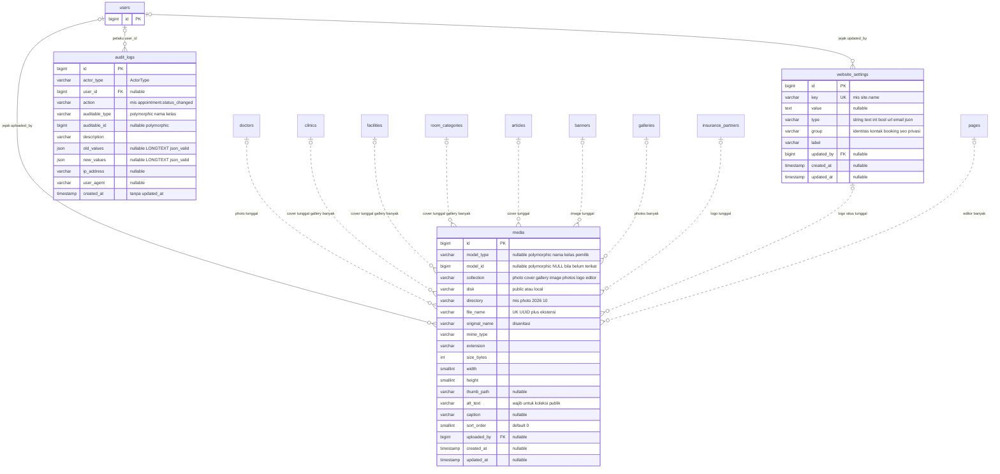

# 08 — ERD (Mermaid)

**Tujuan bagian.** Menggambarkan seluruh model data UNPAM HOSPITAL sebagai *Entity Relationship Diagram* (ERD) Mermaid: satu diagram ikhtisar berisi semua tabel domain, empat diagram per domain lengkap dengan kolom, lalu penjelasan teks untuk setiap relasi (kolom FK, kardinalitas, aksi `ON DELETE`) serta untuk relasi yang **tidak dapat digambarkan Mermaid** (polymorphic `media`, `audit_logs`, `notifications`, dan tabel Spatie). Bagian ini adalah pasangan dari [09-data-dictionary.md](09-data-dictionary.md) (tipe kolom, index, CHECK, cast, aturan hapus) dan wajib konsisten dengan [00-keputusan-inti.md](00-keputusan-inti.md) bagian C (konvensi), D (enum), E (tabel & kolom), F (mesin booking), dan K (media).

**Bagian terkait:** [03-arsitektur.md](03-arsitektur.md) · [04-peran-hak-akses.md](04-peran-hak-akses.md) · [06-alur.md](06-alur.md) · [09-data-dictionary.md](09-data-dictionary.md) · [11-route-controller-model-service.md](11-route-controller-model-service.md) · [12-aturan-bisnis-validasi-keamanan.md](12-aturan-bisnis-validasi-keamanan.md) · [13-data-contoh.md](13-data-contoh.md) · [14-tahapan-implementasi.md](14-tahapan-implementasi.md)

---

## 1. Cara membaca diagram

### 1.1 Notasi kardinalitas

| Simbol Mermaid | Arti | Contoh nyata |
|---|---|---|
| `\|\|--o{` | Satu induk memiliki nol atau banyak anak; FK anak **NOT NULL** | `clinics \|\|--o{ doctors` |
| `\|o--o{` | Induk bersifat opsional (nol atau satu); FK anak **nullable** | `specialties \|o--o{ clinics` |
| `\|o--o\|` | Nol-atau-satu ke nol-atau-satu; FK nullable **dan UNIQUE** | `users \|o--o\| patient_profiles` |
| Garis putus `..` (mis. `\|\|..o{`) | Relasi **logis tanpa FK database**: polymorphic (`model_type` + `model_id`), kolom yang hanya diberi index, atau kunci alami (email) | `users \|\|..o{ model_has_roles` |

Garis solid `--` = FK nyata di database (`FOREIGN KEY` InnoDB). Mermaid tidak punya notasi untuk aksi `ON DELETE`; aksinya dijelaskan di bagian 4.

### 1.2 Kunci dan tipe pada diagram

- `PK` = primary key, `FK` = foreign key, `UK` = unique (kolom tunggal). Kunci komposit (mis. UNIQUE `doctor_schedule_id` + `session_date`) ditulis di komentar kolom karena Mermaid tidak punya notasi untuk unique komposit.
- Tipe pada diagram sengaja disederhanakan menjadi satu kata. Pemetaan ke MariaDB (tipe lengkap ada di [09-data-dictionary.md](09-data-dictionary.md)):

| Tipe diagram | Tipe MariaDB yang dihasilkan |
|---|---|
| `bigint` | `BIGINT UNSIGNED` |
| `smallint` | `SMALLINT UNSIGNED` |
| `tinyint` | `TINYINT(1)` untuk boolean; `TINYINT UNSIGNED` untuk `day_of_week`; `TINYINT` untuk `active_flag` |
| `int` | `INT` / `INT UNSIGNED` |
| `varchar`, `char` | `VARCHAR(n)`, `CHAR(n)` (`utf8mb4_unicode_ci`) |
| `text`, `mediumtext`, `longtext` | `TEXT`, `MEDIUMTEXT`, `LONGTEXT` |
| `json` | **`LONGTEXT` + CHECK `JSON_VALID`** (MariaDB 10.4 tidak punya tipe JSON native; lihat catatan kompatibilitas di bagian 09) |
| `date`, `time`, `datetime`, `timestamp` | `DATE`, `TIME`, `DATETIME`, `TIMESTAMP` |
| `decimal` | `DECIMAL(12,2)` (Rupiah) |

- Komentar kolom (dalam tanda kutip) hanya memuat catatan singkat: nullable, nama enum (`App\Enums\*`), atau sifat khusus (terenkripsi, generated).
- Kolom `created_at`/`updated_at` selalu `timestamp` nullable bawaan Laravel kecuali tabel dinyatakan lain.
- Seluruh entitas, kolom, dan tipe pada diagram bagian 2 dan 3 telah dibandingkan otomatis dengan skema hasil migration yang dijalankan pada MariaDB 10.4.32 (tidak ada selisih; lihat [09-data-dictionary.md](09-data-dictionary.md) bagian 14.1). Sintaks kelima diagram Mermaid divalidasi dengan parser Mermaid. CHECK `chk_schedule_exceptions_scope` (kombinasi jenis pengecualian dan dokter, 00 E.2) ditambahkan sesudah verifikasi itu dan wajib diuji pada fase 3 (09 bagian 14.1).

---

## 2. ERD ikhtisar (semua tabel domain)

Diagram memuat seluruh tabel domain, Spatie, dan tabel bawaan Laravel yang punya hubungan (`users`, `sessions`, `password_reset_tokens`, `notifications`), hanya dengan kolom PK/FK dan kolom kunci polymorphic. Tabel bawaan Laravel yang **tidak punya relasi** (`cache`, `cache_locks`, `jobs`, `job_batches`, `failed_jobs`) tidak digambar; kolomnya ada di [09-data-dictionary.md](09-data-dictionary.md). Relasi jejak pembuat/pengubah ke `users` (kolom `created_by`, `updated_by`, `reviewed_by`, `handled_by`, dst.) digambar dengan label "jejak".

```mermaid
erDiagram
    users {
        bigint id PK
    }
    patient_profiles {
        bigint id PK
        bigint user_id FK, UK "nullable"
        bigint created_by_user_id FK "nullable"
    }
    roles {
        bigint id PK
    }
    permissions {
        bigint id PK
    }
    model_has_roles {
        bigint role_id PK, FK
        varchar model_type PK
        bigint model_id PK
    }
    model_has_permissions {
        bigint permission_id PK, FK
        varchar model_type PK
        bigint model_id PK
    }
    role_has_permissions {
        bigint permission_id PK, FK
        bigint role_id PK, FK
    }
    notifications {
        char id PK
        varchar notifiable_type
        bigint notifiable_id
    }
    password_reset_tokens {
        varchar email PK
    }
    sessions {
        varchar id PK
        bigint user_id "indeks tanpa FK"
    }
    specialties {
        bigint id PK
    }
    clinics {
        bigint id PK
        bigint specialty_id FK "nullable"
    }
    doctors {
        bigint id PK
        bigint clinic_id FK
    }
    doctor_specialties {
        bigint doctor_id PK, FK
        bigint specialty_id PK, FK
    }
    doctor_schedules {
        bigint id PK
        bigint doctor_id FK
        bigint clinic_id FK
        bigint created_by FK "nullable"
        bigint updated_by FK "nullable"
    }
    schedule_exceptions {
        bigint id PK
        bigint doctor_id FK "nullable"
        bigint created_by FK "nullable"
    }
    practice_sessions {
        bigint id PK
        bigint doctor_id FK
        bigint clinic_id FK
        bigint doctor_schedule_id FK "nullable"
        bigint schedule_exception_id FK "nullable"
        bigint reviewed_by FK "nullable"
    }
    insurance_partners {
        bigint id PK
    }
    appointments {
        bigint id PK
        bigint patient_profile_id FK
        bigint practice_session_id FK
        bigint doctor_id FK
        bigint clinic_id FK
        bigint insurance_partner_id FK "nullable"
        bigint created_by_user_id FK "nullable"
        bigint cancelled_by_user_id FK "nullable"
    }
    appointment_status_histories {
        bigint id PK
        bigint appointment_id FK
        bigint actor_user_id FK "nullable"
    }
    room_categories {
        bigint id PK
        bigint availability_updated_by FK "nullable"
    }
    facilities {
        bigint id PK
    }
    pages {
        bigint id PK
        bigint updated_by FK "nullable"
    }
    article_categories {
        bigint id PK
    }
    articles {
        bigint id PK
        bigint article_category_id FK "nullable"
        bigint author_user_id FK "nullable"
    }
    banners {
        bigint id PK
    }
    galleries {
        bigint id PK
    }
    faqs {
        bigint id PK
    }
    contact_messages {
        bigint id PK
        bigint handled_by FK "nullable"
    }
    media {
        bigint id PK
        varchar model_type "polymorphic nullable"
        bigint model_id "polymorphic nullable"
        bigint uploaded_by FK "nullable"
    }
    website_settings {
        bigint id PK
        bigint updated_by FK "nullable"
    }
    audit_logs {
        bigint id PK
        bigint user_id FK "nullable"
        varchar auditable_type
        bigint auditable_id "nullable"
    }

    users |o--o| patient_profiles : "akun login user_id"
    users |o--o{ patient_profiles : "jejak created_by_user_id"
    roles ||--o{ role_has_permissions : "role_id"
    permissions ||--o{ role_has_permissions : "permission_id"
    roles ||--o{ model_has_roles : "role_id"
    permissions ||--o{ model_has_permissions : "permission_id"
    users ||..o{ model_has_roles : "morph model_id"
    users ||..o{ model_has_permissions : "morph model_id"
    users ||..o{ notifications : "morph notifiable"
    users |o..o{ sessions : "user_id tanpa FK"
    users ||..o| password_reset_tokens : "email tanpa FK"

    specialties |o--o{ clinics : "specialty_id"
    clinics ||--o{ doctors : "clinic_id poli utama"
    doctors ||--o{ doctor_specialties : "doctor_id"
    specialties ||--o{ doctor_specialties : "specialty_id"
    doctors ||--o{ doctor_schedules : "doctor_id"
    clinics ||--o{ doctor_schedules : "clinic_id"
    doctors |o--o{ schedule_exceptions : "doctor_id NULL semua dokter"
    doctors ||--o{ practice_sessions : "doctor_id"
    clinics ||--o{ practice_sessions : "clinic_id"
    doctor_schedules |o--o{ practice_sessions : "doctor_schedule_id"
    schedule_exceptions |o--o{ practice_sessions : "schedule_exception_id"

    patient_profiles ||--o{ appointments : "patient_profile_id"
    practice_sessions ||--o{ appointments : "practice_session_id"
    doctors ||--o{ appointments : "doctor_id denormalisasi"
    clinics ||--o{ appointments : "clinic_id denormalisasi"
    insurance_partners |o--o{ appointments : "insurance_partner_id"
    appointments ||--o{ appointment_status_histories : "appointment_id"

    article_categories |o--o{ articles : "article_category_id"

    users |o--o{ doctor_schedules : "jejak created_by updated_by"
    users |o--o{ schedule_exceptions : "jejak created_by"
    users |o--o{ practice_sessions : "jejak reviewed_by"
    users |o--o{ appointments : "jejak pembuat dan pembatal"
    users |o--o{ appointment_status_histories : "jejak actor_user_id"
    users |o--o{ room_categories : "jejak availability_updated_by"
    users |o--o{ pages : "jejak updated_by"
    users |o--o{ articles : "penulis author_user_id"
    users |o--o{ contact_messages : "jejak handled_by"
    users |o--o{ media : "jejak uploaded_by"
    users |o--o{ website_settings : "jejak updated_by"
    users |o--o{ audit_logs : "pelaku user_id"
```

Tabel `facilities`, `banners`, `galleries`, `faqs`, `insurance_partners` (selain relasi ke `appointments`), dan `article_categories` (selain ke `articles`) tidak punya FK ke tabel lain; relasi gambarnya lewat `media` (polymorphic, lihat bagian 5 dan diagram 3.4).

---

## 3. ERD per domain

### 3.1 Domain 1 — Akun & akses

Tabel: `users`, `patient_profiles`, `roles`, `permissions`, `model_has_roles`, `model_has_permissions`, `role_has_permissions`, `notifications`, `password_reset_tokens`, `sessions`.

```mermaid
erDiagram
    users {
        bigint id PK
        varchar name
        varchar email UK
        varchar phone "nullable"
        timestamp email_verified_at "nullable tidak diwajibkan"
        varchar password "hash bcrypt cast hashed"
        varchar account_type "AccountType patient atau staff"
        tinyint is_active "default 1"
        tinyint must_change_password "default 0"
        datetime last_login_at "nullable"
        varchar remember_token "nullable"
        timestamp created_at "nullable"
        timestamp updated_at "nullable"
    }
    patient_profiles {
        bigint id PK
        bigint user_id FK, UK "nullable NULL berarti pasien walk-in tanpa akun"
        varchar patient_number UK "format P000123 diisi setelah insert"
        varchar full_name
        date birth_date
        char gender "Gender L atau P"
        varchar phone
        varchar email "nullable email kontak"
        varchar address
        text bpjs_number "nullable terenkripsi"
        char bpjs_number_last4 "nullable tampilan tersamar"
        varchar registration_channel "BookingChannel online atau loket"
        bigint created_by_user_id FK "nullable petugas pembuat"
        datetime consent_at "persetujuan privasi"
        varchar consent_version
        tinyint is_active "default 1"
        timestamp created_at "nullable"
        timestamp updated_at "nullable"
    }
    roles {
        bigint id PK
        varchar name "UK komposit dengan guard_name"
        varchar guard_name "web"
        timestamp created_at "nullable"
        timestamp updated_at "nullable"
    }
    permissions {
        bigint id PK
        varchar name "UK komposit dengan guard_name"
        varchar guard_name "web"
        timestamp created_at "nullable"
        timestamp updated_at "nullable"
    }
    model_has_roles {
        bigint role_id PK, FK
        varchar model_type PK "App Models User"
        bigint model_id PK "polymorphic ke users.id tanpa FK"
    }
    model_has_permissions {
        bigint permission_id PK, FK
        varchar model_type PK "App Models User"
        bigint model_id PK "polymorphic ke users.id tanpa FK"
    }
    role_has_permissions {
        bigint permission_id PK, FK
        bigint role_id PK, FK
    }
    notifications {
        char id PK "UUID 36 karakter"
        varchar type "kelas notifikasi"
        varchar notifiable_type "App Models User"
        bigint notifiable_id "users.id tanpa FK"
        text data "JSON tanpa data sensitif"
        timestamp read_at "nullable"
        timestamp created_at "nullable"
        timestamp updated_at "nullable"
    }
    password_reset_tokens {
        varchar email PK "kunci alami ke users.email"
        varchar token "hash"
        timestamp created_at "nullable"
    }
    sessions {
        varchar id PK
        bigint user_id "nullable indeks tanpa FK"
        varchar ip_address "nullable"
        text user_agent "nullable"
        longtext payload
        int last_activity "indeks"
    }

    users |o--o| patient_profiles : "akun login user_id"
    users |o--o{ patient_profiles : "dibuat petugas created_by_user_id"
    roles ||--o{ role_has_permissions : "role_id"
    permissions ||--o{ role_has_permissions : "permission_id"
    roles ||--o{ model_has_roles : "role_id"
    permissions ||--o{ model_has_permissions : "permission_id"
    users ||..o{ model_has_roles : "morph model_id"
    users ||..o{ model_has_permissions : "morph model_id"
    users ||..o{ notifications : "morph notifiable"
    users |o..o{ sessions : "user_id tanpa FK"
    users ||..o| password_reset_tokens : "email tanpa FK"
```

**Catatan domain 1**

- Satu tabel `users` untuk pasien dan staf (`account_type`). Hanya akun pasien yang punya `patient_profiles`; akun staf tidak.
- `patient_profiles.user_id` nullable + UNIQUE: profil walk-in tidak punya akun (`NULL`, boleh berulang), sedangkan satu akun maksimal punya satu profil. Booking selalu merujuk `patient_profiles`, bukan `users`.
- Untuk pasien berakun, `patient_profiles.email` selalu disinkronkan dengan `users.email` dan `patient_profiles.is_active` dengan `users.is_active` (00 E.1; keputusan D-07 dan D-08 di 17); kedua sinkronisasi dikerjakan service dalam satu transaksi, bukan constraint database. Untuk walk-in tanpa akun, `email` hanya email kontak opsional.
- Peran staf disimpan lewat tabel Spatie (`model_has_roles`), **bukan** kolom di `users`.
- `sessions.user_id` hanya diberi index, tanpa FK (aturan bawaan Laravel). Saat akun dinonaktifkan, baris `sessions` milik akun itu dihapus agar langsung keluar.

### 3.2 Domain 2 — Dokter, jadwal & booking

Tabel: `specialties`, `clinics`, `doctors`, `doctor_specialties`, `doctor_schedules`, `schedule_exceptions`, `practice_sessions`, `appointments`, `appointment_status_histories`, `insurance_partners`. Entitas `users` dan `patient_profiles` ditampilkan sebagai kerangka (hanya PK) agar relasi ke luar domain terlihat.

```mermaid
erDiagram
    users {
        bigint id PK
    }
    patient_profiles {
        bigint id PK
        varchar patient_number UK
        varchar full_name
    }
    specialties {
        bigint id PK
        varchar name
        varchar slug UK
        text description "nullable"
        tinyint is_active "default 1"
        smallint sort_order "default 0"
        timestamp created_at "nullable"
        timestamp updated_at "nullable"
    }
    clinics {
        bigint id PK
        varchar name
        varchar slug UK
        varchar code UK "awalan antrean maks 5 karakter mis ANK"
        varchar type "ClinicType poliklinik atau penunjang"
        tinyint is_bookable
        bigint specialty_id FK "nullable"
        varchar short_description
        text description "rich text nullable"
        varchar location "mis Gedung A Lt 1"
        tinyint is_active "default 1"
        smallint sort_order "default 0"
        varchar meta_title "nullable"
        varchar meta_description "nullable"
        timestamp created_at "nullable"
        timestamp updated_at "nullable"
    }
    doctors {
        bigint id PK
        bigint clinic_id FK "poliklinik utama"
        varchar name "tanpa gelar"
        varchar slug UK
        varchar title_prefix "nullable mis dr"
        varchar title_suffix "nullable mis Sp.U"
        char gender "Gender L atau P"
        varchar short_bio "nullable maks 500"
        text bio "nullable teks biasa"
        varchar status "DoctorStatus default active"
        datetime archived_at "nullable"
        smallint sort_order "default 0"
        varchar meta_title "nullable"
        varchar meta_description "nullable"
        timestamp created_at "nullable"
        timestamp updated_at "nullable"
    }
    doctor_specialties {
        bigint doctor_id PK, FK
        bigint specialty_id PK, FK
        tinyint is_primary "tepat satu true per dokter"
    }
    doctor_schedules {
        bigint id PK
        bigint doctor_id FK
        bigint clinic_id FK
        tinyint day_of_week "1 Senin sampai 7 Minggu ISO 8601"
        time start_time
        time end_time "CHECK lebih besar dari start_time"
        smallint quota "CHECK 1 sampai 200"
        date valid_from
        date valid_until "nullable"
        tinyint is_active "default 1"
        varchar notes "nullable"
        bigint created_by FK "nullable"
        bigint updated_by FK "nullable"
        timestamp created_at "nullable"
        timestamp updated_at "nullable"
    }
    schedule_exceptions {
        bigint id PK
        bigint doctor_id FK "nullable NULL berarti semua dokter dan RS dibatasi CHECK menurut jenis"
        varchar type "ExceptionType"
        date start_date
        date end_date "CHECK tidak kurang dari start_date"
        varchar reason
        bigint created_by FK "nullable"
        timestamp created_at "nullable"
        timestamp updated_at "nullable"
    }
    practice_sessions {
        bigint id PK
        bigint doctor_id FK
        bigint clinic_id FK
        bigint doctor_schedule_id FK "nullable NULL berarti sesi tambahan manual UK komposit dengan session_date"
        date session_date
        time start_time
        time end_time
        smallint quota
        smallint booked_count "default 0 CHECK tidak melebihi quota"
        smallint last_queue_number "default 0 monoton naik"
        varchar status "SessionStatus default open"
        varchar status_reason "nullable"
        bigint schedule_exception_id FK "nullable"
        json pending_change "nullable LONGTEXT json_valid"
        tinyint is_manually_modified "default 0"
        bigint reviewed_by FK "nullable"
        datetime reviewed_at "nullable"
        timestamp created_at "nullable"
        timestamp updated_at "nullable"
    }
    insurance_partners {
        bigint id PK
        varchar name
        varchar slug UK
        varchar type "asuransi atau perusahaan"
        varchar description "nullable"
        varchar website_url "nullable"
        tinyint is_active "default 1"
        smallint sort_order "default 0"
        timestamp created_at "nullable"
        timestamp updated_at "nullable"
    }
    appointments {
        bigint id PK
        varchar booking_code UK "UPH-XXXX-XXXX"
        bigint patient_profile_id FK "UK komposit dengan practice_session_id dan active_flag"
        bigint practice_session_id FK "UK komposit dengan queue_number"
        bigint doctor_id FK "denormalisasi dari sesi"
        bigint clinic_id FK "denormalisasi dari sesi"
        date session_date "denormalisasi dari sesi"
        smallint queue_number "tidak pernah dipakai ulang"
        varchar status "AppointmentStatus"
        varchar channel "BookingChannel"
        varchar payment_type "PaymentType"
        bigint insurance_partner_id FK "nullable"
        text payment_reference "nullable terenkripsi"
        char payment_reference_last4 "nullable"
        varchar complaint "nullable maks 500"
        bigint created_by_user_id FK "nullable"
        datetime confirmed_at "nullable"
        datetime checked_in_at "nullable"
        datetime completed_at "nullable"
        datetime cancelled_at "nullable"
        datetime no_show_at "nullable"
        varchar cancelled_by_type "nullable ActorType"
        bigint cancelled_by_user_id FK "nullable"
        varchar cancel_reason "nullable"
        datetime schedule_changed_at "nullable penanda pasien perlu diberi tahu"
        tinyint active_flag "generated stored 1 bila pending confirmed checked_in selain itu NULL"
        timestamp created_at "nullable"
        timestamp updated_at "nullable"
    }
    appointment_status_histories {
        bigint id PK
        bigint appointment_id FK
        varchar from_status "nullable"
        varchar to_status
        varchar actor_type "ActorType"
        bigint actor_user_id FK "nullable"
        varchar reason "nullable"
        timestamp created_at "tanpa updated_at"
    }

    specialties |o--o{ clinics : "specialty_id"
    clinics ||--o{ doctors : "clinic_id poli utama"
    doctors ||--o{ doctor_specialties : "doctor_id"
    specialties ||--o{ doctor_specialties : "specialty_id"
    doctors ||--o{ doctor_schedules : "doctor_id"
    clinics ||--o{ doctor_schedules : "clinic_id"
    doctors |o--o{ schedule_exceptions : "doctor_id NULL semua dokter"
    doctors ||--o{ practice_sessions : "doctor_id"
    clinics ||--o{ practice_sessions : "clinic_id"
    doctor_schedules |o--o{ practice_sessions : "doctor_schedule_id"
    schedule_exceptions |o--o{ practice_sessions : "schedule_exception_id"
    patient_profiles ||--o{ appointments : "patient_profile_id"
    practice_sessions ||--o{ appointments : "practice_session_id"
    doctors ||--o{ appointments : "doctor_id denormalisasi"
    clinics ||--o{ appointments : "clinic_id denormalisasi"
    insurance_partners |o--o{ appointments : "insurance_partner_id"
    appointments ||--o{ appointment_status_histories : "appointment_id"
    users |o--o{ doctor_schedules : "jejak created_by updated_by"
    users |o--o{ schedule_exceptions : "jejak created_by"
    users |o--o{ practice_sessions : "jejak reviewed_by"
    users |o--o{ appointments : "jejak created_by_user_id cancelled_by_user_id"
    users |o--o{ appointment_status_histories : "jejak actor_user_id"
```

**Catatan domain 2**

- **Tiga lapis jadwal** (00 F.1): `doctor_schedules` (templat mingguan) → `schedule_exceptions` (blokir rentang tanggal) → `practice_sessions` (sesi nyata per tanggal, baris yang dikunci saat booking). `doctor_schedule_id` NULL = sesi tambahan manual.
- `schedule_exceptions.doctor_id` NULL berarti pengecualian berlaku untuk seluruh dokter (libur RS/nasional). Kombinasi jenis dan dokter ditegakkan CHECK `chk_schedule_exceptions_scope` (09 bagian 11.3; 00 E.2): `doctor_leave` wajib berdokter, `hospital_holiday` dan `national_holiday` wajib `doctor_id` NULL, `other` bebas.
- `practice_sessions.pending_change` (JSON) menyimpan satu perubahan tertunda dari enam sumber (`exception`, `template_time`, `template_removed`, `manual_time`, `manual_cancel`, `doctor_inactive`; 00 F.4); rujukan `exception_id`/`schedule_id`/`doctor_id` di dalamnya bukan FK.
- `appointments.doctor_id`, `clinic_id`, `session_date` adalah **salinan** dari sesi untuk filter dan laporan; nilainya harus selalu sama dengan sesi induk (lihat Invarian di 09).
- Dua constraint terpenting terhadap booking ganda ada di `appointments`: UNIQUE (`practice_session_id`, `queue_number`) dan UNIQUE (`patient_profile_id`, `practice_session_id`, `active_flag`). `active_flag` bernilai `1` hanya untuk status aktif, selain itu `NULL`, sehingga appointment yang dibatalkan tidak menghalangi pendaftaran ulang (MariaDB tidak punya partial unique index).
- `appointment_status_histories` bersifat *append-only* dan satu-satunya tabel anak `appointments`.
- `insurance_partners` muncul di domain ini (dirujuk `appointments.insurance_partner_id`) dan di domain 3 (dikelola sebagai konten).

### 3.3 Domain 3 — Fasilitas & konten

Tabel: `room_categories`, `facilities`, `pages`, `article_categories`, `articles`, `banners`, `galleries`, `faqs`, `insurance_partners`, `contact_messages`. Entitas `users` ditampilkan sebagai kerangka. Gambar semua tabel ini disimpan di `media` (domain 4) lewat relasi polymorphic.

```mermaid
erDiagram
    users {
        bigint id PK
    }
    room_categories {
        bigint id PK
        varchar name
        varchar slug UK "bpjs-kelas-1 bpjs-kelas-2 bpjs-kelas-3 vip"
        varchar short_description
        text description "rich text nullable"
        json amenities "nullable array teks LONGTEXT json_valid"
        smallint bed_capacity
        smallint beds_available "CHECK 0 sampai bed_capacity"
        decimal sample_rate "nullable tarif contoh"
        varchar rate_unit "default per malam"
        varchar rate_note "nullable"
        tinyint is_active "default 1"
        smallint sort_order "default 0"
        datetime availability_updated_at "nullable"
        bigint availability_updated_by FK "nullable"
        varchar meta_title "nullable"
        varchar meta_description "nullable"
        timestamp created_at "nullable"
        timestamp updated_at "nullable"
    }
    facilities {
        bigint id PK
        varchar name
        varchar slug UK
        varchar category "FacilityCategory"
        varchar short_description
        text description "rich text nullable"
        tinyint is_active "default 1"
        smallint sort_order "default 0"
        varchar meta_title "nullable"
        varchar meta_description "nullable"
        timestamp created_at "nullable"
        timestamp updated_at "nullable"
    }
    pages {
        bigint id PK
        varchar key UK "home about vision-mission dst"
        varchar title
        varchar subtitle "nullable"
        mediumtext body "rich text nullable"
        varchar meta_title "nullable"
        varchar meta_description "nullable"
        tinyint is_system "default 1 tidak bisa dihapus"
        bigint updated_by FK "nullable"
        timestamp created_at "nullable"
        timestamp updated_at "nullable"
    }
    article_categories {
        bigint id PK
        varchar name
        varchar slug UK
        varchar description "nullable"
        smallint sort_order "default 0"
        timestamp created_at "nullable"
        timestamp updated_at "nullable"
    }
    articles {
        bigint id PK
        bigint article_category_id FK "nullable"
        bigint author_user_id FK "nullable"
        varchar title
        varchar slug UK
        varchar excerpt "maks 300"
        longtext body "rich text"
        varchar status "ArticleStatus default draft"
        datetime published_at "nullable"
        varchar meta_title "nullable"
        varchar meta_description "nullable"
        timestamp created_at "nullable"
        timestamp updated_at "nullable"
        timestamp deleted_at "nullable soft delete"
    }
    banners {
        bigint id PK
        varchar title
        varchar subtitle "nullable"
        varchar button_label "nullable"
        varchar button_url "nullable path internal atau https"
        smallint sort_order "default 0"
        tinyint is_active "default 1"
        datetime starts_at "nullable"
        datetime ends_at "nullable"
        timestamp created_at "nullable"
        timestamp updated_at "nullable"
    }
    galleries {
        bigint id PK
        varchar title
        varchar slug UK
        varchar description "nullable"
        tinyint is_published "default 0"
        smallint sort_order "default 0"
        timestamp created_at "nullable"
        timestamp updated_at "nullable"
    }
    faqs {
        bigint id PK
        varchar category "pendaftaran bpjs layanan umum"
        varchar question
        text answer "teks biasa"
        smallint sort_order "default 0"
        tinyint is_published "default 0"
        timestamp created_at "nullable"
        timestamp updated_at "nullable"
    }
    insurance_partners {
        bigint id PK
        varchar name
        varchar slug UK
        varchar type "asuransi atau perusahaan"
        varchar description "nullable"
        varchar website_url "nullable"
        tinyint is_active "default 1"
        smallint sort_order "default 0"
        timestamp created_at "nullable"
        timestamp updated_at "nullable"
    }
    contact_messages {
        bigint id PK
        varchar name
        varchar email
        varchar phone "nullable"
        varchar subject
        text message
        varchar status "ContactMessageStatus default new"
        datetime consent_at
        char ip_hash "SHA-256 IP plus APP_KEY"
        bigint handled_by FK "nullable"
        datetime handled_at "nullable"
        timestamp created_at "nullable"
        timestamp updated_at "nullable"
    }

    article_categories |o--o{ articles : "article_category_id"
    users |o--o{ articles : "penulis author_user_id"
    users |o--o{ pages : "jejak updated_by"
    users |o--o{ room_categories : "jejak availability_updated_by"
    users |o--o{ contact_messages : "jejak handled_by"
```

**Catatan domain 3**

- **Tidak ada tabel `rooms` atau `room_availability`.** `room_categories` memakai model kapasitas agregat (`bed_capacity`, `beds_available`); alasannya di [09-data-dictionary.md](09-data-dictionary.md) bagian 9 ("Mengapa tidak ada tabel rooms / room_availability"); riwayat perubahan ketersediaan kamar tercatat di `audit_logs`.
- `pages` adalah halaman statis bawaan (15 kunci baku, `is_system = 1`) yang hanya diedit, tidak dibuat/dihapus lewat UI.
- `articles` satu-satunya tabel dengan soft delete (`deleted_at`).
- `faqs.category` dan `insurance_partners.type` adalah `VARCHAR` dengan daftar nilai tetap di kelas model (bukan enum PHP maupun `ENUM` MariaDB).

### 3.4 Domain 4 — Sistem

Tabel: `media`, `website_settings`, `audit_logs`. Garis putus ke `media` menunjukkan **relasi polymorphic** (`model_type` + `model_id`, tanpa FK); entitas pemilik ditampilkan sebagai kerangka tanpa kolom. Label garis = nama `collection`.

**Catatan domain 4**

- `media` adalah satu-satunya tabel gambar. Database hanya menyimpan path dan metadata; berkas disimpan di Laravel Storage (00 bagian K). Tidak ada kolom BLOB.
- `audit_logs` juga polymorphic lewat `auditable_type` + `auditable_id` (penjelasan di bagian 7); tidak digambar agar diagram terbaca.
- `website_settings` sekaligus menjadi **pemilik media** untuk logo situs (lihat bagian 5, baris `WebsiteSetting`).

---

## 4. Daftar relasi (FK nyata dan relasi logis)

Seluruhnya **38 FOREIGN KEY** nyata + 7 relasi logis tanpa FK. Ringkasan aksi: **12 `RESTRICT`**, **6 `CASCADE`**, **20 `SET NULL`**. Prinsip (00 bagian C): data yang dirujuk riwayat booking tidak pernah dihapus permanen, sehingga FK ke dokter/poliklinik/sesi/pasien/mitra asuransi memakai `RESTRICT`; entitas tersebut cukup dinonaktifkan atau diarsipkan.

### 4.1 FK nyata

| No | Induk (satu) | Anak | Kardinalitas | Kolom FK (pada anak) | ON DELETE | Catatan |
|---:|---|---|---|---|---|---|
| 1 | `users` | `patient_profiles` | 0..1 : 0..1 | `user_id` (nullable, UNIQUE) | `SET NULL` | Satu akun maksimal satu profil; profil walk-in tanpa akun bernilai NULL. |
| 2 | `users` | `patient_profiles` | 0..1 : 0..N | `created_by_user_id` (nullable) | `SET NULL` | Petugas yang membuat profil walk-in. |
| 3 | `roles` | `role_has_permissions` | 1 : 0..N | `role_id` | `CASCADE` | Tabel Spatie. |
| 4 | `permissions` | `role_has_permissions` | 1 : 0..N | `permission_id` | `CASCADE` | Tabel Spatie. |
| 5 | `roles` | `model_has_roles` | 1 : 0..N | `role_id` | `CASCADE` | Tabel Spatie. |
| 6 | `permissions` | `model_has_permissions` | 1 : 0..N | `permission_id` | `CASCADE` | Tabel Spatie; tidak dipakai UI (izin langsung ke pengguna tidak dipakai). |
| 7 | `specialties` | `clinics` | 0..1 : 0..N | `specialty_id` (nullable) | `SET NULL` | Poliklinik boleh tanpa spesialisasi (layanan penunjang). |
| 8 | `clinics` | `doctors` | 1 : 0..N | `clinic_id` | `RESTRICT` | Poliklinik utama dokter. |
| 9 | `doctors` | `doctor_specialties` | 1 : 0..N | `doctor_id` | `CASCADE` | Pivot; dokter tidak dihapus lewat UI sehingga cascade hanya jaring pengaman. |
| 10 | `specialties` | `doctor_specialties` | 1 : 0..N | `specialty_id` | `RESTRICT` | **[ASUMSI]** spesialisasi yang dipakai dokter tidak boleh dihapus. |
| 11 | `doctors` | `doctor_schedules` | 1 : 0..N | `doctor_id` | `RESTRICT` | Templat jadwal mingguan. |
| 12 | `clinics` | `doctor_schedules` | 1 : 0..N | `clinic_id` | `RESTRICT` | Tempat praktik pada templat. |
| 13 | `users` | `doctor_schedules` | 0..1 : 0..N | `created_by` (nullable) | `SET NULL` | Jejak pembuat. |
| 14 | `users` | `doctor_schedules` | 0..1 : 0..N | `updated_by` (nullable) | `SET NULL` | Jejak pengubah. |
| 15 | `doctors` | `schedule_exceptions` | 0..1 : 0..N | `doctor_id` (nullable) | `RESTRICT` | NULL = berlaku untuk semua dokter/RS; hanya sah untuk `hospital_holiday`, `national_holiday`, `other` (CHECK `chk_schedule_exceptions_scope`). |
| 16 | `users` | `schedule_exceptions` | 0..1 : 0..N | `created_by` (nullable) | `SET NULL` | Jejak pembuat. |
| 17 | `doctors` | `practice_sessions` | 1 : 0..N | `doctor_id` | `RESTRICT` | |
| 18 | `clinics` | `practice_sessions` | 1 : 0..N | `clinic_id` | `RESTRICT` | |
| 19 | `doctor_schedules` | `practice_sessions` | 0..1 : 0..N | `doctor_schedule_id` (nullable) | `SET NULL` | NULL = sesi tambahan manual. Templat hanya dihapus bila tidak satu pun sesinya ber-appointment (00 C); sesi tanpa appointment milik templat itu dihapus lebih dulu oleh service agar tidak menjadi sesi manual yatim; selain itu templat dinonaktifkan (09 bagian 3.5). |
| 20 | `schedule_exceptions` | `practice_sessions` | 0..1 : 0..N | `schedule_exception_id` (nullable) | `SET NULL` | Pengecualian penyebab sesi `cancelled`/`needs_review`. |
| 21 | `users` | `practice_sessions` | 0..1 : 0..N | `reviewed_by` (nullable) | `SET NULL` | Petugas yang menyelesaikan sesi `needs_review`. |
| 22 | `patient_profiles` | `appointments` | 1 : 0..N | `patient_profile_id` | `RESTRICT` | Profil beriwayat tidak dihapus. |
| 23 | `practice_sessions` | `appointments` | 1 : 0..N | `practice_session_id` | `RESTRICT` | Sesi beriwayat tidak dihapus. |
| 24 | `doctors` | `appointments` | 1 : 0..N | `doctor_id` | `RESTRICT` | Denormalisasi dari sesi. |
| 25 | `clinics` | `appointments` | 1 : 0..N | `clinic_id` | `RESTRICT` | Denormalisasi dari sesi. |
| 26 | `insurance_partners` | `appointments` | 0..1 : 0..N | `insurance_partner_id` (nullable) | `RESTRICT` | Wajib terisi hanya untuk `payment_type = asuransi`. |
| 27 | `users` | `appointments` | 0..1 : 0..N | `created_by_user_id` (nullable) | `SET NULL` | Petugas pembuat (walk-in/loket). |
| 28 | `users` | `appointments` | 0..1 : 0..N | `cancelled_by_user_id` (nullable) | `SET NULL` | Pelaku pembatalan (pasien pemilik atau petugas). |
| 29 | `appointments` | `appointment_status_histories` | 1 : 0..N | `appointment_id` | `CASCADE` | Appointment tidak pernah dihapus; cascade hanya jaring pengaman. |
| 30 | `users` | `appointment_status_histories` | 0..1 : 0..N | `actor_user_id` (nullable) | `SET NULL` | NULL untuk pelaku `system`. |
| 31 | `users` | `room_categories` | 0..1 : 0..N | `availability_updated_by` (nullable) | `SET NULL` | Pembaruan ketersediaan terakhir. |
| 32 | `users` | `pages` | 0..1 : 0..N | `updated_by` (nullable) | `SET NULL` | |
| 33 | `article_categories` | `articles` | 0..1 : 0..N | `article_category_id` (nullable) | `SET NULL` | Menghapus kategori tidak menghapus artikel. |
| 34 | `users` | `articles` | 0..1 : 0..N | `author_user_id` (nullable) | `SET NULL` | |
| 35 | `users` | `contact_messages` | 0..1 : 0..N | `handled_by` (nullable) | `SET NULL` | |
| 36 | `users` | `media` | 0..1 : 0..N | `uploaded_by` (nullable) | `SET NULL` | |
| 37 | `users` | `website_settings` | 0..1 : 0..N | `updated_by` (nullable) | `SET NULL` | |
| 38 | `users` | `audit_logs` | 0..1 : 0..N | `user_id` (nullable) | `SET NULL` | Baris audit tetap ada walau akun pelaku dihapus. |

Catatan umum FK ke `users`: akun **tidak pernah dihapus lewat aplikasi** (hanya `is_active = false`), sehingga `SET NULL` di sini hanya berlaku bila operator menghapus baris langsung di database. **[ASUMSI]** Semua kolom jejak pembuat/pengubah dibuat *nullable* + `SET NULL` (00 hanya menyebut aksinya untuk `patient_profiles.user_id`, `articles.author_user_id`, `appointment_status_histories.actor_user_id`, `media.uploaded_by`, `audit_logs.user_id`) agar data seeder/sistem tanpa pelaku tetap valid.

### 4.2 Relasi logis (tanpa FK database)

| No | Dari | Ke | Kardinalitas | Kolom penghubung | Alasan tanpa FK |
|---:|---|---|---|---|---|
| L1 | `users` | `model_has_roles` | 1 : 0..N | `model_type` + `model_id` | Polymorphic Spatie (bagian 6). |
| L2 | `users` | `model_has_permissions` | 1 : 0..N | `model_type` + `model_id` | Polymorphic Spatie. |
| L3 | `users` | `notifications` | 1 : 0..N | `notifiable_type` + `notifiable_id` | Polymorphic Laravel (bagian 7). |
| L4 | `users` | `sessions` | 1 : 0..N | `sessions.user_id` | Desain bawaan Laravel: hanya index; baris dibuang saat akun dinonaktifkan. |
| L5 | `users` | `password_reset_tokens` | 1 : 0..1 | `password_reset_tokens.email` | Kunci alami email; token milik email yang belum tentu terdaftar. |
| L6 | berbagai pemilik | `media` | 1 : 0..N | `model_type` + `model_id` + `collection` | Polymorphic (bagian 5). |
| L7 | berbagai entitas | `audit_logs` | 1 : 0..N | `auditable_type` + `auditable_id` | Polymorphic (bagian 7). |

Rujukan lunak lain yang **bukan FK**: `website_settings.value` untuk kunci `site.logo_media_id` berisi `media.id` (string), dan `practice_sessions.pending_change` (JSON) berisi `exception_id`/`schedule_id` (lihat invarian di 09). Keduanya dijaga oleh service, bukan database.

---

## 5. Relasi polymorphic `media`

Mermaid tidak dapat menggambarkan relasi `model_type` + `model_id`. Aturannya:

- Satu tabel `media` untuk semua gambar. Pemilik ditentukan kolom `model_type` (nama kelas model, mis. `App\Models\Doctor`) dan `model_id` (id baris pemilik). Kelompok gambar dalam satu pemilik dibedakan kolom `collection`; urutan memakai `sort_order`.
- **[ASUMSI]** `model_type` berisi nama kelas lengkap (default Laravel, tanpa `Relation::morphMap`). Jika bagian 11 memutuskan memakai `Relation::enforceMorphMap`, nilainya berganti alias tanpa mengubah skema (kolom `VARCHAR(255)` cukup).
- Tidak ada FK pada `model_id` (database tidak mendukung FK polymorphic). Integritas dijaga trait model `HasMedia`: event `deleting` pemilik menghapus baris dan berkas `media`-nya lewat `MediaService::delete`.
- `model_id` **NULL** hanya untuk unggahan editor yang belum terikat (00 bagian K). `media:prune` menghapus baris NULL berumur > 24 jam.
- Koleksi **tunggal** = paling banyak satu baris per (`model_type`, `model_id`, `collection`); penggantian lewat `MediaService::replace` (simpan baru, lalu hapus lama setelah commit). Koleksi **banyak** = beberapa baris, diurutkan `sort_order` lalu `id`. Database tidak bisa menegakkan "paling banyak satu" (tidak ada partial unique index di MariaDB 10.4), jadi dijaga service dengan mengunci baris pemilik (`lockForUpdate`) saat mengganti.

### 5.1 Pemetaan pemilik → koleksi

| Pemilik (`model_type`) | Tabel | `collection` | Tunggal / banyak | Tampil di | Aturan unggah (00 bagian K) |
|---|---|---|---|---|---|
| `App\Models\Doctor` | `doctors` | `photo` | tunggal | kartu dokter, detail dokter | maks 2 MB, min 300×300 |
| `App\Models\Clinic` | `clinics` | `cover` | tunggal | daftar & detail layanan | maks 2 MB, min 800×450 |
| `App\Models\Clinic` | `clinics` | `gallery` | banyak | detail layanan | maks 2 MB, min 600×400 |
| `App\Models\Facility` | `facilities` | `cover` | tunggal | daftar & detail fasilitas | maks 2 MB, min 800×450 |
| `App\Models\Facility` | `facilities` | `gallery` | banyak | detail fasilitas | maks 2 MB, min 600×400 |
| `App\Models\RoomCategory` | `room_categories` | `cover` | tunggal | ringkasan kamar | maks 2 MB, min 800×450 |
| `App\Models\RoomCategory` | `room_categories` | `gallery` | banyak | detail kamar ("galeri foto" kebutuhan §7) | maks 2 MB, min 600×400 |
| `App\Models\Article` | `articles` | `cover` | tunggal | daftar & detail artikel | maks 2 MB, min 800×450 |
| `App\Models\Banner` | `banners` | `image` | tunggal | karusel beranda | maks 4 MB, min 1200×400 |
| `App\Models\Gallery` | `galleries` | `photos` | banyak | halaman galeri & album | maks 2 MB, min 600×400 |
| `App\Models\InsurancePartner` | `insurance_partners` | `logo` | tunggal | halaman BPJS & asuransi | maks 2 MB, min 120×40 |
| `App\Models\WebsiteSetting` (baris `key = site.logo_media_id`) | `website_settings` | `logo` | tunggal | header, footer, bukti pendaftaran | maks 2 MB, min 120×40 |
| `App\Models\Page`, `Article`, `Clinic`, `Facility`, `RoomCategory` (pemilik kolom rich text) | tabel masing-masing | `editor` | banyak | di dalam isi rich text | maks 2 MB, min 200×100; `model_id` NULL sampai konten disimpan |

Dimensi minimum per koleksi mengikuti 00 K (maksimum 6000×6000 untuk semua koleksi); angka lengkap dan pesan galatnya ada di 12 bagian 3.2.

Penjelasan baris `WebsiteSetting`: 00 bagian K menyebut koleksi `logo` dipakai "mitra asuransi & logo situs" tetapi `media:prune` menghapus baris tanpa pemilik. Agar logo situs tidak ikut terhapus, **[ASUMSI]** pemiliknya adalah baris `website_settings` berkunci `site.logo_media_id` (baris itu selalu ada karena di-seed; `value` kosong = pakai placeholder). Nilai `value` berisi `media.id` logo aktif, ditulis `SettingsService` dalam transaksi yang sama dengan `MediaService::replace`.

Kombinasi (pemilik, koleksi) di luar tabel ini ditolak oleh `MediaService` (daftar putih per model, mis. `Doctor::MEDIA_COLLECTIONS = ['photo' => 'single']`). Koleksi pada disk `local` (privat) saat ini **tidak dipakai** siapa pun; disiapkan untuk dokumen pasien di masa depan dan hanya boleh dilayani lewat controller + policy.

### 5.2 Gambar sisipan rich text (`editor`)

1. Editor Quill mengunggah gambar lewat `admin.media.editor-upload` → baris `media` dibuat dengan `collection = editor`, `model_type`/`model_id` = NULL, dan `alt_text` yang diisi pengguna.
2. Saat formulir pemilik disimpan, `MediaService::syncEditorImages($model)` memindai HTML (setelah sanitasi) untuk URL `storage/editor/...`, lalu mengisi `model_type`/`model_id` pada baris yang dipakai. Baris editor milik model yang tidak lagi dipakai di HTML dikembalikan ke NULL (dan `updated_at` diperbarui) sehingga ikut dibersihkan `media:prune` setelah 24 jam (`Media::orphaned()` menghitung umur dari `updated_at`). Dipicu otomatis oleh hook `saved` trait `SanitizesRichText` bila kolom rich text berubah atau model baru dibuat; baris yang sudah dimiliki model lain tidak direbut (D-55, fase 2).
3. Gambar yang tidak pernah disimpan bersama formulir tetap berstatus NULL dan dihapus `media:prune`.

---

## 6. Relasi Spatie (peran dan izin)

Paket `spatie/laravel-permission` membuat lima tabel. Skema bawaan paket dipakai apa adanya (guard `web`, tanpa fitur *teams*).

| Tabel | Kolom kunci | Peran dalam model data |
|---|---|---|
| `roles` | `id`, `name`, `guard_name` (UNIQUE `name` + `guard_name`) | Tiga peran baku: `super-admin`, `content-admin`, `registration-officer`. Label UI ("Super Admin", dst.) diambil dari berkas bahasa `lang/id`, bukan kolom. |
| `permissions` | `id`, `name`, `guard_name` (UNIQUE `name` + `guard_name`) | 19 izin baku (00 bagian G), mis. `appointments.manage`. |
| `role_has_permissions` | PK (`permission_id`, `role_id`), FK ke `permissions` dan `roles` (`CASCADE`) | Pivot many-to-many **peran ↔ izin**. Dikelola layar `admin.roles.*`. |
| `model_has_roles` | PK (`role_id`, `model_id`, `model_type`), FK `role_id` → `roles` (`CASCADE`) | Pivot **polymorphic pengguna ↔ peran**. |
| `model_has_permissions` | PK (`permission_id`, `model_id`, `model_type`), FK `permission_id` → `permissions` (`CASCADE`) | Pivot polymorphic izin langsung ke pengguna. Skemanya ada, tetapi **tidak dipakai**. |

Penjelasan polymorphic `model_has_roles`:

- `model_type` berisi nama kelas pemilik peran (`App\Models\User`) dan `model_id` berisi `users.id`. Hanya sisi `role_id` yang punya FK; sisi `model_id` tidak punya FK (polymorphic), sehingga baris `model_has_roles` yatim bisa muncul jika baris `users` dihapus langsung di database. Trait `HasRoles` membersihkannya saat model dihapus lewat Eloquent; di aplikasi ini akun staf tidak dihapus (dinonaktifkan).
- Hanya akun `account_type = staff` yang mendapat baris `model_has_roles`; akun pasien tidak memiliki peran. **[ASUMSI]** Setiap akun staf memiliki tepat satu peran (formulir `admin.staff.*` memakai satu pilihan), walaupun skema mengizinkan banyak.
- **[ASUMSI]** Izin **hanya** diberikan lewat peran: `model_has_permissions` tetap kosong. Menu `admin.roles.*` mengubah `role_has_permissions`. Peran `super-admin` terkunci (tidak bisa diubah izinnya atau dihapus; `RolePolicy`) dan melewati semua pemeriksaan lewat `Gate::before`; baris `role_has_permissions`-nya tetap diisi 19 izin agar tampilan matriks akurat.
- Spatie menyimpan hasil pemeriksaan izin di cache (kunci `spatie.permission.cache`). Setelah seeder mengubah izin, jalankan `php artisan permission:cache-reset`; cache ini memakai tabel `cache` (lihat bagian 8.1 di 09).

---

## 7. Relasi polymorphic lainnya

| Tabel | Kolom morph | Nilai | Catatan |
|---|---|---|---|
| `notifications` | `notifiable_type` + `notifiable_id` | `App\Models\User` + `users.id` | Hanya pasien berakun yang menerima notifikasi; walk-in tanpa akun dihubungi lewat telepon. `data` (JSON) tidak boleh memuat nomor BPJS/polis atau keluhan. |
| `audit_logs` | `auditable_type` + `auditable_id` | kelas model yang diaudit (mis. `App\Models\Appointment`) + id-nya; `auditable_id` NULL untuk aksi tanpa satu baris (mis. ekspor CSV) | `user_id` (FK) adalah pelaku; `auditable_*` adalah objek yang diubah. Tidak ada FK pada `auditable_id` sehingga baris audit tetap ada walau objeknya dihapus (mis. artikel yang di-soft-delete atau dibersihkan). |
| `media` | `model_type` + `model_id` | lihat bagian 5 | |

---

## 8. Ringkasan ketergantungan hapus dan jalur join utama

### 8.1 Siapa yang boleh dihapus (ringkas; detail per tabel ada di 09)

Mengikuti tabel aturan `destroy` di 00 bagian C (tidak ditambah atau dikurangi di sini):

| Kelompok (00 C) | Tabel | Perilaku |
|---|---|---|
| Hapus permanen diizinkan | `banners`, `faqs`, `galleries` (beserta fotonya), `article_categories` (artikel menjadi tanpa kategori), `facilities`, `media` | Penghapusan membersihkan file media pemiliknya lewat `MediaService`. |
| Soft delete | `articles` | `deleted_at`; tanpa UI pemulihan di prototipe **[ASUMSI]**. |
| Hapus hanya bila tidak dirujuk; bila dirujuk diganti "Nonaktifkan" dengan pesan alasan | `specialties`, `clinics`, `insurance_partners`, `room_categories` (tidak dirujuk tabel mana pun, sehingga selalu dapat dihapus), `doctor_schedules` (hanya bila tidak ada sesi ber-appointment), `practice_sessions` (hanya sesi tambahan manual tanpa appointment) | FK `RESTRICT` dan pemeriksaan `deletionBlockedReason()` di service/controller. |
| Hapus = cabut pengecualian | `schedule_exceptions` | Lewat `ScheduleChangeService::removeException` (sesi terkait dibuka kembali lebih dulu). |
| Tidak ada aksi hapus | `doctors` (diarsipkan), `users` (dinonaktifkan), `patient_profiles` (dinonaktifkan), `appointments`, `appointment_status_histories`, `pages`, `contact_messages` (status `archived`), `website_settings`, `audit_logs` | Tidak ada route `destroy`; `appointment_status_histories` dan `audit_logs` append-only. |
| Terkunci | peran `super-admin` | `RolePolicy` + `StaffAccountService`. |

### 8.2 Jalur join yang paling sering (dasar pemilihan index)

| Kebutuhan | Jalur | Index pendukung |
|---|---|---|
| Daftar antrean sebuah sesi | `appointments` WHERE `practice_session_id` ORDER BY `queue_number` | UNIQUE (`practice_session_id`, `queue_number`) |
| Pendaftaran hari ini per status (dashboard) | `appointments` WHERE `session_date` GROUP BY `status` | INDEX (`session_date`, `status`) |
| Riwayat pasien | `appointments` WHERE `patient_profile_id` ORDER BY `session_date` DESC | INDEX (`patient_profile_id`, `session_date`) |
| Jadwal publik satu dokter | `practice_sessions` WHERE `doctor_id` AND `session_date` BETWEEN … | INDEX (`doctor_id`, `session_date`) |
| Jadwal publik satu poliklinik | `practice_sessions` WHERE `clinic_id` AND `session_date` BETWEEN … | INDEX (`clinic_id`, `session_date`) |
| Sesi terdampak | `practice_sessions` WHERE `status = 'needs_review'` | INDEX (`session_date`, `status`) |
| Dokter per spesialisasi | `doctor_specialties` JOIN `doctors` | PK (`doctor_id`, `specialty_id`) + index FK `specialty_id` |
| Timeline status satu booking | `appointment_status_histories` WHERE `appointment_id` ORDER BY `created_at` | INDEX (`appointment_id`, `created_at`) |
| Gambar milik sebuah entitas | `media` WHERE `model_type`, `model_id`, `collection` ORDER BY `sort_order` | INDEX (`model_type`, `model_id`, `collection`, `sort_order`) |

---

## Asumsi di bagian ini

1. **[ASUMSI]** `media.model_type`, `audit_logs.auditable_type`, `notifications.notifiable_type`, dan `model_has_*.model_type` berisi nama kelas lengkap (tanpa morph map).
2. **[ASUMSI]** Logo situs dimiliki baris `website_settings` berkunci `site.logo_media_id` (koleksi `logo`), agar tidak terhapus `media:prune`.
3. **[ASUMSI]** Semua FK jejak pembuat/pengubah ke `users` bersifat nullable dengan `ON DELETE SET NULL`; akun tidak pernah dihapus lewat aplikasi.
4. **[ASUMSI]** `doctor_specialties.specialty_id` memakai `RESTRICT` (spesialisasi terpakai dokter tidak dapat dihapus); `doctor_specialties.doctor_id` memakai `CASCADE`.
5. **[ASUMSI]** Setiap staf memiliki tepat satu peran dan izin hanya lewat peran (`model_has_permissions` kosong).
6. **[ASUMSI]** Tipe `json` pada diagram = `LONGTEXT` + CHECK `JSON_VALID` (MariaDB 10.4); tipe diagram lain dipetakan seperti tabel bagian 1.2.
7. **[ASUMSI]** Gambar `editor` yang tidak lagi dipakai pada HTML pemilik dikembalikan ke `model_id` NULL agar dibersihkan `media:prune`.
8. **[ASUMSI]** Kelas model mengikuti konvensi Laravel (tabel jamak snake_case → kelas tunggal StudlyCase), mis. `website_settings` → `WebsiteSetting`; penamaan final ada di [11-route-controller-model-service.md](11-route-controller-model-service.md).

## Nama baru yang diusulkan

Tidak ada tabel, kolom, atau enum baru pada bagian ini. Semua nama pada diagram berasal dari 00 bagian E. Satu-satunya tambahan adalah *konvensi* (bukan nama skema): pemilik media logo situs adalah baris `website_settings` (lihat Asumsi 2). Nama constraint/index tambahan (`chk_*` termasuk `chk_schedule_exceptions_scope`, `appointments_patient_session_active_unique`) dicatat di [09-data-dictionary.md](09-data-dictionary.md). Grup pengaturan `privasi` dan seluruh nilai enum sudah ada di 00 (E.6, E.7, D); tidak ada nama baru yang belum diterima.
