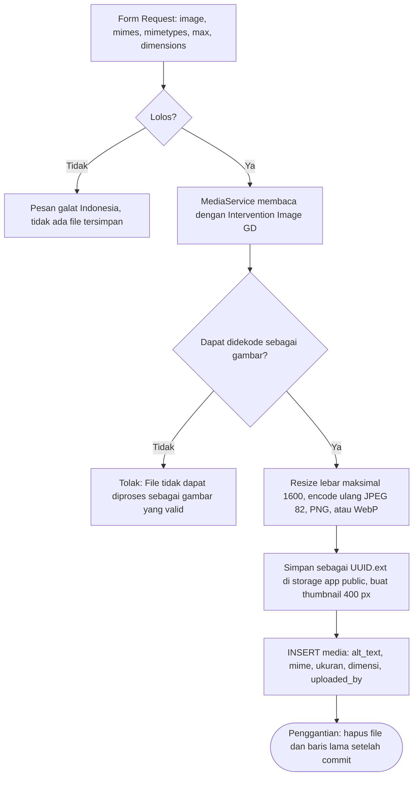

# 12 — Aturan Bisnis, Validasi, dan Keamanan

**Tujuan bagian.** Bagian ini menetapkan seluruh **aturan bisnis** yang harus ditegakkan aplikasi (dengan penegakan konkret di service, constraint database, policy, atau Form Request), **aturan validasi untuk setiap form** (aturan Laravel dan pesan galat Bahasa Indonesia), **kontrol keamanan** yang memenuhi kebutuhan §12 beserta pemetaan OWASP Top 10 (2021), **prinsip privasi dan minimisasi data**, **katalog audit log**, serta perbedaan konfigurasi keamanan lokal dan produksi. Nama tabel, kolom, enum, route, izin, kunci pengaturan, dan service mengikuti [00 — Keputusan Inti](00-keputusan-inti.md) secara persis. Alur yang memakai aturan ini dijelaskan di [06 — Alur](06-alur.md).

**Bagian terkait:** [03 — Arsitektur](03-arsitektur.md) · [04 — Peran dan Hak Akses](04-peran-hak-akses.md) · [05 — Sitemap dan Matriks Halaman](05-sitemap-matriks-halaman.md) · [06 — Alur](06-alur.md) · [08 — ERD](08-erd.md) · [09 — Data Dictionary](09-data-dictionary.md) · [11 — Route, Controller, Model, Service](11-route-controller-model-service.md) · [13 — Data Contoh](13-data-contoh.md) · [15 — Pengujian dan Penerimaan](15-pengujian-penerimaan.md) · [16 — Instalasi dan Operasional](16-instalasi-operasional.md) · [17 — Keputusan dan Konfirmasi](17-keputusan-konfirmasi.md)

---

## 1. Prinsip Penulisan Aturan dan Validasi

1. **Validasi server adalah satu-satunya yang dipercaya.** Setiap form memakai Form Request (`App\Http\Requests\...`); validasi JavaScript hanya kenyamanan. Method `authorize()` setiap Form Request memeriksa izin/policy (bukan `return true`, kecuali form tamu). Karena `Gate::before` membuat Super Admin melewati seluruh Policy, **aturan mutlak yang juga berlaku bagi Super Admin** (minimal satu Super Admin aktif, tidak menonaktifkan diri sendiri, larangan hapus permanen, sesi lampau tidak dapat diubah) ditegakkan di service dan Form Request, bukan di Policy (00 G).
2. **Pesan galat Bahasa Indonesia** disimpan di `lang/id/validation.php` (pesan baku + `attributes` label) dan di method `messages()` Form Request untuk pesan khusus. Kalimat pesan di bagian ini adalah **nilai akhir** yang tampil ke pengguna. Nama bidang pada pesan memakai label UI.
3. **Aturan ditulis berurutan**; `bail` ditambahkan di awal untuk bidang yang aturan berikutnya mahal (query `exists`/`unique`). Setiap aturan ditulis dalam kode `seperti ini`; objek aturan ditulis `new NamaAturan` atau `Rule::...`. Tidak ada aturan yang memakai karakter `|` (selalu array) agar tabel dan kode tidak ambigu.
4. **Normalisasi sebelum validasi** (`prepareForValidation`): `trim` semua string; email → huruf kecil; telepon → hapus spasi, tanda hubung, tanda kurung, dan titik; nomor BPJS/polis → hapus spasi dan tanda hubung; `code` poliklinik → huruf kapital; angka tarif → buang pemisah ribuan (`.`) dan ubah `,` desimal menjadi `.`.
5. **Hanya `$request->validated()`** yang dipakai untuk mengisi model; model memakai `$fillable` eksplisit. Bidang seperti `user_id`, `patient_number`, `status`, `booked_count`, `is_active` tidak pernah diisi dari input pengguna kecuali form khususnya.
6. **Keterlibatan database** adalah lapis pengaman terakhir (UNIQUE, CHECK, FK), bukan pengganti validasi.
7. Pesan galat sistem umum (403, 404, 419, 422, 429, 500) ada di [06 §0.4](06-alur.md#04-pesan-sistem-umum-dipakai-semua-alur-kecuali-dinyatakan-lain).

---

## 2. Aturan Bisnis

Setiap aturan: **ID**, pernyataan, **penegakan** (lapisan yang menegakkan), dan **pesan galat** bila relevan. Penanda **[ASUMSI]** menandai aturan yang melengkapi 00 dan tercatat di bagian *Asumsi*. Kode galat `BookingException` (9 kode, 00 F.5, termasuk `SYSTEM_BUSY`) dan `InvalidTransitionException` (00 J.6; kodenya `INVALID_TRANSITION`, `ALREADY_FINAL`, `FORBIDDEN_TRANSITION`, `STALE_STATUS`, `CANCEL_CUTOFF_PASSED`, `CONFIRM_AFTER_END`, `CHECKIN_NOT_TODAY`, `CHECKIN_NOT_OPEN`, `CHECKIN_CLOSED`, `CORRECTION_NOT_SAME_DAY`, `SESSION_NOT_ENDED`, `REASON_REQUIRED`, daftar di 11 §6.2) serta pesannya didefinisikan di [06 §3.F](06-alur.md#3f-cabang-galat-bookingexception-00-f5) dan [06 §8.2](06-alur.md#82-tabel-transisi-00-f8-dengan-galat). Galat lain pada perubahan jadwal, resolusi sesi terdampak, dan penghubungan akun melempar `ValidationException` biasa (00 F.5: tidak ada kelas exception khusus); label huruf besar seperti `CLINIC_CHANGE_BLOCKED`, `SESSION_PAST`, `SESSION_ALREADY_RESOLVED`, `PROFILE_ALREADY_LINKED` pada kolom Penegakan hanyalah penanda dokumentasi untuk pesan `ValidationException` tersebut.

### 2.A Dokter, spesialisasi, poliklinik, dan templat jadwal

| ID | Aturan | Penegakan | Pesan galat |
|---|---|---|---|
| BR-01 | Nama dokter disimpan tanpa gelar. Nama tampilan = `"{title_prefix} {name}, {title_suffix}"` dengan bagian kosong dibuang. | Accessor `Doctor::display_name`; teks bantuan pada form. | — |
| BR-02 | Dokter wajib memiliki satu poliklinik utama (`doctors.clinic_id`), minimal satu spesialisasi, dan tepat satu spesialisasi `is_primary`. | `StoreDoctorRequest`/`UpdateDoctorRequest`; PK komposit `doctor_specialties`; transaksi simpan. | "Pilih minimal satu spesialisasi." / "Spesialisasi utama harus salah satu spesialisasi yang dipilih." |
| BR-03 | Dokter tidak pernah dihapus permanen. Status: `active`, `inactive`, `archived`. | FK `RESTRICT` dari `doctor_schedules`, `practice_sessions`, `appointments`; tidak ada route `destroy` (ditegakkan oleh ketiadaan route dan FK, bukan Policy). | — |
| BR-04 | Hanya dokter `active` di poliklinik aktif tampil di `doctors.index`, `doctors.show`, `schedules.index` dan dapat dipesan. Dokter `inactive`/`archived` atau di poliklinik nonaktif → detail menjawab 404, juga bagi staf yang login. | Scope `Doctor::publiclyVisible()` (dokter `active` + poliklinik aktif); `DoctorAvailabilityQuery` (syarat `is_bookable_online`). | — |
| BR-05 (00 F.4, D-01/D-02) | **Menonaktifkan** dokter diizinkan walau ada appointment aktif: sesi mendatang tanpa appointment aktif → `cancelled`; dengan appointment aktif → `needs_review` dengan `pending_change` sumber `doctor_inactive` (appointment lama tidak dibatalkan otomatis; petugas menyelesaikannya di layar Sesi terdampak; `keep` hanya bila dokter diaktifkan kembali, selain itu wajib `cancel`). **Mengarsipkan** dokter **ditolak** bila masih ada appointment aktif pada sesi mendatang (selesaikan sesi terdampak dahulu). | `ScheduleChangeService::applyDoctorInactive()` (dipanggil `DoctorController@status`/`@archive`); arsip: `ArchiveDoctorRequest` + `DoctorService::archiveBlockedReason()` yang memakai `DoctorService::futureActiveAppointmentsCount()` (scope `Appointment::scopeUpcomingActive()`; F3-R15). `applyDoctorInactive()` dipanggil `DoctorService::changeStatus()`/`archive()` dalam transaksi yang sama (F3-R16). | Nonaktif dan arsip (flash `success`, bukan `warning`; fase 3): pesan baku "Dokter dinonaktifkan." atau "Dokter diarsipkan." ditambah ringkasan `ScheduleChangeReport::message()` bila tidak kosong, mis. "Dokter dinonaktifkan. 1 sesi dibatalkan, 1 sesi perlu ditindaklanjuti petugas pendaftaran." Arsip ditolak: "Dokter masih memiliki {N} pendaftaran aktif pada sesi mendatang. Selesaikan sesi terdampak terlebih dahulu, lalu arsipkan dokter." |
| BR-06 **[ASUMSI]** | Mengarsipkan dokter (hanya bila BR-05 terpenuhi) mengisi `archived_at`, memanggil `applyDoctorInactive()` (semua sesi mendatang tanpa appointment aktif → `cancelled`), dan menonaktifkan seluruh templatnya; dokter arsip tidak tampil di publik dan tidak dapat diberi jadwal. Pemulihan dari arsip menghasilkan status `inactive`; templat tidak otomatis aktif kembali; sesi `cancelled` tidak dibuka otomatis (dibuka manual per sesi setelah dokter `active`). | `ScheduleChangeService`; `admin.doctors.archive`/`admin.doctors.status`. | — |
| BR-07 | Templat: `day_of_week` 1–7 (ISO-8601, 1 = Senin), `end_time > start_time`, kuota 1–200. | `DoctorScheduleRequest`; CHECK DB `end_time > start_time`. | "Hari tidak valid." / "Jam selesai harus setelah jam mulai." / "Kuota minimal 1 dan maksimal 200." |
| BR-08 | Templat aktif seorang dokter pada hari yang sama tidak boleh beririsan jam (`start1 < end2 AND start2 < end1`) dalam rentang berlaku yang beririsan (`valid_until` NULL = tanpa batas). | Rule `NoOverlappingSchedule` (mengecualikan baris sendiri; hanya bila `is_active`). | "Jadwal bertabrakan dengan jadwal aktif lain milik dokter ini pada hari yang sama ({hari} {jam}, berlaku {rentang})." |
| BR-09 | `valid_from` wajib; `valid_until` boleh kosong (tanpa batas) dan bila diisi tidak boleh sebelum `valid_from`. `valid_from` pada templat baru tidak boleh di masa lalu. | `DoctorScheduleRequest`. | "Tanggal mulai berlaku tidak boleh di masa lalu." / "Tanggal berlaku sampai tidak boleh sebelum tanggal mulai berlaku." |
| BR-10 | Poliklinik pada templat harus `is_active` dan `is_bookable`. Mengganti poliklinik templat ditolak bila ada sesi mendatang dengan appointment aktif (buat templat baru lalu nonaktifkan yang lama). | `Rule::exists('clinics','id')->where(...)`; `ScheduleChangeService::assertClinicChangeAllowed()` melempar `ValidationException` (label `CLINIC_CHANGE_BLOCKED`). | "Poliklinik tidak dapat diganti karena masih ada sesi mendatang dengan pendaftaran aktif. Buat jadwal baru, lalu nonaktifkan jadwal lama." |
| BR-11 | Satu dokter tidak dapat berpraktik di dua poliklinik pada jam yang beririsan. | BR-08 dicek per dokter, bukan per poliklinik. | (sama dengan BR-08) |
| BR-12 | Menurut 00 C, templat boleh dihapus **hanya bila tidak ada sesi miliknya yang ber-appointment** (termasuk riwayat batal); sesi tanpa appointment milik templat itu, **lampau maupun mendatang**, ikut dihapus lebih dulu dalam transaksi yang sama (pengecualian sadar atas aturan "sesi lampau tidak diubah", yang hanya berlaku untuk operasi per sesi; JDW-19a). Bila ada sesi ber-appointment, tombol hapus diganti "Nonaktifkan" (`is_active = false`) dengan pesan alasan. | `ScheduleChangeService::deleteTemplate()` (service, bukan Policy; `DoctorSchedulePolicy::delete` memeriksa hal yang sama). | "Jadwal ini sudah memiliki sesi dengan pendaftaran dan hanya dapat dinonaktifkan." |
| BR-13 **[ASUMSI]** | `clinics.code` berupa huruf kapital A–Z sepanjang 2–5, unik, dan tidak dapat diubah setelah poliklinik memiliki appointment (nomor antrean tercetak, mis. `ANK-007`, tetap konsisten). | `ClinicRequest` + UNIQUE `code`. | "Kode poliklinik harus 2 sampai 5 huruf kapital." / "Kode poliklinik sudah digunakan." / "Kode poliklinik tidak dapat diubah karena sudah dipakai pada nomor antrean." |
| BR-14 **[ASUMSI]** | `is_bookable = true` hanya untuk `type = poliklinik`; layanan penunjang tidak memiliki sesi. | `ClinicRequest` (`prohibited_if`). | "Layanan penunjang tidak dapat dibuka untuk pendaftaran kunjungan." |
| BR-15 | `slug` entitas publik dibuat sistem dari nama/judul, unik (sufiks `-2`, `-3`), dan tidak berubah saat nama diedit. | Trait `HasUniqueSlug` (event `creating`; sumber nama tanpa gelar, dipotong sesuai panjang kolom) + UNIQUE `slug` (F2-R5). | — |
| BR-16 | **Satu sumber jadwal** (§6 kebutuhan): halaman publik (`doctors.index` dengan filter tanggal, `doctors.show`, `schedules.index`), wizard `patient.appointments.create`, dan form walk-in memakai `DoctorAvailabilityQuery`; tidak ada query jadwal lain. | Kelas tunggal; tes konsistensi membandingkan keluaran halaman publik dan wizard. | — |
| BR-17 | Spesialisasi/poliklinik (juga mitra asuransi) yang dirujuk data lain tidak dihapus permanen; bila dirujuk tombol hapus diganti "Nonaktifkan" dengan pesan alasan (00 C). | FK `RESTRICT`/`nullOnDelete`; `deletionBlockedReason()` pada controller penghapusan. | "{Spesialisasi/Poliklinik} masih dipakai oleh {N} data. Nonaktifkan saja." |

### 2.B Sesi dan pengecualian

| ID | Aturan | Penegakan | Pesan galat |
|---|---|---|---|
| BR-18 | Jadwal berlapis tiga: `doctor_schedules` (templat) → `schedule_exceptions` (pemblokiran) → `practice_sessions` (sesi nyata). Booking merujuk sesi, bukan templat. | Struktur tabel dan FK `appointments.practice_session_id`. | — |
| BR-19 | Pembangkitan sesi idempoten untuk rentang hari ini … hari ini + `booking.window_days`. | `PracticeSessionGenerator` memakai `insertOrIgnore` pada UNIQUE (`doctor_schedule_id`, `session_date`). | — |
| BR-20 | Pemicu pembangkitan: (a) setiap simpan templat/pengecualian; (b) maksimal sekali per hari saat halaman jadwal publik atau wizard dibuka; (c) `php artisan sessions:generate {--days=}`. | `Cache::lock` + penanda `sessions:generated:{Y-m-d}`. | — |
| BR-21 | Sesi baru yang jatuh dalam rentang pengecualian dibuat `cancelled` dengan `schedule_exception_id`. Bila beberapa pengecualian berlaku, dipilih yang khusus dokter, lalu `id` terkecil (F3-R10; aturan yang sama dipakai `removeException` saat memindahkan sesi ke pengecualian lain). | `PracticeSessionGenerator`, `ScheduleChangeService`. | — |
| BR-22 | Generator tidak pernah mengubah sesi yang sudah ada dan tidak pernah membangkitkan tanggal sebelum hari ini. | `insertOrIgnore`; `from = today`. | — |
| BR-23 | Pengecualian berlaku untuk **satu hari penuh**; `doctor_id` NULL = seluruh dokter/RS; `end_date >= start_date`. | `ScheduleExceptionRequest`; CHECK DB. | "Tanggal selesai tidak boleh sebelum tanggal mulai." |
| BR-24 | `start_date` pengecualian tidak boleh di masa lalu. Pada pembaruan, `start_date` yang tidak berubah boleh tetap di masa lalu. | `ScheduleExceptionRequest`. | "Tanggal mulai tidak boleh di masa lalu." |
| BR-25 | Kombinasi jenis pengecualian vs dokter (00 E.2): `doctor_leave` wajib memilih dokter; `hospital_holiday` dan `national_holiday` tidak boleh memilih dokter (`doctor_id` NULL = seluruh RS); `other` boleh keduanya. | `ScheduleExceptionRequest` (`required_if`/`prohibited_if`) + CHECK DB `chk_schedule_exceptions_scope` (09 bagian 11.3). | "Pilih dokter untuk cuti dokter." / "Libur rumah sakit atau libur nasional berlaku untuk semua dokter. Kosongkan pilihan dokter." |
| BR-26 **[ASUMSI]** | Rentang satu pengecualian maksimal 365 hari. | `ScheduleExceptionRequest`. | "Rentang pengecualian maksimal 365 hari." |
| BR-27 | Menambah pengecualian: sesi mendatang dalam rentang tanpa appointment aktif → `cancelled`; dengan appointment aktif → `needs_review` (sumber `exception`). Berlaku terlepas dari `is_manually_modified` **[ASUMSI]**. | `ScheduleChangeService`. | — |
| BR-28 | Menghapus/mempersempit pengecualian: sesi yang dibatalkan olehnya dan belum lewat dibuka kembali (`open`) atau diarahkan ke pengecualian lain yang masih berlaku; sesi `needs_review` sumber `exception` kembali `open`; keduanya dievaluasi ulang terhadap templat **[ASUMSI]**. | `ScheduleChangeService`. | — |
| BR-29 | Sesi tambahan manual (`doctor_schedule_id` NULL): `session_date` antara hari ini dan 365 hari ke depan **[ASUMSI]**, tidak pada tanggal yang tercakup pengecualian, dan jamnya tidak beririsan dengan sesi non-`cancelled` dokter yang sama pada tanggal itu **[ASUMSI]**. | `PracticeSessionRequest::after()` (tanpa kelas aturan terpisah). | "Tanggal sesi tidak boleh di masa lalu." / "Tanggal ini berada dalam pengecualian jadwal ({alasan}). Hapus atau ubah pengecualian terlebih dahulu." / "Jam sesi bertabrakan dengan sesi lain milik dokter ini pada tanggal tersebut." |
| BR-30 | Setiap edit sesi menyetel `is_manually_modified = true`; sesi tersebut tidak ditimpa regenerasi maupun perubahan templat. | `PracticeSessionRequest`/service. | — |
| BR-31 | Kuota sesi 1–200 dan tidak boleh kurang dari `booked_count`. | `PracticeSessionRequest`; CHECK DB `booked_count <= quota`. | "Kuota tidak boleh kurang dari jumlah pendaftaran yang sudah ada ({booked})." |
| BR-32 | Jam sesi: `end_time > start_time`. | `PracticeSessionRequest`; CHECK DB. | "Jam selesai harus setelah jam mulai." |
| BR-33 | Sesi dengan tanggal sebelum hari ini tidak dapat diubah. | `PracticeSessionRequest` dan `ScheduleChangeService` (`ValidationException`, label `SESSION_PAST`). | "Sesi yang sudah lewat tidak dapat diubah." |
| BR-34 | `closed` dan `needs_review` menutup booking baru tetapi booking lama tetap berlaku; `cancelled` tidak memiliki booking aktif. | `DoctorAvailabilityQuery`, `BookingService` aturan 1. | "Sesi praktik ini tidak tersedia untuk pendaftaran. Silakan pilih sesi lain." |
| BR-35 (00 F.4, D-03) | Pada edit manual satu sesi yang memiliki appointment aktif: perubahan **kuota** langsung diterapkan (tidak boleh < `booked_count`); menggeser **jam** menjadikan sesi `needs_review` sumber `manual_time`; **membatalkan** sesi menjadikannya `needs_review` sumber `manual_cancel`; keduanya diselesaikan petugas. Sesi tanpa appointment aktif langsung diubah/dibatalkan. | `ScheduleChangeService::updateSession()`/`setSessionStatus()`. | "Sesi memiliki {N} pendaftaran aktif. Perubahan dikirim ke layar Sesi terdampak untuk diselesaikan petugas pendaftaran." |
| BR-36 **[ASUMSI]** | `Availability` diturunkan (tidak disimpan) dengan urutan: past → leave/holiday/cancelled → under_review → closed → full → booking_closed → available. | `DoctorAvailabilityQuery` (rinci di [06 §9.3](06-alur.md#93-turunan-availability-tidak-disimpan-di-db)). | — |

### 2.C Booking dan kuota

| ID | Aturan | Penegakan | Pesan galat |
|---|---|---|---|
| BR-37 | Sesi harus `open`, dokter `active`, poliklinik `is_active` dan `is_bookable` (F.5 #1). | `BookingService::book` → `SESSION_UNAVAILABLE`. | "Sesi praktik ini tidak tersedia untuk pendaftaran. Silakan pilih sesi lain." |
| BR-38 | `session_date` antara hari ini dan hari ini + `booking.window_days`; pasien tidak dapat memilih jadwal yang sudah lewat (F.5 #2). | → `OUTSIDE_WINDOW`. | "Pendaftaran hanya dapat dilakukan untuk tanggal mulai hari ini sampai {N} hari ke depan." |
| BR-39 | Online: `now < start − booking.online_cutoff_minutes`. Loket: `now < end_time` pada tanggal sesi (F.5 #3). | → `CUTOFF_PASSED`. | Online: "Pendaftaran online untuk sesi ini sudah ditutup ({N} menit sebelum sesi dimulai). Silakan datang ke loket pendaftaran atau hubungi rumah sakit." Loket: "Sesi ini sudah berakhir." |
| BR-40 | Kuota tidak boleh terlampaui, termasuk pada pendaftaran bersamaan: `booked_count < quota` diperiksa setelah `lockForUpdate` pada sesi (F.5 #4). | Kunci baris + CHECK `booked_count <= quota` → `QUOTA_FULL`. | "Kuota sesi ini sudah penuh. Silakan pilih tanggal atau sesi lain." |
| BR-41 | Pasien tidak boleh memiliki dua appointment aktif pada sesi yang sama (F.5 #5). | Pemeriksaan dalam transaksi + UNIQUE (`patient_profile_id`, `practice_session_id`, `active_flag`) → `DUPLICATE_BOOKING`. | "{Anda/Pasien ini} sudah memiliki pendaftaran aktif pada sesi dokter ini." |
| BR-42 | Pasien tidak boleh memiliki appointment aktif pada tanggal yang sama di sesi lain dengan jam beririsan, lintas dokter dan poliklinik (`start1 < end2 AND start2 < end1`) (F.5 #6). | Pemeriksaan di bawah kunci profil → `OVERLAPPING_BOOKING`. | "Jadwal ini bertabrakan dengan pendaftaran lain {Anda/Pasien ini} pada tanggal yang sama ({dokter}, {jam mulai}–{jam selesai})." |
| BR-43 | Jumlah appointment aktif mendatang pasien harus `< booking.max_active_per_patient` (kanal online saja). "Mendatang" = status `ACTIVE`, `session_date >= hari ini`, dan akhir sesi belum lewat **[ASUMSI]**. | → `ACTIVE_LIMIT_REACHED`. | "{Anda/Pasien ini} sudah memiliki {N} pendaftaran aktif yang akan datang (batas maksimum). Selesaikan atau batalkan salah satunya terlebih dahulu." |
| BR-44 | Pembayaran: `bpjs` → `payment_reference` 13 digit angka wajib; `asuransi` → `insurance_partner_id` wajib + nomor polis opsional; `umum` → keduanya kosong (F.5 #8). | Form Request (pesan per field) + `BookingService` → `INVALID_PAYMENT`. | "Data pembayaran tidak sesuai: nomor BPJS (13 digit) wajib untuk pembayaran BPJS dan mitra asuransi wajib untuk pembayaran asuransi." |
| BR-45 **[ASUMSI]** | Pasien online hanya mendaftarkan dirinya (satu akun = satu profil = satu pasien); profil dan akun harus aktif. Petugas dapat memilih profil aktif mana pun. | `StoreAppointmentRequest` memakai profil milik `$request->user()`; `Rule::exists(...)->where('is_active', true)` pada form walk-in. | "Profil pasien tidak aktif atau tidak ditemukan." |
| BR-46 | Semua pemeriksaan F.5 berjalan **di dalam transaksi setelah penguncian** dengan urutan baku `patient_profiles` → `practice_sessions` → `appointments`; `attempts: 3`. | `DB::transaction(..., attempts: 3)`; sisa galat penguncian → `BookingException` kode `SYSTEM_BUSY` (00 F.5). | "Sistem sedang sibuk, silakan coba lagi beberapa saat." (bila 3 percobaan gagal; tidak ada data tersimpan sebagian) |
| BR-47 | Lapis pengaman DB: UNIQUE (`practice_session_id`, `queue_number`), UNIQUE `booking_code`, UNIQUE (`patient_profile_id`, `practice_session_id`, `active_flag`), CHECK `booked_count <= quota`. Pelanggaran diterjemahkan menjadi `BookingException` yang sesuai atau diulang dengan memeriksa `errorInfo[1]`: duplikat UNIQUE = SQLSTATE 23000/errno 1062; pelanggaran CHECK = errno 4025 (MariaDB) atau 3819 (MySQL 8); lock wait timeout (errno 1205) dan deadlock (errno 1213) yang masih terjadi setelah `attempts: 3` menjadi `SYSTEM_BUSY` (tabel penerjemahan di 09 bagian 11.4). | Constraint DB + penangkap `QueryException` di `BookingService`. | (sesuai kode) |
| BR-48 | Cegah kirim ganda: tombol dinonaktifkan saat submit, `Cache::lock("booking-submit:{user_id}", 10)`, throttle `booking` 10/menit per user id. | JS + `Cache::lock` + `RateLimiter`. | "Permintaan Anda sedang diproses. Mohon tunggu sebentar dan jangan menekan tombol berulang kali." |
| BR-49 | `booking_code` = `UPH-` + 8 karakter acak Crockford Base32 (`0123456789ABCDEFGHJKMNPQRSTVWXYZ`, `random_int`) berformat `UPH-XXXX-XXXX`, unik (ulangi bila bentrok), **tidak memuat data pasien**. QR code (SVG) hanya berisi string kode ini. | `BookingCodeGenerator`; UNIQUE `booking_code`. | — |
| BR-50 | `queue_number = ++last_queue_number` per sesi: unik per dokter + tanggal + sesi, monoton naik, **tidak pernah dipakai ulang**. Tampilan `{clinics.code}-{3 digit}` (4 digit atau lebih bila ≥ 1000). | `BookingService`; UNIQUE (`practice_session_id`, `queue_number`); `QueueNumberFormatter`. | — |
| BR-51 | Status awal: kanal online `pending` (atau `confirmed` bila `booking.auto_confirm = true`); kanal loket `confirmed`. | `BookingService`. | — |
| BR-52 | `doctor_id`, `clinic_id`, `session_date` pada `appointments` disalin dari sesi saat booking (denormalisasi untuk filter/laporan) dan tidak diubah sesudahnya. | `BookingService`; tidak ada form yang mengubahnya. | — |
| BR-53 | `payment_reference` (nomor BPJS/polis) terenkripsi (cast `encrypted`); `payment_reference_last4` dipakai untuk tampilan. Nomor utuh tidak pernah ditampilkan kepada staf; bukti pendaftaran dan ekspor hanya memuat 4 digit terakhir. | Model cast; `AppointmentResource`/view memakai `*_last4`. | — |
| BR-54 | Bukti pendaftaran hanya dapat diakses pemilik atau staf dengan `appointments.view`. Pasien yang bukan pemilik menerima 404 (bukan 403) agar kode booking tidak dapat diuji keberadaannya **[ASUMSI]**. | `AppointmentPolicy::view` dengan `Response::denyAsNotFound()` bagi pasien. | "Halaman yang Anda cari tidak ditemukan." |
| BR-55 | `complaint` (keluhan) opsional, maksimal 500 karakter, teks biasa, hanya dilihat pemilik dan staf `appointments.view`; tidak disertakan di notifikasi, ekspor, maupun audit. | `StoreAppointmentRequest`; `AuditLogger` redaksi; template notifikasi. | "Keluhan maksimal 500 karakter." |
| BR-56 **[ASUMSI]** | Nomor BPJS disimpan ke `patient_profiles` (terenkripsi + `bpjs_number_last4`) hanya bila pasien memilih "Simpan nomor BPJS ke profil saya"; pasien dapat menghapusnya dari profil. | `StoreAppointmentRequest` (`save_bpjs`), `UpdatePatientProfileRequest` (`remove_bpjs`). | — |
| BR-178 (00 F.3, D-06) | Kelayakan **loket/walk-in** terpisah dari online: `is_bookable_counter` = syarat `is_bookable_online` kecuali batas waktu menjadi `now < end_time` pada `session_date`; sesi yang `booking_closed` bagi online tetap dapat dipilih petugas di loket selama belum berakhir dan kuota tersedia. Form walk-in dan `BookingService` (aktor staf) memakai aturan ini; batas `booking.max_active_per_patient` tidak berlaku untuk loket. | `DoctorAvailabilityQuery` (`SessionAvailability::isBookableCounter`); `BookingRules::assertBookable`. | "Sesi ini sudah berakhir." (bila lewat `end_time`) |
| BR-179 (00 I.3) | Kegagalan validasi atau `BookingException` pada `patient.appointments.review` maupun `patient.appointments.store` **dialihkan ke `patient.appointments.create` dengan query langkah terakhir (`poli`, `dokter`, `sesi`) + `withInput()`**, tidak pernah `back()`: halaman konfirmasi adalah hasil POST yang tidak punya route GET, sehingga `back()` berujung 405. Data pembayaran sensitif (`bpjs_number`) tidak ikut dikembalikan ke formulir. | `StoreAppointmentRequest::getRedirectUrl()`/`ReviewAppointmentRequest`, `SafeRedirect::back()` (11 §11.2). | (pesan galat tampil di langkah wizard yang dikembalikan) |

### 2.D Antrean dan status

| ID | Aturan | Penegakan | Pesan galat |
|---|---|---|---|
| BR-57 | Status yang menghitung kuota: `pending`, `confirmed`, `checked_in`, `completed`, `no_show`. `cancelled` tidak menghitung dan `booked_count` dikurangi 1. Invarian: `booked_count = COUNT(appointments non-cancelled)` per sesi. | `AppointmentStatusService`; tes invarian. | — |
| BR-58 | Hanya transisi pada tabel F.8 yang sah; status final (`completed`, `cancelled`, `no_show`) tidak dapat diubah. | `AppointmentStatusService::transition` → `INVALID_TRANSITION`/`ALREADY_FINAL`. | "Perubahan status dari ':dari' ke ':ke' tidak diperbolehkan." / "Pendaftaran ini sudah berstatus {status} dan tidak dapat diubah lagi." |
| BR-59 | Setiap transisi mengisi kolom waktu terkait, menulis `appointment_status_histories` dan `audit_logs`, serta mengirim notifikasi ke pasien berakun setelah commit: kanal `database` untuk **setiap** transisi, kanal `mail` hanya untuk `confirmed`, `cancelled`, dan perubahan jadwal (00 F.8; K-13 (b), diputuskan pemilik 2026-10-08, di 17). | `AppointmentStatusService`; `via()` kelas notifikasi. | — |
| BR-60 | Konfirmasi `pending → confirmed` hanya oleh petugas (`appointments.manage`) sebelum sesi berakhir. `booking.auto_confirm` hanya memengaruhi pendaftaran baru. | `TransitionAppointmentRequest`; service → `CONFIRM_AFTER_END`. | "Sesi sudah berakhir sehingga pendaftaran tidak dapat dikonfirmasi." |
| BR-61 | Check-in hanya oleh petugas, pada `session_date`, dari `start − booking.checkin_open_minutes` sampai `end_time`. | Service → `CHECKIN_NOT_TODAY`/`CHECKIN_NOT_OPEN`/`CHECKIN_CLOSED`. | "Check-in hanya dapat dilakukan pada tanggal kunjungan ({tanggal})." / "Check-in belum dibuka. Check-in dibuka pukul {jam}." / "Sesi sudah berakhir sehingga check-in tidak dapat dilakukan." |
| BR-62 | Pendaftaran `pending` boleh langsung di-check-in tanpa konfirmasi terpisah. | Tabel transisi F.8. | — |
| BR-63 | `completed` hanya dari `checked_in` oleh petugas. | Service → `INVALID_TRANSITION`. | (lihat BR-58) |
| BR-64 | Koreksi `checked_in → confirmed` hanya pada hari yang sama dengan alasan wajib; `checked_in_at` dikosongkan; riwayat tetap mencatat. | Service → `CORRECTION_NOT_SAME_DAY`/`REASON_REQUIRED`. | "Koreksi check-in hanya dapat dilakukan pada hari yang sama." / "Alasan wajib diisi untuk pembatalan atau koreksi check-in." |
| BR-65 | `no_show` hanya setelah `end_time` sesi lewat, lewat aksi massal per sesi (`admin.queue.mark-no-show`) atau `php artisan appointments:mark-no-show {--date=}`; tidak per individu; tetap menghitung kuota. | Service → `SESSION_NOT_ENDED`; `TransitionAppointmentRequest` menolak `to = no_show`. | "Tandai tidak hadir hanya dapat dilakukan setelah sesi berakhir (pukul {jam})." |
| BR-66 | Perintah `appointments:mark-no-show` idempoten (tidak menyentuh status final), aktor `ActorType::system`; tanpa `--date` memproses seluruh tanggal ≤ hari ini **[ASUMSI]**. | Perintah Artisan. | "{N} pendaftaran pada {M} sesi ditandai tidak hadir." |
| BR-67 **[ASUMSI]** | Transisi menyertakan `expected_status` untuk mencegah aksi ganda (dua petugas/klik ganda). | Service → `STALE_STATUS`. | "Status pendaftaran sudah berubah. Muat ulang halaman untuk melihat status terbaru." |
| BR-68 **[ASUMSI]** | Nomor antrean menentukan urutan layanan per sesi (urut kedatangan pendaftaran), bukan prioritas klinis; prioritas darurat/lansia di luar prototipe. | Kebijakan; `admin.queue.index` mengurutkan `queue_number`. | — |
| BR-69 | Pencarian/pemindaian kode booking di `admin.queue.index` hanya menemukan dan menyorot baris; check-in tetap tindakan petugas. | Controller; tanpa efek samping GET **[ASUMSI]**. | "Kode booking tidak ditemukan." / "Pendaftaran ini untuk tanggal {tanggal}, bukan hari ini." |
| BR-70 **[ASUMSI]** | Pelaku `system` hanya dipakai oleh perintah `appointments:mark-no-show`; tidak ada pembatalan otomatis oleh sistem. | Kode `Actor::system()` hanya dipanggil dari perintah. | — |
| BR-71 | `active_flag` (kolom generated) bernilai 1 untuk `pending`/`confirmed`/`checked_in` dan NULL untuk status final sehingga pasien dapat mendaftar ulang pada sesi yang sama setelah batal. | Kolom `storedAs(...)` + UNIQUE. | — |
| BR-72 | Melihat antrean/pendaftaran memerlukan `appointments.view`; mengubah status memerlukan `appointments.manage`. | Middleware `permission:*`, `AppointmentPolicy`, `authorize()`; `AppointmentStatusService` → `FORBIDDEN_TRANSITION` bila pelaku tidak berhak atas transisi itu (mis. pasien memilih `confirmed`). | "Anda tidak memiliki izin untuk mengakses halaman ini." |

### 2.E Pembatalan

| ID | Aturan | Penegakan | Pesan galat |
|---|---|---|---|
| BR-73 | Pasien pemilik dapat membatalkan `pending`/`confirmed` bila `now <= start − booking.cancel_cutoff_minutes` (bawaan 120 menit; sesi 09.00 → sampai 07.00 tepat). | `AppointmentStatusService` → `CANCEL_CUTOFF_PASSED`. | "Batas pembatalan online telah lewat (maksimal {N} menit sebelum sesi dimulai). Silakan hubungi rumah sakit di {telepon} atau melalui WhatsApp." |
| BR-74 | Setelah batas, pasien diarahkan menghubungi rumah sakit (telepon/WhatsApp biasa dari `contact.phone`/`contact.whatsapp`); tombol batalkan tidak ditampilkan dan server menolak. | View + service. | (sama BR-73) |
| BR-75 | Petugas dapat membatalkan `pending`/`confirmed` kapan saja sebelum check-in; alasan wajib (5–255 karakter). | `TransitionAppointmentRequest`; service → `REASON_REQUIRED`. | "Alasan wajib diisi untuk pembatalan atau koreksi check-in." |
| BR-76 | Alasan pembatalan oleh pasien opsional (maks. 255 karakter). | `CancelAppointmentRequest`. | "Alasan maksimal 255 karakter." |
| BR-77 | Pembatalan mengurangi `booked_count` 1; `last_queue_number` tidak dikurangi sehingga nomor antrean tidak dipakai ulang; kuota terbuka kembali selama sesi masih dapat dipesan. | `AppointmentStatusService`. | — |
| BR-78 | Setelah membatalkan, pasien boleh mendaftar lagi pada sesi yang sama (mendapat nomor baru) selama seluruh aturan booking terpenuhi. | `active_flag` NULL + BR-37…BR-44. | — |
| BR-79 | Pendaftaran `checked_in` tidak dapat dibatalkan langsung; petugas mengoreksi ke `confirmed` lebih dahulu. | Tabel transisi. | "Pendaftaran yang sudah check-in tidak dapat dibatalkan. Silakan hubungi petugas pendaftaran." |
| BR-80 | Pembatalan mengisi `cancelled_at`, `cancelled_by_type`, `cancelled_by_user_id`, `cancel_reason`; alasan terlihat oleh pasien (detail dan notifikasi). | Service. | — |
| BR-81 | Pasien hanya dapat membatalkan pendaftaran miliknya; milik pasien lain menjawab 404. | `AppointmentPolicy::cancel` + `denyAsNotFound`. | "Halaman yang Anda cari tidak ditemukan." |
| BR-82 | Pembatalan akibat resolusi sesi `cancel` dicatat `cancelled_by_type = staff`, alasan wajib, notifikasi dikirim. | `ScheduleChangeService::resolve`. | "Alasan pembatalan wajib diisi dan akan dikirim kepada pasien." |

### 2.F Perubahan jadwal setelah ada booking

| ID | Aturan | Penegakan | Pesan galat |
|---|---|---|---|
| BR-83 | Perubahan templat hanya memengaruhi sesi dengan `session_date >= hari ini`, berasal dari templat itu, dan `is_manually_modified = false`. | `ScheduleChangeService`. | — |
| BR-84 | Sesi tanpa appointment sama sekali dihapus lalu digenerate ulang. | `ScheduleChangeService` + `PracticeSessionGenerator`. | — |
| BR-85 | Sesi yang hanya memiliki riwayat batal diperbarui di tempat, atau `cancelled` bila tidak lagi valid. | `ScheduleChangeService`. | — |
| BR-86 | Perubahan **kuota saja** pada sesi berappointment aktif diterapkan sebagai `max(kuota_baru, booked_count)`; admin diberi pesan jumlah sesi yang disesuaikan. | `ScheduleChangeService`. | "{N} sesi disesuaikan; kuota tidak diturunkan di bawah jumlah pendaftaran yang ada." |
| BR-87 | Perubahan **jam**, **hari**, penonaktifan, atau penyempitan rentang berlaku pada sesi berappointment aktif menjadikan sesi `needs_review` dengan `pending_change` (`template_time` atau `template_removed`). | `ScheduleChangeService`. | "{N} sesi perlu ditindaklanjuti petugas pendaftaran." |
| BR-88 | Sesi `needs_review` tertutup untuk booking baru; booking lama tetap berlaku (tidak dibatalkan otomatis). | `DoctorAvailabilityQuery`, `BookingService`. | — |
| BR-89 | Resolusi hanya oleh pemegang `sessions.review`. Pilihan per sumber: `exception` → keep, cancel; `template_time` → keep, apply, cancel; `template_removed` → keep, cancel; `manual_time` → keep, apply, cancel; `manual_cancel` → keep, cancel; `doctor_inactive` → keep, cancel (`keep` hanya bila dokter diaktifkan kembali, selain itu wajib `cancel`). | `ResolveSessionRequest` + `ScheduleChangeService::allowedResolutions()`. | "Pilihan penyelesaian tidak tersedia untuk jenis perubahan ini." |
| BR-90 | `keep`: sesi tetap dengan nilai lama, `status = open`, `is_manually_modified = true`, `pending_change = NULL`. | Service. | — |
| BR-91 | `apply` (hanya `template_time`/`manual_time`): jam diperbarui, `open`, appointment aktif diberi `schedule_changed_at = now()` dan notifikasi. Layar menampilkan peringatan (tidak memblokir) bila jam baru berbenturan dengan booking lain pasien yang sama. | Service + view. | (peringatan) "Jam baru bertabrakan dengan pendaftaran {pasien} di {dokter} pukul {jam}. Hubungi pasien." |
| BR-92 | `cancel`: sesi `cancelled`; seluruh appointment aktif → `cancelled` (`cancelled_by_type = staff`, alasan wajib), kuota dilepas, notifikasi dikirim; petugas dapat membuat booking pengganti. | Service. | "Alasan pembatalan wajib diisi dan akan dikirim kepada pasien." |
| BR-93 | Pasien walk-in tanpa akun dihubungi petugas lewat telepon yang tercatat; layar hasil resolusi menampilkan daftarnya. | View `admin.sessions.review`. | — |
| BR-94 | Admin Konten tidak melihat data pribadi pasien: pada layar jadwal hanya **jumlah** booking per sesi; setelah mengubah jadwal ia diberi tahu "N sesi perlu ditindaklanjuti petugas pendaftaran". | Policy + view per izin (`appointments.view`). | — |
| BR-95 | Resolusi berjalan dalam transaksi dengan urutan kunci baku; resolusi ganda ditolak. | Service → `ValidationException` (label `SESSION_ALREADY_RESOLVED`). | "Sesi ini sudah diselesaikan oleh petugas lain. Muat ulang halaman." |
| BR-96 **[ASUMSI]** | Sesi `needs_review` yang tanggalnya sudah lewat hanya dapat di-`keep` (penutupan arsip). | Service/view. | "Sesi yang sudah lewat hanya dapat dipertahankan." |
| BR-97 | Audit perubahan templat/pengecualian mencatat jumlah sesi per jenis dampak (dibangkitkan ulang, disesuaikan, dibatalkan, perlu tindak lanjut) tanpa data pasien. | `AuditLogger`. | — |
| BR-176 (00 F.4) | **Satu sesi hanya menyimpan satu `pending_change`.** Bila sumber baru datang saat sesi masih `needs_review`: sumber jenis-batal (`exception`, `template_removed`, `manual_cancel`, `doctor_inactive`) mengalahkan sumber jenis-jam (`template_time`, `manual_time`); pada tingkat yang sama, sumber terbaru menggantikan yang lama; setiap penggantian dicatat di audit (`session.pending_replaced`). Pengecualian yang dicabut/dipersempit sementara sesi masih `needs_review` (belum diselesaikan) membuat sesi kembali `open` dengan `pending_change` dan `schedule_exception_id` dikosongkan (bila belum lewat). | `ScheduleChangeService::setPendingChange()` / `removeException()`. | — |
| BR-177 (00 F.4, D-01) | Menonaktifkan dokter: sesi mendatang tanpa appointment aktif → `cancelled`; dengan appointment aktif → `needs_review` sumber `doctor_inactive` (BR-05). `PracticeSessionGenerator` tidak membuat sesi untuk dokter non-`active`; membuka kembali sesi `cancelled` milik dokter non-`active` ditolak. | `ScheduleChangeService::applyDoctorInactive()`, `setSessionStatus()`. | "Sesi tidak dapat dibuka karena dokter belum aktif kembali." |

### 2.G Walk-in dan penghubungan akun

| ID | Aturan | Penegakan | Pesan galat |
|---|---|---|---|
| BR-98 | Petugas dapat membuat profil pasien **tanpa akun login** (`user_id` NULL) dan mendaftarkan kunjungan pada sesi yang sama dengan booking online; kuota dibagi (keputusan K1). Booking merujuk `patient_profiles`, bukan `users`. | `StorePatientRequest`, `StoreWalkInAppointmentRequest`, `BookingService` mengunci baris sesi yang sama. | — |
| BR-99 | Pembuatan profil walk-in mewajibkan petugas mencentang persetujuan privasi lisan; sistem menyimpan `consent_at = now()` dan `consent_version = privacy.consent_version`. | `StorePatientRequest` (`accepted`). | "Persetujuan privasi lisan dari pasien wajib dicentang." |
| BR-100 | NIK tidak dikumpulkan, tidak ada kolomnya, dan tidak diminta di form mana pun. | Skema 00 E.1; tinjauan form. | — |
| BR-101 | Nomor telepon wajib pada profil walk-in (dipakai petugas bila jadwal berubah dan tidak ada notifikasi sistem). | `StorePatientRequest`. | "Nomor telepon wajib diisi." |
| BR-102 **[ASUMSI]** | Sebelum menyimpan profil walk-in, sistem memeriksa profil aktif yang mirip (`full_name` + `birth_date` sama, atau `phone` sama). Bila ada, petugas memilih profil lama atau mencentang konfirmasi; tidak ada penggabungan otomatis. | `StorePatientRequest::withValidator`. | "Terdapat profil yang mirip. Pilih profil yang sudah ada atau centang konfirmasi untuk tetap membuat profil baru." |
| BR-103 | `patient_number` berformat `P` + 6 digit dari `id` (mis. `P000123`), unik, dan tidak dipakai ulang. | `PatientNumberGenerator`; UNIQUE `patient_number`. | — |
| BR-104 | Booking walk-in: kanal `loket`, status awal `confirmed`, aturan F.5 versi loket (cutoff `now < end_time`; batas aktif per pasien tidak berlaku); `created_by_user_id` = petugas. | `BookingService` + `StoreWalkInAppointmentRequest`. | (sesuai kode `BookingException`) |
| BR-105 **[ASUMSI]** | Profil nonaktif tidak dapat didaftarkan. Menonaktifkan profil ditolak bila ada appointment aktif; menonaktifkan profil yang terhubung ke akun ikut menonaktifkan akun (`users.is_active`) dalam satu transaksi. | `UpdatePatientStatusRequest` dan service pasien (satu transaksi; selaras 00 E.1). | "Pasien masih memiliki {N} pendaftaran aktif. Batalkan atau selesaikan terlebih dahulu." |
| BR-106 | Penghubungan profil walk-in ke akun online hanya oleh petugas (`patients.manage`) setelah verifikasi identitas di loket; tidak ada pencocokan otomatis berdasarkan email atau telepon. | `LinkPatientAccountRequest` (`identity_verified` = `accepted`); `PatientProfilePolicy::linkAccount`. | "Anda harus menegaskan bahwa identitas pasien telah diverifikasi di loket." |
| BR-107 | Syarat penghubungan: profil walk-in belum punya `user_id`; akun target bertipe `patient` dan aktif; profil milik akun target belum memiliki appointment. | `PatientAccountLinker` → `ValidationException` (label `PROFILE_ALREADY_LINKED`, `ACCOUNT_NOT_FOUND`, `ACCOUNT_INACTIVE`, `ACCOUNT_HAS_HISTORY`). | "Profil ini sudah terhubung ke sebuah akun." / "Akun pasien dengan email tersebut tidak ditemukan." / "Akun pasien tidak aktif." / "Akun ini sudah memiliki riwayat pendaftaran. Penggabungan dua profil berriwayat belum didukung." |
| BR-108 | Penghubungan berjalan dalam satu transaksi: kunci kedua profil menurut `id` menaik, hapus profil kosong milik akun, pasang `user_id` pada profil walk-in, tulis audit `patient.account_linked` (memuat nomor pasien dan persetujuan profil yang dihapus). | `PatientAccountLinker`. | — |
| BR-109 | Penggabungan dua profil yang sama-sama berriwayat dan pelepasan tautan (*unlink*) tidak tersedia pada prototipe (pengembangan lanjutan). | Tidak ada route/aksi. | — |
| BR-110 | Perubahan data profil oleh petugas memerlukan `patients.manage` dan dicatat `patient.updated`; nilai kolom PII (alamat, telepon, email, tanggal lahir) tidak disimpan di audit, hanya nama bidang yang berubah. | `PatientProfilePolicy::update`; `AuditLogger` redaksi tingkat 2. | — |

### 2.H Kamar dan fasilitas

| ID | Aturan | Penegakan | Pesan galat |
|---|---|---|---|
| BR-111 | Kapasitas kamar bersifat agregat per kategori (`room_categories`); tidak ada tabel kamar/tempat tidur per unit pada tahap ini. | Skema 00 E.4. | — |
| BR-112 | `0 <= beds_available <= bed_capacity`. | `UpdateRoomAvailabilityRequest`; CHECK DB. | "Jumlah tempat tidur tersedia tidak boleh melebihi kapasitas ({kapasitas} tempat tidur)." |
| BR-113 | Ketersediaan diperbarui **manual**; setiap pembaruan mengisi `availability_updated_at` dan `availability_updated_by`; kedua nilai tampil di halaman publik dan dashboard. | `admin.room-categories.availability`. | — |
| BR-114 | UI publik tidak menyebut ketersediaan sebagai pemantauan langsung; selalu menampilkan waktu pembaruan dan anjuran menghubungi rumah sakit. Label "Data mungkin tidak terkini" bila pembaruan > 24 jam **[ASUMSI]**. | View `rooms.*`; komponen `availability-badge`. | — |
| BR-115 | `bed_capacity` tidak boleh lebih kecil dari `beds_available` saat ini. | `RoomCategoryRequest`. | "Kapasitas tidak boleh lebih kecil dari tempat tidur tersedia saat ini ({n}). Perbarui ketersediaan terlebih dahulu." |
| BR-116 | Tarif (`sample_rate`, `rate_unit`, `rate_note`) adalah **contoh**, opsional, berlabel "Tarif contoh"; klasifikasi kamar (BPJS Kelas 1/2/3, VIP) tidak dinyatakan sebagai ketentuan BPJS yang telah diverifikasi. | Label di view; teks seeder; `RoomCategoryRequest`. | — |
| BR-117 | Kategori `is_active = false` tidak tampil di publik tetapi tetap dapat dikelola di admin; empat kategori seed (`bpjs-kelas-1`, `bpjs-kelas-2`, `bpjs-kelas-3`, `vip`) dapat diubah namanya, dan `slug` tidak berubah. | Scope publik; BR-15. | — |
| BR-118 | `amenities` adalah array teks: maksimal 30 butir, tiap butir 2–80 karakter dan unik. | `RoomCategoryRequest`. | "Fasilitas kamar maksimal 30 butir." / "Setiap butir fasilitas harus 2 sampai 80 karakter." |
| BR-119 | Fasilitas memiliki kategori `medis`, `penunjang`, atau `umum`; fasilitas nonaktif tidak tampil di publik. | `FacilityRequest`; scope publik. | "Kategori fasilitas tidak valid." |
| BR-120 | Pembaruan ketersediaan memerlukan `rooms.update-availability`; perubahan struktur kategori memerlukan `facilities.manage`. | Middleware `permission:*`, `RoomCategoryPolicy`. | "Anda tidak memiliki izin untuk mengakses halaman ini." |

### 2.I Konten dan media

| ID | Aturan | Penegakan | Pesan galat |
|---|---|---|---|
| BR-121 | Halaman sistem (`pages.key` baku, `is_system = true`) tidak dapat dibuat atau dihapus; hanya judul, subjudul, isi (untuk kunci yang memiliki `body`), dan meta yang dapat diubah. | `PagePolicy` (tanpa create/delete); `PageRequest` (`body` dilarang untuk kunci tanpa isi). | "Halaman ini tidak memiliki isi yang dapat diedit." |
| BR-122 | Hanya lima kolom rich text (`pages.body`, `articles.body`, `clinics.description`, `facilities.description`, `room_categories.description`) yang boleh berisi HTML dan dirender dengan `{!! !!}`; wajib disanitasi **saat disimpan**. Semua kolom lain dirender dengan `{{ }}`. | `HtmlSanitizer` (profil `rich_text` `mews/purifier`) dipanggil hanya oleh trait `SanitizesRichText` pada event `saving` sehingga setiap jalur simpan (form, seeder, `update()`) tersanitasi; Form Request tidak membersihkan HTML (F2-R14); tinjauan kode melarang `{!! !!}` di luar daftar. | — |
| BR-123 | `meta_title` ≤ 70 dan `meta_description` ≤ 160 karakter; bila kosong, halaman detail memakai nama + ringkasan sebagai cadangan. | Form Request; accessor `seoTitle`/`seoDescription` (11 §5). | "Meta title maksimal 70 karakter." / "Meta description maksimal 160 karakter." |
| BR-124 | Banner: `button_url` berupa jalur internal (diawali `/`, bukan `//`) atau URL `https://`; skema lain (`javascript:`, `data:`, `http:`) ditolak. Banner tayang bila `is_active` dan sekarang berada dalam [`starts_at`, `ends_at`] (`ends_at` NULL = tanpa batas). | Rule `InternalOrHttpsUrl`; scope `Banner::currentlyActive()` (starts_at/ends_at NULL = tanpa batas). | "Tautan harus berupa alamat internal (diawali /) atau URL https." |
| BR-125 | Artikel tayang bila `status = published` dan `published_at <= now()`; penghapusan memakai soft delete; `excerpt` ≤ 300 karakter. | Scope `Article::published()`; `SoftDeletes`. | "Ringkasan artikel maksimal 300 karakter." |
| BR-126 | Album galeri tampil di publik bila `is_published`; setiap foto wajib memiliki teks alternatif. | `GalleryRequest`, `StoreGalleryPhotosRequest`. | "Teks alternatif gambar wajib diisi." |
| BR-127 | FAQ: `category` hanya `pendaftaran`, `bpjs`, `layanan`, `umum`; jawaban teks biasa tanpa HTML; tampil bila `is_published`. | `FaqRequest` (`Rule::in`, `new NoHtml`). | "Kategori FAQ tidak valid." / "Jawaban tidak boleh mengandung tag HTML." |
| BR-128 | Data mitra asuransi bersifat fiktif dan berlabel "Contoh"; tidak boleh mengklaim kerja sama nyata; `website_url` opsional dan harus `https`; hanya mitra `is_active` yang dapat dipilih pada pendaftaran. | Seeder; `InsurancePartnerRequest`; `Rule::exists(...)->where('is_active', true)`. | "Alamat situs harus berupa URL https yang valid." |
| BR-129 | Unggahan gambar (00 K, D-11): `file`, `image`, `mimes:jpg,jpeg,png,webp`, `mimetypes:image/jpeg,image/png,image/webp`, ukuran maksimal 2048 KB (banner 4096 KB), dimensi maksimal 6000×6000 piksel untuk semua koleksi dan **minimum per koleksi**: `photo` 300×300, `cover` 800×450, `gallery`/`photos` 600×400, `image` (banner) 1200×400, `logo` 120×40, `editor` 200×100. **SVG unggahan ditolak** (risiko XSS); hanya placeholder bawaan aplikasi yang SVG. | Rule bersama `ImageRules::for($collection)`; aturan `image` Laravel 12 sudah menolak SVG. | "File harus berupa gambar JPG, PNG, atau WebP." / "Ukuran gambar maksimal 2 MB." |
| BR-130 | Pemrosesan wajib: baca dengan Intervention Image (GD) → resize lebar maksimal 1600 px → encode ulang (JPEG kualitas 82 / PNG / WebP; membuang EXIF dan muatan tersembunyi) → simpan dengan nama UUID → buat thumbnail lebar 400 px. Ekstensi file berasal dari format hasil encode, bukan dari nama unggahan. | `MediaService::store`. | "File tidak dapat diproses sebagai gambar yang valid." |
| BR-131 | Nama asli file hanya metadata (`original_name`) yang disanitasi (huruf/angka/spasi/`._-`, maks. 150 karakter); tidak pernah dipakai pada path atau header `Content-Disposition` tanpa sanitasi. | `MediaService`. | — |
| BR-132 | `alt_text` wajib (maks. 255 karakter) untuk seluruh koleksi publik: `photo`, `cover`, `gallery`, `image`, `photos`, `logo`, `editor`. | Form Request unggahan (`required`), kolom `media.alt_text`. | "Teks alternatif gambar wajib diisi." |
| BR-133 | Koleksi tunggal (`photo`, `cover`, `image`, `logo`) bersifat *ganti*; koleksi banyak (`gallery`, `photos`) mendukung tambah, urut ulang, dan hapus per gambar. | `MediaService::store/replace/delete`; `admin.media.reorder`. | — |
| BR-134 | Penggantian gambar: simpan file + baris `media` baru dahulu; setelah commit (`DB::afterCommit`) hapus file + baris lama; bila transaksi gagal, file baru dibersihkan dan yang lama tetap utuh. | `MediaService::replace`. | "Foto gagal disimpan. Periksa izin folder penyimpanan, lalu coba lagi." |
| BR-135 | `php artisan media:prune {--dry-run}` menghapus (a) baris `media` tanpa pemilik (`model_id` NULL) berumur > 24 jam dan (b) file di disk yang tidak tercatat di `media`; `--dry-run` hanya melaporkan. | Perintah Artisan. | "{N} baris dan {M} file akan dihapus (simulasi)." |
| BR-136 | Bila media NULL atau file fisik hilang, tampil placeholder lokal `public/images/placeholders/{doctor,clinic,facility,room,article,banner,gallery,logo}.svg`; aplikasi tidak mengambil gambar dari internet. | Accessor URL + `x-image` (fallback lewat skrip bundel, bukan atribut `onerror` inline). | — |
| BR-137 | Dokumen privat pasien (bila ditambahkan kelak) disimpan di disk `local` dan hanya dilayani lewat controller + policy; tidak pernah lewat URL publik. | Konfigurasi disk; `MediaPolicy`. | — |
| BR-138 | Tidak ada file executable yang dapat diunggah atau dieksekusi: whitelist ekstensi/MIME, re-encode, nama UUID, dan berkas `.htaccess` di `storage/app/public` yang menolak eksekusi skrip (`php`, `phtml`, `phar`) dan mematikan daftar direktori. | `ImageRules`, `MediaService`, konfigurasi Apache (16). | — |
| BR-139 | Pengaturan website memakai tipe tetap per kunci (`string`, `text`, `int`, `bool`, `url`, `email`, atau `json`); simpan membersihkan cache `settings:all` (kunci cache baku, 00 J.1). Telepon, WhatsApp, dan email bawaan adalah placeholder berlabel sampai data resmi tersedia. | `UpdateSettingsRequest`, `SettingsService`. | (lihat V-39) |
| BR-140 | WhatsApp hanya berupa tautan `https://wa.me/{contact.whatsapp}` yang dibuka manual oleh pengguna; **bukan** pengiriman otomatis. | Komponen tautan; tidak ada integrasi API. | — |
| BR-141 | `map.embed_url` hanya boleh berawalan `https://www.google.com/maps` atau `https://maps.google.com/` (sejalan dengan `frame-src` CSP); alamat teks selalu tampil walau peta gagal dimuat. | `UpdateSettingsRequest`; komponen `map-embed`. | "URL peta tersemat harus diawali https://www.google.com/maps atau https://maps.google.com/." |
| BR-142 | Informasi BPJS, tarif, dan persyaratan (`pages.insurance-info`) dapat diedit admin; konten tidak boleh mengklaim akreditasi atau kerja sama resmi yang belum ada. | Kebijakan konten; label "Contoh" pada data seed. | — |
| BR-143 | Tidak ada UI atau teks yang menyiratkan integrasi lanjutan (BPJS, SATUSEHAT, SIMRS, payment gateway, WhatsApp API, rekam medis, sinkronisasi kamar real-time) sudah aktif. | Tinjauan konten; 02 dan 17. | — |
| BR-180 (00 C) | Aturan `destroy` per tabel mengikuti tabel 00 C: **hapus permanen** (file media ikut dibersihkan) untuk `banners`, `faqs`, `galleries` (beserta fotonya), `article_categories` (artikel menjadi tanpa kategori), `facilities`, `media`; **soft delete** untuk `articles`; **hapus hanya bila tidak dirujuk, bila dirujuk diganti "Nonaktifkan" dengan pesan alasan** untuk `specialties`, `clinics`, `insurance_partners`, `room_categories` (tidak dirujuk tabel mana pun), `doctor_schedules` (BR-12), `practice_sessions` (hanya sesi tambahan manual tanpa appointment); **hapus = cabut pengecualian** lewat `removeException` untuk `schedule_exceptions`; **tidak ada aksi hapus** untuk `doctors` (arsip), `users` (nonaktif), `patient_profiles` (nonaktif), `appointments`, `appointment_status_histories`, `pages`, `contact_messages` (`archived`), `website_settings`, `audit_logs`. Route yang tidak diizinkan tidak didaftarkan (11 §3.4). | Ketiadaan route + `*Policy::delete` + `deletionBlockedReason()`. | "{Entitas} masih dipakai oleh {N} data. Nonaktifkan saja." |

### 2.J Akun dan peran

| ID | Aturan | Penegakan | Pesan galat |
|---|---|---|---|
| BR-144 | Satu tabel `users` dan satu guard `web`. `/masuk` hanya menerima akun `patient`; `/admin/login` hanya akun `staff`. Pesan login selalu generik. | `LoginRequest`/`AdminLoginRequest` + `Auth::attempt(... 'account_type')`. | "Email atau password salah." |
| BR-145 | Password di-hash bcrypt (cast `hashed`, `BCRYPT_ROUNDS=12`) dengan aturan `Password::min(8)->letters()->numbers()` dan maksimal 64 karakter; `uncompromised()` tidak dipakai (butuh internet). | `PasswordRules::default()` pada semua Form Request password. | "Password minimal 8 karakter." / "Password harus mengandung huruf." / "Password harus mengandung angka." / "Password maksimal 64 karakter." |
| BR-146 | Batas laju: `login` 5/menit (email+IP), `password-reset` 3/10 menit (email+IP), `register` 5/jam (IP), `booking` 10/menit (user id), `contact` 3/10 menit (IP). | `RateLimiter::for` + middleware `throttle:*`. | "Terlalu banyak percobaan. Silakan coba lagi dalam {detik} detik." |
| BR-147 | Login meregenerasi sesi; logout memanggil `invalidate()` dan `regenerateToken()`; akun yang dinonaktifkan terputus pada permintaan berikutnya. | `LoginController`, middleware `active`. | "Akun Anda tidak aktif. Silakan hubungi rumah sakit." |
| BR-148 | Reset password: respons permintaan selalu generik; tautan tidak pernah tampil di halaman; hanya akun pasien aktif; token berlaku 60 menit **[ASUMSI]**; seluruh sesi akun dihapus setelah reset. | Password broker + controller. | "Jika email terdaftar, tautan untuk mengatur ulang password telah dikirim. Periksa kotak masuk Anda." |
| BR-149 | Registrasi pasien membuat `users` dan `patient_profiles` dalam satu transaksi; persetujuan privasi wajib; email unik di seluruh `users`. | `RegisterRequest` + `PatientRegistrationService` (`DB::transaction`). | "Email ini sudah terdaftar. Silakan masuk atau gunakan email lain." |
| BR-150 | Pasien hanya melihat dan mengubah data miliknya (profil, appointment, notifikasi): query selalu dibatasi lewat relasi `$request->user()->patientProfile`; model yang diikat route diperiksa Policy; milik orang lain → 404. | Policy + query scoping. | "Halaman yang Anda cari tidak ditemukan." |
| BR-151 (00 E.1, D-07) | Untuk pasien berakun, email profil **selalu disinkronkan** dengan email login: mengubah `email` di profil memperbarui `patient_profiles.email` dan `users.email` dalam satu transaksi, dengan validasi unik di `users` (mengabaikan akun sendiri; email bentrok ditolak tanpa perubahan parsial). Perubahan nama/telepon pada profil disinkronkan ke `users.name`/`users.phone` **[ASUMSI]**. Untuk walk-in tanpa akun, email hanya kontak opsional; penghubungan akun menyamakannya dengan email akun. | `UpdatePatientProfileRequest` (`Rule::unique('users','email')->ignore($user->id)`) + `PatientRegistrationService::updateProfile()` (11 §6.8). | "Email ini sudah terdaftar. Gunakan email lain." |
| BR-152 | Akun staf dibuat Super Admin dengan password sementara (`must_change_password = true`); staf wajib menggantinya sebelum mengakses halaman admin lain. | `StaffRequest`; middleware `password.changed`. | "Anda harus mengganti password sementara sebelum melanjutkan." |
| BR-153 | Akun tidak dihapus; hanya dinonaktifkan (`is_active = false`) dan seluruh sesinya diputus. Tidak ada route `destroy` untuk `admin.staff.*`. | `UpdateStaffStatusRequest`; `StaffAccountService`; tidak ada route `destroy`. | — |
| BR-154 | Minimal satu Super Admin aktif harus selalu ada; Super Admin tidak dapat menonaktifkan atau mengubah peran akunnya sendiri. | `StaffAccountService` + `UpdateStaffStatusRequest`/`StaffRequest` (hitung di transaksi dengan `lockForUpdate`); **bukan Policy**, karena `Gate::before` melewati Policy bagi Super Admin (00 G). | "Tidak dapat menonaktifkan atau mengubah Super Admin aktif terakhir. Harus selalu ada minimal satu Super Admin aktif." / "Anda tidak dapat menonaktifkan akun Anda sendiri." |
| BR-155 | Peran `super-admin` melewati seluruh pemeriksaan (`Gate::before`) dan terkunci: izinnya tidak dapat diubah dan perannya tidak dapat dihapus. | `Gate::before` (bypass); penguncian oleh `StaffAccountService` dan `UpdateRolePermissionsRequest`. | "Peran Super Admin terkunci dan tidak dapat diubah." |
| BR-156 **[ASUMSI]** | Izin `staff.manage`, `settings.manage`, `audit.view` hanya dapat dimiliki Super Admin; `dashboard.view` wajib bagi semua peran; izin `*.manage` otomatis menyertakan `*.view` pasangannya (`doctors`, `schedules`, `patients`, `appointments`) dan `reports.export`/`sessions.review` menyertakan `appointments.view`. Perubahan izin berlaku segera (cache Spatie dibersihkan). | `UpdateRolePermissionsRequest`. | "Izin ini hanya dapat dimiliki Super Admin." / "Izin Lihat dashboard wajib dimiliki semua peran staf." |
| BR-157 | Admin Konten tidak dapat melihat data pribadi pasien. Dashboard menampilkan angka agregat untuk semua `dashboard.view`; daftar yang memuat nama pasien hanya untuk `appointments.view`. | Policy, view per `@can`, `DashboardMetrics` memisahkan agregat dan daftar. | — |
| BR-158 | Pembatasan sisi server berlapis: middleware route `permission:*` + Policy per model + `authorize()` Form Request. Menyembunyikan menu dengan `@can` hanya kenyamanan. | Tes akses langsung URL admin oleh pasien/peran lain (15). | "Anda tidak memiliki izin untuk mengakses halaman ini." |
| BR-159 **[ASUMSI]** | Satu akun staf memiliki tepat satu peran; Super Admin boleh membuat Super Admin lain. | `StaffRequest`. | "Peran wajib dipilih." |
| BR-160 | Akun staf tidak memiliki profil pasien; staf yang membuka rute portal pasien dialihkan ke `admin.dashboard` (permintaan JSON mendapat 403; D-142), dan pasien yang membuka rute admin mendapat 403. | Middleware `account:patient`/`account:staff`. | "Anda tidak memiliki izin untuk mengakses halaman ini." |
| BR-161 | Pasien tidak dapat mengubah field sistem (`user_id`, `patient_number`, `is_active`, `consent_*`, `registration_channel`) lewat form profil. | `UpdatePatientProfileRequest` (daftar field tertutup), `$fillable`. | — |
| BR-162 | Registrasi dan form pasien tidak pernah meminta NIK atau data medis (diagnosis, hasil pemeriksaan). | Skema dan tinjauan form (kebutuhan §8). | — |

### 2.K Laporan dan audit

| ID | Aturan | Penegakan | Pesan galat |
|---|---|---|---|
| BR-163 | Dashboard: dokter aktif (`status = active`), pasien terdaftar (profil `is_active`), pendaftaran hari ini (berdasarkan `session_date`), jumlah per status, grafik per hari berdasarkan tanggal kunjungan (7/30/90 hari atau rentang kustom) **[ASUMSI]**, ringkasan kamar (`beds_available`/`bed_capacity` + `availability_updated_at`). | `DashboardMetrics`. | — |
| BR-164 | Rentang kustom grafik maksimal 366 hari dan `to >= from`. | `DashboardChartRequest`. | "Rentang tanggal maksimal 366 hari." |
| BR-165 | Ekspor CSV memerlukan `reports.export`; filter tanggal kunjungan, poliklinik, dokter, status, kanal; kolom tetap (kode booking, tanggal kunjungan, jam sesi, poliklinik, dokter, nomor antrean, no. pasien, nama pasien, jenis pembayaran, status, kanal, dibuat pada); **tanpa** nomor BPJS/polis, alamat, telepon, tanggal lahir, keluhan; UTF-8 dengan BOM, pemisah `;`, streaming. | `ExportAppointmentsRequest`, `AppointmentCsvExporter`. | "Tidak ada pendaftaran pada filter yang dipilih." |
| BR-166 **[ASUMSI]** | Sel CSV yang diawali `=`, `+`, `-`, `@`, tab, atau CR dinetralkan dengan awalan `'`; rentang ekspor maksimal 366 hari. | `AppointmentCsvExporter`; `ExportAppointmentsRequest`. | "Rentang tanggal ekspor maksimal 366 hari." |
| BR-167 | Setiap ekspor dicatat di audit log (`report.exported`) beserta filter dan jumlah baris, ditulis **sebelum** streaming dimulai. | `AuditLogger`. | — |
| BR-168 | Audit log wajib untuk perubahan akun, hak akses, jadwal, pendaftaran, pasien, kamar, pengaturan, media, dan ekspor (katalog di §8). | `AuditLogger::log` dipanggil dari service/controller. | — |
| BR-169 | Audit log tidak dapat diubah atau dihapus dari UI: tidak ada route `update`/`destroy`; hanya `audit.view` (baca-saja). | Route `admin.audit-logs.index/show`; `AuditLogPolicy`. | — |
| BR-170 | Redaksi: `password`, `password_confirmation`, `current_password`, `remember_token`, `token`, `bpjs_number`, `payment_reference` tidak pernah disimpan (diganti `[disamarkan]`); kolom PII (alamat, telepon, email, tanggal lahir, keluhan) hanya dicatat sebagai nama bidang; teks panjang/rich text (`body`, `bio`, `description`, `message`) hanya dicatat sebagai nama bidang **[ASUMSI]**. | `AuditLogger::redact()`. | — |
| BR-171 | Audit mencatat `actor_type`, `user_id`, `ip_address`, `user_agent`, `created_at`. | `AuditLogger`. | — |
| BR-172 | `appointment_status_histories` bersifat *append-only* (tanpa route ubah/hapus); baris hanya terhapus bersama appointment (`cascadeOnDelete`), dan appointment tidak pernah dihapus. | Skema; tidak ada route/aksi. | — |
| BR-173 | Retensi audit log dan riwayat status: tidak dihapus otomatis pada prototipe. **[KONFIRMASI]** periode retensi untuk produksi (K-09 di 17). | Kebijakan; 17. | — |
| BR-174 | Notifikasi pasien (database dan mail, termasuk `PatientWelcomeNotification`) tidak memuat nomor BPJS/polis, keluhan, alamat, atau telepon. | Kelas notifikasi. | — |
| BR-175 | Kotak pesan kontak hanya dapat dibuka pemegang `messages.manage`; IP pengirim tidak disimpan (hanya `ip_hash` SHA-256 dari IP + `APP_KEY`); persetujuan (`consent_at`) wajib. | `ContactMessagePolicy`; `StoreContactMessageRequest`. | "Anda harus menyetujui pengolahan data untuk mengirim pesan." |
| BR-181 (00 F.8, K-13) | Kanal notifikasi pasien berakun: `database` untuk setiap transisi status; `mail` hanya untuk `confirmed`, `cancelled`, dan perubahan jadwal (`schedule_changed_at`); `PatientWelcomeNotification` (mail) setelah registrasi akun mengikuti K-22 default (a), tanpa verifikasi email wajib. Pasien walk-in tanpa akun dihubungi petugas lewat telepon yang tercatat. | `via()` pada `AppointmentStatusChangedNotification`, `AppointmentScheduleChangedNotification`, `PatientWelcomeNotification`. | — |

### 2.L Keterlacakan aturan

**Kebutuhan §9 → aturan bisnis**

| Butir kebutuhan §9 | Aturan |
|---|---|
| Pasien tidak dapat memilih jadwal yang sudah lewat atau tidak aktif | BR-37, BR-38, BR-39, BR-34, BR-36 |
| Jadwal cuti/libur tidak dapat dipesan | BR-21, BR-23, BR-25, BR-27, BR-34, BR-37 |
| Cegah pendaftaran aktif ganda pada sesi dokter yang sama | BR-41, BR-47 |
| Cegah benturan kunjungan pada sesi beririsan | BR-42 |
| Kuota tidak terlampaui walau pendaftaran bersamaan | BR-40, BR-46, BR-47 |
| Transaksi database, locking, constraint | BR-46, BR-47, BR-48 |
| Nomor antrean unik per dokter, tanggal, sesi | BR-50, BR-47 |
| Nomor antrean batal tidak dipakai ulang; kuota dapat dibuka kembali | BR-50, BR-77, BR-78 |
| Bukti hanya untuk pemilik dan petugas berwenang | BR-54 |
| Kode booking/QR tanpa data sensitif | BR-49 |
| Status dan transisi; status yang mengurangi kuota | BR-57, BR-58, BR-59, BR-71 |
| Siapa yang boleh mengubah status; batas pembatalan | BR-60 s.d. BR-65, BR-72, BR-73, BR-75 |
| Penanganan jadwal dokter berubah setelah ada booking | BR-83 s.d. BR-97 |
| Jadwal publik dan form pendaftaran memakai sumber data yang sama (§6) | BR-16 |

**Keputusan 00 F → aturan bisnis**

| Bagian 00 | Aturan |
|---|---|
| F.1 tiga lapis jadwal | BR-18, BR-30 |
| F.2 pembangkitan sesi | BR-19, BR-20, BR-21, BR-22 |
| F.3 `DoctorAvailabilityQuery` (termasuk `is_bookable_counter`) | BR-16, BR-36, BR-37, BR-38, BR-39, BR-178 |
| F.4 perubahan jadwal setelah ada booking (termasuk edit manual, dokter nonaktif/arsip, prioritas `pending_change`) | BR-05, BR-06, BR-10, BR-27, BR-28, BR-31, BR-35, BR-83 s.d. BR-97, BR-176, BR-177 |
| F.5 aturan booking (8 aturan) dan `SYSTEM_BUSY` | BR-37 s.d. BR-44, BR-46 |
| F.6 konkurensi | BR-40, BR-46, BR-47, BR-48 |
| F.7 kode booking dan nomor antrean | BR-49, BR-50, BR-69 |
| F.8 status dan transisi (termasuk kanal notifikasi, K-13) | BR-57 s.d. BR-67, BR-73 s.d. BR-82, BR-181 |
| F.9 walk-in dan penghubungan akun | BR-98 s.d. BR-110 |
| F.10 bukti pendaftaran | BR-53, BR-54 |
| C aturan `destroy` per tabel | BR-03, BR-12, BR-17, BR-180 |
| E.1 sinkron email dan status profil pasien berakun | BR-105, BR-151 |
| I.3 alur review/store wizard tanpa `back()` | BR-179 |
| G izin dan peran | BR-154 s.d. BR-158, BR-160 |
| H autentikasi | BR-144 s.d. BR-153 |
| K media | BR-129 s.d. BR-138 |
| L laporan dan notifikasi | BR-163 s.d. BR-167, BR-174 |

---

## 3. Aturan Validasi Bersama

### 3.1 Objek aturan kustom (`App\Rules`) dan bundel

| Nama | Definisi | Pesan galat |
|---|---|---|
| `new PersonName` | `regex:/^[\p{L}\s.'’-]+$/u` (huruf Unicode, spasi, titik, apostrof, tanda hubung) | "{Label} hanya boleh berisi huruf, spasi, titik, apostrof, dan tanda hubung." |
| `new IndonesianPhone` **[ASUMSI]** | Setelah normalisasi (hapus spasi, `-`, `(`, `)`, `.`): `regex:/^(\+62\|62\|0)8[0-9]{7,12}$/` (nomor seluler Indonesia; `\|` pada tabel berarti karakter pipa literal pada pola) | "Nomor telepon tidak valid. Gunakan nomor seluler Indonesia, mis. 081234567890." |
| `new NoHtml` | `not_regex:/<\s*\/?\s*[a-zA-Z!][^>]*>/` (hanya menolak pola tag HTML sungguhan; teks seperti "tekanan <90 dan >100" tetap lolos) | "{Label} tidak boleh mengandung tag HTML." |
| `new InternalOrHttpsUrl` | Lolos bila diawali `/` (bukan `//`) atau diawali `https://` dan lolos `FILTER_VALIDATE_URL` | "Tautan harus berupa alamat internal (diawali /) atau URL https." |
| `new NoOverlappingSchedule($doctorId, $ignoreId)` | Lihat BR-08 | "Jadwal bertabrakan dengan jadwal aktif lain milik dokter ini pada hari yang sama ({hari} {jam}, berlaku {rentang})." |
| (tidak dibuat sebagai kelas; fase 3) | Benturan jam sesi non-`cancelled` dokter yang sama pada tanggal sesi diperiksa di `PracticeSessionRequest::after()`; lihat BR-29 | "Jam sesi bertabrakan dengan sesi lain milik dokter ini pada tanggal tersebut." |
| `PasswordRules::default()` | `required`, `confirmed`, `max:64`, `Password::min(8)->letters()->numbers()` | "Password wajib diisi." / "Konfirmasi password tidak cocok." / "Password maksimal 64 karakter." / "Password minimal 8 karakter." / "Password harus mengandung huruf." / "Password harus mengandung angka." |
| `ImageRules::for($collection)` | Lihat 3.2 | Lihat 3.2 |

Aturan tanggal lahir (dipakai V-01, V-06, V-13): `required` `date_format:Y-m-d` `before:today` `after_or_equal:-120 years`.
Aturan nomor BPJS (dipakai V-10, V-11, V-14): `nullable` `required_if:payment_type,bpjs` `prohibited_unless:payment_type,bpjs` `digits:13`.

### 3.2 Aturan unggahan gambar per koleksi (00 K)

Seluruh koleksi memakai: `file` `image` `mimes:jpg,jpeg,png,webp` `mimetypes:image/jpeg,image/png,image/webp` + `max` dan `dimensions` berikut (dimensi minimum per koleksi sama dengan 00 K dan 11 §6.9 `MediaService::COLLECTIONS`).

| Koleksi | Pemilik | `max` (KB) | `dimensions` | Jumlah |
|---|---|---|---|---|
| `photo` | dokter | 2048 | `min_width=300,min_height=300,max_width=6000,max_height=6000` | tunggal |
| `cover` | poliklinik, fasilitas, kategori kamar, artikel | 2048 | `min_width=800,min_height=450,max_width=6000,max_height=6000` | tunggal |
| `gallery` | poliklinik, fasilitas, kategori kamar | 2048 | `min_width=600,min_height=400,max_width=6000,max_height=6000` | banyak (maks. 20 per entitas **[ASUMSI]**) |
| `image` | banner | 4096 | `min_width=1200,min_height=400,max_width=6000,max_height=6000` | tunggal |
| `photos` | album galeri | 2048 | `min_width=600,min_height=400,max_width=6000,max_height=6000` | banyak (maks. 100 per album **[ASUMSI]**) |
| `logo` | mitra asuransi, logo situs | 2048 | `min_width=120,min_height=40,max_width=6000,max_height=6000` (logo lebar seperti 600×150 tidak ditolak) | tunggal |
| `editor` | gambar sisipan rich text | 2048 | `min_width=200,min_height=100,max_width=6000,max_height=6000` | banyak |

| Aturan | Pesan galat |
|---|---|
| `file` / `image` | "File harus berupa gambar." |
| `mimes`, `mimetypes` (termasuk SVG, GIF, PDF, PHP) | "File harus berupa gambar JPG, PNG, atau WebP." |
| `max:2048` | "Ukuran gambar maksimal 2 MB." |
| `max:4096` (banner) | "Ukuran banner maksimal 4 MB." |
| `dimensions` (per koleksi) | "Dimensi gambar minimal {lebar} x {tinggi} piksel dan maksimal 6000 x 6000 piksel." — {lebar} x {tinggi}: foto dokter 300 x 300, sampul 800 x 450, galeri dan foto album 600 x 400, gambar editor 200 x 100; banner: "Dimensi banner minimal 1200 x 400 piksel ..."; logo: "Dimensi logo minimal 120 x 40 piksel ..." |
| Dekode Intervention gagal | "File tidak dapat diproses sebagai gambar yang valid." |
| `uploaded` (melebihi `upload_max_filesize` PHP) | "Gambar gagal diunggah. Ukuran file melebihi batas server." |
| `alt_text` kosong | "Teks alternatif gambar wajib diisi." |

Batas PHP (`upload_max_filesize`, `post_max_size`) pada XAMPP diatur lebih besar dari aturan aplikasi (≥ 6 MB / 8 MB; lihat 16) agar pesan aplikasi yang tampil, bukan galat server.

---

## 4. Validasi per Form

Setiap subbagian memuat: Form Request, route, otorisasi, lalu tabel `Field | Aturan Laravel | Pesan galat (Indonesia)`. Konvensi: aturan `string` memakai pesan baku "{Label} harus berupa teks."; aturan `integer` memakai "{Label} harus berupa angka bulat."; aturan `boolean` memakai "{Label} tidak valid."; `Rule::enum`/`Rule::in`/`exists` yang gagal memakai "{Label} yang dipilih tidak valid." kecuali dituliskan lain. Pesan-pesan baku itu tidak diulang di tabel. Pesan galat khusus (cek irisan, alasan bersyarat, dsb.) selalu dituliskan.

### V-01 Registrasi pasien

`RegisterRequest` · `POST /daftar` (`register.store`) · otorisasi: tamu (`guest`), throttle `register` · alur: [06 §1.1](06-alur.md#11-registrasi-pasien)

| Field | Aturan Laravel | Pesan galat (Indonesia) |
|---|---|---|
| `full_name` | `required` `string` `min:3` `max:100` `new PersonName` | "Nama lengkap wajib diisi."<br>"Nama lengkap minimal 3 karakter."<br>"Nama lengkap maksimal 100 karakter."<br>"Nama lengkap hanya boleh berisi huruf, spasi, titik, apostrof, dan tanda hubung." |
| `email` | `bail` `required` `email:rfc` `max:255` `unique:users,email` (tanpa `dns` karena butuh internet) | "Email wajib diisi."<br>"Format email tidak valid."<br>"Email maksimal 255 karakter."<br>"Email ini sudah terdaftar. Silakan masuk atau gunakan email lain." |
| `phone` | `required` `new IndonesianPhone` | "Nomor telepon wajib diisi."<br>"Nomor telepon tidak valid. Gunakan nomor seluler Indonesia, mis. 081234567890." |
| `birth_date` | `required` `date_format:Y-m-d` `before:today` `after_or_equal:-120 years` | "Tanggal lahir wajib diisi."<br>"Format tanggal lahir tidak valid."<br>"Tanggal lahir harus sebelum hari ini."<br>"Tanggal lahir tidak boleh lebih dari 120 tahun yang lalu." |
| `gender` | `required` `Rule::enum(Gender::class)` | "Jenis kelamin wajib dipilih."<br>"Jenis kelamin tidak valid." |
| `address` | `required` `string` `min:10` `max:500` | "Alamat wajib diisi."<br>"Alamat minimal 10 karakter."<br>"Alamat maksimal 500 karakter." |
| `password` | `PasswordRules::default()` | "Password wajib diisi."<br>"Password minimal 8 karakter."<br>"Password harus mengandung huruf."<br>"Password harus mengandung angka."<br>"Password maksimal 64 karakter."<br>"Konfirmasi password tidak cocok." |
| `password_confirmation` | `required` | "Konfirmasi password wajib diisi." |
| `consent` | `accepted` | "Anda harus menyetujui Kebijakan Privasi untuk melanjutkan." |

### V-02 Login pasien

`LoginRequest` · `POST /masuk` (`login.store`) · otorisasi: tamu, throttle `login` (email+IP) · alur: [06 §1.2](06-alur.md#12-login-pasien-dan-logout)

| Field | Aturan Laravel | Pesan galat (Indonesia) |
|---|---|---|
| `email` | `required` `email:rfc` `max:255` | "Email wajib diisi."<br>"Format email tidak valid."<br>Gagal autentikasi (salah email/password/akun staf): "Email atau password salah."<br>Akun nonaktif: "Akun Anda tidak aktif. Silakan hubungi rumah sakit." |
| `password` | `required` `string` `max:255` | "Password wajib diisi." |
| `remember` | `nullable` `boolean` | "Pilihan ingat saya tidak valid." |

### V-03 Login admin

`AdminLoginRequest` · `POST /admin/login` (`admin.login.store`) · otorisasi: tamu, throttle `login` · alur: [06 §14.A](06-alur.md#14a-login-admin-dan-ganti-password-pertama)

| Field | Aturan Laravel | Pesan galat (Indonesia) |
|---|---|---|
| `email` | `required` `email:rfc` `max:255` | "Email wajib diisi."<br>"Format email tidak valid."<br>Gagal autentikasi (termasuk akun pasien dan akun nonaktif): "Email atau password salah." (pesan generik, 00 H dan AKS-08; alasan `inactive` hanya tercatat di audit `auth.staff_login_failed`)<br>Akun yang dinonaktifkan saat sesinya berjalan (middleware `active`, BR-147): "Akun Anda tidak aktif. Silakan hubungi rumah sakit." |
| `password` | `required` `string` `max:255` | "Password wajib diisi." |

### V-04 Permintaan reset password

`ForgotPasswordRequest` · `POST /lupa-password` (`password.email`) · otorisasi: tamu, throttle `password-reset` · alur: [06 §2](06-alur.md#2-reset-password-lokal)

| Field | Aturan Laravel | Pesan galat (Indonesia) |
|---|---|---|
| `email` | `required` `email:rfc` `max:255` | "Email wajib diisi."<br>"Format email tidak valid."<br>(Email tidak terdaftar **tidak** menghasilkan galat; respons selalu: "Jika email terdaftar, tautan untuk mengatur ulang password telah dikirim. Periksa kotak masuk Anda.") |

### V-05 Reset password

`ResetPasswordRequest` · `POST /reset-password` (`password.update`) · otorisasi: tamu dengan token valid

| Field | Aturan Laravel | Pesan galat (Indonesia) |
|---|---|---|
| `token` | `required` `string` | "Tautan pengaturan ulang password tidak valid. Silakan ajukan permintaan baru."<br>Token salah/kedaluwarsa: "Tautan pengaturan ulang password tidak valid atau sudah kedaluwarsa. Silakan ajukan permintaan baru." |
| `email` | `required` `email:rfc` | "Email wajib diisi."<br>"Format email tidak valid." |
| `password` | `PasswordRules::default()` | (sama dengan V-01 `password`) |
| `password_confirmation` | `required` | "Konfirmasi password wajib diisi." |

### V-06 Profil pasien

`UpdatePatientProfileRequest` (namespace `Patient`) · `PUT /pasien/profil` (`patient.profile.update`) · otorisasi: `PatientProfilePolicy::update` pada `$request->user()->patientProfile` (tanpa id di URL/form → tidak ada IDOR) · alur: [06 §1](06-alur.md#1-registrasi-pasien-login-dan-logout)

| Field | Aturan Laravel | Pesan galat (Indonesia) |
|---|---|---|
| `full_name` | `required` `string` `min:3` `max:100` `new PersonName` | (sama dengan V-01 `full_name`) |
| `birth_date` | `required` `date_format:Y-m-d` `before:today` `after_or_equal:-120 years` | (sama dengan V-01 `birth_date`) |
| `gender` | `required` `Rule::enum(Gender::class)` | "Jenis kelamin wajib dipilih."<br>"Jenis kelamin tidak valid." |
| `phone` | `required` `new IndonesianPhone` | (sama dengan V-01 `phone`) |
| `email` (email login = email profil, 00 E.1) | `required` `email:rfc` `max:255` `Rule::unique('users','email')->ignore($user->id)` | "Email wajib diisi."<br>"Format email tidak valid."<br>"Email maksimal 255 karakter."<br>"Email ini sudah terdaftar. Gunakan email lain." |
| `address` | `required` `string` `min:10` `max:500` | (sama dengan V-01 `address`) |
| `remove_bpjs` | `nullable` `boolean` | "Pilihan hapus nomor BPJS tidak valid." |

Field di luar tabel (mis. `user_id`, `patient_number`, `is_active`, `consent_at`) diabaikan karena hanya `validated()` yang dipakai. Email yang diubah memperbarui `users.email` dan `patient_profiles.email` dalam **satu transaksi** (`PatientRegistrationService::updateProfile()`); email yang sudah dipakai akun lain ditolak tanpa perubahan parsial (BR-151). Pasien tidak lagi memakai email kontak terpisah.

### V-07 Ganti password pasien

`UpdatePasswordRequest` · `PUT /pasien/password` (`patient.password.update`) · otorisasi: pengguna terautentikasi (akun sendiri)

| Field | Aturan Laravel | Pesan galat (Indonesia) |
|---|---|---|
| `current_password` | `required` `current_password` | "Password saat ini wajib diisi."<br>"Password saat ini tidak sesuai." |
| `password` | `PasswordRules::default()` `different:current_password` | "Password baru wajib diisi."<br>"Password minimal 8 karakter."<br>"Password harus mengandung huruf."<br>"Password harus mengandung angka."<br>"Password maksimal 64 karakter."<br>"Konfirmasi password tidak cocok."<br>"Password baru harus berbeda dari password saat ini." |
| `password_confirmation` | `required` | "Konfirmasi password wajib diisi." |

### V-08 Ganti password staf (termasuk penggantian wajib pertama)

`UpdatePasswordRequest` · `PUT /admin/ganti-password` (`admin.password.update`) · otorisasi: staf terautentikasi; bersama `admin.password.edit` dan `admin.logout` tidak dipagari `password.changed` (00 I.4) · alur: [06 §14.A](06-alur.md#14a-login-admin-dan-ganti-password-pertama)

| Field | Aturan Laravel | Pesan galat (Indonesia) |
|---|---|---|
| `current_password` | `required` `current_password` | "Password saat ini wajib diisi."<br>"Password saat ini tidak sesuai." |
| `password` | `PasswordRules::default()` `different:current_password` | (sama dengan V-07) |
| `password_confirmation` | `required` | "Konfirmasi password wajib diisi." |

### V-09 Wizard pendaftaran — pilihan langkah (query GET)

`BookingWizardQueryRequest` · `GET /pasien/pendaftaran/baru` (`patient.appointments.create`) · otorisasi: `account:patient`, `active`. Kegagalan **tidak** menampilkan galat per field; pengguna dialihkan ke langkah 1 dengan flash "Poliklinik, dokter, atau sesi yang dipilih tidak tersedia. Silakan pilih kembali."

| Field | Aturan Laravel | Pesan galat (Indonesia) |
|---|---|---|
| `poli` | `nullable` `string` `max:100` `Rule::exists('clinics','slug')->where('is_active', true)->where('is_bookable', true)` | "Poliklinik yang dipilih tidak tersedia." |
| `dokter` | `nullable` `string` `max:150` `Rule::exists('doctors','slug')->where('status', 'active')`; setelah validasi: bila `dokter` ada tanpa `poli` dan tanpa `sesi` → galat | "Dokter yang dipilih tidak tersedia."<br>"Pilih poliklinik terlebih dahulu." |
| `sesi` | `nullable` `integer` `min:1` `Rule::exists('practice_sessions','id')` | "Sesi praktik tidak ditemukan." |
| `tanggal` | `nullable` `date_format:Y-m-d` `after_or_equal:today` `before_or_equal:{hari ini + booking.window_days}`; menyaring langkah 3 | "Tanggal yang dipilih tidak valid." |

### V-10 Wizard — data pendaftaran dan tinjauan

`ReviewAppointmentRequest` · `POST /pasien/pendaftaran/tinjau` (`patient.appointments.review`) · otorisasi: `account:patient`, `active`; profil = milik `$request->user()` (tidak diterima dari input) · alur: [06 §3.D](06-alur.md#3d-langkah)

| Field | Aturan Laravel | Pesan galat (Indonesia) |
|---|---|---|
| `practice_session_id` | `required` `integer` `Rule::exists('practice_sessions','id')`; setelah validasi: `BookingService::precheck()` — kegagalan memberi galat pada field ini dengan pesan `BookingException` | "Sesi praktik wajib dipilih."<br>"Sesi praktik tidak ditemukan."<br>(pesan `BookingException`, lihat [06 §3.F](06-alur.md#3f-cabang-galat-bookingexception-00-f5)) |
| `payment_type` | `required` `Rule::enum(PaymentType::class)` | "Jenis pembayaran wajib dipilih."<br>"Jenis pembayaran tidak valid." |
| `bpjs_number` | `nullable` `required_if:payment_type,bpjs` `prohibited_unless:payment_type,bpjs` `digits:13` | "Nomor BPJS wajib diisi untuk pembayaran BPJS."<br>"Nomor BPJS hanya boleh diisi bila jenis pembayaran adalah BPJS."<br>"Nomor BPJS harus terdiri dari 13 digit angka." |
| `insurance_partner_id` | `nullable` `required_if:payment_type,asuransi` `prohibited_unless:payment_type,asuransi` `Rule::exists('insurance_partners','id')->where('is_active', true)` | "Mitra asuransi wajib dipilih untuk pembayaran asuransi."<br>"Mitra asuransi hanya boleh dipilih bila jenis pembayaran adalah asuransi."<br>"Mitra asuransi yang dipilih tidak tersedia." |
| `policy_number` | `nullable` `prohibited_unless:payment_type,asuransi` `string` `max:30` `regex:/^[A-Za-z0-9\/-]+$/` | "Nomor polis hanya boleh diisi bila jenis pembayaran adalah asuransi."<br>"Nomor polis maksimal 30 karakter."<br>"Nomor polis hanya boleh berisi huruf, angka, garis miring, dan tanda hubung." |
| `complaint` | `nullable` `string` `max:500` | "Keluhan maksimal 500 karakter." |
| `save_bpjs` | `nullable` `boolean` | "Pilihan simpan nomor BPJS tidak valid." |

### V-11 Wizard — simpan pendaftaran

`StoreAppointmentRequest` · `POST /pasien/pendaftaran` (`patient.appointments.store`) · otorisasi: `account:patient`, `active`, throttle `booking`, `Cache::lock`. Aturan field **identik dengan V-10** (dua Form Request berbagi trait `HasBookingRules`) dan divalidasi ulang sepenuhnya karena data tinjauan dibawa sebagai field tersembunyi dan tidak dipercaya. Setelah lolos validasi, `BookingService::book()` menerapkan aturan F.5 di dalam transaksi; kegagalannya muncul sebagai pesan `BookingException` (tabel di [06 §3.F](06-alur.md#3f-cabang-galat-bookingexception-00-f5); kode `SYSTEM_BUSY` = "Sistem sedang sibuk, silakan coba lagi beberapa saat."). Kegagalan validasi maupun `BookingException` dialihkan ke `patient.appointments.create` dengan query langkah terakhir (`sesi={practice_session_id}`) + `withInput()` — tidak pernah `back()` (BR-179).

### V-12 Pembatalan oleh pasien

`CancelAppointmentRequest` · `POST /pasien/pendaftaran/{appointment:booking_code}/batal` (`patient.appointments.cancel`) · otorisasi: `AppointmentPolicy::cancel` (pemilik; selain itu 404) · alur: [06 §4](06-alur.md#4-pembatalan-oleh-pasien)

| Field | Aturan Laravel | Pesan galat (Indonesia) |
|---|---|---|
| `cancel_reason` | `nullable` `string` `max:255` | "Alasan maksimal 255 karakter." |
| (aturan bisnis) | `AppointmentStatusService::transition` | "Batas pembatalan online telah lewat (maksimal {N} menit sebelum sesi dimulai). Silakan hubungi rumah sakit di {telepon} atau melalui WhatsApp."<br>"Pendaftaran ini sudah berstatus {status} dan tidak dapat diubah lagi.", "Status pendaftaran sudah berubah. Muat ulang halaman untuk melihat status terbaru." |

### V-13 Profil walk-in (buat dan ubah)

`StorePatientRequest` / `UpdatePatientRequest` (namespace `Admin`) · `POST /admin/pasien` (`admin.patients.store`), `PUT /admin/pasien/{patient}` (`admin.patients.update`) · otorisasi: `patients.manage` + `PatientProfilePolicy` · alur: [06 §5](06-alur.md#5-walk-in-oleh-petugas-pendaftaran)

| Field | Aturan Laravel | Pesan galat (Indonesia) |
|---|---|---|
| `full_name` | `required` `string` `min:3` `max:100` `new PersonName` | (sama dengan V-01 `full_name`) |
| `birth_date` | `required` `date_format:Y-m-d` `before:today` `after_or_equal:-120 years` | (sama dengan V-01 `birth_date`) |
| `gender` | `required` `Rule::enum(Gender::class)` | "Jenis kelamin wajib dipilih."<br>"Jenis kelamin tidak valid." |
| `phone` | `required` `new IndonesianPhone` | "Nomor telepon wajib diisi."<br>"Nomor telepon tidak valid. Gunakan nomor seluler Indonesia, mis. 081234567890." |
| `email` | `nullable` `email:rfc` `max:255`; saat **ubah** profil yang sudah berakun: `required` dan `Rule::unique('users','email')->ignore($profile->user_id)` (email profil berakun = email login, disinkronkan ke `users.email`, 00 E.1) | "Format email tidak valid."<br>"Email maksimal 255 karakter."<br>"Email ini sudah terdaftar. Gunakan email lain." |
| `address` | `required` `string` `min:10` `max:500` | (sama dengan V-01 `address`) |
| `verbal_consent` (hanya buat) | `accepted` | "Persetujuan privasi lisan dari pasien wajib dicentang." |
| `confirm_not_duplicate` | `nullable` `boolean`; wajib dicentang bila `withValidator` menemukan profil mirip (nama + tanggal lahir sama, atau telepon sama) | "Terdapat profil yang mirip. Pilih profil yang sudah ada atau centang konfirmasi untuk tetap membuat profil baru." |

### V-14 Booking walk-in

`StoreWalkInAppointmentRequest` · `POST /admin/pendaftaran` (`admin.appointments.store`) · otorisasi: `appointments.manage` (+ `patients.view` untuk memilih profil)

| Field | Aturan Laravel | Pesan galat (Indonesia) |
|---|---|---|
| `patient_profile_id` | `required` `integer` `Rule::exists('patient_profiles','id')->where('is_active', true)` | "Pasien wajib dipilih."<br>"Profil pasien tidak aktif atau tidak ditemukan." |
| `practice_session_id` | `required` `integer` `Rule::exists('practice_sessions','id')` | "Sesi praktik wajib dipilih."<br>"Sesi praktik tidak ditemukan." |
| `payment_type`, `bpjs_number`, `insurance_partner_id`, `policy_number`, `complaint`, `save_bpjs` | sama dengan V-10 | sama dengan V-10 |
| (aturan bisnis) | `BookingService::book` kanal `loket` | Pesan `BookingException` dengan subjek "Pasien ini" ([06 §5](06-alur.md#5-walk-in-oleh-petugas-pendaftaran)) |

### V-15 Transisi status pendaftaran

`TransitionAppointmentRequest` · `POST /admin/pendaftaran/{appointment}/status` (`admin.appointments.transition`) · otorisasi: `appointments.manage` + `AppointmentPolicy::transition` · alur: [06 §6](06-alur.md#6-konfirmasi-booking-oleh-petugas-dan-auto-confirm), [06 §7](06-alur.md#7-antrean-harian-check-in-selesai-koreksi-dan-tidak-hadir)

| Field | Aturan Laravel | Pesan galat (Indonesia) |
|---|---|---|
| `to` | `required` `Rule::in(['confirmed','checked_in','completed','cancelled'])` (`pending` dan `no_show` tidak dapat dipilih per individu) | "Status tujuan wajib dipilih."<br>"Status tujuan tidak diperbolehkan. Gunakan aksi Tandai tidak hadir pada antrean sesi." |
| `reason` | `nullable` `string` `min:5` `max:255`; `Rule::requiredIf` bila `to = cancelled`, atau `to = confirmed` pada appointment berstatus `checked_in` (koreksi) | "Alasan wajib diisi untuk pembatalan atau koreksi check-in."<br>"Alasan minimal 5 karakter."<br>"Alasan maksimal 255 karakter." |
| `expected_status` **[ASUMSI]** | `required` `Rule::enum(AppointmentStatus::class)` | "Status pendaftaran sudah berubah. Muat ulang halaman untuk melihat status terbaru." (saat tidak sama dengan status sebenarnya di bawah kunci) |
| (aturan bisnis) | `AppointmentStatusService::transition` | Pesan `InvalidTransitionException` (kode di 11 §6.2; teks di [06 §8.2](06-alur.md#82-tabel-transisi-00-f8-dengan-galat)) |

### V-16 Tandai tidak hadir massal

`MarkNoShowRequest` · `POST /admin/antrean/{session}/tidak-hadir` (`admin.queue.mark-no-show`) · otorisasi: `appointments.manage` + `PracticeSessionPolicy`

| Field | Aturan Laravel | Pesan galat (Indonesia) |
|---|---|---|
| `confirm` | `accepted` | "Centang konfirmasi untuk menandai seluruh pendaftaran yang belum hadir sebagai tidak hadir." |
| (aturan bisnis) | `now > end_time` sesi | "Tandai tidak hadir hanya dapat dilakukan setelah sesi berakhir (pukul {jam}).", "Tidak ada pendaftaran yang perlu ditandai tidak hadir pada sesi ini." |

### V-17 Hubungkan profil walk-in ke akun

`LinkPatientAccountRequest` · `POST /admin/pasien/{patient}/hubungkan-akun` (`admin.patients.link-account`) · otorisasi: `patients.manage` · alur: [06 §16](06-alur.md#16-menghubungkan-profil-walk-in-ke-akun-online)

| Field | Aturan Laravel | Pesan galat (Indonesia) |
|---|---|---|
| `account_email` | `required` `email:rfc` `max:255` | "Email akun wajib diisi."<br>"Format email tidak valid." |
| `identity_verified` | `accepted` | "Anda harus menegaskan bahwa identitas pasien telah diverifikasi di loket." |
| (aturan bisnis) | `PatientAccountLinker` | "Profil ini sudah terhubung ke sebuah akun."<br>"Akun pasien dengan email tersebut tidak ditemukan."<br>"Akun pasien tidak aktif."<br>"Akun ini sudah memiliki riwayat pendaftaran. Penggabungan dua profil berriwayat belum didukung." |

### V-18 Status profil pasien (nonaktifkan/aktifkan)

`UpdatePatientStatusRequest` · `PATCH /admin/pasien/{patient}/status` (`admin.patients.status`) · otorisasi: `patients.manage`

| Field | Aturan Laravel | Pesan galat (Indonesia) |
|---|---|---|
| `is_active` | `required` `boolean` | "Status pasien wajib dipilih." |
| `reason` | `Rule::requiredIf` bila `is_active = false`; `nullable` `string` `min:5` `max:255` | "Alasan penonaktifan wajib diisi."<br>"Alasan minimal 5 karakter."<br>"Alasan maksimal 255 karakter." |
| (aturan bisnis) | BR-105 | "Pasien masih memiliki {N} pendaftaran aktif. Batalkan atau selesaikan terlebih dahulu." |

### V-19 Dokter (buat dan ubah, termasuk foto)

`StoreDoctorRequest` / `UpdateDoctorRequest` · `POST /admin/dokter` (`admin.doctors.store`), `PUT /admin/dokter/{doctor}` (`admin.doctors.update`) · otorisasi: `doctors.manage` + `DoctorPolicy` · alur: [06 §12](06-alur.md#12-admin-konten-crud-dokter-dan-foto-sampai-tampil-di-website-publik)

| Field | Aturan Laravel | Pesan galat (Indonesia) |
|---|---|---|
| `name` | `required` `string` `min:3` `max:100` `new PersonName` | "Nama dokter wajib diisi."<br>"Nama dokter minimal 3 karakter."<br>"Nama dokter maksimal 100 karakter."<br>"Nama dokter hanya boleh berisi huruf, spasi, titik, apostrof, dan tanda hubung." |
| `title_prefix` | `nullable` `string` `max:20` `regex:/^[\p{L}.\s]+$/u` | "Awalan gelar maksimal 20 karakter."<br>"Awalan gelar hanya boleh berisi huruf, titik, dan spasi." |
| `title_suffix` | `nullable` `string` `max:50` `regex:/^[\p{L}0-9.,\s-]+$/u` | "Akhiran gelar maksimal 50 karakter."<br>"Akhiran gelar hanya boleh berisi huruf, angka, titik, koma, spasi, dan tanda hubung." |
| `gender` | `required` `Rule::enum(Gender::class)` | "Jenis kelamin wajib dipilih."<br>"Jenis kelamin tidak valid." |
| `clinic_id` | `required` `integer` `Rule::exists('clinics','id')->where('is_active', true)` | "Poliklinik utama wajib dipilih."<br>"Poliklinik yang dipilih tidak tersedia." |
| `specialty_ids` | `required` `array` `min:1` `max:5` | "Pilih minimal satu spesialisasi."<br>"Spesialisasi maksimal 5."<br>"Spesialisasi tidak valid." |
| `specialty_ids.*` | `integer` `distinct` `Rule::exists('specialties','id')->where('is_active', true)` | "Spesialisasi tidak boleh dipilih dua kali."<br>"Spesialisasi yang dipilih tidak tersedia."<br>(semua galat per-elemen dilaporkan pada kunci `specialty_ids`, bukan `specialty_ids.N`) |
| `primary_specialty_id` | `required` `integer` `Rule::in($this->specialty_ids)` | "Spesialisasi utama wajib dipilih."<br>"Spesialisasi utama harus salah satu spesialisasi yang dipilih." |
| `short_bio` | `nullable` `string` `max:500` | "Profil singkat maksimal 500 karakter." |
| `bio` | `nullable` `string` `max:5000` `new NoHtml` | "Profil lengkap maksimal 5000 karakter."<br>"Profil lengkap tidak boleh mengandung tag HTML." |
| `sort_order` | `nullable` `integer` `between:0,9999` | "Urutan harus berupa angka bulat."<br>"Urutan harus antara 0 dan 9999." |
| `meta_title` | `nullable` `string` `max:70` | "Meta title maksimal 70 karakter." |
| `meta_description` | `nullable` `string` `max:160` | "Meta description maksimal 160 karakter." |
| `photo` | `nullable` `ImageRules::for('photo')` (lihat 3.2) | "File harus berupa gambar JPG, PNG, atau WebP."<br>"Ukuran gambar maksimal 2 MB."<br>"Dimensi gambar minimal 300 x 300 piksel dan maksimal 6000 x 6000 piksel."<br>"File tidak dapat diproses sebagai gambar yang valid." |
| `photo_alt` | `required_with:photo` `string` `max:255` | "Teks alternatif foto wajib diisi."<br>"Teks alternatif foto maksimal 255 karakter." |

`slug` dan `status` tidak ada di form (dibuat sistem; status lewat V-20).

### V-20 Foto, status, dan arsip dokter

`UploadDoctorPhotoRequest` · `POST /admin/dokter/{doctor}/foto` (`admin.doctors.photo`); `UpdateDoctorStatusRequest` · `PATCH /admin/dokter/{doctor}/status` (`admin.doctors.status`); `ArchiveDoctorRequest` · `PATCH /admin/dokter/{doctor}/arsip` (`admin.doctors.archive`) — dua kelas terpisah (00 J.6) · otorisasi: `doctors.manage`

| Field | Aturan Laravel | Pesan galat (Indonesia) |
|---|---|---|
| `photo` (ganti foto) | `required` `ImageRules::for('photo')` | "Foto wajib dipilih."<br>(pesan gambar sama dengan V-19 `photo`) |
| `alt_text` | `required` `string` `max:255` | "Teks alternatif foto wajib diisi."<br>"Teks alternatif foto maksimal 255 karakter." |
| `status` (aktif/nonaktif; `UpdateDoctorStatusRequest`) | `required` `Rule::in(['active','inactive'])` | "Status dokter wajib dipilih."<br>"Status dokter tidak valid."<br>Dari `archived` hanya `inactive` yang diterima (pemulihan; `archived_at` dikosongkan): "Dokter yang diarsipkan hanya dapat dipulihkan menjadi nonaktif." (F2-R7) |
| `reason` (`UpdateDoctorStatusRequest`, `ArchiveDoctorRequest`) | `nullable` `string` `max:255` | "Alasan maksimal 255 karakter." |
| (aturan bisnis nonaktif; BR-05) | **Menonaktifkan diizinkan** walau ada appointment aktif mendatang: `applyDoctorInactive()` membatalkan sesi tanpa appointment aktif dan menjadikan sesi ber-appointment aktif `needs_review` sumber `doctor_inactive` | Flash `success`: pesan baku ("Dokter dinonaktifkan.") ditambah ringkasan `ScheduleChangeReport::message()` bila tidak kosong, mis. "Dokter dinonaktifkan. 1 sesi dibatalkan, 1 sesi perlu ditindaklanjuti petugas pendaftaran." |
| (aturan bisnis arsip; BR-05, `ArchiveDoctorRequest`) | **Ditolak** bila ada appointment aktif pada sesi mendatang (`DoctorService::futureActiveAppointmentsCount()`, scope `Appointment::scopeUpcomingActive()`; F3-R15) | "Dokter masih memiliki {N} pendaftaran aktif pada sesi mendatang. Selesaikan sesi terdampak terlebih dahulu, lalu arsipkan dokter." |

### V-21 Spesialisasi

`SpecialtyRequest` · `admin.specialties.store`/`update` · otorisasi: `clinics.manage` + `SpecialtyPolicy`

| Field | Aturan Laravel | Pesan galat (Indonesia) |
|---|---|---|
| `name` | `required` `string` `min:3` `max:100` `Rule::unique('specialties','name')->ignore($id)` | "Nama spesialisasi wajib diisi."<br>"Nama spesialisasi minimal 3 karakter."<br>"Nama spesialisasi maksimal 100 karakter."<br>"Nama spesialisasi sudah digunakan." |
| `description` | `nullable` `string` `max:1000` `new NoHtml` | "Deskripsi maksimal 1000 karakter."<br>"Deskripsi tidak boleh mengandung tag HTML." |
| `is_active` | `required` `boolean` | "Status aktif tidak valid." |
| `sort_order` | `nullable` `integer` `between:0,9999` | "Urutan harus antara 0 dan 9999." |

### V-22 Poliklinik / layanan

`ClinicRequest` · `admin.clinics.store`/`update` · otorisasi: `clinics.manage` + `ClinicPolicy`

| Field | Aturan Laravel | Pesan galat (Indonesia) |
|---|---|---|
| `name` | `required` `string` `min:3` `max:100` `Rule::unique('clinics','name')->ignore($id)` | "Nama poliklinik wajib diisi."<br>"Nama poliklinik minimal 3 karakter."<br>"Nama poliklinik maksimal 100 karakter."<br>"Nama poliklinik sudah digunakan." |
| `code` | `required` `string` `regex:/^[A-Z]{2,5}$/` `Rule::unique('clinics','code')->ignore($id)`; saat ubah: ditolak bila poliklinik sudah memiliki appointment | "Kode poliklinik wajib diisi."<br>"Kode poliklinik harus 2 sampai 5 huruf kapital."<br>"Kode poliklinik sudah digunakan."<br>"Kode poliklinik tidak dapat diubah karena sudah dipakai pada nomor antrean." |
| `type` | `required` `Rule::enum(ClinicType::class)` | "Jenis layanan wajib dipilih."<br>"Jenis layanan tidak valid." |
| `is_bookable` | `required` `boolean` `Rule::prohibitedIf($type === 'penunjang')` (hanya boleh `true` untuk `poliklinik`) | "Status pendaftaran tidak valid."<br>"Layanan penunjang tidak dapat dibuka untuk pendaftaran kunjungan." |
| `specialty_id` | `nullable` `integer` `Rule::exists('specialties','id')` | "Spesialisasi yang dipilih tidak tersedia." |
| `short_description` | `required` `string` `max:255` | "Deskripsi singkat wajib diisi."<br>"Deskripsi singkat maksimal 255 karakter." |
| `description` (rich text) | `nullable` `string` `max:30000` (dihitung pada input mentah; kolom `TEXT` 65.535 byte, 09 §1.2 butir 10, F2-R13); disanitasi `HtmlSanitizer` saat simpan lewat trait `SanitizesRichText` | "Deskripsi maksimal 30.000 karakter." |
| `location` | `required` `string` `max:100` | "Lokasi wajib diisi."<br>"Lokasi maksimal 100 karakter." |
| `is_active` | `required` `boolean` | "Status aktif tidak valid." |
| `sort_order` | `nullable` `integer` `between:0,9999` | "Urutan harus antara 0 dan 9999." |
| `meta_title` / `meta_description` | `nullable` `string` `max:70` / `max:160` | "Meta title maksimal 70 karakter." / "Meta description maksimal 160 karakter." |
| `cover` / `cover_alt` | `nullable` `ImageRules::for('cover')` / `required_with:cover` `string` `max:255` | (pesan gambar 3.2) / "Teks alternatif gambar wajib diisi." |

### V-23 Templat jadwal dokter

`DoctorScheduleRequest` · `admin.schedules.store`/`update` · otorisasi: `schedules.manage` + `DoctorSchedulePolicy` · alur: [06 §11.A](06-alur.md#11a-mengubah-templat-jadwal)

| Field | Aturan Laravel | Pesan galat (Indonesia) |
|---|---|---|
| `doctor_id` | `required` `integer` `Rule::exists('doctors','id')->whereNot('status', 'archived')`; saat ubah: ditolak bila berbeda dari dokter templat (propagasi 00 F.4 hanya mengenal perubahan poliklinik, hari, jam, kuota, status, dan rentang; formulir ubah menampilkan dokter sebagai teks). Karena aturan `exists` yang sama berlaku saat ubah, templat milik dokter `archived` tidak dapat diubah (hanya dibaca atau dihapus; `archive()` sudah menonaktifkannya, BR-06) sampai dokter dipulihkan menjadi `inactive` | "Dokter wajib dipilih."<br>"Dokter yang dipilih tidak tersedia."<br>"Dokter pada templat tidak dapat diganti. Buat templat baru, lalu nonaktifkan templat lama." |
| `clinic_id` | `required` `integer` `Rule::exists('clinics','id')->where('is_active', true)->where('is_bookable', true)`; saat ubah: ditolak bila berbeda dari semula dan ada sesi mendatang berpendaftaran aktif | "Poliklinik wajib dipilih."<br>"Poliklinik yang dipilih tidak tersedia atau tidak dibuka untuk pendaftaran."<br>"Poliklinik tidak dapat diganti karena masih ada sesi mendatang dengan pendaftaran aktif. Buat jadwal baru, lalu nonaktifkan jadwal lama." |
| `day_of_week` | `required` `integer` `between:1,7` | "Hari wajib dipilih."<br>"Hari tidak valid." |
| `start_time` | `required` `date_format:H:i` | "Jam mulai wajib diisi."<br>"Format jam mulai tidak valid. Gunakan format JJ:MM." |
| `end_time` | `required` `date_format:H:i` `after:start_time` | "Jam selesai wajib diisi."<br>"Format jam selesai tidak valid. Gunakan format JJ:MM."<br>"Jam selesai harus setelah jam mulai." |
| `quota` | `required` `integer` `between:1,200` | "Kuota wajib diisi."<br>"Kuota harus berupa angka bulat."<br>"Kuota minimal 1 dan maksimal 200." |
| `valid_from` | `required` `date_format:Y-m-d`; pada pembuatan juga `after_or_equal:today` | "Tanggal mulai berlaku wajib diisi."<br>"Format tanggal tidak valid."<br>"Tanggal mulai berlaku tidak boleh di masa lalu." |
| `valid_until` | `nullable` `date_format:Y-m-d` `after_or_equal:valid_from` | "Format tanggal tidak valid."<br>"Tanggal berlaku sampai tidak boleh sebelum tanggal mulai berlaku." |
| `is_active` | `required` `boolean` | "Status aktif tidak valid." |
| `notes` | `nullable` `string` `max:255` | "Catatan maksimal 255 karakter." |
| (irisan, dipasang pada `start_time`) | `new NoOverlappingSchedule($doctor_id, $ignoreId)` — hanya bila `is_active = true`; membandingkan hari yang sama, `start1 < end2 AND start2 < end1`, dan rentang berlaku yang beririsan | "Jadwal bertabrakan dengan jadwal aktif lain milik dokter ini pada hari yang sama ({hari} {jam}, berlaku {rentang})." |

### V-24 Sesi praktik manual dan status sesi

`PracticeSessionRequest` · `admin.sessions.store`/`update`; `UpdateSessionStatusRequest` · `PATCH admin.sessions.status` · otorisasi: `schedules.manage` + `PracticeSessionPolicy` · alur: [06 §11.D](06-alur.md#11d-perubahan-manual-pada-sesi-yang-sudah-memiliki-pendaftaran)

| Field | Aturan Laravel | Pesan galat (Indonesia) |
|---|---|---|
| `doctor_id` (hanya buat) | `required` `integer` `Rule::exists('doctors','id')->where('status', 'active')` | "Dokter wajib dipilih."<br>"Dokter yang dipilih tidak tersedia." |
| `clinic_id` (hanya buat) | `required` `integer` `Rule::exists('clinics','id')->where('is_active', true)->where('is_bookable', true)` | "Poliklinik wajib dipilih."<br>"Poliklinik yang dipilih tidak tersedia atau tidak dibuka untuk pendaftaran." |
| `session_date` (hanya buat; tidak dapat diubah saat edit) | `required` `date_format:Y-m-d` `after_or_equal:today` `before_or_equal:+365 days`; tidak boleh dalam pengecualian | "Tanggal sesi wajib diisi."<br>"Tanggal sesi tidak boleh di masa lalu."<br>"Tanggal sesi maksimal 365 hari ke depan."<br>"Tanggal ini berada dalam pengecualian jadwal ({alasan}). Hapus atau ubah pengecualian terlebih dahulu." |
| `start_time` | `required` `date_format:H:i` | "Jam mulai wajib diisi."<br>"Format jam mulai tidak valid. Gunakan format JJ:MM." |
| `end_time` | `required` `date_format:H:i` `after:start_time` | "Jam selesai wajib diisi."<br>"Jam selesai harus setelah jam mulai." |
| `quota` | `required` `integer` `between:1,200` `gte:{booked_count}` (saat edit) | "Kuota wajib diisi."<br>"Kuota minimal 1 dan maksimal 200."<br>"Kuota tidak boleh kurang dari jumlah pendaftaran yang sudah ada ({booked})." |
| (irisan, dipasang pada `start_time`) | Diperiksa di `PracticeSessionRequest::after()` (bukan kelas `NoOverlappingSession`; fase 3): sesi non-`cancelled` dokter yang sama pada tanggal itu dengan `start1 < end2 AND start2 < end1`, mengabaikan sesi yang sedang diubah | "Jam sesi bertabrakan dengan sesi lain milik dokter ini pada tanggal tersebut." |
| (sesi lampau) | `PracticeSessionPolicy::update` | "Sesi yang sudah lewat tidak dapat diubah." |
| `status` (PATCH) | `required` `Rule::in(['open','closed','cancelled'])` | "Status sesi wajib dipilih."<br>"Status sesi tidak valid." |
| `reason` (PATCH; disimpan ke kolom `status_reason`) | `Rule::requiredIf(status = cancelled)` `nullable` `string` `min:5` `max:255` | "Alasan pembatalan sesi wajib diisi."<br>"Alasan minimal 5 karakter."<br>"Alasan maksimal 255 karakter." |

Bila sesi memiliki appointment aktif, perubahan jam atau pembatalan tidak langsung berlaku (BR-35): pesan "Sesi memiliki {N} pendaftaran aktif. Perubahan dikirim ke layar Sesi terdampak untuk diselesaikan petugas pendaftaran."

### V-25 Pengecualian jadwal (cuti/libur)

`ScheduleExceptionRequest` · `admin.exceptions.store`/`update` · otorisasi: `schedules.manage` + `ScheduleExceptionPolicy` · alur: [06 §11.B](06-alur.md#11b-menambah-dan-menghapus-pengecualian-cutilibur)

| Field | Aturan Laravel | Pesan galat (Indonesia) |
|---|---|---|
| `type` | `required` `Rule::enum(ExceptionType::class)` | "Jenis pengecualian wajib dipilih."<br>"Jenis pengecualian tidak valid." |
| `doctor_id` | `nullable` `integer` `Rule::exists('doctors','id')->whereNot('status', 'archived')`; `Rule::requiredIf(type = doctor_leave)`; `Rule::prohibitedIf(type in [hospital_holiday, national_holiday])` | "Pilih dokter untuk cuti dokter."<br>"Libur rumah sakit atau libur nasional berlaku untuk semua dokter. Kosongkan pilihan dokter."<br>"Dokter yang dipilih tidak tersedia." |
| `start_date` | `required` `date_format:Y-m-d` `after_or_equal:today` (saat ubah: boleh tetap di masa lalu bila nilainya tidak berubah) | "Tanggal mulai wajib diisi."<br>"Format tanggal tidak valid."<br>"Tanggal mulai tidak boleh di masa lalu." |
| `end_date` | `required` `date_format:Y-m-d` `after_or_equal:start_date` `before_or_equal:{start_date + 365 hari}` | "Tanggal selesai wajib diisi."<br>"Tanggal selesai tidak boleh sebelum tanggal mulai."<br>"Rentang pengecualian maksimal 365 hari." |
| `reason` | `required` `string` `min:3` `max:255` | "Alasan wajib diisi."<br>"Alasan minimal 3 karakter."<br>"Alasan maksimal 255 karakter." |
| (kombinasi jenis vs dokter) | Selain Form Request, CHECK DB `chk_schedule_exceptions_scope` (09 §11.3): `doctor_leave` ⇒ `doctor_id` terisi; `hospital_holiday`/`national_holiday` ⇒ `doctor_id` NULL; `other` bebas | (sama dengan pesan `doctor_id` di atas; pelanggaran DB bukan galat pengguna) |

### V-26 Resolusi sesi terdampak

`ResolveSessionRequest` · `POST /admin/jadwal/sesi-terdampak/{session}` (`admin.sessions.resolve`) · otorisasi: `sessions.review` + `PracticeSessionPolicy::resolve` · alur: [06 §11.C](06-alur.md#11c-menyelesaikan-sesi-terdampak-needs_review)

| Field | Aturan Laravel | Pesan galat (Indonesia) |
|---|---|---|
| `resolution` | `required` `Rule::enum(SessionResolution::class)`; setelah validasi: harus termasuk pilihan sah untuk `pending_change.source` sesi (BR-89) | "Pilihan penyelesaian wajib dipilih."<br>"Pilihan penyelesaian tidak tersedia untuk jenis perubahan ini." |
| `reason` | `Rule::requiredIf(resolution = cancel)` `nullable` `string` `min:5` `max:255` | "Alasan pembatalan wajib diisi dan akan dikirim kepada pasien."<br>"Alasan minimal 5 karakter."<br>"Alasan maksimal 255 karakter." |
| (status sesi) | sesi harus `needs_review` (dikunci) | "Sesi ini sudah diselesaikan oleh petugas lain. Muat ulang halaman." |
| (sesi lampau) | hanya `keep` | "Sesi yang sudah lewat hanya dapat dipertahankan." |

### V-27 Fasilitas

`FacilityRequest` · `admin.facilities.store`/`update` · otorisasi: `facilities.manage` + `FacilityPolicy`

| Field | Aturan Laravel | Pesan galat (Indonesia) |
|---|---|---|
| `name` | `required` `string` `min:3` `max:100` `Rule::unique('facilities','name')->ignore($id)` | "Nama fasilitas wajib diisi."<br>"Nama fasilitas minimal 3 karakter."<br>"Nama fasilitas maksimal 100 karakter."<br>"Nama fasilitas sudah digunakan." |
| `category` | `required` `Rule::enum(FacilityCategory::class)` | "Kategori fasilitas wajib dipilih."<br>"Kategori fasilitas tidak valid." |
| `short_description` | `required` `string` `max:255` | "Deskripsi singkat wajib diisi."<br>"Deskripsi singkat maksimal 255 karakter." |
| `description` (rich text) | `nullable` `string` `max:30000`; disanitasi `HtmlSanitizer` (30.000 menggantikan 50.000 karena `TEXT` 65.535 byte; F4B-R3, 09 §1 butir 10) | "Deskripsi maksimal 30.000 karakter." |
| `is_active` | `required` `boolean` | "Status aktif tidak valid." |
| `sort_order` | `nullable` `integer` `between:0,9999` | "Urutan harus antara 0 dan 9999." |
| `meta_title` / `meta_description` | `nullable` `string` `max:70` / `max:160` | "Meta title maksimal 70 karakter." / "Meta description maksimal 160 karakter." |
| `cover` / `cover_alt` | `nullable` `ImageRules::for('cover')` / `required_with:cover` `string` `max:255` | (pesan gambar 3.2) / "Teks alternatif gambar wajib diisi." |
| `gallery` / `gallery_alt` | `nullable` `array` `max:20` / `gallery.*` `ImageRules::for('gallery')` / `gallery_alt.*` `required` `string` `max:255` | "Galeri maksimal 20 gambar." / (pesan gambar 3.2) / "Teks alternatif gambar wajib diisi." |

### V-28 Kategori kamar

`RoomCategoryRequest` · `admin.room-categories.store`/`update` · otorisasi: `facilities.manage` + `RoomCategoryPolicy`

| Field | Aturan Laravel | Pesan galat (Indonesia) |
|---|---|---|
| `name` | `required` `string` `min:3` `max:100` `Rule::unique('room_categories','name')->ignore($id)` | "Nama kategori kamar wajib diisi."<br>"Nama kategori kamar minimal 3 karakter."<br>"Nama kategori kamar maksimal 100 karakter."<br>"Nama kategori kamar sudah digunakan." |
| `short_description` | `required` `string` `max:255` | "Deskripsi singkat wajib diisi."<br>"Deskripsi singkat maksimal 255 karakter." |
| `description` (rich text) | `nullable` `string` `max:30000`; disanitasi (F4B-R3) | "Deskripsi maksimal 30.000 karakter." |
| `amenities` | `nullable` `array` `max:30` | "Fasilitas kamar maksimal 30 butir." |
| `amenities.*` | `string` `min:2` `max:80` `distinct` | "Setiap butir fasilitas harus 2 sampai 80 karakter."<br>"Butir fasilitas tidak boleh sama." |
| `bed_capacity` | `required` `integer` `between:1,500` `gte:{beds_available saat ini}` (saat ubah) | "Kapasitas tempat tidur wajib diisi."<br>"Kapasitas tempat tidur harus berupa angka bulat."<br>"Kapasitas tempat tidur harus antara 1 dan 500."<br>"Kapasitas tidak boleh lebih kecil dari tempat tidur tersedia saat ini ({n}). Perbarui ketersediaan terlebih dahulu." |
| `beds_available` (hanya buat) | `required` `integer` `min:0` `lte:bed_capacity` | "Jumlah tempat tidur tersedia wajib diisi."<br>"Jumlah tempat tidur tersedia tidak boleh kurang dari 0."<br>"Jumlah tempat tidur tersedia tidak boleh melebihi kapasitas." |
| `sample_rate` | `nullable` `numeric` `min:0` `max:9999999999` `decimal:0,2` | "Tarif contoh harus berupa angka."<br>"Tarif contoh tidak boleh negatif."<br>"Tarif contoh terlalu besar."<br>"Tarif contoh maksimal 2 angka desimal." |
| `rate_unit` | `required` `string` `max:30` | "Satuan tarif wajib diisi."<br>"Satuan tarif maksimal 30 karakter." |
| `rate_note` | `nullable` `string` `max:255` | "Catatan tarif maksimal 255 karakter." |
| `is_active` | `required` `boolean` | "Status aktif tidak valid." |
| `sort_order` | `nullable` `integer` `between:0,9999` | "Urutan harus antara 0 dan 9999." |
| `meta_title` / `meta_description` | `nullable` `string` `max:70` / `max:160` | "Meta title maksimal 70 karakter." / "Meta description maksimal 160 karakter." |
| `cover`, `gallery` (+ teks alternatif) | `ImageRules::for('cover')`, `ImageRules::for('gallery')` | (pesan gambar 3.2) / "Teks alternatif gambar wajib diisi." |

### V-29 Ketersediaan kamar

`UpdateRoomAvailabilityRequest` · `PATCH /admin/kamar/{roomCategory}/ketersediaan` (`admin.room-categories.availability`) · otorisasi: `rooms.update-availability` + `RoomCategoryPolicy::updateAvailability` · alur: [06 §13](06-alur.md#13-pembaruan-ketersediaan-kamar-manual)

| Field | Aturan Laravel | Pesan galat (Indonesia) |
|---|---|---|
| `beds_available` | `required` `integer` `min:0` `max:{bed_capacity kategori}` | "Jumlah tempat tidur tersedia wajib diisi."<br>"Jumlah tempat tidur tersedia harus berupa angka bulat."<br>"Jumlah tempat tidur tersedia tidak boleh kurang dari 0."<br>"Jumlah tempat tidur tersedia tidak boleh melebihi kapasitas ({kapasitas} tempat tidur)." |

### V-30 Halaman sistem

`PageRequest` · `PUT /admin/konten/halaman/{page}` (`admin.pages.update`) · otorisasi: `content.manage` + `PagePolicy` (tanpa create/delete)

| Field | Aturan Laravel | Pesan galat (Indonesia) |
|---|---|---|
| `title` | `required` `string` `min:3` `max:150` | "Judul wajib diisi."<br>"Judul minimal 3 karakter."<br>"Judul maksimal 150 karakter." |
| `subtitle` | `nullable` `string` `max:255` | "Subjudul maksimal 255 karakter." |
| `body` (rich text) | `nullable` `string` `max:100000`; `Rule::prohibitedIf` untuk kunci tanpa isi (`home`, `clinics-index`, `doctors-index`, `schedules-index`, `facilities-index`, `rooms-index`, `articles-index`, `galleries-index`, `faq`, `contact`); disanitasi `HtmlSanitizer` | "Isi halaman maksimal 100.000 karakter."<br>"Halaman ini tidak memiliki isi yang dapat diedit." |
| `meta_title` | `nullable` `string` `max:70` | "Meta title maksimal 70 karakter." |
| `meta_description` | `nullable` `string` `max:160` | "Meta description maksimal 160 karakter." |

### V-31 Banner

`BannerRequest` · `admin.banners.store`/`update` · otorisasi: `content.manage` + `BannerPolicy`

| Field | Aturan Laravel | Pesan galat (Indonesia) |
|---|---|---|
| `title` | `required` `string` `min:3` `max:100` | "Judul banner wajib diisi."<br>"Judul banner minimal 3 karakter."<br>"Judul banner maksimal 100 karakter." |
| `subtitle` | `nullable` `string` `max:200` | "Subjudul banner maksimal 200 karakter." |
| `button_label` | `nullable` `required_with:button_url` `string` `max:30` | "Label tombol wajib diisi bila tautan diisi."<br>"Label tombol maksimal 30 karakter." |
| `button_url` | `nullable` `required_with:button_label` `string` `max:255` `new InternalOrHttpsUrl` | "Tautan tombol wajib diisi bila label diisi."<br>"Tautan harus berupa alamat internal (diawali /) atau URL https." |
| `sort_order` | `nullable` `integer` `between:0,9999` | "Urutan harus antara 0 dan 9999." |
| `is_active` | `required` `boolean` | "Status aktif tidak valid." |
| `starts_at` | `nullable` `date` (kosong = langsung tayang, selaras 09 §6.4) | "Format waktu mulai tayang tidak valid." |
| `ends_at` | `nullable` `date` `after:starts_at` | "Waktu selesai tayang harus setelah waktu mulai tayang." |
| `image` | `required` (saat buat) `ImageRules::for('image')` (maks. 4096 KB, minimal 1200×400) | "Gambar banner wajib dipilih."<br>"File harus berupa gambar JPG, PNG, atau WebP."<br>"Ukuran banner maksimal 4 MB."<br>"Dimensi banner minimal 1200 x 400 piksel dan maksimal 6000 x 6000 piksel." |
| `image_alt` | `required_with:image` `string` `max:255` | "Teks alternatif banner wajib diisi." |

### V-32 Artikel

`ArticleRequest` · `admin.articles.store`/`update` · otorisasi: `content.manage` + `ArticlePolicy`

| Field | Aturan Laravel | Pesan galat (Indonesia) |
|---|---|---|
| `title` | `required` `string` `min:5` `max:150` | "Judul artikel wajib diisi."<br>"Judul artikel minimal 5 karakter."<br>"Judul artikel maksimal 150 karakter." |
| `article_category_id` | `nullable` `integer` `Rule::exists('article_categories','id')` | "Kategori artikel yang dipilih tidak tersedia." |
| `excerpt` | `required` `string` `max:300` | "Ringkasan artikel wajib diisi."<br>"Ringkasan artikel maksimal 300 karakter." |
| `body` (rich text) | `required` `string` `min:50` `max:200000`; disanitasi | "Isi artikel wajib diisi."<br>"Isi artikel minimal 50 karakter."<br>"Isi artikel maksimal 200.000 karakter." |
| `status` | `required` `Rule::enum(ArticleStatus::class)` | "Status artikel wajib dipilih."<br>"Status artikel tidak valid." |
| `published_at` | `nullable` `date`; bila `status = published` dan kosong diisi `now()` oleh server | "Format tanggal terbit tidak valid." |
| `meta_title` / `meta_description` | `nullable` `string` `max:70` / `max:160` | "Meta title maksimal 70 karakter." / "Meta description maksimal 160 karakter." |
| `cover` / `cover_alt` | `nullable` `ImageRules::for('cover')` / `required_with:cover` `string` `max:255` | (pesan gambar 3.2) / "Teks alternatif gambar sampul wajib diisi." |

### V-33 Kategori artikel

`ArticleCategoryRequest` · `admin.article-categories.store`/`update` · otorisasi: `content.manage` + `ArticleCategoryPolicy`

| Field | Aturan Laravel | Pesan galat (Indonesia) |
|---|---|---|
| `name` | `required` `string` `min:3` `max:100` `Rule::unique('article_categories','name')->ignore($id)` | "Nama kategori wajib diisi."<br>"Nama kategori minimal 3 karakter."<br>"Nama kategori maksimal 100 karakter."<br>"Nama kategori sudah digunakan." |
| `description` | `nullable` `string` `max:255` `new NoHtml` | "Deskripsi maksimal 255 karakter."<br>"Deskripsi tidak boleh mengandung tag HTML." |
| `sort_order` | `nullable` `integer` `between:0,9999` | "Urutan harus antara 0 dan 9999." |

### V-34 Galeri (album) dan foto album

`GalleryRequest` · `admin.galleries.store`/`update`; `StoreGalleryPhotosRequest` · `POST /admin/konten/galeri/{gallery}/foto` (`admin.galleries.photos.store`) · otorisasi: `content.manage` + `GalleryPolicy`

| Field | Aturan Laravel | Pesan galat (Indonesia) |
|---|---|---|
| `title` | `required` `string` `min:3` `max:100` | "Judul album wajib diisi."<br>"Judul album minimal 3 karakter."<br>"Judul album maksimal 100 karakter." |
| `description` | `nullable` `string` `max:500` | "Deskripsi album maksimal 500 karakter." |
| `is_published` | `required` `boolean` | "Status terbit tidak valid." |
| `sort_order` | `nullable` `integer` `between:0,9999` | "Urutan harus antara 0 dan 9999." |
| `photos` | `required` `array` `min:1` `max:10` (per unggahan) | "Pilih minimal satu foto."<br>"Maksimal 10 foto per unggahan." |
| `photos.*` | `file` `ImageRules::for('photos')` | (pesan gambar 3.2) |
| `alt_texts.*` | `required` `string` `max:255` | "Teks alternatif setiap foto wajib diisi."<br>"Teks alternatif maksimal 255 karakter." |
| `captions.*` | `nullable` `string` `max:255` | "Keterangan foto maksimal 255 karakter." |
| (jumlah total) | maksimal 100 foto per album | "Album sudah mencapai batas 100 foto." |

### V-35 FAQ

`FaqRequest` · `admin.faqs.store`/`update` · otorisasi: `content.manage` + `FaqPolicy`

| Field | Aturan Laravel | Pesan galat (Indonesia) |
|---|---|---|
| `category` | `required` `Rule::in(['pendaftaran','bpjs','layanan','umum'])` | "Kategori FAQ wajib dipilih."<br>"Kategori FAQ tidak valid." |
| `question` | `required` `string` `min:5` `max:255` `new NoHtml` | "Pertanyaan wajib diisi."<br>"Pertanyaan minimal 5 karakter."<br>"Pertanyaan maksimal 255 karakter."<br>"Pertanyaan tidak boleh mengandung tag HTML." |
| `answer` | `required` `string` `min:5` `max:2000` `new NoHtml` | "Jawaban wajib diisi."<br>"Jawaban minimal 5 karakter."<br>"Jawaban maksimal 2000 karakter."<br>"Jawaban tidak boleh mengandung tag HTML." |
| `sort_order` | `nullable` `integer` `between:0,9999` | "Urutan harus antara 0 dan 9999." |
| `is_published` | `required` `boolean` | "Status terbit tidak valid." |

### V-36 Mitra asuransi

`InsurancePartnerRequest` · `admin.insurance-partners.store`/`update` · otorisasi: `content.manage` + `InsurancePartnerPolicy`

| Field | Aturan Laravel | Pesan galat (Indonesia) |
|---|---|---|
| `name` | `required` `string` `min:3` `max:100` `Rule::unique('insurance_partners','name')->ignore($id)` | "Nama mitra wajib diisi."<br>"Nama mitra minimal 3 karakter."<br>"Nama mitra maksimal 100 karakter."<br>"Nama mitra sudah digunakan." |
| `type` | `required` `Rule::in(['asuransi','perusahaan'])` | "Jenis mitra wajib dipilih."<br>"Jenis mitra tidak valid." |
| `description` | `nullable` `string` `max:500` `new NoHtml` | "Deskripsi maksimal 500 karakter."<br>"Deskripsi tidak boleh mengandung tag HTML." |
| `website_url` | `nullable` `url:https` `max:255` | "Alamat situs harus berupa URL https yang valid."<br>"Alamat situs maksimal 255 karakter." |
| `is_active` | `required` `boolean` | "Status aktif tidak valid." |
| `sort_order` | `nullable` `integer` `between:0,9999` | "Urutan harus antara 0 dan 9999." |
| `logo` / `logo_alt` | `nullable` `ImageRules::for('logo')` / `required_with:logo` `string` `max:255` | "Dimensi logo minimal 120 x 40 piksel dan maksimal 6000 x 6000 piksel." / "Teks alternatif logo wajib diisi." |

### V-37 Form kontak (publik)

`StoreContactMessageRequest` (namespace `Public`, 00 J.6) · `POST /kontak` (`contact.store`) · otorisasi: tamu/siapa pun, throttle `contact` · alur: [06 §17](06-alur.md#17-form-kontak--kotak-pesan--status)

| Field | Aturan Laravel | Pesan galat (Indonesia) |
|---|---|---|
| `name` | `required` `string` `min:3` `max:100` `new PersonName` | "Nama wajib diisi."<br>"Nama minimal 3 karakter."<br>"Nama maksimal 100 karakter."<br>"Nama hanya boleh berisi huruf, spasi, titik, apostrof, dan tanda hubung." |
| `email` | `required` `email:rfc` `max:255` | "Email wajib diisi."<br>"Format email tidak valid."<br>"Email maksimal 255 karakter." |
| `phone` | `nullable` `new IndonesianPhone` | "Nomor telepon tidak valid. Gunakan nomor seluler Indonesia, mis. 081234567890." |
| `subject` | `required` `string` `min:5` `max:150` | "Subjek wajib diisi."<br>"Subjek minimal 5 karakter."<br>"Subjek maksimal 150 karakter." |
| `message` | `required` `string` `min:10` `max:2000` | "Pesan wajib diisi."<br>"Pesan minimal 10 karakter."<br>"Pesan maksimal 2000 karakter." |
| `consent` | `accepted` | "Anda harus menyetujui pengolahan data untuk mengirim pesan." |
| `website` (kolom jebakan tersembunyi) | tidak ada di `rules()` (F4B-R7); controller memeriksa `isHoneypotFilled()` dan, bila terisi, mengalihkan ke `contact` dengan flash sukses yang sama tanpa menyimpan | (tidak pernah menampilkan galat) |

### V-38 Status pesan kontak (admin)

`UpdateContactMessageStatusRequest` · `PATCH /admin/pesan/{message}/status` (`admin.messages.status`) · otorisasi: `messages.manage` + `ContactMessagePolicy`

| Field | Aturan Laravel | Pesan galat (Indonesia) |
|---|---|---|
| `status` | `required` `Rule::in(['read','replied','archived'])` (tidak dapat kembali ke `new`) | "Status pesan wajib dipilih."<br>"Status pesan tidak valid." |

### V-39 Pengaturan website

`UpdateSettingsRequest` · `PUT /admin/pengaturan` (`admin.settings.update`) · otorisasi: Gate `settings.manage` · Nama field = kunci `website_settings.key` dengan titik pertama diganti garis bawah (mis. `booking_window_days` ↔ `booking.window_days`). Simpan membersihkan cache `settings:all`; setiap kunci yang berubah dicatat di audit `settings.updated`.

| Field (kunci) | Aturan Laravel | Pesan galat (Indonesia) |
|---|---|---|
| `site_name` (`site.name`) | `required` `string` `min:3` `max:100` | "Nama rumah sakit wajib diisi."<br>"Nama rumah sakit minimal 3 karakter."<br>"Nama rumah sakit maksimal 100 karakter." |
| `site_tagline` (`site.tagline`) | `nullable` `string` `max:150` | "Tagline maksimal 150 karakter." |
| `site_logo` (→ `site.logo_media_id`) | `nullable` `ImageRules::for('logo')`; `site_logo_alt` `required_with:site_logo` `string` `max:255` | "Dimensi logo minimal 120 x 40 piksel dan maksimal 6000 x 6000 piksel."<br>"Teks alternatif logo wajib diisi." |
| `contact_address` (`contact.address`) | `required` `string` `min:10` `max:300` | "Alamat wajib diisi."<br>"Alamat minimal 10 karakter."<br>"Alamat maksimal 300 karakter." |
| `contact_phone` (`contact.phone`) | `required` `string` `max:50` `regex:/^[0-9+()\s.-]{6,50}$/` | "Nomor telepon wajib diisi."<br>"Nomor telepon maksimal 50 karakter."<br>"Nomor telepon hanya boleh berisi angka, spasi, tanda plus, kurung, titik, dan tanda hubung." |
| `contact_emergency_phone` (`contact.emergency_phone`) | `nullable` `string` `max:50` `regex:/^[0-9+()\s.-]{6,50}$/` | "Nomor telepon darurat maksimal 50 karakter."<br>"Nomor telepon darurat hanya boleh berisi angka, spasi, tanda plus, kurung, titik, dan tanda hubung." |
| `contact_whatsapp` (`contact.whatsapp`) | `nullable` `regex:/^62[0-9]{8,13}$/` | "Nomor WhatsApp harus diawali 62, hanya angka, tanpa tanda plus atau spasi (10 sampai 15 digit)." |
| `contact_email` (`contact.email`) | `required` `email:rfc` `max:255` | "Email kontak wajib diisi."<br>"Format email tidak valid."<br>"Email kontak maksimal 255 karakter." |
| `contact_operational_hours` (`contact.operational_hours`) | `required` `string` `max:150` | "Jam operasional wajib diisi."<br>"Jam operasional maksimal 150 karakter." |
| `map_directions_url` (`map.directions_url`) | `required` `url:https` `max:500` | "Tautan petunjuk arah wajib diisi."<br>"Tautan petunjuk arah harus berupa URL https yang valid."<br>"Tautan petunjuk arah maksimal 500 karakter." |
| `map_embed_url` (`map.embed_url`) | `required` `url:https` `max:500` `starts_with:https://www.google.com/maps,https://maps.google.com/` | "URL peta tersemat wajib diisi."<br>"URL peta tersemat harus berupa URL https yang valid."<br>"URL peta tersemat harus diawali https://www.google.com/maps atau https://maps.google.com/." |
| `booking_window_days` (`booking.window_days`) | `required` `integer` `between:1,90` | "Jendela pendaftaran wajib diisi."<br>"Jendela pendaftaran harus berupa angka bulat."<br>"Jendela pendaftaran harus antara 1 dan 90 hari." |
| `booking_online_cutoff_minutes` (`booking.online_cutoff_minutes`) | `required` `integer` `between:0,1440` | "Batas tutup pendaftaran online wajib diisi."<br>"Batas tutup pendaftaran online harus antara 0 dan 1440 menit." |
| `booking_cancel_cutoff_minutes` (`booking.cancel_cutoff_minutes`) | `required` `integer` `between:0,2880` | "Batas pembatalan wajib diisi."<br>"Batas pembatalan harus antara 0 dan 2880 menit." |
| `booking_checkin_open_minutes` (`booking.checkin_open_minutes`) | `required` `integer` `between:0,480` | "Waktu buka check-in wajib diisi."<br>"Waktu buka check-in harus antara 0 dan 480 menit." |
| `booking_max_active_per_patient` (`booking.max_active_per_patient`) | `required` `integer` `between:1,20` | "Batas pendaftaran aktif per pasien wajib diisi."<br>"Batas pendaftaran aktif per pasien harus antara 1 dan 20." |
| `booking_auto_confirm` (`booking.auto_confirm`) | `required` `boolean` | "Pilihan konfirmasi otomatis tidak valid." |
| `seo_default_meta_description` (`seo.default_meta_description`) | `nullable` `string` `max:160` | "Meta description bawaan maksimal 160 karakter." |
| `privacy_consent_version` (`privacy.consent_version`) | `required` `string` `max:20` `regex:/^[0-9]+(\.[0-9]+)*$/` | "Versi persetujuan privasi wajib diisi."<br>"Versi persetujuan privasi maksimal 20 karakter."<br>"Versi persetujuan privasi harus berupa angka bertitik, mis. 1.1." |

### V-40 Akun staf dan status akun

`StaffRequest` · `admin.staff.store`/`update`; `UpdateStaffStatusRequest` · `PATCH /admin/staf/{user}/status` (`admin.staff.status`); `POST admin.staff.reset-password` tanpa field (hanya otorisasi) · otorisasi: `staff.manage`; aturan mutlak oleh `StaffAccountService` · alur: [06 §14](06-alur.md#14-pengelolaan-akun-staf-dan-hak-akses)

| Field | Aturan Laravel | Pesan galat (Indonesia) |
|---|---|---|
| `name` | `required` `string` `min:3` `max:100` `new PersonName` | "Nama wajib diisi."<br>"Nama minimal 3 karakter."<br>"Nama maksimal 100 karakter."<br>"Nama hanya boleh berisi huruf, spasi, titik, apostrof, dan tanda hubung." |
| `email` | `required` `email:rfc` `max:255` `Rule::unique('users','email')->ignore($id)` | "Email wajib diisi."<br>"Format email tidak valid."<br>"Email maksimal 255 karakter."<br>"Email ini sudah terdaftar. Gunakan email lain." |
| `phone` | `nullable` `new IndonesianPhone` | "Nomor telepon tidak valid. Gunakan nomor seluler Indonesia, mis. 081234567890." |
| `role` | `required` `Rule::in(['super-admin','content-admin','registration-officer'])`; setelah validasi: bukan perubahan peran akun sendiri dan bukan penurunan Super Admin aktif terakhir | "Peran wajib dipilih."<br>"Peran tidak valid."<br>"Anda tidak dapat mengubah peran akun Anda sendiri."<br>"Tidak dapat menonaktifkan atau mengubah Super Admin aktif terakhir. Harus selalu ada minimal satu Super Admin aktif." |
| `is_active` (status) | `required` `boolean`; setelah validasi: bukan akun sendiri dan bukan Super Admin aktif terakhir | "Status akun wajib dipilih."<br>"Anda tidak dapat menonaktifkan akun Anda sendiri."<br>"Tidak dapat menonaktifkan atau mengubah Super Admin aktif terakhir. Harus selalu ada minimal satu Super Admin aktif." |

Password sementara dibuat sistem (tidak ada field password pada form buat/ubah).

### V-41 Hak akses peran

`UpdateRolePermissionsRequest` · `PUT /admin/hak-akses/{role}` (`admin.roles.update`) · otorisasi: `staff.manage`; penguncian peran `super-admin` oleh `StaffAccountService` dan Form Request

| Field | Aturan Laravel | Pesan galat (Indonesia) |
|---|---|---|
| `permissions` | `required` `array` `min:1`; setelah validasi: memuat `dashboard.view` | "Pilih minimal satu izin."<br>"Izin Lihat dashboard wajib dimiliki semua peran staf." |
| `permissions.*` | `string` `distinct` `Rule::in($assignablePermissions)` (seluruh izin 00 G kecuali `staff.manage`, `settings.manage`, `audit.view`) | "Izin tidak boleh dipilih dua kali."<br>"Izin yang dipilih tidak valid."<br>"Izin ini hanya dapat dimiliki Super Admin." |
| (peran terkunci) | `StaffAccountService` | "Peran Super Admin terkunci dan tidak dapat diubah." |

Dependensi izin ditambahkan server (bukan galat): `doctors.manage` → `doctors.view`, `schedules.manage` → `schedules.view`, `patients.manage` → `patients.view`, `appointments.manage` / `reports.export` / `sessions.review` → `appointments.view`.

### V-42 Unggahan media (editor, metadata, urutan, hapus)

`EditorImageUploadRequest` · `POST /admin/media/editor` (`admin.media.editor-upload`); `UpdateMediaRequest` · `PATCH /admin/media/{media}` (`admin.media.update`); `ReorderMediaRequest` · `POST /admin/media/urutkan` (`admin.media.reorder`); `DELETE /admin/media/{media}` (`admin.media.destroy`) · otorisasi: izin pemilik media lewat `MediaPolicy` (dokter → `doctors.manage`, poliklinik → `clinics.manage`, fasilitas/kamar → `facilities.manage`, artikel/banner/galeri/mitra/halaman → `content.manage`, logo situs → `settings.manage`; media `editor` tanpa pemilik → pengunggah atau salah satu dari `content.manage`/`clinics.manage`/`facilities.manage`; `model_type` yang belum dipetakan ditolak, F2-R16)

| Field | Aturan Laravel | Pesan galat (Indonesia) |
|---|---|---|
| `file` (editor) | `required` `ImageRules::for('editor')` | "File gambar wajib dipilih."<br>"File harus berupa gambar JPG, PNG, atau WebP."<br>"Ukuran gambar maksimal 2 MB."<br>"Dimensi gambar minimal 200 x 100 piksel dan maksimal 6000 x 6000 piksel."<br>"File tidak dapat diproses sebagai gambar yang valid." |
| `alt_text` (editor, metadata) | `required` `string` `max:255` | "Teks alternatif gambar wajib diisi."<br>"Teks alternatif gambar maksimal 255 karakter." |
| `caption` | `nullable` `string` `max:255` | "Keterangan gambar maksimal 255 karakter." |
| `ids` (urutan) | `required` `array` `min:1` `max:100` | "Daftar gambar wajib diisi."<br>"Maksimal 100 gambar dapat diurutkan sekaligus." |
| `ids.*` | `integer` `distinct` `Rule::exists('media','id')`; setelah validasi: semua milik pemilik dan koleksi yang sama | "Gambar tidak ditemukan."<br>"Urutan gambar tidak valid." |
| (hapus) | `MediaPolicy::delete`; ditolak (422, atau flash `error` pada permintaan non-JSON) hanya bila media dirujuk `site.logo_media_id`; foto dokter, cover, dan galeri boleh dihapus (halaman publik jatuh ke placeholder, F2-R17) | "Gambar tidak dapat dihapus karena sedang dipakai." |

### V-43 Ekspor CSV pendaftaran

`ExportAppointmentsRequest` · `GET /admin/pendaftaran/ekspor` (`admin.appointments.export`) · otorisasi: `reports.export` · alur: [06 §15](06-alur.md#15-ekspor-csv-pendaftaran)

| Field | Aturan Laravel | Pesan galat (Indonesia) |
|---|---|---|
| `dari` | `required` `date_format:Y-m-d` | "Tanggal mulai wajib diisi."<br>"Format tanggal mulai tidak valid." |
| `sampai` | `required` `date_format:Y-m-d` `after_or_equal:dari` `before_or_equal:{dari + 366 hari}` | "Tanggal selesai wajib diisi."<br>"Tanggal selesai tidak boleh sebelum tanggal mulai."<br>"Rentang tanggal ekspor maksimal 366 hari." |
| `poli` | `nullable` `string` `Rule::exists('clinics','slug')` (slug, 00 I.5) | "Poliklinik yang dipilih tidak valid." |
| `dokter` | `nullable` `string` `Rule::exists('doctors','slug')` (slug, 00 I.5) | "Dokter yang dipilih tidak valid." |
| `status` | `nullable` `Rule::enum(AppointmentStatus::class)` | "Status tidak valid." |
| `kanal` | `nullable` `Rule::enum(BookingChannel::class)` | "Kanal tidak valid." |

### V-44 Grafik dan filter dashboard

`DashboardChartRequest` · `GET /admin/dashboard/grafik` (`admin.dashboard.chart`) · otorisasi: `dashboard.view`

| Field | Aturan Laravel | Pesan galat (Indonesia) |
|---|---|---|
| `rentang` | `required` `Rule::in(['7','30','90','kustom'])` | "Rentang grafik wajib dipilih."<br>"Rentang grafik tidak valid." |
| `dari` | `required_if:rentang,kustom` `date_format:Y-m-d` | "Tanggal mulai wajib diisi untuk rentang kustom."<br>"Format tanggal mulai tidak valid." |
| `sampai` | `required_if:rentang,kustom` `date_format:Y-m-d` `after_or_equal:dari` `before_or_equal:{dari + 366 hari}` | "Tanggal selesai wajib diisi untuk rentang kustom."<br>"Tanggal selesai tidak boleh sebelum tanggal mulai."<br>"Rentang tanggal maksimal 366 hari." |

### V-45 Pencarian dan filter daftar admin (GET)

`ListFilterRequest` (basis) dipakai `admin.*.index` dan filter publik/pasien; kegagalan mengabaikan filter tidak valid (tidak pernah galat 500, 00 I.5) dan menampilkan flash "Filter tidak valid dan diabaikan." Nama dan nilai parameter mengikuti 00 I.5: **slug** untuk `poli`, `dokter`, `spesialisasi`, `kategori`; **id numerik** untuk `sesi` dan `pasien`; `YYYY-MM-DD` untuk `tanggal`, `dari`, `sampai`, `minggu`; `urut` menggantikan `sort`/`dir`. Seluruh `orderBy` memakai daftar putih kolom (bukan input mentah) dan karakter `%` serta `_` pada pencarian di-escape.

| Field | Aturan Laravel | Pesan galat (Indonesia) |
|---|---|---|
| `q` | `nullable` `string` `max:100` | "Kata kunci maksimal 100 karakter." |
| `status` | `nullable` `Rule::in([...nilai enum entitas...])` | "Status tidak valid." |
| `tanggal` / `dari` / `sampai` / `minggu` | `nullable` `date_format:Y-m-d` (`minggu`: tanggal mana pun dalam minggu, dinormalkan ke Senin) | "Format tanggal tidak valid." |
| `poli`, `dokter`, `spesialisasi`, `kategori` | `nullable` `string` `max:150` `Rule::exists(tabel, 'slug')` (`clinics`, `doctors`, `specialties`, `article_categories`) | "Pilihan filter tidak valid." |
| `sesi`, `pasien` | `nullable` `integer` `min:1` `Rule::exists('practice_sessions'\|'patient_profiles', 'id')` | "Pilihan filter tidak valid." |
| `kanal` | `nullable` `Rule::enum(BookingChannel::class)` | "Kanal tidak valid." |
| `kode` | `nullable` `string` `max:20` (dinormalkan `BookingCodeGenerator::normalize()`) | "Kode booking tidak valid." |
| `urut` | `nullable` `Rule::in([...kolom yang boleh diurutkan...])`; awalan `-` berarti menurun (mis. `urut=-session_date`) | "Urutan tidak valid." |
| `jadwal_berubah` | `nullable` `Rule::in(['1'])`; hanya `patient.appointments.index`: `1` → hanya appointment dengan `schedule_changed_at` terisi | (nilai lain diabaikan) |
| `kembali` | `nullable` path internal (diawali `/`, bukan `//`, tanpa skema; `SafeRedirect`) | (diabaikan; tanpa galat) |
| `per_page` | `nullable` `Rule::in([10,25,50])` | "Jumlah baris per halaman tidak valid." |
| `page` | `nullable` `integer` `min:1` | "Nomor halaman tidak valid." |

### V-46 Turunan `ListFilterRequest` per layar (GET filter longgar)

Semua kelas di bawah mewarisi `ListFilterRequest` (V-45): parameter yang tidak valid **diabaikan** (filter tidak diterapkan, tidak ada galat 500, 00 I.5) dan `filters()` hanya mengembalikan parameter yang lolos. Aturan tiap parameter sama dengan baris V-45 (slug, id, tanggal, enum); kolom di bawah hanya menyebut parameter yang berlaku per kelas dan batas khususnya. Nilai tidak valid pada langkah wizard dikembalikan ke langkah sebelumnya (V-09).

| Kelas | Route | Parameter (00 I.5) | Aturan/batas khusus |
|---|---|---|---|
| `Public\DoctorIndexRequest` | `doctors.index` | `q`, `spesialisasi`, `poli`, `tanggal` | `tanggal`: hari ini sampai hari ini + `booking.window_days`; `spesialisasi` dan `poli` = slug aktif |
| `Public\ScheduleIndexRequest` | `schedules.index` | `minggu`, `poli`, `dokter` | `minggu` dinormalkan ke Senin; `poli`, `dokter` = slug aktif |
| `Public\ArticleIndexRequest` | `articles.index` | `kategori`, `q` | `kategori` = `article_categories.slug` yang ada; `q` ≤ 100. Berdiri sendiri seperti `Public\DoctorIndexRequest` (D-101, F4A-R12): nilai tidak valid diabaikan tanpa pesan dan tanpa flash `warning` |
| `PracticeSessionIndexRequest` | `admin.sessions.index` | `dari`, `sampai`, `dokter`, `poli`, `status` | `status` = `SessionStatus`; `sampai` ≥ `dari` |
| `AppointmentIndexRequest` | `admin.appointments.index` | `dari`, `sampai`, `poli`, `dokter`, `status`, `kanal`, `q`, `urut` | `status` = `AppointmentStatus`; `kanal` = `BookingChannel`; rentang = tanggal kunjungan |
| `QueueIndexRequest` | `admin.queue.index` | `tanggal`, `poli`, `dokter`, `kode` | `tanggal` default hari ini; `kode` dinormalkan `BookingCodeGenerator::normalize()` |
| `CreateWalkInAppointmentRequest` | `admin.appointments.create` | `pasien`, `sesi`, `tanggal`, `poli`, `dokter`, `kembali` | `pasien` = id profil aktif; `sesi` = id sesi; `kembali` = path internal |
| `FacilityIndexRequest` | `admin.facilities.index` | `status`, `kategori`, `urut`, `q` | `status` ∈ `aktif`/`nonaktif`; `kategori` = `FacilityCategory`; `urut` ∈ `urutan`/`nama`; `q` pada `name` (`LikePattern::contains()`); 25 per halaman (F4B-R22) |
| `ContactMessageIndexRequest` | `admin.messages.index` | `status`, `q` | `status` ∈ `baru`/`dibaca`/`dibalas`/`diarsipkan` (dipetakan `STATUS_MAP`); `q` pada `name`, `email`, `subject`; tanpa `urut` (terbaru lebih dulu); 25 per halaman (F4B-R23) |
| `AuditLogIndexRequest` | `admin.audit-logs.index` | `dari`, `sampai`, `pengguna`, `aksi`, `objek` | `pengguna` = id user; `aksi` = awalan `action` (daftar putih katalog §8); `objek` = nama kelas `auditable_type` yang dikenal; `sampai` ≥ `dari` |

Parameter `pengguna`, `aksi`, `objek` (filter audit) dan `rentang` (V-44) belum tercantum di tabel parameter 00 I.5; dicatat sebagai nama baru yang diusulkan di akhir bagian ini.

---

## 5. Keamanan

### 5.1 Pemetaan butir kebutuhan §12 → implementasi konkret

| No | Butir kebutuhan §12 | Implementasi konkret | Verifikasi |
|---|---|---|---|
| 1 | Hash password melalui fasilitas Laravel | Cast `'password' => 'hashed'` pada model `User` (bcrypt, `BCRYPT_ROUNDS=12`); tidak ada `md5`/`sha1`/enkripsi dua arah untuk password; password tidak pernah dicatat di log atau audit (BR-170). Registrasi, reset, ganti password, dan password sementara staf semuanya lewat cast ini. | Tes: kolom `users.password` diawali `$2y$` dan tidak sama dengan input; `Hash::check` berhasil. |
| 2 | CSRF protection dan regenerasi session setelah login | Middleware CSRF bawaan grup `web`; `@csrf` di semua form (termasuk logout yang `POST`); permintaan AJAX (unggah gambar editor, urut media) mengirim header `X-CSRF-TOKEN` dari `<meta name="csrf-token">`. Login memanggil `session()->regenerate()`; logout memanggil `invalidate()` + `regenerateToken()`. Cookie sesi `HttpOnly`, `SameSite=lax`, `Secure` di produksi. | Tes: POST tanpa token → 419; id sesi berbeda sebelum dan sesudah login. |
| 3 | Pembatasan percobaan login serta permintaan reset password | `RateLimiter::for('login')` 5/menit (email+IP), `password-reset` 3/10 menit (email+IP), `register` 5/jam (IP), `booking` 10/menit (user id), `contact` 3/10 menit (IP); penghitung dibersihkan saat login sukses; respons 429 berpesan Indonesia; kegagalan login admin diaudit (`auth.staff_login_failed`). Penyimpanan penghitung di cache `database`. | Tes: percobaan ke-6 dalam semenit → 429. |
| 4 | Validasi server menggunakan Form Request | Setiap form pada §4 memiliki Form Request dengan `rules()`, `messages()`, `attributes()`, dan `authorize()`; controller hanya memakai `validated()`. | Tinjauan: tidak ada `$request->all()`/`input()` untuk mengisi model. |
| 5 | Otorisasi akses data per pengguna | Tiga lapis (5.2): middleware route, Policy, `authorize()`; **query scoping** lewat relasi pemilik (`$request->user()->patientProfile->appointments()`); route model binding `{appointment:booking_code}` tetap diperiksa `AppointmentPolicy` dan menjawab 404 untuk pasien bukan pemilik (`denyAsNotFound`). ID profil tidak pernah diterima dari input pasien. | Tes: pasien A membuka/membatalkan/mengunduh bukti pasien B → 404; pasien membuka `/admin/...` → 403. |
| 6 | Query aman melalui Eloquent/query builder | Seluruh akses data lewat Eloquent/query builder berparameter. `DB::raw`/`whereRaw` hanya untuk ekspresi statis tanpa input pengguna (mis. kolom generated `active_flag` di migration); `DB::statement` hanya di migration (CHECK constraint). `orderBy` memakai daftar putih kolom; pencarian `LIKE` meng-escape `%` dan `_`. | Tinjauan kode: pencarian `DB::raw`, `whereRaw`, `selectRaw`, dan `orderByRaw` harus nol temuan yang memuat input pengguna. |
| 7 | Escape output dan sanitasi konten rich text | Blade `{{ }}` untuk semua kolom; `{!! !!}` **hanya** untuk lima kolom rich text (00 C) yang disanitasi `HtmlSanitizer` (`mews/purifier`, profil `rich_text`, 5.5) saat disimpan; data ke JavaScript lewat `@json`/`Js::from` (bukan interpolasi string); tautan `target="_blank"` selalu `rel="noopener noreferrer"`; pesan kontak dirender dengan `nl2br(e())`. | Tes: `<script>` pada artikel dibuang saat simpan; `<script>` pada nama/pesan tampil sebagai teks. |
| 8 | Validasi unggahan berdasarkan MIME, ekstensi, ukuran, dan dimensi | `ImageRules::for($collection)` (3.2): `image`, `mimes`, `mimetypes`, `max`, `dimensions`; dekode ulang oleh Intervention membuktikan file benar-benar gambar; SVG ditolak. | Tes: unggah `.php` berganti nama `.jpg`, SVG, GIF, 5 MB, 100×100 → semuanya ditolak. |
| 9 | Larangan file executable; nama file dibuat sistem | Nama file `uuid.ext` (ekstensi dari format hasil encode); nama asli hanya metadata tersanitasi; re-encode membuang muatan tersembunyi; `.htaccess` di `storage/app/public` menolak `php`, `phtml`, `phar` dan mematikan daftar direktori; disk privat tidak memiliki URL publik. | Tes: berkas polyglot gambar+PHP menjadi gambar bersih setelah encode; akses langsung `*.php` di `public/storage` → 403. |
| 10 | Kredensial dalam `.env`, tanpa hardcode | `.env` di luar DocumentRoot (`public/`) dan di `.gitignore`; `.env.example` hanya berisi nilai contoh; kode memakai `config()` (bukan `env()` di luar `config/`); user DB khusus `unpam_app`; `APP_KEY` dibuat `php artisan key:generate` dan disimpan terpisah dari backup; password akun demo hanya ada di `DemoSeeder` yang berjalan di `local`/`testing`. | Tinjauan: pencarian string rahasia nol temuan; `git ls-files .env` kosong. |
| 11 | Halaman privasi dan persetujuan penggunaan data | Halaman `privacy` (`pages.key = privacy-policy`, 7.8); checkbox persetujuan wajib pada registrasi, walk-in (lisan, dicentang petugas), dan form kontak; `consent_at` + `consent_version` disimpan. | Tes: registrasi tanpa centang ditolak; kolom `consent_*` terisi. |
| 12 | Pembatasan akses admin terhadap data pasien sesuai tugas | Matriks 5.2: Admin Konten tidak memiliki `patients.*`/`appointments.*`; pada jadwal hanya melihat jumlah booking; nomor BPJS/polis tidak pernah tampil utuh; daftar bernama di dashboard hanya untuk `appointments.view`. | Tes: Admin Konten → `admin.patients.index` 403; dashboard tidak memuat nama. |
| 13 | Audit perubahan akun, jadwal, dan pendaftaran | `AuditLogger` dipanggil pada seluruh aksi katalog §8 (akun staf, peran, templat, pengecualian, sesi, appointment, pasien, kamar, pengaturan, ekspor, media); redaksi otomatis; tidak ada UI ubah/hapus. | Tes: setiap aksi pada katalog menghasilkan satu baris `audit_logs`; `password` tidak pernah muncul. |

### 5.2 Otorisasi berlapis dan pembatasan akses data pasien

| Lapis | Mekanisme | Contoh |
|---|---|---|
| 1. Tipe akun | Middleware `account:patient` / `account:staff`, `active`, `password.changed` | Pasien membuka `/admin` → 403; staf membuka wizard → dialihkan 302 ke `admin.dashboard` (permintaan JSON: 403; D-142) |
| 2. Izin route | Middleware `permission:*` (Spatie) dan `Gate::before` untuk `super-admin` | `permission:appointments.manage` pada `admin.appointments.transition` |
| 3. Policy per model | `AppointmentPolicy`, `PatientProfilePolicy`, `MediaPolicy`, dst. | `AppointmentPolicy::view`: pemilik atau `appointments.view`. Super Admin melewati Policy (`Gate::before`), sehingga aturan mutlak ditegakkan di service/Form Request |
| 4. Form Request | `authorize()` memanggil Policy/izin yang sama | `TransitionAppointmentRequest::authorize()` |
| 5. Query scoping | Data pasien selalu diambil lewat relasi pemilik | `$user->patientProfile->appointments()->where(...)` |
| 6. Tampilan | `@can` menyembunyikan menu/tombol (kenyamanan saja) | Menu "Pasien" hanya untuk `patients.view` |

Matriks akses data pasien:

| Data | Pasien (pemilik) | Admin Konten | Petugas Pendaftaran | Super Admin |
|---|---|---|---|---|
| Nama, nomor pasien, jenis kelamin | Lihat/ubah miliknya | Tidak | Lihat (+ ubah dengan `patients.manage`) | Lihat/ubah |
| Tanggal lahir, alamat, email kontak | Lihat/ubah miliknya | Tidak | Lihat di halaman detail | Lihat/ubah |
| Telepon | Lihat/ubah miliknya | Tidak | Tersamar di daftar (`0812****5678`), utuh di detail dan daftar kontak resolusi sesi | Seperti petugas |
| Nomor BPJS/polis | Hanya miliknya (diisi ulang di formulir pendaftaran; tidak ditampilkan di halaman lain) | Tidak | 4 digit terakhir (`•••••••••1234`) | 4 digit terakhir |
| Keluhan | Lihat miliknya | Tidak | Lihat di detail pendaftaran | Lihat |
| Riwayat pendaftaran/bukti | Miliknya | Hanya **jumlah** booking per sesi | Lihat/kelola | Lihat/kelola |
| Kotak pesan kontak | — | Tidak | Lihat/kelola (`messages.manage`) | Lihat/kelola |
| Audit log | Tidak | Tidak | Tidak | Lihat (baca-saja) |
| Ekspor CSV | — | Tidak | Ya (`reports.export`, tanpa kolom sensitif) | Ya |

### 5.3 Autentikasi dan sesi

| Pengaturan | Nilai |
|---|---|
| Driver | `SESSION_DRIVER=database`; `SESSION_LIFETIME=120` menit (waktu menganggur) **[ASUMSI]** |
| Cookie | `HttpOnly`, `SameSite=lax`, `SESSION_SECURE_COOKIE=true` di produksi |
| Isi sesi | `SESSION_ENCRYPT=false` di lokal, `true` di produksi **[ASUMSI]** (payload sesi memuat URL tujuan dan flash) |
| Fiksasi sesi | `session()->regenerate()` setelah login dan setelah ganti password |
| Pemutusan | Baris `sessions` milik pengguna dihapus saat reset password, penonaktifan akun, dan reset oleh Super Admin |
| Pesan | Selalu generik untuk login dan reset (tidak membocorkan keberadaan akun) |
| Halaman sensitif | `Cache-Control: no-store` pada form pendaftaran yang memuat nomor BPJS, halaman password sementara, dan bukti pendaftaran |

### 5.4 Header keamanan dan CSP (`SecurityHeaders`)

| Header | Nilai |
|---|---|
| `X-Content-Type-Options` | `nosniff` |
| `X-Frame-Options` | `SAMEORIGIN` |
| `Referrer-Policy` | `strict-origin-when-cross-origin` |
| `Permissions-Policy` | `camera=(), microphone=(), geolocation=(), payment=(), usb=()` (sama dengan 11 §7.4) |
| `Strict-Transport-Security` | Hanya produksi ber-HTTPS: `max-age=31536000; includeSubDomains` setelah HTTPS stabil **[ASUMSI]** |
| `Content-Security-Policy` | Hanya produksi (lokal dinonaktifkan agar Vite dev server berjalan): `default-src 'self'; script-src 'self'; style-src 'self' 'unsafe-inline'; img-src 'self' data:; font-src 'self'; frame-src https://www.google.com https://maps.google.com; connect-src 'self'; object-src 'none'; base-uri 'self'; form-action 'self'; frame-ancestors 'self'` |

Catatan penting: atribut penanganan-kejadian *inline* (mis. `onerror`) diblokir oleh `script-src 'self'`. Karena itu, sesuai 00 K (D-10), fallback gambar `x-image` memakai atribut `data-fallback` + **satu pendengar `error` terdelegasi** di fase *capture* (`document.addEventListener('error', …, true)`) pada `resources/js/app.js` (juga dimuat `admin.js`), tanpa atribut `onerror` inline sehingga kompatibel dengan CSP ketat. `style-src 'unsafe-inline'` dipertahankan karena Quill dan Chart.js menyisipkan gaya *inline*; alternatifnya nonce per permintaan **[ASUMSI]**. Data untuk JavaScript ditaruh pada `<script type="application/json">` (bukan eksekusi inline).

### 5.5 Sanitasi rich text (profil `rich_text` pada `config/purifier.php`)

| Aspek | Ketentuan |
|---|---|
| Tag diizinkan | `p`, `br`, `h2`, `h3`, `h4`, `strong`, `em`, `u`, `ul`, `ol`, `li`, `blockquote`, `a`, `img`, `table`, `thead`, `tbody`, `tr`, `th`, `td` (sama dengan profil `rich_text` di 10 §7.2) |
| Atribut diizinkan | `a[href\|title\|target\|rel]`, `img[src\|alt\|width\|height]`; atribut `class`/`style` (termasuk `ql-*` Quill) dibuang |
| Dilarang | `script`, `style`, `iframe`, `object`, `embed`, `form`, `input`, `svg`, `video`, `audio`, atribut `style`, semua `on*` |
| Skema URI | Hanya `http`, `https`, `mailto`, `tel`; `javascript:` dan `data:` dibuang |
| Gambar | `src` hanya jalur `/storage/...` (media lokal; URL absolut ke host aplikasi dinormalkan ke path relatif); sisanya dibuang |
| Tautan eksternal | `target="_blank"` otomatis diberi `rel="noopener noreferrer"` |
| Waktu | Dibersihkan **saat simpan** (dan oleh seeder lewat service yang sama), bukan saat render |

(Tanda `\|` pada sel di atas adalah pemisah atribut dalam notasi HTMLPurifier.)

### 5.6 Alur pemrosesan unggahan



---

## 6. Pemetaan OWASP Top 10 (2021)

| Kode | Kategori | Risiko pada aplikasi ini | Mitigasi |
|---|---|---|---|
| A01 | Broken Access Control | Pasien membaca/membatalkan appointment atau bukti milik orang lain (IDOR lewat `booking_code`); pasien atau Admin Konten membuka URL admin langsung; eskalasi hak lewat pengelolaan peran; CSRF pada aksi ubah status | Policy + query scoping + 404 untuk non-pemilik (BR-54, BR-81, BR-150); middleware `account:*` dan `permission:*` (BR-158, BR-160); izin sensitif hanya Super Admin dan peran `super-admin` terkunci (BR-155, BR-156); CSRF pada semua form dan logout `POST` |
| A02 | Cryptographic Failures | Nomor BPJS/polis terbaca bila DB bocor; kredensial lewat HTTP di produksi; `APP_KEY` hilang atau bocor; password lemah | Cast `encrypted` untuk `bpjs_number` dan `payment_reference` (BR-53); bcrypt cost 12 (BR-145); HTTPS + HSTS + cookie `Secure` di produksi (§9); `APP_KEY` disimpan terpisah dari backup dan diganti dengan `APP_PREVIOUS_KEYS` bila dirotasi; backup terenkripsi |
| A03 | Injection | SQL injection pada pencarian/filter; XSS tersimpan (artikel rich text, nama, keluhan, pesan kontak) dan terpantul (parameter filter); injeksi rumus CSV; *path traversal* lewat nama file unggahan | Query berparameter dan daftar putih `orderBy` (5.1 no. 6); Blade `{{ }}` + `HtmlSanitizer` (5.1 no. 7, 5.5); netralisasi CSV (BR-166); nama file UUID dan nama asli hanya metadata (BR-131); tidak ada eksekusi perintah dari input |
| A04 | Insecure Design | *Race condition* kuota dan nomor antrean; pendaftaran ganda/benturan; penyalahgunaan (menimbun slot dengan banyak booking); enumerasi akun; takeover profil lewat penghubungan akun | Transaksi + kunci baris berurutan + constraint DB (BR-40, BR-41, BR-46, BR-47); batas `booking.max_active_per_patient` dan throttle `booking` (BR-43, BR-48); respons generik (BR-144, BR-148); penghubungan akun hanya oleh petugas setelah verifikasi (BR-106, BR-107) |
| A05 | Security Misconfiguration | `APP_DEBUG=true` di produksi; bawaan XAMPP (phpMyAdmin tanpa password untuk `root`, daftar direktori, `expose_php`); `.env`/`storage` terbuka; header keamanan hilang | Perbedaan konfigurasi eksplisit (§9); DocumentRoot hanya `public/`; user DB khusus; `SecurityHeaders` (5.4); halaman galat khusus tanpa jejak tumpukan; `.htaccess` unggahan (BR-138) |
| A06 | Vulnerable and Outdated Components | MariaDB 10.4 sudah EOL dari vendor; PHP 8.2 (terverifikasi di php.net: dukungan keamanan berakhir 31 Desember 2026, lebih awal daripada Laravel 12; PHP 8.2.12 bawaan XAMPP juga sudah tertinggal banyak patch keamanan); Laravel 12 menerima perbaikan keamanan sampai 24 Februari 2027; paket Composer/npm | `composer audit` dan `npm audit` rutin; `composer.lock`/`package-lock.json` di-commit; rencana peningkatan ke MariaDB ≥ 10.11 LTS/MySQL 8.4 LTS, PHP ≥ 8.3, dan Laravel 13 sebelum produksi **[KONFIRMASI]** (17) |
| A07 | Identification and Authentication Failures | *Credential stuffing* dan brute force login; fiksasi sesi; penyalahgunaan reset password; akun demo bocor ke produksi | Throttle `login`/`password-reset`/`register` (BR-146); regenerasi sesi (BR-147); token reset berumur 60 menit, tautan tidak tampil, sesi lama dihapus (BR-148); `DemoSeeder` hanya `local`/`testing` dan Super Admin produksi via `app:create-super-admin` (§9) |
| A08 | Software and Data Integrity Failures | Dependensi berubah tanpa terdeteksi; skrip pihak ketiga; deserialisasi sesi/cookie; unggahan berisi muatan tersembunyi | Seluruh aset frontend dibundel lokal (tanpa CDN); lockfile; `composer install --no-dev --prefer-dist` di produksi; sesi `database` terenkripsi (`SESSION_ENCRYPT`); re-encode gambar (BR-130); `APP_KEY` melindungi cookie dan kolom terenkripsi |
| A09 | Security Logging and Monitoring Failures | Perubahan penting tanpa jejak; login gagal tidak terpantau; log memuat data sensitif | Katalog audit (§8) tak dapat diubah dari UI (BR-169); `auth.staff_login_failed`; redaksi (BR-170); log harian `LOG_CHANNEL=daily` tanpa kredensial; pemantauan/alarm otomatis di luar lingkup prototipe **[KONFIRMASI]** (K-23 di 17) |
| A10 | Server-Side Request Forgery | Fitur yang mengambil URL dari pengguna | Tidak ada fitur yang mengambil URL di sisi server: `website_url`, `button_url`, tautan peta hanya dirender untuk peramban; Intervention hanya membaca berkas unggahan sementara, tidak pernah menerima URL; tidak ada *webhook* atau impor dari URL |

---

## 7. Privasi dan Minimisasi Data

### 7.1 Data yang dikumpulkan dan alasannya

| Data | Kolom | Tujuan | Wajib? | Siapa dapat melihat | Perlindungan |
|---|---|---|---|---|---|
| Nama lengkap | `users.name`, `patient_profiles.full_name` | Identifikasi pasien pada pendaftaran dan antrean | Ya | Pemilik; petugas | Akses per peran |
| Email login | `users.email` | Autentikasi, reset password, notifikasi | Ya (akun online) | Pemilik; Super Admin (daftar staf) | Unik; dapat diubah pasien lewat profil dan disinkronkan dengan `patient_profiles.email` (00 E.1) |
| Password | `users.password` | Autentikasi | Ya (akun online) | Tidak seorang pun | Hash bcrypt |
| Telepon | `patient_profiles.phone` | Menghubungi pasien bila jadwal berubah | Ya | Pemilik; petugas | Tersamar di daftar |
| Email profil | `patient_profiles.email` | Notifikasi/kontak | Pasien berakun: sama dengan email login; walk-in: opsional | Pemilik; petugas | — |
| Tanggal lahir, jenis kelamin | `patient_profiles.birth_date`, `gender` | Identifikasi pasien dan penyesuaian layanan (mis. poli anak) | Ya | Pemilik; petugas | Tidak ada di ekspor |
| Alamat | `patient_profiles.address` | Kelengkapan identitas pendaftaran | Ya | Pemilik; petugas | Tidak ada di ekspor |
| Nomor BPJS | `appointments.payment_reference` (+ `_last4`); opsional `patient_profiles.bpjs_number` | Verifikasi peserta BPJS pada kunjungan | Hanya bila pembayaran BPJS | Pemilik (di formulir); staf hanya 4 digit | Terenkripsi; tidak ada di ekspor/audit/notifikasi |
| Nomor polis, mitra asuransi | `appointments.payment_reference`, `insurance_partner_id` | Verifikasi penjamin | Hanya bila asuransi | Pemilik; staf hanya 4 digit polis | Terenkripsi |
| Keluhan singkat | `appointments.complaint` | Membantu petugas menyiapkan layanan | Tidak (opsional, maks. 500 karakter) | Pemilik; petugas | Bukan data rekam medis; tidak di ekspor/audit/notifikasi |
| Riwayat pendaftaran | `appointments`, `appointment_status_histories` | Layanan pendaftaran dan antrean | Ya | Pemilik; petugas | Policy |
| Persetujuan | `consent_at`, `consent_version` | Bukti persetujuan pengolahan data | Ya | Super Admin/petugas (detail) | — |
| Pesan kontak | `contact_messages.*` | Menanggapi pertanyaan pengunjung | Nama, email, subjek, pesan | `messages.manage` | IP hanya sebagai `ip_hash` |
| Jejak audit | `audit_logs.ip_address`, `user_agent` | Keamanan dan akuntabilitas staf | Otomatis | `audit.view` | Redaksi; tak dapat diubah |
| Sesi | `sessions`, `users.last_login_at` | Menjaga login | Otomatis | Sistem | Terenkripsi |

### 7.2 Data yang **tidak** dikumpulkan

NIK (tidak ada kolom maupun field); diagnosis, rekam medis, resep, dan hasil laboratorium; foto/scan identitas (KTP/kartu BPJS); data kartu pembayaran; agama, suku, atau data biometrik; lokasi geografis presisi; IP mentah pada pesan kontak; kontak darurat/data keluarga. Pengembangan lanjutan yang memerlukan data tersebut harus melalui tinjauan privasi baru.

### 7.3 Persetujuan

1. **Registrasi online:** checkbox "Saya telah membaca dan menyetujui Kebijakan Privasi" (wajib); disimpan `consent_at` dan `consent_version` (dari `privacy.consent_version`).
2. **Walk-in:** persetujuan lisan dicentang petugas setelah menjelaskan kebijakan; disimpan dengan kolom yang sama.
3. **Form kontak:** checkbox persetujuan pengolahan data (wajib); disimpan `consent_at`.
4. **Perubahan versi kebijakan:** menaikkan `privacy.consent_version` tidak otomatis meminta persetujuan ulang pada prototipe **[KONFIRMASI]** (K-06 di 17: apakah pasien perlu menyetujui ulang saat login berikutnya).
5. **Penarikan persetujuan/penghapusan data:** tidak ada swalayan pada prototipe; pasien menghubungi rumah sakit, petugas menonaktifkan profil. Riwayat pendaftaran bersifat arsip dan tidak dihapus permanen (00 C). **[KONFIRMASI]** kebijakan penghapusan/anonimisasi untuk produksi.

### 7.4 Penyamaran dan enkripsi

| Data | Tampilan di UI/dokumen | Penyimpanan |
|---|---|---|
| Nomor BPJS/polis | `•••••••••1234` (4 digit terakhir) di detail, bukti, dan daftar | Kolom terenkripsi (`encrypted`) + `*_last4` |
| Telepon | `0812****5678` pada daftar; utuh pada detail dan daftar kontak | Teks biasa (perlu pencarian) |
| Nomor BPJS tersimpan di profil | Tidak ditampilkan; hanya mengisi ulang formulir pemilik | Terenkripsi + `bpjs_number_last4` |
| Pesan kontak | Hanya `messages.manage` | IP → `ip_hash` SHA-256 (IP + `APP_KEY`) |
| Audit | Nilai sensitif `[disamarkan]` | Redaksi di `AuditLogger` |

Kolom terenkripsi tidak dapat dicari atau diurutkan; pencarian pasien memakai nama, nomor pasien, telepon, dan tanggal lahir. Rotasi `APP_KEY` memakai `APP_PREVIOUS_KEYS` agar data lama tetap terbaca.

### 7.5 Ekspor tanpa data sensitif

Ekspor CSV hanya memuat kolom operasional (BR-165). Tidak ada ekspor data pasien lengkap, tidak ada ekspor audit log pada prototipe.

### 7.6 Garis besar isi halaman `privacy-policy` (`pages.key = privacy-policy`, route `privacy`)

1. Pengelola dan kontak pengelola data (dari `contact.*`; tertera "prototipe, data contoh").
2. Data yang dikumpulkan (ringkasan §7.1) dan data yang tidak dikumpulkan (§7.2, termasuk pernyataan "kami tidak meminta NIK maupun data medis").
3. Tujuan pemrosesan: pendaftaran kunjungan rawat jalan, penjadwalan, antrean, komunikasi terkait jadwal, keamanan akun.
4. Dasar pemrosesan dan persetujuan (versi `privacy.consent_version`, cara persetujuan online/lisan).
5. Pembagian data: tidak dijual; tidak dibagikan ke pihak ketiga pada tahap ini; tidak ada integrasi BPJS/SIMRS/SATUSEHAT/WhatsApp API; peta Google dimuat dari pihak ketiga hanya bila pengguna daring dan tidak mengirim data pasien.
6. Keamanan: enkripsi nomor BPJS/polis, pembatasan akses per peran, audit, batas percobaan login.
7. Penyimpanan dan retensi (isi final menunggu keputusan **[KONFIRMASI]**).
8. Hak pemilik data: mengakses dan memperbaiki data lewat profil, meminta penonaktifan/penghapusan lewat rumah sakit, menarik persetujuan.
9. Cookie: hanya cookie sesi dan token CSRF yang diperlukan; tidak ada pelacak iklan atau analitik pihak ketiga.
10. Pendaftaran untuk anak atau orang di bawah pengampuan: dilakukan di loket oleh orang tua/wali (profil walk-in); portal online ditujukan bagi pasien dewasa **[ASUMSI]**.
11. Perubahan kebijakan dan nomor versi.
12. Cara menghubungi rumah sakit untuk permintaan privasi.

### 7.7 [KONFIRMASI] Kepatuhan UU No. 27 Tahun 2022 tentang Pelindungan Data Pribadi

Sebelum produksi, pemilik harus memastikan (disarankan bersama penasihat hukum) bahwa pengelolaan data memenuhi UU PDP, antara lain: (a) data kesehatan termasuk kategori data pribadi yang bersifat spesifik sehingga bidang `complaint` dan pencatatan kunjungan poli tertentu perlu dasar pemrosesan dan perlindungan yang sesuai — pertimbangkan menghapus atau mengenkripsi `complaint`; (b) dasar pemrosesan dan persetujuan eksplisit, termasuk persetujuan ulang saat versi kebijakan berubah; (c) hak subjek data (akses, perbaikan, penghapusan, penarikan persetujuan) beserta prosedur dan tenggat layanannya; (d) kebijakan retensi dan penghapusan/anonimisasi; (e) penunjukan pejabat/petugas pelindungan data pribadi bila diwajibkan; (f) penilaian dampak pelindungan data bila terjadi pemrosesan berisiko tinggi; (g) prosedur pemberitahuan kegagalan pelindungan data kepada subjek dan lembaga berwenang dalam tenggat yang diwajibkan; (h) persetujuan orang tua/wali untuk data anak; (i) perjanjian pemrosesan bila kelak memakai pihak ketiga (BPJS, SIMRS, penyedia email/WhatsApp). Prototipe ini tidak mengklaim telah memenuhi UU tersebut.

---

## 8. Katalog Audit Log

### 8.1 Ketentuan umum

- Tabel `audit_logs` (00 E.6): `actor_type`, `user_id`, `action`, `auditable_type`, `auditable_id`, `description`, `old_values`, `new_values`, `ip_address`, `user_agent`, `created_at`. Hanya `INSERT`; tidak ada route `update`/`destroy`; UI hanya `admin.audit-logs.index` dan `admin.audit-logs.show` (izin `audit.view`).
- `AuditLogger::log(action, model, old, new, description)` dipanggil di service/controller **dalam transaksi yang sama** dengan perubahan, sehingga audit tidak ada tanpa perubahan dan sebaliknya (kecuali `auth.*` yang berdiri sendiri).
- Penamaan aksi: `{entitas}.{kata_kerja}` huruf kecil dengan garis bawah.
- **Redaksi** (diterapkan otomatis pada `old_values`/`new_values`, rekursif):

```php
private const REDACT_ALWAYS   = ['password', 'password_confirmation', 'current_password',
                                 'remember_token', 'token', 'bpjs_number', 'payment_reference'];   // → "[disamarkan]"
private const REDACT_PII      = ['address', 'phone', 'email', 'birth_date', 'complaint', 'message']; // hanya untuk patient.*, appointment.*, contact_message.*
private const NAME_ONLY       = ['body', 'bio', 'short_bio', 'description'];                         // dicatat sebagai "[konten diubah]"
```

- Nilai string dipotong 500 karakter; `user_agent` dipotong 255 dan karakter kontrol dibuang (mencegah injeksi log).
- Aktor: `actor_type` = `patient`/`staff`/`system`; `user_id` terisi bila ada pengguna.

### 8.2 Aksi utama

| `action` | Pemicu | Aktor | `auditable` | Data yang disimpan (`old_values` → `new_values`) | Redaksi/catatan |
|---|---|---|---|---|---|
| `auth.staff_login` | Staf berhasil login di `/admin/login` | staff | `User` | — (IP dan user agent pada kolom) | — |
| `auth.staff_login_failed` | Login admin gagal (password salah, akun bukan staf, akun nonaktif) | staff | `User` bila email cocok akun staf, selain itu NULL | `{"email":"…","reason":"bad_credentials, inactive, atau not_staff"}` | Password tidak pernah dicatat; alasan hanya untuk audit, tidak ditampilkan ke pengguna |
| `auth.staff_logout` | Staf keluar | staff | `User` | — | — |
| `auth.password_changed` | Pengguna mengganti password sendiri (termasuk penggantian wajib staf) | patient/staff | `User` | `{"must_change_password":true}` → `{"must_change_password":false}` (staf) | Tanpa password |
| `auth.password_reset` | Reset password lewat token selesai | patient | `User` | — | Token tidak dicatat |
| `staff.created` | Super Admin membuat staf, atau `app:create-super-admin` (aktor `system`) | staff/system | `User` | → `{"name","email","role"}` | Password sementara tidak dicatat |
| `staff.updated` | Nama/email/telepon/peran staf diubah | staff | `User` | nilai lama → baru untuk `name`, `email`, `role`; `phone` `[disamarkan]` | — |
| `staff.deactivated` | Akun staf dinonaktifkan | staff | `User` | `{"is_active":true}` → `{"is_active":false}` | Sesi akun dihapus |
| `staff.activated` | Akun staf diaktifkan kembali | staff | `User` | `{"is_active":false}` → `{"is_active":true}` | — |
| `staff.password_reset` | Super Admin mengatur ulang password staf | staff | `User` | → `{"must_change_password":true}` | Tanpa password |
| `role.permissions_updated` | Izin peran diubah | staff | `Role` | daftar nama izin lama → baru | Peran `super-admin` tidak dapat diubah |
| `doctor.created` | Dokter dibuat | staff | `Doctor` | → `{"name","clinic_id","status","specialty_ids"}` | `bio` hanya sebagai `[konten diubah]` |
| `doctor.updated` | Data dokter diubah | staff | `Doctor` | nilai lama → baru bidang berubah | Teks panjang: nama bidang saja |
| `doctor.status_changed` | Aktif/nonaktif (menonaktifkan diizinkan walau ada appointment aktif, 00 F.4) | staff | `Doctor` | `{"status":"active"}` → `{"status":"inactive"}` + `{"impact":{"cancelled":3,"needs_review":2}}` (sesi `doctor_inactive`) | Tanpa data pasien |
| `doctor.archived` | Dokter diarsipkan (hanya bila tidak ada appointment aktif mendatang, BR-05) | staff | `Doctor` | `{"status":"active","archived_at":null}` → `{"status":"archived","archived_at":"…"}` + jumlah templat dinonaktifkan dan sesi dibatalkan | Ditolak (tanpa baris audit) bila ada appointment aktif mendatang |
| `schedule.created`, `schedule.updated`, `schedule.deleted` | Templat jadwal dibuat/diubah/dihapus (hapus hanya bila tidak ada sesi ber-appointment, BR-12; sesi tanpa appointment ikut dihapus) | staff | `DoctorSchedule` | field templat lama → baru + `{"impact":{"regenerated":4,"quota_adjusted":1,"needs_review":2,"cancelled":0}}` | Tanpa data pasien |
| `exception.created`, `exception.updated`, `exception.deleted` | Pengecualian jadwal | staff | `ScheduleException` | `{"type","doctor_id","start_date","end_date","reason"}` + `impact` (`cancelled`, `needs_review`, `reopened`) | Tanpa data pasien |
| `session.created`, `session.updated`, `session.status_changed`, `session.deleted` | Sesi manual dibuat/diubah; status sesi `open`/`closed`/`cancelled` diubah manual; sesi tambahan manual tanpa appointment dihapus (`admin.sessions.destroy`) | staff | `PracticeSession` | field lama → baru (`start_time`, `end_time`, `quota`, `status`, `status_reason`) | — |
| `session.resolved` | Petugas menyelesaikan sesi `needs_review` | staff | `PracticeSession` | `{"status":"needs_review","pending_change":{…}}` → `{"resolution":"keep, apply, atau cancel","appointment_ids":[…],"reason":"…"}` | Hanya id appointment, bukan data pasien |
| `session.pending_replaced` | Sumber `pending_change` baru menggantikan yang lama pada sesi `needs_review` (prioritas 00 F.4: jenis-batal mengalahkan jenis-jam; setingkat → terbaru menggantikan) | staff/system | `PracticeSession` | `{"pending_change":{…lama…}}` → `{"pending_change":{…baru…}}` | Tanpa data pasien |
| `appointment.created` | Pendaftaran dibuat (online atau loket) | patient/staff | `Appointment` | → `{"booking_code","practice_session_id","status","channel","payment_type"}` | `payment_reference` dan `complaint` tidak dicatat |
| `appointment.status_changed` | Setiap transisi status (konfirmasi, check-in, selesai, koreksi, batal, tidak hadir) | patient/staff/system | `Appointment` | `{"status":"pending"}` → `{"status":"confirmed","reason":"…"}` | `reason` maks. 255 karakter |
| `patient.registered` | Registrasi pasien online | patient | `PatientProfile` | → `{"patient_number","registration_channel":"online","consent_version"}` | Tanpa data pribadi |
| `patient.created` | Profil walk-in dibuat petugas | staff | `PatientProfile` | → `{"patient_number","registration_channel":"loket","consent_version"}` | Tanpa data pribadi |
| `patient.updated` | Profil diubah (pasien atau petugas) | patient/staff | `PatientProfile` | hanya nama bidang berubah; `full_name` dan `gender` boleh bernilai; `address`, `phone`, `email`, `birth_date` `[disamarkan]`; BPJS `[disamarkan]` | PII tingkat 2 |
| `patient.status_changed` | Profil diaktifkan/dinonaktifkan | staff | `PatientProfile` | `{"is_active":true}` → `{"is_active":false,"reason":"…"}` | Menonaktifkan akun terkait |
| `patient.account_linked` | Profil walk-in dihubungkan ke akun | staff | `PatientProfile` | `{"removed_profile":{"id","patient_number","consent_at","consent_version"}}` → `{"profile_id","user_id"}` | Menyimpan bukti persetujuan profil yang dihapus |
| `room.availability_updated` | `beds_available` diperbarui | staff | `RoomCategory` | `{"beds_available":5}` → `{"beds_available":3}` | — |
| `settings.updated` | Pengaturan website disimpan | staff | `WebsiteSetting` | hanya kunci yang berubah: nilai lama → baru | Tidak ada rahasia pada pengaturan |
| `report.exported` | Ekspor CSV pendaftaran dimulai | staff | — | → `{"filters":{…},"row_count":123,"columns":[…]}` | Ditulis sebelum streaming |
| `media.replaced` | Gambar tunggal diganti | staff | `Media` (pemilik) | `{"media_id","file_name"}` → `{"media_id","file_name"}` | Nama asli file tersanitasi |
| `contact_message.status_changed` | Status pesan kontak diubah | staff | `ContactMessage` | `{"status":"read"}` → `{"status":"replied"}` | Tanpa isi pesan |

### 8.3 Aksi pelengkap (pola)

| Pola `action` | Entitas | Pemicu | Catatan |
|---|---|---|---|
| `media.uploaded`, `media.deleted` | `Media` | Gambar ditambah atau dihapus (galeri, editor, koleksi tunggal) | `media.pruned` dicatat oleh `media:prune` (aktor `system`, jumlah baris/file) |
| `specialty.created\|updated\|deleted`, `clinic.created\|updated\|deleted` | `Specialty`, `Clinic` | CRUD spesialisasi/poliklinik | Hapus hanya bila tidak dirujuk |
| `facility.created\|updated\|deleted`, `room_category.created\|updated\|deleted` | `Facility`, `RoomCategory` | CRUD fasilitas/kategori kamar | Perubahan ketersediaan memakai `room.availability_updated` |
| `page.updated` | `Page` | Halaman sistem diubah | `body` hanya `[konten diubah]` |
| `banner.*`, `article.*`, `article_category.*`, `gallery.*`, `faq.*`, `insurance_partner.*` | entitas konten | CRUD konten | `article.updated` mencatat perubahan `status`/`published_at`; `body` hanya `[konten diubah]` |

(Tanda `\|` pada sel di atas memisahkan varian kata kerja.)

---

## 9. Konfigurasi Keamanan Lokal vs Produksi

| Aspek | Lokal (XAMPP, prototipe) | Produksi | Alasan |
|---|---|---|---|
| `APP_ENV` / `APP_DEBUG` | `local` / `true` | `production` / `false` | Debug membocorkan jejak tumpukan, variabel lingkungan, dan kueri |
| URL dan HTTPS | `http://unpam-hospital.test` (HTTP) | URL HTTPS resmi; pengalihan HTTP→HTTPS; HSTS setelah stabil | Melindungi kredensial, sesi, dan data pendaftaran saat transit |
| Cookie sesi | `SESSION_SECURE_COOKIE=false`; `SESSION_ENCRYPT=false` | `true`; `HttpOnly`; `SameSite=lax`; `SESSION_ENCRYPT=true` | Cookie `Secure` tidak terkirim lewat HTTP lokal |
| CSP | Dinonaktifkan atau longgar (Vite dev server) | Aktif ketat (5.4) | Mencegah XSS dan sumber tak dikenal |
| Mail | `MAIL_MAILER=log` (atau SMTP ke Mailpit `127.0.0.1:1025`) | SMTP resmi dengan TLS **[KONFIRMASI]** (K-02) | Reset password dan notifikasi diuji lokal tanpa layanan berbayar |
| Tautan reset | Terbaca di `storage/logs/laravel-YYYY-MM-DD.log` atau Mailpit; tidak pernah di halaman | Hanya di email; log tidak menyimpan isi email (`log` mailer tidak dipakai) | Cegah pengambilalihan akun |
| Seeder demo | `DemoSeeder` aktif hanya jika `app()->environment(['local','testing'])`; akun demo berpassword `Demo12345` atau `DEMO_PASSWORD` (K-11 default (a); opsi (b): acak per eksekusi dan dicetak di konsol) | **Tidak pernah dijalankan**; tabel tidak berisi akun demo | Akun demo adalah kredensial publik |
| Super Admin pertama | Dibuat `DemoSeeder` | `php artisan app:create-super-admin` interaktif (nama, email, password lewat prompt tersembunyi, aturan password sama); mencatat `staff.created` aktor `system`; password tidak lewat argumen baris perintah | Hindari kredensial di riwayat shell dan repo |
| Database | User `unpam_app` (bukan `root`); hak penuh hanya pada skema `unpam_hospital` | User khusus berhak minimum (tanpa `FILE`, `SUPER`, `GRANT`); password kuat; hanya dapat diakses dari host aplikasi; MariaDB ≥ 10.11 LTS atau MySQL 8.4 LTS | Batasi dampak kebocoran |
| phpMyAdmin / XAMPP | Hanya `localhost`; `root` MariaDB dibiarkan tanpa password bawaan XAMPP selama MariaDB hanya mendengarkan `127.0.0.1` (K-12 default (a); aplikasi memakai user khusus `unpam_app`), atau diberi password + phpMyAdmin login cookie (opsi (b), 16 §4.3) | Tidak dipasang atau dibatasi jaringan internal; `root` wajib berpassword | Bawaan XAMPP tidak aman untuk produksi |
| Izin file | Pastikan akun layanan Apache dapat menulis `storage/` dan `bootstrap/cache/` | Linux: pemilik `www-data`; direktori `755`, berkas `644`, `storage/` dan `bootstrap/cache/` `775`, `.env` `640`; web user tanpa tulis ke kode | Prinsip hak minimum |
| Apache/PHP | `mod_rewrite` aktif; DocumentRoot `public/`; `AllowOverride All` | Tambah `Options -Indexes`, `ServerTokens Prod`, `expose_php=Off`; PHP `display_errors=Off`; `upload_max_filesize` dan `post_max_size` sesuai aturan unggahan | Kurangi paparan informasi |
| Logging | `LOG_CHANNEL=daily`, `LOG_LEVEL=debug` | `daily`, `LOG_LEVEL=warning`, retensi 14 hari (`LOG_DAILY_DAYS`), tanpa data sensitif | Log mengandung PII bila tidak dikendalikan |
| Queue | `QUEUE_CONNECTION=sync` | `database` + worker terawasi; email dan notifikasi lewat antrean | Kegagalan SMTP tidak memperlambat permintaan |
| Optimasi | `php artisan optimize:clear` saat pengembangan | `config:cache`, `route:cache`, `view:cache`, `event:cache`; `composer install --no-dev --optimize-autoloader` | Kinerja dan mengurangi permukaan serangan |
| Backup | `scripts/backup.ps1` (dump + berkas unggahan) ke folder di luar `public/` | Backup terjadwal **terenkripsi** (mis. arsip AES-256) disimpan di lokasi terpisah; **`APP_KEY` disimpan terpisah dari backup**; uji pulih berkala | Tanpa `APP_KEY` kolom BPJS/polis tidak terbaca; backup tak terenkripsi membocorkan data |
| Kunci aplikasi | `php artisan key:generate`; tidak dibagikan | Disimpan di pengelola rahasia/brankas; rotasi memakai `APP_PREVIOUS_KEYS` | Melindungi cookie dan kolom terenkripsi |
| Batas laju | Cache `database` | Cache bersama (database/Redis) bila lebih dari satu server | Penghitung konsisten antar-server |
| Pembaruan komponen | Manual | Jadwal `composer audit`/`npm audit`; rencana peningkatan PHP/Laravel/MariaDB (17) | EOL komponen (A06) |
| Zona waktu/NTP | `Asia/Jakarta` | `Asia/Jakarta` + sinkronisasi NTP | Batas waktu cutoff dan check-in bergantung jam server |

---

## Asumsi di bagian ini

1. **[ASUMSI]** Pola telepon Indonesia `^(\+62|62|0)8[0-9]{7,12}$` setelah normalisasi; hanya nomor seluler; hanya telepon pengaturan situs (`contact.phone`, `contact.emergency_phone`) yang boleh berformat telepon rumah.
2. Dimensi minimum per koleksi mengikuti 00 K (logo 120×40, dst.; D-11); **[ASUMSI]** batas 20 gambar `gallery` per entitas dan 100 foto per album.
3. **[ASUMSI]** Pasien yang bukan pemilik mendapat 404 (bukan 403) pada appointment/bukti.
4. **[ASUMSI]** Batas rentang: pengecualian ≤ 365 hari; sesi manual ≤ 365 hari ke depan; ekspor CSV dan grafik dashboard ≤ 366 hari.
5. **[ASUMSI]** `SESSION_LIFETIME=120` menit, `SESSION_ENCRYPT=true`, HSTS `max-age=31536000` setelah HTTPS stabil, `style-src 'unsafe-inline'` (atau nonce).
6. **[ASUMSI]** `meta_title` ≤ 70 dan `meta_description` ≤ 160 karakter.
7. **[ASUMSI]** Redaksi audit tingkat 2: kolom PII (`address`, `phone`, `email`, `birth_date`, `complaint`, `message`) dan teks panjang (`body`, `bio`, `short_bio`, `description`) hanya dicatat sebagai nama bidang.
8. Email profil pasien berakun disinkronkan dengan email login (00 E.1, D-07); form profil mengubah keduanya dalam satu transaksi dengan validasi unik di `users` (bukan lagi asumsi).
9. **[ASUMSI]** Nama orang divalidasi `PersonName` (huruf Unicode, spasi, titik, apostrof, tanda hubung); nama dengan angka ditolak.
10. Mengarsipkan dokter ditolak bila ada appointment aktif mendatang; menonaktifkan dokter menghasilkan sesi `doctor_inactive` (00 F.4, D-01/D-02; bukan lagi asumsi). **[ASUMSI]** Menonaktifkan profil pasien ditolak bila ada appointment aktif; nama spesialisasi/poliklinik/fasilitas/kategori kamar/kategori artikel/mitra dibuat unik di level aplikasi walau 00 hanya mewajibkan `slug` unik.
11. **[ASUMSI]** Layanan penunjang tidak boleh `is_bookable`; `clinics.code` tidak berubah setelah ada appointment pada poliklinik itu.
12. **[ASUMSI]** Persetujuan privasi tidak diminta ulang saat versi kebijakan naik (K-06 di 17); halaman privasi menyatakan portal ditujukan bagi pasien dewasa dan pendaftaran anak dilakukan di loket.
13. **[KONFIRMASI]** Kepatuhan UU No. 27 Tahun 2022 (daftar §7.7), termasuk apakah `complaint` dipertahankan, dienkripsi, atau dihapus (K-06 di 17).
14. **[KONFIRMASI]** Retensi audit log, riwayat status, dan pesan kontak untuk produksi; mekanisme penghapusan/anonimisasi atas permintaan subjek data (K-09 di 17).
15. **[KONFIRMASI]** Rencana peningkatan komponen yang mendekati akhir dukungan (MariaDB 10.4 EOL; PHP 8.2 dukungan keamanan berakhir 31 Desember 2026, terverifikasi di php.net; Laravel 12 sampai 24 Februari 2027) sebelum produksi (K-01, K-03 di 17).
16. **[KONFIRMASI]** Penyedia SMTP produksi (K-02) dan kebijakan enkripsi backup/disk (K-20) di 17.
17. **[KONFIRMASI]** Apakah staf produksi memerlukan autentikasi dua faktor (K-18 di 17; di luar lingkup prototipe). Pemantauan dan alarm galat/login gagal staf = K-23; pembatasan hak `INSERT, SELECT` pada tabel audit = K-19.

## Nama baru yang diusulkan

**Form Request** (`App\Http\Requests\...`): selain yang sudah tercatat di [06](06-alur.md#nama-baru-yang-diusulkan): `Admin\SpecialtyRequest`, `Admin\ClinicRequest`, `Admin\FacilityRequest`, `Admin\RoomCategoryRequest`, `Admin\PageRequest`, `Admin\BannerRequest`, `Admin\ArticleRequest`, `Admin\ArticleCategoryRequest`, `Admin\GalleryRequest`, `Admin\StoreGalleryPhotosRequest`, `Admin\FaqRequest`, `Admin\InsurancePartnerRequest`, `Admin\UpdateSettingsRequest`, `Admin\EditorImageUploadRequest`, `Admin\UpdateMediaRequest`, `Admin\ReorderMediaRequest`, `Admin\DashboardChartRequest`, `Admin\ArchiveDoctorRequest` (kelas terpisah dari `UpdateDoctorStatusRequest`, diterima 00 J.6), `ListFilterRequest` (namespace `App\Http\Requests`, bukan `Admin`); trait `HasBookingRules` (dipakai `ReviewAppointmentRequest` dan `StoreAppointmentRequest`, serta `StoreWalkInAppointmentRequest`).

**Objek aturan dan helper (diterima 00 J.6):** `App\Rules\PersonName`, `IndonesianPhone`, `NoHtml`, `InternalOrHttpsUrl`, `NoOverlappingSchedule`; `App\Rules\ImageRules::for(string $collection): array`; `App\Rules\PasswordRules::default(): array`.

**Metode Policy/Model/Service:** `AppointmentPolicy::cancel`, `AppointmentPolicy::transition`, `PracticeSessionPolicy::resolve`, `RoomCategoryPolicy::updateAvailability`, `PatientProfilePolicy::linkAccount`; scope `Doctor::active()`, `Banner::currentlyActive()`, `Article::published()`; accessor `Doctor::display_name`; `DoctorService::futureActiveAppointmentsCount()` (scope `Appointment::scopeUpcomingActive()`, F3-R15); `AuditLogger::redact()`; `PracticeSessionPolicy::delete` (untuk `admin.sessions.destroy`, 00 I.4); `BookingService::precheck()` (diterima 00 J.6).

**Kode aksi audit (lengkap):** `session.deleted`, `session.pending_replaced`, `auth.staff_logout`, `auth.password_changed`, `auth.password_reset`, `staff.updated`, `staff.activated`, `staff.password_reset`, `doctor.created`, `doctor.status_changed`, `schedule.created`, `schedule.deleted`, `exception.updated`, `exception.deleted`, `session.created`, `session.updated`, `session.status_changed`, `patient.registered`, `patient.created`, `patient.status_changed`, `media.uploaded`, `media.deleted`, `media.pruned`, `contact_message.status_changed`, serta pola `specialty.*`, `clinic.*`, `facility.*`, `room_category.*`, `page.updated`, `banner.*`, `article.*`, `article_category.*`, `gallery.*`, `faq.*`, `insurance_partner.*` (kode `auth.staff_login`, `auth.staff_login_failed`, `staff.created`, `staff.deactivated`, `role.permissions_updated`, `doctor.updated`, `doctor.archived`, `schedule.updated`, `exception.created`, `session.resolved`, `appointment.created`, `appointment.status_changed`, `patient.updated`, `patient.account_linked`, `room.availability_updated`, `settings.updated`, `report.exported`, `media.replaced` bersumber dari permintaan penulisan bagian ini).

**Parameter query tambahan (di luar tabel 00 I.5):** `rentang` (dashboard: 7/30/90/`kustom`), `pengguna`, `aksi`, `objek` (filter audit log), `jadwal_berubah` (sudah di 00 I.5), `per_page`, `page`. Kelas turunan `ListFilterRequest` per layar (V-46): `DoctorIndexRequest`, `ScheduleIndexRequest`, `ArticleIndexRequest`, `PracticeSessionIndexRequest`, `AppointmentIndexRequest`, `QueueIndexRequest`, `CreateWalkInAppointmentRequest`, `AuditLogIndexRequest`.

**Kunci/variabel lingkungan:** `SESSION_ENCRYPT`, `APP_PREVIOUS_KEYS`, `LOG_DAILY_DAYS` (variabel standar Laravel yang dirujuk, bukan kunci `website_settings` baru). Tidak ada tabel, kolom, enum, atau route baru.
