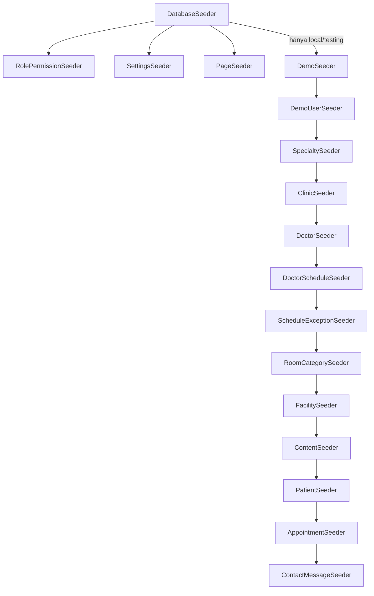

# 13 — Rencana Data Contoh (Seeder)

**Tujuan bagian.** Menetapkan isi, urutan, dan cara memeriksa data contoh (seeder, factory, gambar placeholder) sehingga UNPAM HOSPITAL langsung tampil lengkap dan realistis di localhost tanpa internet, sekaligus menjaga data produksi bersih dari kredensial dan data demo. Semua nama tabel, kolom, enum, izin, dan service mengikuti [00 — Keputusan Inti](00-keputusan-inti.md).

Bagian terkait: [04 — Peran & hak akses](04-peran-hak-akses.md) · [06 — Alur](06-alur.md) · [08 — ERD](08-erd.md) · [09 — Data dictionary](09-data-dictionary.md) · [11 — Route, controller, model, service](11-route-controller-model-service.md) · [12 — Aturan bisnis, validasi, keamanan](12-aturan-bisnis-validasi-keamanan.md) · [14 — Tahapan implementasi](14-tahapan-implementasi.md) · [15 — Pengujian & penerimaan](15-pengujian-penerimaan.md) · [16 — Instalasi & operasional](16-instalasi-operasional.md).

> Seluruh data di bagian ini **fiktif**. Nama dokter, pasien, mitra asuransi, tarif, telepon, dan e-mail adalah contoh untuk prototipe. Tidak ada klaim akreditasi, kerja sama BPJS/asuransi, atau tanggal libur nasional yang nyata.

---

## 1. Prinsip Data Contoh

1. **Dua kelompok seeder.** *Seeder inti* (peran, pengaturan, halaman) aman dan wajib di semua lingkungan. *Seeder demo* hanya untuk `local` dan `testing`.
2. **Tanggal relatif.** Semua tanggal pada jadwal, pengecualian, dan appointment dihitung relatif terhadap **tanggal seeding** (`today`) sehingga data selalu "segar" kapan pun `migrate --seed` dijalankan. Tidak ada tanggal kalender yang ditulis mati.
3. **Appointment lewat service.** Appointment dibuat dan diubah statusnya hanya lewat `BookingService::book()` dan `AppointmentStatusService::transition()` agar `booked_count`, `last_queue_number`, riwayat status, audit log, dan notifikasi konsisten (invarian di §11). Factory hanya untuk tes.
4. **Gambar lokal.** Semua gambar contoh dibuat oleh GD/Intervention di mesin sendiri, disimpan lewat `MediaService` ke disk `public`. Tidak ada unduhan dari internet (lihat §9).
5. **Idempoten untuk seeder inti, sekali-jalan untuk demo.** Seeder inti memakai `firstOrCreate` (tidak menimpa suntingan admin). `DemoSeeder` berhenti dengan peringatan bila akun demo sudah ada; ulangi dengan `migrate:fresh --seed`.

---

## 2. Urutan dan Pembagian Seeder

### 2.1 Diagram urutan



### 2.2 Tanggung jawab dan volume

| Urutan | Seeder | Lingkungan | Tabel yang diisi | Jumlah baris (DB baru) |
|---|---|---|---|---|
| 1 | `RolePermissionSeeder` | semua | `roles`, `permissions`, `role_has_permissions` | 3 peran, 19 izin |
| 2 | `SettingsSeeder` | semua | `website_settings` | 19 kunci (00 E.7) |
| 3 | `PageSeeder` | semua | `pages` | 15 halaman (00 E.5) |
| 4 | `DemoSeeder` | `local`, `testing` | — (orkestrator + guard) | — |
| 4.1 | `DemoUserSeeder` | demo | `users`, `model_has_roles` | 3 staf + 7 akun pasien |
| 4.2 | `SpecialtySeeder` | demo | `specialties` | 13 |
| 4.3 | `ClinicSeeder` | demo | `clinics`, `media` | 13 poliklinik + 4 penunjang |
| 4.4 | `DoctorSeeder` | demo | `doctors`, `doctor_specialties`, `media` | 18 dokter (16 aktif, 1 nonaktif, 1 arsip) |
| 4.5 | `DoctorScheduleSeeder` | demo | `doctor_schedules`, `practice_sessions` | 52 templat (51 aktif + 1 nonaktif); ±300 sesi (14 hari lampau + 30 hari ke depan) |
| 4.6 | `ScheduleExceptionSeeder` | demo | `schedule_exceptions`, `practice_sessions` | 2 pengecualian + 1 sesi `closed` + 1 sesi tambahan manual kuota kecil |
| 4.7 | `RoomCategorySeeder` | demo | `room_categories`, `media` | 4 |
| 4.8 | `FacilitySeeder` | demo | `facilities`, `media` | 10 |
| 4.9 | `ContentSeeder` | demo | `article_categories`, `articles`, `banners`, `galleries`, `faqs`, `insurance_partners`, `media` | 4, 8, 3, 3 album, 12, 4 |
| 4.10 | `PatientSeeder` | demo | `patient_profiles` | 13 (7 berakun, 6 walk-in) |
| 4.11 | `AppointmentSeeder` | demo | `appointments`, `appointment_status_histories`, `audit_logs`, `notifications`, + 1 pengecualian akhir | 29 appointment |
| 4.12 | `ContactMessageSeeder` | demo | `contact_messages` | 5 |

> `DemoUserSeeder` berjalan **sebelum** data master karena `created_by`/`updated_by` pada jadwal, kamar, dan pesan merujuk ke akun staf demo.

### 2.3 Guard lingkungan (wajib)

```php
// database/seeders/DatabaseSeeder.php
public function run(): void
{
    $this->call([RolePermissionSeeder::class, SettingsSeeder::class, PageSeeder::class]);

    if (app()->environment(['local', 'testing'])) {
        $this->call(DemoSeeder::class);
    } else {
        $this->command?->warn('DemoSeeder dilewati (APP_ENV=' . app()->environment() . '). Buat Super Admin dengan: php artisan app:create-super-admin');
    }
}

// database/seeders/DemoSeeder.php
public function run(): void
{
    if (! app()->environment(['local', 'testing'])) {
        throw new \RuntimeException('DemoSeeder DILARANG di APP_ENV=' . app()->environment() . '. Data demo memuat akun berpassword umum.');
    }
    if (\App\Models\User::where('email', 'superadmin@unpamhospital.test')->exists()) {
        $this->command?->warn('Data demo sudah ada. Jalankan: php artisan migrate:fresh --seed');
        return;
    }
    $this->command?->warn('MODE DEMO: akun & data contoh dibuat. Jangan gunakan di produksi.');
    config(['mail.default' => 'array']);          // surat notifikasi seeding dibuang, bukan ditumpuk di log
    $this->call([DemoUserSeeder::class, /* … urutan §2.1 … */]);
}
```

**Produksi:** hanya `php artisan migrate --force` lalu `php artisan db:seed --force` (menjalankan tiga seeder inti) lalu `php artisan app:create-super-admin`. Perintah `db:seed --class=DemoSeeder` di produksi melempar `RuntimeException`. Tes keamanan di [15](15-pengujian-penerimaan.md) (kasus `SEED-02`) memverifikasi guard ini.

### 2.4 Seeder inti — `RolePermissionSeeder`

- `Permission::firstOrCreate(['name' => …, 'guard_name' => 'web'])` untuk 19 izin baku (00 G), `Role::firstOrCreate` untuk `super-admin`, `content-admin`, `registration-officer`, lalu `syncPermissions` sesuai matriks 00 G (`super-admin` memperoleh semua izin untuk tampilan UI; pemeriksaan tetap lewat `Gate::before`).
- Diakhiri `app(PermissionRegistrar::class)->forgetCachedPermissions()`.
- `SettingsSeeder`: `firstOrCreate` per `key` dengan `type`, `group`, `label` sesuai 00 E.7 (nilai default tidak menimpa nilai yang sudah diubah admin). Kunci `contact.phone` berisi `(021) 0000-0000` dan label menyatakan "placeholder — ganti dengan nomor resmi".
- `PageSeeder`: `firstOrCreate` per `key` untuk 15 kunci (isi di §8), `is_system = true`.

---

## 3. Akun Demo (domain `.test`)

| Peran | Nama | Email | `account_type` | Izin efektif |
|---|---|---|---|---|
| `super-admin` | Super Admin Demo | `superadmin@unpamhospital.test` | `staff` | semua (via `Gate::before`) |
| `content-admin` | Admin Konten Demo | `konten@unpamhospital.test` | `staff` | lihat 00 G |
| `registration-officer` | Petugas Pendaftaran Demo | `pendaftaran@unpamhospital.test` | `staff` | lihat 00 G |
| (pasien) | Anisa Rahmawati | `pasien@unpamhospital.test` | `patient` | portal pasien |

Aturan akun demo:

- **Password demo** (keputusan K-11 di 17, default (a)): diambil dari kunci opsional `DEMO_PASSWORD` di `.env`; bila kosong dipakai `Demo12345` (memenuhi `Password::min(8)->letters()->numbers()`), hanya di `local`/`testing`. Opsi (b) pemilik: password acak per eksekusi seeder dan dicetak di konsol (hanya `DemoUserSeeder` yang berubah). Password **hanya** ditampilkan (a) di keluaran konsol `DemoSeeder` (tabel `$this->command->table(...)` di akhir seeding) dan (b) di README lokal pengembangan. Tidak pernah ditulis ke dokumen produksi, log aplikasi, atau halaman web.
- Staf demo: `must_change_password = false` (agar demo cepat). Akun staf yang dibuat untuk skenario uji `must_change_password` dibuat oleh factory di tes, bukan di seeder.
- Enam akun pasien lain memakai domain `@contoh.test` dan password yang sama (tabel di §10) supaya skenario multi-pasien mudah diuji.
- Hash memakai cast `hashed` (bcrypt) — tidak ada password mentah di kolom mana pun.
- **Dilarang di produksi:** guard §2.3 + `DemoUserSeeder` memeriksa ulang `app()->environment('production')` dan melempar pengecualian. Daftar periksa produksi di [16 §14](16-instalasi-operasional.md#14-catatan-produksi-singkat) mencantumkan "tidak ada pengguna `@unpamhospital.test`/`@contoh.test`" dengan kueri: `SELECT email FROM users WHERE email LIKE '%.test';` → harus 0 baris.

---

## 4. Spesialisasi (13) — `SpecialtySeeder`

Dari kebutuhan §6. `is_active = true`; `sort_order` mengikuti urutan tabel; `description` satu kalimat netral (mis. "Pelayanan kesehatan saluran kemih dan sistem reproduksi pria (contoh).").

| # | `name` | `slug` |
|---|---|---|
| 1 | Urologi | `urologi` |
| 2 | Penyakit Dalam | `penyakit-dalam` |
| 3 | Anak | `anak` |
| 4 | Obstetri dan Ginekologi | `obstetri-dan-ginekologi` |
| 5 | Bedah Umum | `bedah-umum` |
| 6 | Jantung | `jantung` |
| 7 | Saraf | `saraf` |
| 8 | Mata | `mata` |
| 9 | THT | `tht` |
| 10 | Kulit dan Kelamin | `kulit-dan-kelamin` |
| 11 | Ortopedi | `ortopedi` |
| 12 | Dokter Umum | `dokter-umum` |
| 13 | Dokter Gigi | `dokter-gigi` |

---

## 5. Poliklinik dan Layanan Penunjang (17) — `ClinicSeeder`

Satu poliklinik per spesialisasi (`type = poliklinik`, `is_bookable = true`) ditambah empat layanan penunjang (`type = penunjang`, `is_bookable = false`, `specialty_id = NULL`). Kolom `code` unik 2–5 huruf kapital (awalan nomor antrean, mis. `ANK-007`). `short_description` satu kalimat; `description` HTML pendek (`<p>…</p>` + daftar `<ul>`) yang melewati `HtmlSanitizer`; `meta_title`/`meta_description` dikosongkan (fallback otomatis).

| # | `name` | `slug` | `code` | `type` | `is_bookable` | Spesialisasi | `location` |
|---|---|---|---|---|:-:|---|---|
| 1 | Poliklinik Urologi | `poliklinik-urologi` | `URO` | poliklinik | ya | Urologi | Gedung A Lt. 1 |
| 2 | Poliklinik Penyakit Dalam | `poliklinik-penyakit-dalam` | `PD` | poliklinik | ya | Penyakit Dalam | Gedung A Lt. 1 |
| 3 | Poliklinik Anak | `poliklinik-anak` | `ANK` | poliklinik | ya | Anak | Gedung A Lt. 1 |
| 4 | Poliklinik Kandungan | `poliklinik-kandungan` | `OBG` | poliklinik | ya | Obstetri dan Ginekologi | Gedung A Lt. 2 |
| 5 | Poliklinik Bedah Umum | `poliklinik-bedah-umum` | `BDH` | poliklinik | ya | Bedah Umum | Gedung A Lt. 2 |
| 6 | Poliklinik Jantung | `poliklinik-jantung` | `JTG` | poliklinik | ya | Jantung | Gedung B Lt. 1 |
| 7 | Poliklinik Saraf | `poliklinik-saraf` | `SRF` | poliklinik | ya | Saraf | Gedung B Lt. 1 |
| 8 | Poliklinik Mata | `poliklinik-mata` | `MTA` | poliklinik | ya | Mata | Gedung B Lt. 2 |
| 9 | Poliklinik THT | `poliklinik-tht` | `THT` | poliklinik | ya | THT | Gedung B Lt. 2 |
| 10 | Poliklinik Kulit dan Kelamin | `poliklinik-kulit-dan-kelamin` | `KK` | poliklinik | ya | Kulit dan Kelamin | Gedung B Lt. 2 |
| 11 | Poliklinik Ortopedi | `poliklinik-ortopedi` | `ORT` | poliklinik | ya | Ortopedi | Gedung C Lt. 1 |
| 12 | Poliklinik Umum | `poliklinik-umum` | `UMM` | poliklinik | ya | Dokter Umum | Gedung A Lt. 1 |
| 13 | Poliklinik Gigi | `poliklinik-gigi` | `GG` | poliklinik | ya | Dokter Gigi | Gedung C Lt. 1 |
| 14 | Laboratorium | `laboratorium` | `LAB` | penunjang | tidak | — | Gedung C Lt. 1 |
| 15 | Radiologi | `radiologi` | `RAD` | penunjang | tidak | — | Gedung C Lt. 1 |
| 16 | Farmasi | `farmasi` | `FAR` | penunjang | tidak | — | Gedung A Lt. 1 |
| 17 | IGD 24 Jam | `igd-24-jam` | `IGD` | penunjang | tidak | — | Gedung A Lt. 1 (contoh) |

Catatan: layanan penunjang tampil di `clinics.index` dan `clinics.show` tetapi **tanpa** tombol "Daftar"/jadwal (karena `is_bookable = false`). Deskripsi IGD memuat kalimat "Jam layanan dan nomor darurat adalah contoh prototipe". Poliklinik #13 (`GG`) tidak diberi `cover` sehingga menampilkan placeholder SVG (menguji fallback gambar).

---

## 6. Dokter Fiktif (18) — `DoctorSeeder`

Nama adalah gabungan fiktif nama Indonesia umum; kemiripan dengan orang sungguhan bersifat kebetulan. Nama tampilan: `"{title_prefix} {name}, {title_suffix}"` (tanpa koma bila `title_suffix` kosong). `slug` dari `name` (mis. `raka-pradipta-wibowo`). `short_bio` dibuat dari templat: "{nama tampilan} melayani konsultasi {spesialisasi} di UNPAM HOSPITAL. (Profil contoh)." `bio` dua paragraf netral tanpa klaim pengalaman, penghargaan, atau lembaga nyata.

| # | `name` (tanpa gelar) | `title_prefix` | `title_suffix` | `gender` | Spesialisasi primer | Spesialisasi tambahan | Poliklinik (`clinic_id`) | `status` | Foto |
|---|---|---|---|:-:|---|---|---|---|---|
| 1 | Raka Pradipta Wibowo | dr. | Sp.U | L | Urologi | — | Poliklinik Urologi | active | ya |
| 2 | Sekar Ayuningtyas | dr. | Sp.PD | P | Penyakit Dalam | — | Poliklinik Penyakit Dalam | active | ya |
| 3 | Bagas Setiawan Nugroho | dr. | Sp.PD | L | Penyakit Dalam | — | Poliklinik Penyakit Dalam | active | ya |
| 4 | Laras Wulandari | dr. | Sp.A | P | Anak | — | Poliklinik Anak | active | ya |
| 5 | Dimas Aryaputra | dr. | Sp.A | L | Anak | — | Poliklinik Anak | active | ya |
| 6 | Nadira Kusumawardani | dr. | Sp.OG | P | Obstetri dan Ginekologi | — | Poliklinik Kandungan | active | ya |
| 7 | Hendra Mahardika | dr. | Sp.B | L | Bedah Umum | — | Poliklinik Bedah Umum | active | ya |
| 8 | Maya Kartika Sari | dr. | Sp.JP | P | Jantung | Penyakit Dalam | Poliklinik Jantung | active | ya |
| 9 | Fajar Ramadhan Lubis | dr. | Sp.N | L | Saraf | — | Poliklinik Saraf | active | ya |
| 10 | Intan Permatasari | dr. | Sp.M | P | Mata | — | Poliklinik Mata | active | ya |
| 11 | Yoga Prasetya | dr. | Sp.THT-KL | L | THT | — | Poliklinik THT | active | ya |
| 12 | Citra Anindya Putri | dr. | Sp.DV | P | Kulit dan Kelamin | — | Poliklinik Kulit dan Kelamin | active | ya |
| 13 | Arif Budiman Santoso | dr. | Sp.OT | L | Ortopedi | Bedah Umum | Poliklinik Ortopedi | active | ya |
| 14 | Rani Oktaviani | dr. | *(kosong)* | P | Dokter Umum | — | Poliklinik Umum | active | ya |
| 15 | Teguh Wicaksono | dr. | *(kosong)* | L | Dokter Umum | — | Poliklinik Umum | active | **tidak** (uji placeholder) |
| 16 | Ayu Larasati Hakim | drg. | *(kosong)* | P | Dokter Gigi | — | Poliklinik Gigi | active | **tidak** (uji placeholder) |
| 17 | Eko Susanto | dr. | Sp.B | L | Bedah Umum | — | Poliklinik Bedah Umum | **inactive** | ya |
| 18 | Lilis Marlina | dr. | Sp.M | P | Mata | — | Poliklinik Mata | **archived** (`archived_at` = today − 30 hari) | ya |

- `doctor_specialties`: 18 baris primer (`is_primary = true`) + 2 sekunder (#8 → Penyakit Dalam, #13 → Bedah Umum) = 20 baris. Uji: filter `spesialisasi=penyakit-dalam` di `doctors.index` menampilkan dr. Sekar, dr. Bagas, dan dr. Maya.
- Dokter #17 dan #18 **tidak muncul di publik** dan tidak dapat dipesan; keduanya ada untuk menguji filter status di `admin.doctors.index`.
- `sort_order` = nomor urut tabel. 16 dokter berfoto (JPEG 600×600, §9); #15 dan #16 sengaja tanpa foto.

---

## 7. Jadwal Mingguan, Sesi, dan Pengecualian

### 7.1 Templat mingguan — `DoctorScheduleSeeder`

`day_of_week` ISO-8601: 1 = Senin … 7 = Minggu. `valid_from = today − 45 hari`, `valid_until = NULL`, `is_active = true`, `created_by` = Admin Konten Demo. Pita waktu: **pagi** 08:00–11:00 atau 09:00–12:00, **siang** 13:00–16:00, **sore** 16:00–19:00. `clinic_id` = poliklinik dokter. Format sel: `Hari jam mulai–selesai · kuota`. Kuota 10–30. Tidak ada jadwal hari Minggu (lihat sesi tambahan manual di §7.3). Tidak ada irisan jam pada hari yang sama untuk satu dokter.

| Dokter | Sesi 1 | Sesi 2 | Sesi 3 | Sesi 4 |
|---|---|---|---|---|
| 1 dr. Raka (URO) | Sen 09:00–12:00 · 15 | Rab 09:00–12:00 · 15 | Jum 13:00–15:00 · 10 | — |
| 2 dr. Sekar (PD) | Sen 08:00–11:00 · 20 | Rab 08:00–11:00 · 20 | Jum 08:00–11:00 · 20 | Sab 08:00–10:00 · 15 |
| 3 dr. Bagas (PD) | Sel 13:00–16:00 · 20 | Kam 13:00–16:00 · 20 | Sab 10:00–12:00 · 15 | — |
| 4 dr. Laras (ANK) | Sen 09:00–12:00 · 20 | Sel 09:00–12:00 · 20 | Kam 09:00–12:00 · 20 | Sab 09:00–11:00 · 15 |
| 5 dr. Dimas (ANK) | Sel 16:00–19:00 · 15 | Rab 13:00–16:00 · 20 | Jum 13:00–16:00 · 20 | — |
| 6 dr. Nadira (OBG) | Sen 13:00–16:00 · 15 | Rab 13:00–16:00 · 15 | Jum 09:00–12:00 · 15 | — |
| 7 dr. Hendra (BDH) | Sel 09:00–12:00 · 12 | Kam 09:00–12:00 · 12 | — | — |
| 8 dr. Maya (JTG) | Sen 16:00–19:00 · 12 | Kam 16:00–19:00 · 12 | Sab 09:00–12:00 · 10 | — |
| 9 dr. Fajar (SRF) | Sel 13:00–16:00 · 15 | Jum 13:00–16:00 · 15 | — | — |
| 10 dr. Intan (MTA) | Sel 08:00–11:00 · 20 | Kam 08:00–11:00 · 20 | Sab 08:00–11:00 · 15 | — |
| 11 dr. Yoga (THT) | Sen 13:00–16:00 · 15 | Rab 09:00–12:00 · 15 | Jum 16:00–19:00 · 15 | — |
| 12 dr. Citra (KK) | Sen 16:00–19:00 · 20 | Rab 16:00–19:00 · 20 | Sab 09:00–12:00 · 20 | — |
| 13 dr. Arif (ORT) | Sel 16:00–19:00 · 12 | Kam 13:00–16:00 · 12 | Sab 09:00–11:00 · 10 | — |
| 14 dr. Rani (UMM) | Sen 08:00–11:00 · 30 | Sel 08:00–11:00 · 30 | Rab 08:00–11:00 · 30 | Kam 08:00–11:00 · 30 |
| 15 dr. Teguh (UMM) | Sen 13:00–16:00 · 25 | Kam 16:00–19:00 · 25 | Jum 13:00–16:00 · 25 | Sab 08:00–11:00 · 30 |
| 16 dr. Ayu (GG) | Sen 09:00–12:00 · 15 | Rab 13:00–16:00 · 15 | Jum 09:00–12:00 · 15 | Sab 09:00–12:00 · 15 |
| 17 dr. Eko (BDH, nonaktif) | Sel 13:00–16:00 · 12 — **`is_active = false`** | — | — | — |

Total: **51 templat aktif + 1 templat nonaktif**. `PracticeSessionGenerator` tidak membangkitkan sesi dari templat nonaktif maupun untuk dokter `inactive`/`archived`. Setiap hari Senin–Sabtu ada sesi dari beberapa poliklinik (poliklinik Umum buka Senin–Sabtu). Setelah templat disimpan, seeder memanggil `PracticeSessionGenerator::ensureRange(today, today + booking.window_days)` untuk sesi ke depan dan `ensureRange(today − 14, today − 1)` untuk sesi lampau (**[ASUMSI]** `ensureRange` menerima rentang bebas, termasuk masa lampau; hanya `ensureDailyHorizon()` yang terikat pada jendela booking). Sesi lampau dibutuhkan agar appointment berstatus `completed`/`no_show` dapat dibuat lewat service.

### 7.2 Pengecualian jadwal — `ScheduleExceptionSeeder`

Tanggal dihitung relatif; baris `schedule_exceptions` dibuat lalu `ScheduleChangeService::applyException($exception, null, Actor::system())` dipanggil (sehingga sesi terkait otomatis `cancelled` dengan `schedule_exception_id` terisi).

| # | `type` | Dokter | `start_date` → `end_date` | `reason` | Dampak |
|---|---|---|---|---|---|
| 1 | `doctor_leave` | dr. Dimas Aryaputra (ANK) | `today + 8` → `today + 14` (tepat 7 hari, selalu memuat Sel/Rab/Jum) | Cuti tahunan (contoh) | Sesi dr. Dimas pada rentang itu `cancelled`, tampil "Cuti" di jadwal publik |
| 2 | `hospital_holiday` | `NULL` (seluruh RS) | satu hari: tanggal pertama yang **bukan Minggu** pada atau setelah `today + 16` | Contoh libur rumah sakit (bukan tanggal libur nasional) | Semua sesi hari itu `cancelled`, tampil "Libur" |

Rentang #1 dan #2 sengaja tidak beririsan agar kolom `schedule_exception_id` per sesi tidak ambigu. Pengecualian ketiga (sumber sesi `needs_review`) dibuat di akhir `AppointmentSeeder` (§10.3) karena butuh appointment aktif lebih dulu.

### 7.3 Sesi khusus contoh (di `ScheduleExceptionSeeder`)

| Sesi | Cara membuat | Tujuan uji |
|---|---|---|
| **Sesi `closed`** | Sesi dr. Citra (KK) pertama dengan `session_date >= today + 3` lewat `ScheduleChangeService::setSessionStatus($sesi, SessionStatus::Closed, Actor::system(), …)`: `status = closed`, `status_reason = "Ditutup sementara (contoh)"`, `is_manually_modified = true` | Badge `Availability::closed`; tidak dapat dipesan |
| **Sesi tambahan manual** | lewat `ScheduleChangeService::createManualSession([...], Actor::system())` dengan `doctor_schedule_id = NULL`: dr. Teguh (UMM), `session_date = today + 2`, 08:00–10:00, `quota = 2`, `is_manually_modified = true`, `status_reason = "Sesi tambahan (contoh)"` | Dipakai appointment A28–A29 sehingga menjadi **penuh** (`Availability::full`) |
| **Cadangan hari ini** | Bila pada hari seeding ada < 3 sesi `open` (mis. Minggu), buat sesi manual hari ini: dr. Rani 08:00–11:00 (kuota 20), dr. Sekar 13:00–16:00 (kuota 20), dr. Laras 16:00–19:00 (kuota 20) | Menjamin skenario "hari ini" di §10 selalu punya sesi |

---

## 8. Fasilitas, Kamar, Konten, Halaman, dan Pengaturan

### 8.1 Kategori kamar (4) — `RoomCategorySeeder`

Nama kategori mengikuti permintaan prototipe dan **bukan** klasifikasi BPJS yang telah diverifikasi (K-05 di 17: penamaan terhadap ketentuan BPJS terbaru/KRIS ditinjau sebelum produksi; kategori adalah data sehingga cukup diubah lewat admin/seeder). Semua tarif adalah **contoh**; `rate_note` selalu menyatakannya. `availability_updated_at` = sekarang − 2 jam; `availability_updated_by` = Petugas Pendaftaran Demo. Halaman publik menulis "Diperbarui manual pada {waktu}" dan tidak memakai kata "real-time".

| `slug` | `name` | `amenities` (JSON array) | `bed_capacity` | `beds_available` | `sample_rate` | `rate_unit` | `rate_note` |
|---|---|---|:-:|:-:|---:|---|---|
| `bpjs-kelas-1` | Kamar BPJS Kelas 1 | ["2 tempat tidur per kamar","Kamar mandi dalam","AC","Televisi","Lemari pasien","Kursi pendamping"] | 12 | 5 | 400000 | per malam | Tarif contoh untuk prototipe; bukan tarif resmi dan bukan ketentuan BPJS. |
| `bpjs-kelas-2` | Kamar BPJS Kelas 2 | ["3–4 tempat tidur per kamar","Kamar mandi dalam","AC","Lemari pasien","Kursi pendamping"] | 16 | **0** | 250000 | per malam | Tarif contoh untuk prototipe; bukan tarif resmi dan bukan ketentuan BPJS. |
| `bpjs-kelas-3` | Kamar BPJS Kelas 3 | ["4–6 tempat tidur per kamar","Kamar mandi bersama","Kipas/ventilasi","Lemari pasien"] | 24 | 9 | 150000 | per malam | Tarif contoh untuk prototipe; bukan tarif resmi dan bukan ketentuan BPJS. |
| `vip` | Kamar VIP/Pribadi | ["1 tempat tidur","Kamar mandi dalam","AC","Televisi","Sofa pendamping","Lemari es kecil","Meja kerja"] | 6 | 2 | 1200000 | per malam | Tarif contoh untuk prototipe; bukan tarif resmi. |

- Kelas 2 sengaja `beds_available = 0` agar tampilan "Penuh/Tidak tersedia" teruji; CHECK `beds_available BETWEEN 0 AND bed_capacity` terpenuhi untuk keempat baris.
- Urutan `sort_order`: Kelas 1, Kelas 2, Kelas 3, VIP. `short_description` satu kalimat; `description` HTML pendek. Setiap kamar memiliki 1 `cover` + 2 foto `gallery` placeholder.

### 8.2 Fasilitas (10) — `FacilitySeeder`

Deskripsi netral berakhiran "(deskripsi contoh)"; tidak ada klaim sertifikasi atau peralatan merek tertentu.

| # | `name` | `slug` | `category` | `short_description` |
|---|---|---|---|---|
| 1 | Instalasi Gawat Darurat | `instalasi-gawat-darurat` | medis | Ruang penanganan awal kondisi gawat darurat (contoh). |
| 2 | Ruang Tindakan Minor | `ruang-tindakan-minor` | medis | Ruang untuk tindakan ringan rawat jalan (contoh). |
| 3 | Laboratorium | `fasilitas-laboratorium` | penunjang | Ruang pemeriksaan sampel untuk penunjang diagnosis (contoh). |
| 4 | Radiologi | `fasilitas-radiologi` | penunjang | Ruang pemeriksaan pencitraan penunjang diagnosis (contoh). |
| 5 | Apotek | `apotek` | penunjang | Layanan penyiapan obat sesuai resep dokter (contoh). |
| 6 | Ruang Pendaftaran dan Informasi | `ruang-pendaftaran-dan-informasi` | umum | Loket pendaftaran, check-in, dan bantuan informasi (contoh). |
| 7 | Ruang Tunggu Pasien | `ruang-tunggu-pasien` | umum | Area tunggu dengan tempat duduk dan pendingin ruangan (contoh). |
| 8 | Musala | `musala` | umum | Tempat ibadah untuk pasien dan pendamping (contoh). |
| 9 | Area Parkir | `area-parkir` | umum | Area parkir kendaraan roda dua dan roda empat (contoh). |
| 10 | Akses Ramah Difabel | `akses-ramah-difabel` | umum | Jalur landai dan toilet yang dapat diakses kursi roda (contoh). |

Setiap fasilitas memiliki 1 `cover` placeholder; #6 dan #7 juga memiliki 2 foto `gallery`.

### 8.3 Banner (3) — `ContentSeeder`

`is_active = true`; `starts_at` = awal hari seeding (kolom boleh NULL = langsung tayang, 09 §6.4; seed mengisinya agar uji penjadwalan jelas); `ends_at = NULL`; gambar 1600×600 (`image`, min 1200×400).

| `sort_order` | `title` | `subtitle` | `button_label` | `button_url` |
|:-:|---|---|---|---|
| 1 | Selamat Datang di UNPAM HOSPITAL | Informasi layanan, dokter, dan jadwal praktik dalam satu tempat. | Cari Dokter | `/dokter` |
| 2 | Daftar Kunjungan Lebih Mudah | Buat akun, pilih dokter dan sesi, lalu simpan bukti pendaftaran Anda. | Daftar Kunjungan | `/pasien/pendaftaran/baru` |
| 3 | Lihat Jadwal Dokter Terbaru | Jadwal di halaman ini sama dengan jadwal pada form pendaftaran. | Jadwal Dokter | `/jadwal-dokter` |

### 8.4 FAQ (12) — `ContentSeeder`

`is_published = true`; jawaban teks biasa. Angka mengikuti default seed pengaturan booking (00 E.7); **[ASUMSI]** bila admin mengubah pengaturan, admin juga memperbarui jawaban FAQ terkait secara manual.

| # | `category` | `question` | `answer` (ringkas) |
|:-:|---|---|---|
| 1 | pendaftaran | Bagaimana cara mendaftar kunjungan rawat jalan secara online? | Buat akun di halaman Daftar, masuk, pilih poliklinik, dokter, tanggal dan sesi, isi data pendaftaran, lalu konfirmasi. Bukti pendaftaran berisi kode booking dan nomor antrean dapat dicetak atau diunduh. |
| 2 | pendaftaran | Sampai berapa hari ke depan saya dapat mendaftar? | Pendaftaran online dapat dilakukan untuk sesi sampai 30 hari ke depan. |
| 3 | pendaftaran | Kapan pendaftaran online untuk suatu sesi ditutup? | Pendaftaran online ditutup 60 menit sebelum sesi dimulai. Setelah itu Anda dapat mendaftar langsung di loket selama sesi belum berakhir dan kuota masih tersedia. |
| 4 | pendaftaran | Bagaimana cara membatalkan pendaftaran? | Buka Riwayat Pendaftaran lalu pilih Batalkan, paling lambat 120 menit sebelum sesi dimulai. Setelah batas itu, hubungi rumah sakit melalui telepon atau WhatsApp. |
| 5 | pendaftaran | Apa yang perlu saya bawa saat datang? | Tunjukkan kode booking atau bukti pendaftaran, identitas diri, serta kartu BPJS atau polis asuransi bila memakainya. Check-in dibuka 60 menit sebelum sesi dimulai. |
| 6 | pendaftaran | Apakah saya bisa mendaftar tanpa akun? | Bisa. Datang ke loket pendaftaran; petugas dapat membuat profil pasien dan mendaftarkan kunjungan Anda. Kuota dibagi bersama pendaftaran online. |
| 7 | bpjs | Apakah nomor BPJS wajib diisi? | Hanya jika Anda memilih jenis pembayaran BPJS Kesehatan (13 digit). Untuk pembayaran umum atau asuransi, nomor BPJS tidak diminta. |
| 8 | bpjs | Apakah saya perlu mengisi NIK? | Tidak. Sistem ini tidak meminta NIK. |
| 9 | layanan | Apakah jadwal dokter dapat berubah? | Dapat berubah, misalnya karena cuti. Bila jadwal Anda terdampak, petugas menindaklanjuti dan Anda menerima pemberitahuan di akun atau melalui telepon yang tercatat. |
| 10 | layanan | Apakah ketersediaan kamar rawat inap bersifat real-time? | Tidak. Ketersediaan diperbarui manual oleh petugas dan waktu pembaruan terakhir ditampilkan. Hubungi rumah sakit untuk memastikan ketersediaan. |
| 11 | umum | Bagaimana data pribadi saya dilindungi? | Data hanya digunakan untuk pendaftaran kunjungan, nomor BPJS disimpan terenkripsi, dan akses dibatasi bagi petugas berwenang. Baca Kebijakan Privasi untuk rinciannya. |
| 12 | umum | Bagaimana menghubungi rumah sakit? | Gunakan halaman Kontak dan Lokasi atau tombol WhatsApp. Tombol WhatsApp hanya membuka aplikasi WhatsApp dan pesan dikirim sendiri oleh Anda; bukan pengiriman otomatis. Nomor pada prototipe ini adalah placeholder. |

### 8.5 Kategori dan artikel — `ContentSeeder`

Kategori artikel (4): **Kesehatan Umum** (`kesehatan-umum`), **Keluarga dan Anak** (`keluarga-dan-anak`), **Gaya Hidup Sehat** (`gaya-hidup-sehat`), **Info Layanan** (`info-layanan`). Artikel orisinal, `author_user_id` = Admin Konten Demo, `published_at` = now − N hari. Isi (`body`) 2–3 paragraf HTML pendek, netral, tanpa klaim penyembuhan, dosis, atau angka medis spesifik, dan selalu ditutup kalimat: *"Informasi ini bersifat umum dan tidak menggantikan konsultasi dengan tenaga kesehatan."* Artikel #5 sengaja tanpa `cover` (uji placeholder).

| # | `title` | `slug` | Kategori | `status` | `published_at` | `excerpt` |
|:-:|---|---|---|---|---|---|
| 1 | Kebiasaan Sederhana untuk Menjaga Kesehatan Jantung | `kebiasaan-sederhana-menjaga-kesehatan-jantung` | Gaya Hidup Sehat | published | now − 3 hari | Aktivitas fisik teratur, pola makan seimbang, dan istirahat cukup adalah kebiasaan umum yang mendukung kesehatan jantung. |
| 2 | Mengapa Pemeriksaan Kesehatan Berkala Itu Penting | `pentingnya-pemeriksaan-kesehatan-berkala` | Kesehatan Umum | published | now − 6 hari | Pemeriksaan berkala membantu Anda mengenali kondisi tubuh dan berdiskusi dengan dokter tentang langkah pencegahan. |
| 3 | Menyiapkan Diri Sebelum Berkunjung ke Poliklinik | `menyiapkan-diri-sebelum-berkunjung-ke-poliklinik` | Info Layanan | published | now − 9 hari | Catat keluhan, bawa dokumen yang diperlukan, dan datang lebih awal agar kunjungan berjalan lancar. |
| 4 | Mengenali Tanda Kekurangan Cairan pada Anak | `mengenali-tanda-kekurangan-cairan-pada-anak` | Keluarga dan Anak | published | now − 12 hari | Anak yang rewel, jarang buang air kecil, atau tampak lemas perlu diperhatikan; hubungi tenaga kesehatan bila ragu. |
| 5 | Pola Tidur yang Baik untuk Tubuh yang Bugar | `pola-tidur-yang-baik-untuk-tubuh-bugar` | Gaya Hidup Sehat | published | now − 15 hari | Jadwal tidur yang konsisten dan lingkungan tidur yang nyaman membantu tubuh beristirahat dengan baik. |
| 6 | Cara Mencuci Tangan yang Benar | `cara-mencuci-tangan-yang-benar` | Kesehatan Umum | published | now − 20 hari | Mencuci tangan dengan sabun dan air mengalir adalah kebiasaan sederhana untuk membantu mencegah penularan penyakit. |
| 7 | Panduan Pendaftaran Online di UNPAM HOSPITAL | `panduan-pendaftaran-online-unpam-hospital` | Info Layanan | published | now − 1 hari | Langkah membuat akun, memilih dokter dan sesi, hingga menyimpan bukti pendaftaran. |
| 8 | Draf: Menjaga Kesehatan di Musim Hujan | `draf-menjaga-kesehatan-di-musim-hujan` | Kesehatan Umum | **draft** | `NULL` | Draf yang belum terbit — tidak boleh tampil di publik (uji status). |

### 8.6 Album galeri (3) — `ContentSeeder`

`is_published = true`; tiap album 4 foto (`photos`, 1200×800) dengan `alt_text` dan `caption` yang diawali "Foto contoh".

| `sort_order` | `title` | `slug` | `description` |
|:-:|---|---|---|
| 1 | Lobi dan Area Pendaftaran (Foto Contoh) | `lobi-dan-area-pendaftaran` | Ilustrasi area penerimaan pasien. |
| 2 | Fasilitas Pelayanan (Foto Contoh) | `fasilitas-pelayanan` | Ilustrasi ruang pelayanan dan penunjang. |
| 3 | Edukasi Kesehatan (Foto Contoh) | `edukasi-kesehatan` | Ilustrasi kegiatan penyuluhan kesehatan. |

### 8.7 Mitra asuransi fiktif (4) — `ContentSeeder`

Semua berlabel "Contoh" pada nama dan `description`; **tidak** menyatakan kerja sama nyata; `website_url = NULL`; logo PNG 400×200 dari generator placeholder.

| `name` | `slug` | `type` | `description` |
|---|---|---|---|
| Asuransi Contoh Sehat | `asuransi-contoh-sehat` | asuransi | Contoh mitra asuransi kesehatan untuk keperluan prototipe. Bukan kerja sama nyata. |
| Asuransi Contoh Sentosa | `asuransi-contoh-sentosa` | asuransi | Contoh mitra asuransi jiwa dan kesehatan. Bukan kerja sama nyata. |
| Asuransi Contoh Prima | `asuransi-contoh-prima` | asuransi | Contoh mitra asuransi kesehatan keluarga. Bukan kerja sama nyata. |
| PT Contoh Karya Mandiri | `pt-contoh-karya-mandiri` | perusahaan | Contoh perusahaan rekanan layanan kesehatan karyawan. Bukan kerja sama nyata. |

### 8.8 Halaman statis — `PageSeeder` (semua lingkungan)

Seluruh 15 kunci 00 E.5 dibuat (`is_system = true`). `meta_description` ≤ 160 karakter. Kolom **Body** menandai halaman yang memiliki rich text; isinya disanitasi oleh `HtmlSanitizer`.

| `key` | `title` | `subtitle` | Body | `meta_description` (ringkas) |
|---|---|---|:-:|---|
| `home` | UNPAM HOSPITAL | Layanan kesehatan yang ramah dan terpercaya (contoh) | — | Informasi layanan, dokter, jadwal praktik, dan pendaftaran kunjungan UNPAM HOSPITAL. |
| `about` | Profil Rumah Sakit | Mengenal UNPAM HOSPITAL | ya | Profil UNPAM HOSPITAL, rumah sakit prototipe di Universitas Pamulang Kampus 2 Viktor. |
| `vision-mission` | Visi dan Misi | Arah dan komitmen pelayanan | ya | Visi dan misi contoh UNPAM HOSPITAL. |
| `clinics-index` | Layanan dan Poliklinik | Pilih layanan sesuai kebutuhan Anda | — | Daftar poliklinik dan layanan penunjang UNPAM HOSPITAL. |
| `doctors-index` | Cari Dokter | Cari berdasarkan nama, spesialisasi, poliklinik, atau tanggal praktik | — | Cari dokter UNPAM HOSPITAL berdasarkan nama, spesialisasi, poliklinik, dan tanggal. |
| `schedules-index` | Jadwal Dokter | Jadwal praktik per minggu | — | Jadwal praktik dokter UNPAM HOSPITAL per minggu dengan sisa kuota. |
| `facilities-index` | Fasilitas | Fasilitas medis, penunjang, dan umum | — | Daftar fasilitas UNPAM HOSPITAL. |
| `rooms-index` | Kamar Rawat Inap | Ringkasan kategori kamar dan ketersediaan | — | Kategori kamar rawat inap, kapasitas, dan ketersediaan yang diperbarui manual. |
| `insurance-info` | Informasi BPJS dan Asuransi | Persyaratan dan pembayaran | ya | Informasi contoh tentang BPJS Kesehatan dan asuransi di UNPAM HOSPITAL. |
| `registration-guide` | Panduan Pendaftaran Pasien | Langkah mendaftar kunjungan rawat jalan | ya | Panduan mendaftar kunjungan rawat jalan online maupun di loket. |
| `articles-index` | Artikel Kesehatan | Informasi kesehatan umum | — | Artikel kesehatan umum dari UNPAM HOSPITAL. |
| `galleries-index` | Galeri | Foto-foto contoh | — | Galeri foto UNPAM HOSPITAL. |
| `faq` | Pertanyaan yang Sering Diajukan | Jawaban atas pertanyaan umum | — | Pertanyaan umum tentang pendaftaran, BPJS, layanan, dan data pribadi. |
| `contact` | Kontak dan Lokasi | Hubungi kami atau kunjungi kami | — | Alamat, telepon, WhatsApp, e-mail, peta, dan formulir kontak UNPAM HOSPITAL. |
| `privacy-policy` | Kebijakan Privasi | Cara kami memperlakukan data Anda | ya | Kebijakan privasi dan persetujuan penggunaan data pasien UNPAM HOSPITAL. |

Isi `body` (versi seeder; admin dapat menggantinya di `admin.pages.edit`):

- **`about`** — Paragraf 1: UNPAM HOSPITAL adalah rumah sakit **prototipe** yang berlokasi di Universitas Pamulang Kampus 2 Viktor (alamat lengkap dari `contact.address`). Paragraf 2: situs ini memperlihatkan informasi layanan, dokter, jadwal, dan pendaftaran kunjungan rawat jalan. Paragraf 3: seluruh data pada situs ini adalah contoh dan akan diganti dengan data resmi. Tidak memuat klaim akreditasi.
- **`vision-mission`** — Visi (contoh): "Menjadi layanan kesehatan yang ramah, mudah diakses, dan mengutamakan keselamatan pasien." Misi (daftar bernomor, contoh): memberikan pelayanan yang ramah dan tertib; menyediakan informasi jadwal yang jelas dan mutakhir; menjaga kerahasiaan data pasien; mempermudah pendaftaran kunjungan.
- **`insurance-info`** — Bagian "BPJS Kesehatan": gunakan nomor peserta 13 digit saat mendaftar; bawa kartu/identitas dan dokumen lain sesuai ketentuan yang berlaku. Bagian "Asuransi": pilih mitra dari daftar (contoh) dan bawa kartu/polis. Bagian "Pembayaran umum". Kotak peringatan: "Informasi ini contoh dan harus diverifikasi serta disesuaikan oleh admin dengan ketentuan resmi sebelum digunakan. Rumah sakit ini tidak menyatakan kerja sama resmi dengan pihak mana pun." Daftar mitra asuransi aktif ditampilkan otomatis dari tabel `insurance_partners`.
- **`registration-guide`** — Langkah daring (6 langkah: daftar akun → masuk → pilih poliklinik → pilih dokter dan sesi → isi data dan konfirmasi → simpan bukti/kode booking), langkah di loket (walk-in), aturan batas pendaftaran/pembatalan/check-in (60/120/60 menit), catatan "nomor antrean tidak dipakai ulang bila dibatalkan".
- **`privacy-policy`** — Data yang dikumpulkan (nama, tanggal lahir, jenis kelamin, telepon, e-mail, alamat, nomor BPJS/polis bila dipilih, keluhan singkat opsional; **NIK tidak dikumpulkan**); tujuan (pendaftaran kunjungan dan komunikasi terkait jadwal); penyimpanan (nomor BPJS/polis terenkripsi; alamat IP pesan kontak hanya disimpan sebagai hash); akses (hanya petugas berwenang; admin konten tidak melihat data pasien); hak pasien (melihat dan mengubah profil sendiri; permintaan penghapusan via kontak); versi `1.0` (sama dengan `privacy.consent_version`). Catatan: "Teks contoh; tinjau dengan konsultan hukum sebelum produksi." **[KONFIRMASI]** untuk produksi.

### 8.9 Pengaturan — `SettingsSeeder` (semua lingkungan)

Nilai default persis 00 E.7; kolom berikut melengkapi `type`, `group`, dan `label` untuk seeder.

| `key` | `type` | `group` | `label` |
|---|---|---|---|
| `site.name` | string | identitas | Nama situs |
| `site.tagline` | string | identitas | Tagline |
| `site.logo_media_id` | int (kosong) | identitas | Logo situs (kosong = placeholder bawaan) |
| `contact.address` | text | kontak | Alamat |
| `contact.phone` | string | kontak | Telepon (placeholder) |
| `contact.emergency_phone` | string | kontak | Telepon darurat (placeholder) |
| `contact.whatsapp` | string | kontak | Nomor WhatsApp (format 62…, placeholder) |
| `contact.email` | email | kontak | E-mail kontak (placeholder) |
| `contact.operational_hours` | string | kontak | Jam operasional |
| `map.directions_url` | url | kontak | Tautan Petunjuk Arah |
| `map.embed_url` | url | kontak | Tautan peta tersemat |
| `booking.window_days` | int | booking | Jendela pendaftaran (hari) |
| `booking.online_cutoff_minutes` | int | booking | Batas pendaftaran online (menit sebelum sesi) |
| `booking.cancel_cutoff_minutes` | int | booking | Batas pembatalan pasien (menit sebelum sesi) |
| `booking.checkin_open_minutes` | int | booking | Check-in dibuka (menit sebelum sesi) |
| `booking.max_active_per_patient` | int | booking | Maks. pendaftaran aktif per pasien |
| `booking.auto_confirm` | bool | booking | Konfirmasi otomatis |
| `seo.default_meta_description` | text | seo | Meta description bawaan |
| `privacy.consent_version` | string | privasi | Versi persetujuan privasi |

Nilai: `booking.window_days=30`, `online_cutoff_minutes=60`, `cancel_cutoff_minutes=120`, `checkin_open_minutes=60`, `max_active_per_patient=3`, `auto_confirm=false`, `privacy.consent_version=1.0`; sisanya sesuai 00 E.7. `seo.default_meta_description` = "UNPAM HOSPITAL — informasi layanan, dokter, jadwal praktik, dan pendaftaran kunjungan rawat jalan (situs prototipe)."

---

## 9. Gambar Placeholder Lokal

Prinsip: **tidak ada unduhan dari internet** saat seeding maupun saat halaman tampil. Ada dua lapis.

### 9.1 Placeholder statis (fallback) — `public/images/placeholders/`

Delapan SVG bawaan aplikasi (dikomit ke repo; SVG hanya boleh berasal dari aplikasi, bukan unggahan pengguna): `doctor.svg`, `clinic.svg`, `facility.svg`, `room.svg`, `article.svg`, `banner.svg`, `gallery.svg`, `logo.svg`. Dipakai oleh accessor URL ketika media `NULL`, dan oleh `x-image` ketika file fisik hilang (atribut `data-fallback` berisi URL placeholder + satu listener `error` terdelegasi di `resources/js/app.js`; tanpa `onerror` inline agar kompatibel dengan CSP ketat, 00 K). Setiap SVG: `viewBox` sesuai rasio (doctor 1:1, clinic/facility/room/gallery 3:2, article 16:9, banner 8:3, logo 4:1), latar token warna, ikon sederhana (bentuk vektor), teks "Foto contoh" (kecuali `logo.svg` yang berisi inisial "UH" dan teks "UNPAM HOSPITAL"), `<title>` deskriptif, tanpa `<script>`, tanpa tautan/font/gambar eksternal, `font-family="system-ui, sans-serif"`.

```xml
<svg xmlns="http://www.w3.org/2000/svg" viewBox="0 0 600 600" role="img" aria-labelledby="t">
  <title id="t">Foto contoh dokter</title>
  <rect width="600" height="600" fill="#F3F7FB"/>
  <circle cx="300" cy="230" r="90" fill="#0A4D8C"/>
  <path d="M120 520c0-110 80-170 180-170s180 60 180 170z" fill="#0E7C74"/>
  <text x="300" y="575" text-anchor="middle" font-family="system-ui, sans-serif" font-size="28" fill="#0A4D8C">Foto contoh</text>
</svg>
```

### 9.2 Gambar bitmap contoh dari GD — `App\Services\Media\PlaceholderImageGenerator`

Dipanggil oleh seeder master/konten. Setiap gambar dibuat di berkas sementara, dibungkus `Illuminate\Http\UploadedFile` (mode `test = true`), lalu disimpan lewat `MediaService::store()` (re-encode, nama UUID, thumbnail 400 px, `alt_text` wajib terisi) ke disk `public`, dan berkas sementara dihapus di blok `finally`.

- **Isi gambar:** latar warna token (bergilir `#0A4D8C`, `#0E7C74`, `#1E7D45`, `#13A89E`), pita dekoratif `#13A89E`, **inisial** pemilik (mis. "RP" untuk Raka Pradipta, "URO" untuk kode poliklinik) berukuran besar di tengah, dan teks kecil **"Foto contoh"** di bagian bawah. Teks pada latar `#13A89E` memakai warna gelap `#08233B` (kontras; 00 M melarang teks putih di atas toska muda).
- **Font:** TTF yang dibundel di repo, `resources/fonts/PlusJakartaSans-Bold.ttf` (lisensi SIL OFL; disalin dari paket `@fontsource/plus-jakarta-sans` atau sumber resminya **sekali** saat pengembangan, bukan saat seeding). GD memerlukan FreeType (aktif di PHP XAMPP; cek `php -r "print_r(gd_info());"` → `FreeType Support => 1`). **[ASUMSI]** bila berkas font tidak ada, generator jatuh ke `imagestring()` bawaan GD sehingga seeding tetap berhasil.
- **Pembuatan:** `ImageManager(new GdDriver)` → `create(w, h)->fill(warna)` → `drawRectangle` (pita) → `text(inisial …)` → `toJpeg(82)` atau `toPng()`.

| Koleksi | Pemilik | Jumlah | Ukuran | Format | `alt_text` (pola) |
|---|---|:-:|---|---|---|
| `photo` | dokter | 16 | 600×600 | JPEG | "Foto contoh {nama tampilan}" |
| `cover` | poliklinik/penunjang | 16 (kecuali `GG`) | 1200×800 | JPEG | "Foto contoh {nama layanan}" |
| `cover` + `gallery` | fasilitas | 10 + 4 | 1200×800 | JPEG | "Foto contoh {nama fasilitas}" |
| `cover` + `gallery` | kategori kamar | 4 + 8 | 1200×800 | JPEG | "Foto contoh {nama kamar}" |
| `cover` | artikel | 6 (kecuali #5 dan draf #8) | 1200×675 | JPEG | "Ilustrasi contoh {judul}" |
| `image` | banner | 3 | 1600×600 | JPEG | "Banner contoh {judul}" |
| `photos` | album galeri | 12 (3 × 4) | 1200×800 | JPEG | "Foto contoh {judul album} {n}" |
| `logo` | mitra asuransi | 4 | 400×200 | PNG | "Logo contoh {nama mitra}" |

Total **83 gambar + 83 thumbnail** (±30–60 detik di XAMPP). Logo situs tidak di-seed: `site.logo_media_id` kosong sehingga `logo.svg` dipakai. Di lingkungan `testing`, tes yang memanggil `DemoSeeder` wajib `Storage::fake('public')` agar tidak menulis ke disk nyata.

---

## 10. Pasien, Appointment, dan Pesan Kontak

### 10.1 Pasien (13) — `PatientSeeder`

`consent_at` = waktu pembuatan, `consent_version = 1.0`. Walk-in: `user_id = NULL`, `registration_channel = loket`, `created_by_user_id` = Petugas Pendaftaran Demo (persetujuan privasi dicentang petugas). Untuk pasien berakun, `patient_profiles.email` **selalu sama** dengan `users.email` dan `is_active` profil sama dengan `is_active` akun (sinkronisasi 00 E.1); untuk walk-in email dikosongkan. Telepon memakai pola `0812-0000-00NN`, alamat "Jl. Contoh No. N, Pamulang, Tangerang Selatan". Nomor BPJS adalah **angka fiktif 13 digit yang tidak valid**; disimpan terenkripsi dan `bpjs_number_last4` terisi. `patient_number` mengikuti `P` + 6 digit dari `id` (nilai di kolom pertama berlaku pada DB baru).

| No. | Nama | `gender` | `birth_date` | Akun (email) | Kanal | BPJS fiktif |
|---|---|:-:|---|---|---|---|
| P000001 | Anisa Rahmawati | P | 1994-05-12 | `pasien@unpamhospital.test` (**akun demo**) | online | `0009900000011` |
| P000002 | Budi Hartanto | L | 1985-11-03 | `budi.hartanto@contoh.test` | online | `0009900000022` |
| P000003 | Dewi Susilowati | P | 1990-07-21 | `dewi.susilowati@contoh.test` | online | — |
| P000004 | Fitri Handayani | P | 1998-01-30 | `fitri.handayani@contoh.test` | online | `0009900000033` |
| P000005 | Gilang Saputra | L | 2001-09-09 | `gilang.saputra@contoh.test` | online | — |
| P000006 | Kartika Dewi Anggraini | P | 1979-12-15 | `kartika.anggraini@contoh.test` | online | — |
| P000007 | Mulyani Astuti | P | 1958-02-20 | `mulyani.astuti@contoh.test` (profil kosong tanpa appointment — **kandidat uji "hubungkan akun"**) | online | — |
| P000008 | Eko Prasetyo | L | 1975-03-04 | — (walk-in) | loket | — |
| P000009 | Hesti Purwanti | P | 1988-08-18 | — (walk-in) | loket | — |
| P000010 | Imam Santosa | L | 1969-06-27 | — (walk-in) | loket | — |
| P000011 | Lukman Fauzi | L | 1992-10-10 | — (walk-in) | loket | — |
| P000012 | Mulyani Astuti | P | 1958-02-20 | — (walk-in; memiliki appointment — pasangan uji hubungkan akun) | loket | `0009900000044` |
| P000013 | Nayla Putri Prakoso | P | 2020-03-18 | — (walk-in anak; telepon orang tua) | loket | `0009900000055` |

7 akun pasien (`users.account_type = patient`) + 6 profil walk-in = 13 profil. Akun #7 dan profil #12 sengaja memiliki nama dan tanggal lahir sama untuk menguji alur verifikasi identitas manual (F.9). Penggabungan dua profil beriwayat tidak didukung (00 N).

### 10.2 Aturan pembuatan appointment — `AppointmentSeeder`

1. **Hanya lewat service.** `BookingService::book(PatientProfile, PracticeSession, BookingData, Actor)` untuk pembuatan dan `AppointmentStatusService::transition(Appointment, AppointmentStatus, Actor, ?string $reason)` untuk setiap perubahan status. `Actor` dibentuk dengan `Actor::patient($user)`, `Actor::staff($user)`, atau `Actor::system()` ([11 §6.1](11-route-controller-model-service.md)); data pendaftaran berupa `new BookingData(PaymentType::Bpjs, null, '0009900000011', 'Kontrol rutin')` (tipe pembayaran, `insurance_partner_id`, nomor BPJS/polis, keluhan). Seeder tidak memanggil `Appointment::create()` langsung.
2. **Jam semu.** Sebelum tiap langkah seeder memanggil `Carbon::setTestNow(...)` ke waktu yang valid menurut F.5/F.8, dan mereset di `finally`:

   | Langkah | Jam semu |
   |---|---|
   | Booking online sesi lampau/hari ini | 1–2 hari sebelum `session_date`, pukul 10:00 |
   | Booking loket sesi lampau/hari ini | `start_time − 30 menit` pada `session_date` |
   | Konfirmasi petugas | 1 hari sebelum sesi pukul 14:00 (atau `start − 45 menit` untuk loket hari ini) |
   | Check-in | `start − 20 menit` |
   | Selesai | `start + 40 menit` |
   | Tidak hadir | `end_time + 10–15 menit` |
   | Pembatalan pasien | sebelum `start − booking.cancel_cutoff_minutes` |
   | Booking sesi mendatang | **tanpa** jam semu (waktu nyata), dalam jendela `booking.window_days` |

   Konsekuensi: `created_at` riwayat/audit/notifikasi konsisten dengan urutan kejadian. Untuk sesi hari ini, `created_at` bisa lebih awal/akhir dari jam nyata seeding — dapat diterima untuk data demo.
3. **Pemilih sesi (`SessionPicker`).** Skenario memakai acuan relatif: `lampau-N` = sesi `open` ke-N terakhir milik dokter sebelum hari ini; `hari ini-N` = sesi `open` hari ini urut `start_time` dengan poliklinik berbeda (sesi cadangan §7.3 dipakai bila kurang dari 3); `depan-N` = sesi `open` mendatang ke-N dengan `session_date >= today + 1`; `manual` = sesi tambahan kuota 2 (§7.3). Bila `BookingService` melempar `OVERLAPPING_BOOKING` atau `DUPLICATE_BOOKING` untuk kandidat, picker mencoba kandidat berikutnya (seeding deterministik tetapi tahan terhadap hari-dalam-pekan yang berbeda).
4. **Notifikasi.** Notifikasi `database` untuk pasien berakun tetap dibuat; yang berkaitan dengan appointment lampau ditandai dibaca (`read_at` diisi) sehingga banner "belum dibaca" hanya muncul untuk perubahan hari ini/mendatang. Surat dibuang (`mail.default = array`).

### 10.3 Daftar appointment (29)

Kode `A01`–`A29` hanya untuk dokumen ini. "Riwayat" ditulis `dari → ke (pelaku)`; `∅` = tidak ada status sebelumnya.

| ID | Pasien | Dokter (poli) | Sesi | Kanal | Bayar | Status akhir | Riwayat status |
|---|---|---|---|---|---|---|---|
| A01 | Anisa | Rani (UMM) | lampau-1 | online | umum | `completed` | ∅→pending (pasien) → confirmed (petugas) → checked_in (petugas) → completed (petugas) |
| A02 | Budi | Sekar (PD) | lampau-2 | online | bpjs | `completed` | idem A01 |
| A03 | Dewi | Nadira (OBG) | lampau-1 | online | umum | `completed` | idem A01 |
| A04 | Eko | Teguh (UMM) | lampau-1 | loket | umum | `completed` | ∅→confirmed (petugas) → checked_in → completed |
| A05 | Nayla | Laras (ANK) | lampau-1 | loket | bpjs | `completed` | idem A04 |
| A06 | Hesti | Citra (KK) | lampau-1 | loket | umum | `completed` | idem A04 |
| A07 | Fitri | Intan (MTA) | lampau-1 | online | asuransi (Asuransi Contoh Sehat, polis fiktif) | `completed` | idem A01 |
| A08 | Anisa | Ayu (GG) | lampau-2 | online | umum | `completed` | idem A01 |
| A09 | Gilang | Arif (ORT) | lampau-1 | online | umum | `no_show` | ∅→pending → confirmed → no_show (sistem lewat `AppointmentStatusService::markNoShowForDate()`, seolah `appointments:mark-no-show`) |
| A10 | Imam | Hendra (BDH) | lampau-1 | loket | umum | `no_show` | ∅→confirmed (petugas) → no_show (petugas, aksi massal `markNoShowForSession()`) |
| A11 | Kartika | Maya (JTG) | lampau-1 | online | umum | `cancelled` | ∅→pending → cancelled (pasien; alasan "Berhalangan hadir") |
| A12 | Budi | Yoga (THT) | lampau-1 | online | umum | `cancelled` | ∅→pending → confirmed → cancelled (petugas; alasan "Pasien meminta pembatalan melalui telepon") |
| A13 | Anisa | hari ini-1 | hari ini | online | umum | `pending` | ∅→pending (pasien) |
| A14 | Budi | hari ini-2 | hari ini | online | bpjs | `confirmed` | ∅→pending → confirmed (petugas) |
| A15 | Hesti | hari ini-3 | hari ini | loket | umum | `checked_in` | ∅→confirmed (petugas) → checked_in (petugas) |
| A16 | Lukman | hari ini-1 | hari ini | loket | umum | `confirmed` | ∅→confirmed (petugas) |
| A17 | Anisa | Raka (URO) | depan-1 | online | bpjs | `pending` | ∅→pending |
| A18 | Budi | Sekar (PD) | depan-1 | online | umum | `confirmed` | ∅→pending → confirmed |
| A19 | Dewi | Maya (JTG) | depan-1 | online | asuransi (Asuransi Contoh Sentosa) | `pending` | ∅→pending |
| A20 | Fitri | Nadira (OBG) | depan-1 | online | bpjs | `confirmed` | ∅→pending → confirmed |
| A21 | Gilang | Fajar (SRF) | depan-1 | online | umum | `confirmed` | ∅→pending → confirmed |
| A22 | Kartika | Intan (MTA) | depan-1 | online | umum | `cancelled` | ∅→pending → confirmed → cancelled (pasien; alasan "Jadwal bentrok dengan pekerjaan") — antrean 1 |
| A23 | Fitri | Intan (MTA) | **sesi sama dengan A22**, dipesan setelah A22 batal | online | umum | `confirmed` | ∅→pending → confirmed — **antrean 2** (antrean 1 tidak dipakai ulang) |
| A24 | Nayla | Laras (ANK) | depan-2 | loket | bpjs | `confirmed` | ∅→confirmed (petugas) |
| A25 | Mulyani (walk-in) | Bagas (PD) | depan-1 | loket | bpjs | `confirmed` | ∅→confirmed (petugas) |
| A26 | Budi | Hendra (BDH) | sesi pertama dengan `session_date >= today + 5` | online | umum | `pending` | ∅→pending |
| A27 | Lukman | Hendra (BDH) | sesi sama dengan A26 | loket | umum | `confirmed` | ∅→confirmed (petugas) |
| A28 | Dewi | Teguh (UMM) | manual (kuota 2) | online | umum | `pending` | ∅→pending |
| A29 | Kartika | Teguh (UMM) | manual (kuota 2) | online | umum | `pending` | ∅→pending — sesi menjadi **penuh** |

Hasil acuan pada DB baru (diperiksa di §11):

| Status | Jumlah | | Ukuran | Nilai |
|---|:-:|---|---|:-:|
| `pending` | 6 | | Total appointment | 29 |
| `confirmed` | 9 | | Baris `appointment_status_histories` | 64 |
| `checked_in` | 1 | | Penjumlahan `booked_count` seluruh sesi | 26 (= 29 − 3 batal) |
| `completed` | 8 | | Appointment kanal `loket` | 9 |
| `no_show` | 2 | | Appointment kanal `online` | 20 |
| `cancelled` | 3 | | Sesi `needs_review` | 1 (lihat bawah) |

Cakupan: **semua enam status**; lampau (`completed`, `no_show`, `cancelled`), hari ini (`pending`, `confirmed`, `checked_in`), mendatang (`pending`, `confirmed`, `cancelled`); tiga jenis pembayaran; dua kanal; pasien berakun dan walk-in.

**Cakupan sumber `pending_change`.** Seeder hanya membuat satu sesi `needs_review` bersumber `exception` (di bawah). Lima sumber lain (`template_time`, `template_removed`, `manual_time`, `manual_cancel`, `doctor_inactive`) dan prioritas `pending_change` (00 F.4) diuji lewat factory pada kasus `JDW-*` di [15](15-pengujian-penerimaan.md), bukan lewat seeder demo, agar data demo tetap sederhana dan 29 appointment di atas tidak berubah.

**Langkah akhir — sesi `needs_review` contoh.** Setelah A26 dan A27 dibuat, seeder menambah pengecualian ketiga lewat `ScheduleChangeService`: `doctor_leave` untuk dr. Hendra pada **tepat tanggal sesi A26/A27** (`start_date = end_date = session_date`), `reason = "Cuti mendadak (contoh)"`. Karena sesi itu punya appointment aktif, statusnya menjadi `needs_review` dengan `schedule_exception_id` terisi dan `pending_change = {"source":"exception","exception_id":<id>}`; A26/A27 tetap aktif, `booked_count = 2`. Sesi tampil di `admin.sessions.review` (resolusi `keep` atau `cancel`). Tanggal ini selalu jatuh pada `today + 5 … today + 9`, sehingga tidak beririsan dengan pengecualian #1 (hari +8…+14, dokter lain) maupun #2 (≥ hari +16).

**Catatan.** Budi memiliki tiga appointment aktif (A14, A18, A26); selama A14 masih dihitung "aktif mendatang" pada hari seeding, pendaftaran baru atas namanya memunculkan `ACTIVE_LIMIT_REACHED` — berguna untuk uji manual. Akun demo Anisa hanya memiliki dua appointment aktif (A13, A17) sehingga dapat mencoba wizard pendaftaran.

### 10.4 Pesan kontak (5) — `ContactMessageSeeder`

`consent_at` terisi; `ip_hash = hash('sha256', '127.0.0.1' . config('app.key'))` (IP mentah tidak disimpan).

| # | `name` | `email` | `subject` | `status` | `handled_by` |
|:-:|---|---|---|---|---|
| 1 | Rudi Hartono | `rudi@contoh.test` | Pertanyaan jam operasional | `new` | — |
| 2 | Sinta Maharani | `sinta@contoh.test` | Menanyakan ketersediaan kamar VIP | `new` | — |
| 3 | Tono Wibisono | `tono@contoh.test` | Saran tampilan jadwal dokter | `read` | — |
| 4 | Wati Kusuma | `wati@contoh.test` | Perubahan data profil | `replied` | Petugas Pendaftaran Demo (`handled_at` terisi) |
| 5 | Vina Oktaviana | `vina@contoh.test` | Pesan uji (diarsipkan) | `archived` | Petugas Pendaftaran Demo |

---

## 11. Invarian Setelah Seeding dan Cara Memeriksanya

Invarian harus benar **segera setelah** `migrate:fresh --seed` dan setelah operasi apa pun di aplikasi. Karena seeder melewati `BookingService`/`AppointmentStatusService`, semua pemeriksaan di bawah harus menghasilkan **0 pelanggaran**.

| ID | Invarian | Dijaga oleh |
|---|---|---|
| I1 | `practice_sessions.booked_count` = jumlah appointment dengan status ≠ `cancelled` (QUOTA_CONSUMING) | service + CHECK |
| I2 | `last_queue_number` ≥ `MAX(queue_number)` sesi itu | service + UNIQUE |
| I3 | (tambahan, **[ASUMSI]** tidak ada appointment yang pernah dihapus) `last_queue_number` = jumlah seluruh appointment sesi termasuk yang batal → bukti nomor tidak dipakai ulang | service |
| I4 | Tidak ada dua appointment aktif untuk (pasien, sesi) yang sama | UNIQUE `active_flag` |
| I5 | Tidak ada dua appointment aktif milik pasien yang sama pada tanggal sama dengan jam beririsan | `BookingService` (aturan F.5 #6) |
| I6 | `appointments.doctor_id`, `clinic_id`, `session_date` = milik `practice_sessions` terkait | service |
| I7 | `room_categories.beds_available` ∈ [0, `bed_capacity`] | CHECK |
| I8 | `booked_count` ∈ [0, `quota`] | CHECK |
| I9 | `appointments.status` = `to_status` riwayat terakhir; setiap appointment punya ≥ 1 riwayat | `AppointmentStatusService` |
| I10 | Cap waktu status terisi (`completed_at`, `checked_in_at`, `no_show_at`, `cancelled_at` + `cancelled_by_type`) | `AppointmentStatusService` |
| I11 | Konsistensi pembayaran: `bpjs` → `payment_reference` & `payment_reference_last4` terisi; `asuransi` → `insurance_partner_id` terisi; `umum` → kosong | `BookingService` |
| I12 | `booking_code` berformat `UPH-XXXX-XXXX` (alfabet Crockford Base32) | `BookingCodeGenerator` |
| I13 | Sesi `needs_review` memiliki `pending_change` | `ScheduleChangeService` |
| I14 | `audit_logs` tidak memuat deret 13 digit (nomor BPJS fiktif ter-redaksi) | `AuditLogger` |
| I15 | `patient_number` = `P` + `id` 6 digit | `PatientNumberGenerator` |
| I16 | Untuk profil berakun, `patient_profiles.email` = `users.email` | `PatientRegistrationService`, sinkronisasi profil (00 E.1) |
| I17 | Untuk profil berakun, `patient_profiles.is_active` = `users.is_active` | sinkronisasi nonaktifkan/aktifkan (00 E.1) |

### 11.1 Kueri gabungan (satu hasil; kolom `pelanggaran` harus 0 semua)

Simpan sebagai `scripts/sql/seed-invariants.sql` (ASCII murni, kompatibel MariaDB 10.4):

```sql
SELECT 'I1 booked_count = appointment non-batal' AS invarian, COUNT(*) AS pelanggaran FROM (
  SELECT ps.id FROM practice_sessions ps
  LEFT JOIN appointments a ON a.practice_session_id = ps.id AND a.status <> 'cancelled'
  GROUP BY ps.id, ps.booked_count HAVING ps.booked_count <> COUNT(a.id)) x
UNION ALL
SELECT 'I2 last_queue_number >= MAX(queue_number)', COUNT(*) FROM (
  SELECT ps.id FROM practice_sessions ps JOIN appointments a ON a.practice_session_id = ps.id
  GROUP BY ps.id, ps.last_queue_number HAVING ps.last_queue_number < MAX(a.queue_number)) x
UNION ALL
SELECT 'I3 last_queue_number = jumlah seluruh appointment', COUNT(*) FROM (
  SELECT ps.id FROM practice_sessions ps LEFT JOIN appointments a ON a.practice_session_id = ps.id
  GROUP BY ps.id, ps.last_queue_number HAVING ps.last_queue_number <> COUNT(a.id)) x
UNION ALL
SELECT 'I4 tidak ada duplikat aktif pasien+sesi', COUNT(*) FROM (
  SELECT patient_profile_id, practice_session_id FROM appointments
  WHERE status IN ('pending','confirmed','checked_in')
  GROUP BY patient_profile_id, practice_session_id HAVING COUNT(*) > 1) x
UNION ALL
SELECT 'I5 tidak ada benturan jam aktif', COUNT(*) FROM appointments a1
  JOIN appointments a2 ON a2.patient_profile_id = a1.patient_profile_id
   AND a2.session_date = a1.session_date AND a2.id > a1.id
  JOIN practice_sessions s1 ON s1.id = a1.practice_session_id
  JOIN practice_sessions s2 ON s2.id = a2.practice_session_id
  WHERE a1.status IN ('pending','confirmed','checked_in')
    AND a2.status IN ('pending','confirmed','checked_in')
    AND s1.start_time < s2.end_time AND s2.start_time < s1.end_time
UNION ALL
SELECT 'I6 denormalisasi appointment = sesi', COUNT(*) FROM appointments a
  JOIN practice_sessions ps ON ps.id = a.practice_session_id
  WHERE a.doctor_id <> ps.doctor_id OR a.clinic_id <> ps.clinic_id OR a.session_date <> ps.session_date
UNION ALL
SELECT 'I7 beds_available dalam 0..bed_capacity', COUNT(*) FROM room_categories
  WHERE beds_available < 0 OR beds_available > bed_capacity
UNION ALL
SELECT 'I8 booked_count dalam 0..quota', COUNT(*) FROM practice_sessions
  WHERE booked_count < 0 OR booked_count > quota
UNION ALL
SELECT 'I9 status = riwayat terakhir', COUNT(*) FROM appointments a
  WHERE a.status <> COALESCE((SELECT h.to_status FROM appointment_status_histories h
                              WHERE h.appointment_id = a.id ORDER BY h.id DESC LIMIT 1), '')
UNION ALL
SELECT 'I10 cap waktu status terisi', COUNT(*) FROM appointments
  WHERE (status = 'checked_in' AND checked_in_at IS NULL)
     OR (status = 'completed' AND completed_at IS NULL)
     OR (status = 'no_show' AND no_show_at IS NULL)
     OR (status = 'cancelled' AND (cancelled_at IS NULL OR cancelled_by_type IS NULL))
UNION ALL
SELECT 'I11 konsistensi pembayaran', COUNT(*) FROM appointments
  WHERE (payment_type = 'bpjs' AND (payment_reference IS NULL OR payment_reference_last4 IS NULL))
     OR (payment_type = 'asuransi' AND insurance_partner_id IS NULL)
     OR (payment_type = 'umum' AND (payment_reference IS NOT NULL OR insurance_partner_id IS NOT NULL))
UNION ALL
SELECT 'I12 format booking_code', COUNT(*) FROM appointments
  WHERE booking_code NOT REGEXP '^UPH-[0-9A-HJKMNP-TV-Z]{4}-[0-9A-HJKMNP-TV-Z]{4}$'
UNION ALL
SELECT 'I13 needs_review punya pending_change', COUNT(*) FROM practice_sessions
  WHERE status = 'needs_review' AND pending_change IS NULL
UNION ALL
SELECT 'I14 audit_logs tanpa deret 13 digit', COUNT(*) FROM audit_logs
  WHERE CONCAT_WS(' ', description, old_values, new_values) REGEXP '[0-9]{13}'
UNION ALL
SELECT 'I15 format patient_number', COUNT(*) FROM patient_profiles
  WHERE patient_number <> CONCAT('P', LPAD(id, 6, '0'))
UNION ALL
SELECT 'I16 email profil = email akun', COUNT(*) FROM patient_profiles p
  JOIN users u ON u.id = p.user_id
  WHERE p.email IS NULL OR p.email <> u.email
UNION ALL
SELECT 'I17 is_active profil = is_active akun', COUNT(*) FROM patient_profiles p
  JOIN users u ON u.id = p.user_id
  WHERE p.is_active <> u.is_active;
```

Jalankan dari PowerShell (`-p` meminta kata sandi `unpam_app`; berkas hanya ASCII sehingga aman dialirkan lewat pipe; XAMPP di mesin pemilik berada di `C:\xampp3`, di mesin lain sesuaikan path):

```powershell
Get-Content -Raw "D:\Project Web RS\scripts\sql\seed-invariants.sql" |
  & "C:\xampp3\mysql\bin\mysql.exe" -u unpam_app -p --default-character-set=utf8mb4 --table unpam_hospital
```

Atau tempel isinya di tab **SQL** phpMyAdmin pada database `unpam_hospital`. Hasil lulus: 17 baris dengan `pelanggaran = 0`.

### 11.2 Angka acuan DB baru

```sql
SELECT status, COUNT(*) AS jumlah FROM appointments GROUP BY status ORDER BY status;
-- cancelled 3, checked_in 1, completed 8, confirmed 9, no_show 2, pending 6
SELECT COUNT(*) FROM appointment_status_histories;                  -- 64
SELECT SUM(booked_count) FROM practice_sessions;                    -- 26
SELECT status, COUNT(*) FROM practice_sessions GROUP BY status;     -- needs_review = 1, closed = 1
SELECT COUNT(*) FROM users WHERE email LIKE '%.test';               -- 10 (hanya di local/testing)
```

### 11.3 Pemeriksaan di PHP

- **Tes otomatis** `Tests\Feature\Seeding\DemoSeederInvariantsTest`: `Storage::fake('public')`, `$this->seed(DatabaseSeeder::class)` (lingkungan `testing`), lalu menjalankan isi `seed-invariants.sql` (dibaca dengan `DB::select`) dan menegaskan seluruh `pelanggaran = 0`, serta angka acuan §11.2 (kecuali yang bergantung hari: jumlah sesi). Kasus uji `SEED-01` di [15](15-pengujian-penerimaan.md).
- **Tes guard produksi** `Tests\Feature\Seeding\SeederProductionGuardTest`: dengan `app()->detectEnvironment(fn () => 'production')`, `DatabaseSeeder` tidak memanggil `DemoSeeder` dan `DemoSeeder::run()` melempar `RuntimeException` (kasus `SEED-02`).
- **File media:** `php artisan media:prune --dry-run` harus melaporkan 0 baris `media` yatim dan 0 file yatim setelah seeding (kasus `SEED-03`).

---

## 12. Factory yang Dibutuhkan

Factory dipakai oleh tes ([15](15-pengujian-penerimaan.md)) dan sebagian oleh `PatientSeeder`/`DoctorSeeder`. Locale Faker `id_ID`. **Factory tidak dipakai untuk membuat appointment demo** (seeder memakai service). `AppointmentFactory` sendiri menjaga invarian: dalam `configure()` ia menyalin `doctor_id`, `clinic_id`, `session_date` dari sesi, menentukan `queue_number = last_queue_number + 1`, dan pada `afterCreating` menyinkronkan `last_queue_number` serta `booked_count` (hanya bila status ≠ `cancelled`) **[ASUMSI]**.

| Factory | State penting |
|---|---|
| `UserFactory` | `patient()`, `staff()`, `inactive()`, `mustChangePassword()`, `withRole(string $role)` |
| `PatientProfileFactory` | `withAccount()`, `walkIn()`, `withBpjs(?string $number)`, `inactive()`, `minor()` |
| `SpecialtyFactory` | `inactive()` |
| `ClinicFactory` | `poliklinik()`, `penunjang()` (`is_bookable = false`), `inactive()`, `notBookable()` |
| `DoctorFactory` | `inactive()`, `archived()`, `withPhoto()`, `withoutTitleSuffix()`, `forSpecialty(Specialty $s, bool $primary = true)` |
| `DoctorScheduleFactory` | `onDay(int $isoDay)`, `morning()`, `afternoon()`, `evening()`, `withQuota(int $q)`, `inactive()`, `expired()`, `futureStart()` |
| `ScheduleExceptionFactory` | `leave(Doctor $d)`, `hospitalHoliday()`, `nationalHoliday()`, `between(Carbon $from, Carbon $to)` |
| `PracticeSessionFactory` | `open()`, `closed()`, `cancelled()`, `needsReview(array $pendingChange)`, `full()`, `almostFull(int $remaining = 1)`, `past()`, `today()`, `manual()`, `startingInMinutes(int $m)` |
| `AppointmentFactory` | `pending()`, `confirmed()`, `checkedIn()`, `completed()`, `cancelled()` (melepas kuota, mengisi `cancelled_at`/`cancelled_by_type`), `noShow()`, `online()`, `loket()`, `umum()`, `bpjs(?string $number)`, `asuransi(InsurancePartner $p)`, `forSession(PracticeSession $s)`, `forPatient(PatientProfile $p)` |
| `AppointmentStatusHistoryFactory` | `transition(string $from, string $to)` |
| `RoomCategoryFactory` | `full()` (`beds_available = 0`), `inactive()`, `withoutRate()` |
| `FacilityFactory` | `category(FacilityCategory $c)`, `inactive()` |
| `PageFactory` | `withBody()` |
| `ArticleCategoryFactory` / `ArticleFactory` | `published()`, `draft()`, `trashed()`, `withCover()` |
| `BannerFactory` | `expired()`, `scheduled()`, `inactive()` |
| `GalleryFactory` | `unpublished()`, `withPhotos(int $n)` |
| `FaqFactory` | `unpublished()`, `category(string $c)` |
| `InsurancePartnerFactory` | `inactive()`, `company()` |
| `ContactMessageFactory` | `read()`, `replied()`, `archived()` |
| `MediaFactory` | `forModel(Model $m, string $collection)`, `missingFile()` (baris ada, file fisik tidak) |
| `AuditLogFactory` | `forAction(string $action)` |

---

## Asumsi di bagian ini

- **[ASUMSI]** `DEMO_PASSWORD` adalah kunci `.env` opsional; bila kosong dipakai `Demo12345`. Hanya berlaku di `local`/`testing`.
- **[ASUMSI]** `PracticeSessionGenerator::ensureRange($from, $to)` menerima rentang masa lampau (untuk membuat sesi lampau demo) tanpa batas jendela booking.
- **[ASUMSI]** `Carbon::setTestNow()` dipakai di luar tes oleh `AppointmentSeeder` untuk "jam semu"; direset di blok `finally`.
- **[ASUMSI]** Pengecualian ketiga (pemicu `needs_review`) dibuat di akhir `AppointmentSeeder`, bukan di `ScheduleExceptionSeeder`, karena membutuhkan appointment aktif lebih dulu.
- **[ASUMSI]** `MediaService::store()` menerima `UploadedFile` mode uji (tanpa Form Request) dan melakukan re-encode serta thumbnail; validasi dimensi minimum banner (1200×400) dipenuhi gambar placeholder 1600×600.
- **[ASUMSI]** Font TTF Plus Jakarta Sans (SIL OFL) boleh dibundel di `resources/fonts/`; bila tidak ada, `imagestring()` GD dipakai.
- **[ASUMSI]** Seeder inti memakai `firstOrCreate` sehingga menjalankan `db:seed` ulang di produksi tidak menimpa suntingan admin.
- **[ASUMSI]** Teks halaman, FAQ, dan artikel adalah contoh yang wajib ditinjau admin sebelum produksi; angka FAQ mengikuti default pengaturan booking.
- **[ASUMSI]** Seeding mengirim surat ke transport `array` (dibuang) dan hanya menyimpan notifikasi `database`.
- Password demo = K-11 di 17 (default (a): tetap `Demo12345`, hanya lokal; opsi (b): acak per eksekusi) — bukan lagi pertanyaan terbuka di dokumen ini.
- Klasifikasi kamar BPJS Kelas 1/2/3 = K-05 di 17 (nama prototipe; ditinjau sebelum produksi, termasuk arah KRIS); seed memakai slug `bpjs-kelas-1`, `bpjs-kelas-2`, `bpjs-kelas-3`, `vip` (00 E.4).

## Nama baru yang diusulkan

| Nama | Jenis | Keterangan |
|---|---|---|
| `DemoSeeder`, `DemoUserSeeder`, `SpecialtySeeder`, `ClinicSeeder`, `DoctorSeeder`, `DoctorScheduleSeeder`, `ScheduleExceptionSeeder`, `RoomCategorySeeder`, `FacilitySeeder`, `ContentSeeder`, `PatientSeeder`, `AppointmentSeeder`, `ContactMessageSeeder`, `RolePermissionSeeder`, `SettingsSeeder`, `PageSeeder` | Seeder (`database/seeders`) | Urutan di §2 |
| `App\Services\Media\PlaceholderImageGenerator` | Kelas pendukung | Pembuat gambar GD lokal (§9.2); **diterima di 00 J.6** |
| `Database\Seeders\Support\SessionPicker` | Kelas pendukung | Pemilih sesi relatif untuk skenario appointment (§10.2) |
| Factory §12 (`UserFactory` … `AuditLogFactory`) beserta state | Factory | Daftar di §12 |
| `DEMO_PASSWORD` | Kunci `.env` opsional | Password akun demo (lokal) |
| `resources/fonts/PlusJakartaSans-Bold.ttf` | Aset | Font untuk placeholder GD |
| `scripts/sql/seed-invariants.sql` | Skrip SQL | Pemeriksaan invarian (§11.1) |
| `Tests\Feature\Seeding\DemoSeederInvariantsTest`, `Tests\Feature\Seeding\SeederProductionGuardTest` | Tes | §11.3 |
| ID kasus uji `SEED-01`, `SEED-02`, `SEED-03` | Penanda | Didefinisikan di [15](15-pengujian-penerimaan.md) |
