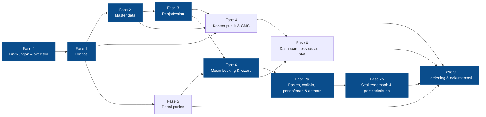

# 14 — Tahapan Implementasi Berdasarkan Dependensi

**Tujuan bagian.** Mengurutkan pembangunan UNPAM HOSPITAL menjadi sepuluh fase (0–9) menurut dependensi teknis, sehingga setiap fase menghasilkan keluaran yang dapat diuji dan menjadi dasar fase berikutnya. Bagian ini juga menetapkan kriteria keluar (tes yang harus lulus), risiko, jalur kritis, dan cara mengeksekusi setiap fase sebagai rencana implementasi tersendiri.

Bagian terkait: [02 — Ruang lingkup](02-ruang-lingkup.md) · [03 — Arsitektur](03-arsitektur.md) · [05 — Sitemap & matriks halaman](05-sitemap-matriks-halaman.md) · [08 — ERD](08-erd.md) · [10 — Struktur folder](10-struktur-folder.md) · [11 — Route, controller, model, service](11-route-controller-model-service.md) · [13 — Data contoh](13-data-contoh.md) · [15 — Pengujian & penerimaan](15-pengujian-penerimaan.md) · [16 — Instalasi & operasional](16-instalasi-operasional.md) · [00 — Keputusan inti](00-keputusan-inti.md).

---

## 1. Prinsip Pengurutan

1. **Dependensi dahulu, tampilan kemudian.** Fondasi yang dipakai semua fitur (layout, komponen, peran, media, audit, pengaturan) dibangun sebelum modul bisnis.
2. **Jantung sistem paling awal diperkecil risikonya.** Mesin jadwal dan booking (fase 3 dan 6) adalah bagian paling berisiko (konkurensi, kuota, status). Skema tabel `appointments` dibuat di fase 3 dan bukti konkurensi dua koneksi (KON-01) dijalankan sebagai *spike* di awal fase 3 sebelum UI dibangun.
3. **Irisan vertikal.** Setiap fase menghasilkan migration + model + policy + Form Request + controller + view + tes untuk fitur yang dicakup — bukan lapisan horizontal yang baru berguna di akhir.
4. **Satu sumber jadwal.** `DoctorAvailabilityQuery` (fase 3) dipakai halaman publik, wizard booking, dan form walk-in; tidak ada kueri jadwal kedua.
5. **Tes bersama kode (TDD).** Tes ditulis lebih dulu per tugas; `php artisan test` harus hijau pada setiap commit.
6. **Gerbang fase.** Fase berikutnya tidak dimulai sebelum seluruh kriteria keluar fase sebelumnya terpenuhi, `vendor\bin\pint --test` bersih, dan matriks akses halaman (grup `AKS`) diperluas untuk halaman baru.

---

## 2. Ringkasan Fase

Ukuran relatif **[ASUMSI]**: S = kecil, M = sedang, L = besar, XL = sangat besar (untuk perbandingan antar-fase, bukan janji waktu).

| Fase | Nama | Halaman # (lihat 05) | Dependensi | Ukuran |
|---|---|---|---|---|
| 0 | Lingkungan dan skeleton | — | — | S |
| 1 | Fondasi | 31 (+ ganti password staf) | 0 | L |
| 2 | Master data | 4, 5, 33, 34 | 1 | M |
| 3 | Penjadwalan | 6, 7, 8, 35 (tanpa layar tinjau sesi terdampak) | 2 | L |
| 4 | Konten publik dan CMS | 1, 2, 3, 9–22, galeri detail, privasi, 36, 39, kotak pesan | 1, 2 (4a), 3 (beranda) | L (dua rencana: 4a, 4b) |
| 5 | Portal pasien (akun) | 23–28 | 1 | M |
| 6 | Mesin booking, wizard, bukti | 29, 30 | 3, 5 | XL |
| 7a | Pasien, walk-in, pendaftaran, antrean (admin) | 37, 38 | 6 | L |
| 7b | Sesi terdampak dan pemberitahuan lintas peran | layar tinjau sesi terdampak (bagian 35) | 7a | M |
| 8 | Dashboard, ekspor, audit log, pengaturan, staf | 32, 40 | 4, 6 (data), 1 | M |
| 9 | Hardening dan dokumentasi | semua (verifikasi) | 4, 5, 7, 8 | M |

Total halaman utama: 40 (+ layar tambahan: ganti password staf, detail album, kebijakan privasi, kotak pesan, antrean, sesi terdampak, bukti admin). Pemetaan lengkap halaman ke fase ada di tiap fase di bawah.

---

## 3. Diagram Dependensi dan Jalur Kritis



**Jalur kritis (warna biru):** 0 → 1 → 2 → 3 → 6 → 7a → 7b → 9. Perubahan apa pun pada fase-fase ini langsung menggeser tanggal selesai.

**Dapat dikerjakan paralel (di luar jalur kritis):**

| Setelah | Dapat berjalan paralel |
|---|---|
| Fase 1 selesai | Fase 5 (akun pasien) dan Fase 4a (CMS statis) — keduanya hanya butuh fondasi |
| Fase 2 selesai | Fase 4b (fasilitas/kamar/kontak) |
| Fase 6 selesai | Fase 7a dan Fase 8 (7b menyusul 7a) |

**Urutan eksekusi default (keputusan K-10 di 17, pilihan (a) — situs publik lebih dulu): 0 → 1 → 2 → 3 → 4 → 5 → 6 → 7 → 8 → 9**, dikerjakan berurutan oleh satu pengembang plus subagen. Urutan ini hanya mengatur urutan kerja dan tidak mengubah desain atau dependensi di §3 (fase 4 tidak bergantung pada fase 5–7; fase 6 tetap menunggu fase 3 dan 5). Alternatif (b) bila pemilik menginginkan risiko terbesar (booking) teruji lebih awal: 0 → 1 → 2 → 3 → 5 → 6 → 7 → 4 → 8 → 9; (b) hanya dipakai bila pemilik memilihnya secara eksplisit. Fase 3 sudah memuat spike konkurensi (`KON-01`) sehingga risiko booking tetap ditutup di awal pada kedua urutan.

---

## 4. Pemetaan ID Fitur (dari 02) ke Fase

ID fitur mengikuti [02 — Ruang lingkup](02-ruang-lingkup.md) (`F-PUB`, `F-AUTH`, `F-PAS`, `F-ADM`, `F-SYS`); tidak ada ID baru. Tabel ini menempatkan tiap ID pada fase yang membangunnya. "(sebagian)" berarti fase yang tercantum membangun bagiannya dan fase lain menuntaskannya.

| Fase | Fitur (ID 02) |
|---|---|
| 0 | F-SYS-18 (zona waktu, locale; `lang/id` dasar) — selebihnya lingkungan dan skeleton |
| 1 | F-AUTH-03 (logout staf), F-AUTH-06, F-AUTH-07, F-AUTH-08, F-AUTH-09, F-SYS-07, F-SYS-08, F-SYS-09, F-SYS-10, F-SYS-11, F-SYS-12 (`app:create-super-admin`, `media:prune`), F-SYS-15, F-SYS-16, F-SYS-17, F-SYS-18, F-PUB-19, F-PUB-20 |
| 2 | F-ADM-02, F-ADM-03, F-ADM-04, F-ADM-29 (endpoint media + editor, D-28), F-PUB-04 (dan F-SYS-14 bagian data master) |
| 3 | F-ADM-05, F-ADM-06, F-ADM-07, F-SYS-01, F-SYS-02, F-SYS-06 (sebagian: propagasi), F-SYS-12 (`sessions:generate`), F-PUB-05, F-PUB-06, F-PUB-07 |
| 4a | F-PUB-01, F-PUB-02, F-PUB-03, F-PUB-10, F-PUB-11, F-PUB-12, F-PUB-13, F-PUB-14, F-PUB-17, F-PUB-18, F-ADM-18, F-ADM-19, F-ADM-20, F-ADM-21, F-ADM-22, F-ADM-23 |
| 4b | F-PUB-08, F-PUB-09, F-PUB-15, F-PUB-16, F-ADM-09, F-ADM-10, F-ADM-11, F-ADM-24 |
| 5 | F-AUTH-01, F-AUTH-02, F-AUTH-03 (logout pasien), F-AUTH-04, F-AUTH-05, F-PAS-01 (sebagian: sapaan dan profil), F-PAS-02, F-PAS-03 |
| 6 | F-SYS-03, F-SYS-04, F-SYS-05, F-PAS-04, F-PAS-05, F-PAS-06, F-PAS-07, F-PAS-08, F-PAS-09, F-PAS-10, F-SYS-19 (sebagian: kelas notifikasi), F-PAS-01 (kunjungan mendatang dan banner notifikasi) |
| 7a | F-ADM-12, F-ADM-13, F-ADM-14, F-ADM-15, F-ADM-16, F-SYS-12 (`appointments:mark-no-show`) |
| 7b | F-ADM-08, F-SYS-06 (resolusi), F-SYS-19 (notifikasi perubahan jadwal) |
| 8 | F-ADM-01, F-ADM-17, F-ADM-25, F-ADM-26, F-ADM-27, F-ADM-28 |
| 9 | F-SYS-13, F-SYS-14 (seeder final), F-SYS-20, F-SYS-10 (CSP produksi), F-SYS-15–F-SYS-17 (audit akhir), F-PUB-19/F-PUB-20 (verifikasi) |

---

## 5. Rincian Per Fase

### Fase 0 — Lingkungan dan Skeleton

**Tujuan.** Menyiapkan mesin pemilik (XAMPP 8.2.12, MariaDB, Apache, Composer, Node) dan skeleton Laravel 12 di `D:\Project Web RS` sehingga pengembangan dan tes dapat berjalan di MariaDB yang sama dengan runtime.

**Keluaran.** XAMPP 8.2.12 terpasang dan berjalan (di mesin pemilik sudah ada di `C:\xampp3`; folder `C:\xampp` lama hanya sisa dan tidak dipakai); ekstensi PHP `gd`/`intl`/`zip` aktif dan `date.timezone = Asia/Jakarta`; skeleton Laravel 12 di root repo (`.git` dan `docs/` utuh); paket Composer dan npm sesuai 00 B.1; database `unpam_hospital` dan `unpam_hospital_test` beserta user `unpam_app`; `.env` dan `.env.testing`; VirtualHost `http://unpam-hospital.test`; `phpunit.xml` mengarah ke `unpam_hospital_test`; `config/app.php` (zona waktu, locale `id`, faker `id_ID`); `lang/id/*`; `composer dev` tanpa pail. Tidak ada halaman bisnis.

**Dependensi.** Tidak ada (hanya mesin pemilik). Langkah rinci ada di [16 — Instalasi](16-instalasi-operasional.md).

**Tugas utama (berurutan).**
1. Verifikasi XAMPP yang **sudah terpasang** di `C:\xampp3` (PHP 8.2.12, Apache 2.4.58, MariaDB 10.4.32 berjalan; `mod_rewrite` dan `Include conf/extra/httpd-vhosts.conf` sudah aktif). Langkah pemasangan di [16 §1](16-instalasi-operasional.md) hanya untuk mesin baru; di mesin lain folder bisa `C:\xampp`.
2. Aktifkan ekstensi `gd`, `intl`, `zip` di `C:\xampp3\php\php.ini` (barisnya masih dikomentari), ubah `date.timezone` dari `Europe/Berlin` menjadi `Asia/Jakarta`, restart Apache dari `C:\xampp3\xampp-control.exe`; verifikasi dengan `C:\xampp3\php\php.exe -m` (batas unggah 40M dan `memory_limit` 512M sudah cukup).
3. Putuskan strategi PHP: pakai `C:\xampp3\php\php.exe` untuk `artisan` atau awali PATH sesi dengan `C:\xampp3\php`.
4. `composer create-project laravel/laravel:^12.0` ke folder sementara, pindahkan isinya ke root repo; `composer config platform.php 8.2.12`.
5. Pasang paket Composer (spatie/laravel-permission, intervention/image ^3, mews/purifier, barryvdh/laravel-dompdf, chillerlan/php-qrcode); hapus `laravel/pail` dari skrip `dev`.
6. npm: hapus `tailwindcss` dan `@tailwindcss/vite`; pasang bootstrap, @popperjs/core, sass, bootstrap-icons, chart.js, quill, @fontsource/plus-jakarta-sans.
7. Buat database, user `unpam_app`, `.env`, `.env.testing`; `php artisan key:generate`.
8. Konfigurasi `config/app.php` (zona waktu) dan `config/database.php` (`'timezone' => '+07:00'` pada koneksi `mariadb`, A-33); `php artisan lang:publish` + terjemahan `lang/id`; `phpunit.xml` (database uji dipaksa); `.gitignore` (tambah `backups/`); `pint.json`; `.env.example` dan `.env.testing.example`.
9. VirtualHost + entri `hosts`; uji `http://unpam-hospital.test`.
10. Tes asap (smoke): `GET /` mengembalikan 200 dan satu tes koneksi MariaDB (`SELECT VERSION()` memuat "MariaDB").
11. Commit awal skeleton (tanpa vendor/node_modules).

**Keputusan terkait (17).** K-12 (akun `root` MariaDB: default (a) dibiarkan tanpa password karena hanya localhost, aplikasi memakai `unpam_app`; panduan di [16 §4.3](16-instalasi-operasional.md)).

**Kriteria keluar.**
- `C:\xampp3\php\php.exe artisan about` menampilkan PHP 8.2.12, environment `local`, database `mariadb`.
- `php artisan migrate` berhasil di `unpam_hospital` dan `unpam_hospital_test`; `php artisan test` hijau (tes smoke).
- `npm run build` berhasil; `http://unpam-hospital.test` tampil.
- Kasus manual `INS-01`–`INS-04` di [15](15-pengujian-penerimaan.md) lulus.

**Risiko dan mitigasi.**

| Risiko | Mitigasi |
|---|---|
| Salah memakai folder XAMPP lama `C:\xampp` (sisa) alih-alih `C:\xampp3` | Definisikan `$XAMPP = "C:\xampp3"` sekali di awal sesi ([16](16-instalasi-operasional.md)); jangan ubah isi `C:\xampp` |
| `php.ini` belum diubah → `gd`/`intl`/`zip` hilang, zona waktu `Europe/Berlin` | Skrip aktivasi di [16 §2](16-instalasi-operasional.md) + restart Apache; periksa `-m` dan `date.timezone` |
| Dua PHP (8.4 PATH vs 8.2 XAMPP) → dependensi tidak cocok runtime | `platform.php = 8.2.12`; `artisan` selalu lewat PHP XAMPP |
| Port 80 dipakai IIS/Skype | Lihat tabel troubleshooting [16 §13](16-instalasi-operasional.md#13-troubleshooting) |
| Path proyek mengandung spasi | Kutip semua path di PowerShell dan `httpd-vhosts.conf` |
| `composer create-project` menolak folder tidak kosong | Pakai folder sementara lalu pindahkan |

---

### Fase 1 — Fondasi

**Tujuan.** Membangun semua yang dipakai lintas-fitur: tampilan dasar, otorisasi, pengaturan, audit, media, keamanan dasar.

**Keluaran.**
- Halaman: **#31 Login admin**, layar ganti password staf, kerangka `layouts.admin` (halaman beranda admin sementara berisi sapaan sampai fase 8), error page dasar 403/404.
- Fitur: F-AUTH-03 (logout staf), F-AUTH-06, F-AUTH-07, F-AUTH-08, F-AUTH-09, F-SYS-07 sampai F-SYS-12, F-SYS-15 sampai F-SYS-18, F-PUB-19, F-PUB-20 (F-ADM-29, endpoint media, dikerjakan di fase 2: D-28, F2-R3). Antarmuka dasar: SCSS tema Bootstrap, token warna 00 M, komponen Blade generik (SCSS tema Bootstrap, token warna 00 M, komponen Blade J.5 yang bersifat generik: `x-image`, `form.*`, `data-table`, `status-badge`, `empty-state`, `flash-alert`, `loading-button`, `confirm-modal`, `breadcrumb`, `page-header`, `stat-card`).
- Skema: `users` (+ kolom 00 E.1), tabel Spatie, `website_settings`, `audit_logs`, `media`, tabel bawaan (`sessions`, `cache`, `jobs`, `notifications`, `password_reset_tokens`).
- Enum (`App\Enums\*`), `RolePermissionSeeder`, `SettingsSeeder`.
- Autentikasi pasien: **infrastruktur** (middleware `account`, `active`, `password.changed`, rate limiter `login`/`password-reset`/`register`/`booking`/`contact`); UI pasien menyusul di fase 5 **[ASUMSI]**.

**Dependensi.** Fase 0.

**Tugas utama (berurutan).**
1. Migration dasar + model `User` (cast `hashed`, `account_type`), enum, `AccountType`.
2. `RolePermissionSeeder` (19 izin, 3 peran), `Gate::before` untuk `super-admin`, alias middleware di `bootstrap/app.php`.
3. `SettingsService` (`get`, `set`, cache + pembersihan) dan `SettingsSeeder` (19 kunci).
4. `AuditLogger` dengan daftar redaksi (`password`, `remember_token`, `token`, `bpjs_number`, `payment_reference` → `[disamarkan]`).
5. SCSS tema, Vite, font lokal, ikon lokal; layout `public`, `patient`, `admin`, `auth`; komponen Blade.
6. `MediaService` (`store`, `replace`, `delete`, `prune`), `HtmlSanitizer` (profil `rich_text`), `x-image`, 8 placeholder SVG, perintah `media:prune --dry-run`.
7. Login/logout staf, ganti password paksa, `last_login_at`, throttle `login`; `RateLimiter::for` semua limiter.
8. Middleware `SecurityHeaders` (profil lokal; CSP produksi menyusul di fase 9).
9. Perintah `app:create-super-admin`.
10. Perluas matriks akses halaman (`AKS`) untuk `/admin/login` dan area admin (`password.changed` tidak dipasang pada `admin.password.edit`/`update` dan `admin.logout`, 00 I.4).
11. `config/navigation.php`, `App\Support\Actor` dan `App\Support\SafeRedirect` (parameter `kembali` hanya path internal), `resources/js/app.js` dengan listener `error` terdelegasi untuk fallback gambar (`data-fallback`, tanpa `onerror` inline).

**Kriteria keluar.**
- Grup tes: `AKS-09`, `AKS-10`; `SEK-01` (password hash), `SEK-02` (regenerasi session + logout), `SEK-03` (throttle login), `SEK-07` (security headers), `SEK-09` dan `SEK-10` (unggahan SVG/PHP ganda ekstensi ditolak di `MediaService`), `SEK-11` (redaksi audit), `MED-03`–`MED-06` (re-encode, EXIF terbuang, nama UUID, thumbnail), `MED-07` (`media:prune`), `SET-01`, `VAL-07` (parameter query tidak valid dan `kembali` eksternal diabaikan).
- Super Admin tidak dapat dihapus/dinonaktifkan bila satu-satunya (tes unit aturan; UI di fase 8).
- `vendor\bin\pint --test` bersih.

**Risiko dan mitigasi.**

| Risiko | Mitigasi |
|---|---|
| Ekstensi GD/FreeType tidak aktif → media gagal | Periksa di fase 0; tes `MediaService` memberi pesan jelas |
| Peringatan deprecation Sass pada Bootstrap 5.3 | Pakai `@use`/impor sesuai dokumentasi Bootstrap dan `silenceDeprecations` di konfigurasi Vite/Sass |
| Desain komponen terlalu spesifik → refaktor mahal | Bangun komponen generik dulu; komponen domain (`doctor-card`, `schedule-table`) di fase 3 |
| Cache pengaturan basi | Tes: simpan pengaturan → nilai baru terbaca tanpa `cache:clear` |

---

### Fase 2 — Master Data

**Tujuan.** Menyediakan data induk spesialisasi, poliklinik, dan dokter (termasuk foto) yang menjadi dasar jadwal dan booking.

**Keluaran.**
- Halaman: **#33 Pengelolaan dokter** (index, create, edit, show, status, arsip, foto), **#34 Spesialisasi & poliklinik**, publik **#4 Daftar layanan**, **#5 Detail layanan** (tanpa daftar jadwal sampai fase 3).
- Fitur: F-ADM-02, F-ADM-03, F-ADM-04, F-ADM-29, F-PUB-04 (dan F-SYS-14 bagian data master).
- Skema: `specialties`, `clinics`, `doctors`, `doctor_specialties`; seeder demo `SpecialtySeeder`, `ClinicSeeder`, `DoctorSeeder`; `PlaceholderImageGenerator`; factory terkait.

**Dependensi.** Fase 1.

**Tugas utama (berurutan).**
1. Migration + model + relasi + `slug` otomatis lewat trait `HasUniqueSlug` (route publik `{clinic:slug}` ditulis eksplisit, model tanpa `getRouteKeyName()`; F2-R4, F2-R5) untuk tabel yang ber-slug; FK `restrict` pada `doctors.clinic_id`.
2. Policy (`SpecialtyPolicy`, `ClinicPolicy`, `DoctorPolicy`) dan Form Request.
3. Controller admin + view (`data-table` dengan pencarian, filter status, pagination, kartu di mobile).
4. Editor rich text Quill (`clinics.description`) + penyimpanan lewat `HtmlSanitizer`; gambar editor via `admin.media.editor-upload`.
5. Unggah dan ganti foto dokter (`admin.doctors.photo`) dengan `MediaService::replace` (file lama dihapus setelah commit).
6. Aktif/nonaktif/arsip dokter lewat `UpdateDoctorStatusRequest` (`admin.doctors.status`) dan `ArchiveDoctorRequest` (`admin.doctors.archive`), dua kelas terpisah; aturan F.4 (nonaktif → sesi mendatang `cancelled`/`needs_review` sumber `doctor_inactive`; arsip ditolak bila ada appointment aktif mendatang) dilengkapi di fase 3 setelah tabel `appointments` dan `ScheduleChangeService` ada (fase 2: titik sambung `DoctorService::futureActiveAppointmentsCount()` selalu 0, arsip diizinkan, F2-R8; pemulihan arsip lewat `admin.doctors.status` dengan `inactive`, F2-R7); nama tampilan `{title_prefix} {name}, {title_suffix}`.
7. Halaman publik #4 dan #5; komponen `x-image` fallback.
8. Seeder dan factory demo; perluas matriks `AKS`. Carry fase 1 yang dikerjakan di sini: `x-form.checkbox` larik (hanya nilai `old()` skalar yang dipakai), `x-data-table` (halaman di luar jangkauan, `preserve`), meta `csrf-token`, poles hasil uji manual, butir (c) `media:prune` (F2-R26); carry pengaturan situs (WhatsApp `62…`, bool/int ketat) ditunda ke fase 8 (F2-R27).

**Kriteria keluar.**
- `CRD-01`–`CRD-04` (CRUD spesialisasi/poliklinik/dokter tampil di publik), `MED-01` (unggah foto), `MED-02` (ganti foto → file lama terhapus), `MED-08` (gambar hilang → placeholder), `AKS` untuk rute fase ini (content-admin boleh, petugas pendaftaran hanya lihat dokter), `VAL-01` (pesan validasi form dokter).
- Dokter yang dinonaktifkan/diarsipkan tidak tampil di publik; penghapusan data bersejarah ditolak (FK `restrict`).

**Risiko dan mitigasi.**

| Risiko | Mitigasi |
|---|---|
| Foto besar membuat unggah lambat/ditolak | Validasi `max:2048`, pesan jelas, kompresi di server |
| Ganti foto gagal di tengah → kehilangan foto lama | Hapus file lama hanya di `DB::afterCommit` |
| Slug bentrok | Sufiks angka otomatis; unique index sebagai pengaman |

---

### Fase 3 — Penjadwalan

**Tujuan.** Membangun tiga lapis jadwal (templat, pengecualian, sesi) dan satu sumber kebenaran `DoctorAvailabilityQuery`, serta skema appointment untuk menguji konkurensi sejak dini.

**Keluaran.**
- Halaman: **#35 Jadwal, kuota, libur** (templat `admin.schedules.*`, sesi `admin.sessions.*`, pengecualian `admin.exceptions.*`; layar tinjau sesi terdampak menyusul di fase 7b), publik **#6 Daftar dokter** (filter `q`, `spesialisasi`, `poli`, `tanggal`), **#7 Detail dokter**, **#8 Jadwal dokter**.
- Fitur: F-ADM-05, F-ADM-06, F-ADM-07, F-SYS-01, F-SYS-02, F-SYS-06 (propagasi), F-PUB-05, F-PUB-06, F-PUB-07.
- Skema: `doctor_schedules`, `schedule_exceptions`, `practice_sessions` (CHECK + UNIQUE), **dan** `patient_profiles`, `insurance_partners` (skema saja karena `appointments.insurance_partner_id` wajib FK `RESTRICT`; model, factory, seeder, dan admin-nya tetap di fase 4, F3-R3), `appointments` (kolom `active_flag` generated + tiga UNIQUE), `appointment_status_histories` (skema, model, dan factory saja; belum ada UI, `BookingService`, atau `AppointmentStatusService`, F3-R4).
- Perintah `sessions:generate {--days=}`; `DoctorScheduleSeeder`, `ScheduleExceptionSeeder`; komponen `schedule-table`, `availability-badge`, `doctor-card`, `module-tabs` (tab Templat/Sesi/Pengecualian/Sesi terdampak).

**Dependensi.** Fase 2.

**Tugas utama (berurutan).**
1. **Spike konkurensi (hari pertama):** migration `practice_sessions`, `appointments`, `patient_profiles` + skrip dua koneksi PDO `FOR UPDATE` membuktikan urutan kunci dan UNIQUE/CHECK berjalan di MariaDB 10.4 (cikal `KON-01`).
2. Migration CHECK via `DB::statement` (`booked_count`, `end_time > start_time`); kolom `active_flag` `storedAs(...)`; verifikasi dengan tes migrasi.
3. `DoctorSchedule` + validasi tidak beririsan (Form Request kustom) + antarmuka kelola templat.
4. `PracticeSessionGenerator` (`ensureRange`, `ensureDailyHorizon`, `insertOrIgnore`, `Cache::lock`), perintah `sessions:generate`.
5. `ScheduleException` (kombinasi jenis vs dokter 00 E.2 + CHECK `chk_schedule_exceptions_scope`) + `ScheduleChangeService` (propagasi: sesi tanpa appointment dihapus/digenerate ulang, kuota saja → `max(kuota_baru, booked_count)`, perubahan jam/hari/nonaktif/penyempitan → `needs_review` + `pending_change`, pengecualian → `cancelled`/`needs_review`; hapus/persempit pengecualian → buka kembali sesi; satu `pending_change` per sesi dengan prioritas jenis-batal > jenis-jam dan penggantian diaudit lewat `setPendingChange()`; `deleteTemplate`/`deleteManualSession` untuk aturan `destroy` 00 C). Pengujian memakai appointment dari factory.
6. `DoctorAvailabilityQuery` (enum `Availability` dengan prioritas label F.3, `remaining`, `is_bookable_online` dan `is_bookable_counter`; keduanya dipakai halaman publik, wizard, dan form walk-in).
7. Halaman publik #6, #7, #8 yang memakai query yang sama; edit sesi manual (`is_manually_modified`), sesi tambahan, tutup sesi, hapus sesi tambahan manual tanpa appointment (`admin.sessions.destroy`, 00 I.4).
8. Admin Konten melihat hanya **jumlah** booking per sesi dan pesan "N sesi perlu ditindaklanjuti".
9. Edit manual satu sesi (`createManualSession`, `updateSession`, `setSessionStatus`): kuota langsung diterapkan, perubahan jam → `needs_review` sumber `manual_time`, pembatalan → `manual_cancel`.
10. Hook perubahan status dokter pada `ScheduleChangeService`: dokter dinonaktifkan → sesi mendatang `cancelled` atau `needs_review` sumber `doctor_inactive`; arsip hanya bila tidak ada appointment aktif mendatang.

**Kriteria keluar.**
- `JDW-01`–`JDW-10` (templat, generator idempoten, cuti/libur tidak dapat dipesan menurut `DoctorAvailabilityQuery`, sesi lampau, tumpang tindih templat ditolak, kuota tidak turun di bawah `booked_count`, perubahan templat dengan appointment aktif → `needs_review`, hapus pengecualian membuka kembali sesi); `JDW-12` (publik dan wizard memakai query yang sama — tes kontrak pada `DoctorAvailabilityQuery`; di fase 3 dua konsumennya adalah `doctors.show` dan `schedules.index`, dibuktikan di `PublicScheduleTest`), `JDW-13` (sesi tambahan manual), `JDW-14` (Admin Konten hanya melihat jumlah booking).
- `KON-01` versi spike lulus pada skema final (`ConcurrencySpikeTest`: dua koneksi PDO mentah, F3-R6).
- Bagian `book()`, wizard, dan form walk-in dari `JDW-03`, `JDW-04`, `JDW-05`, `JDW-12`, `JDW-13`, `CRD-02`, `CRD-05`, dan `KON-01a`–`d` diuji di fase 6 (wizard) dan 7a (form walk-in); di fase 3 kasus-kasus itu diuji lewat `DoctorAvailabilityQuery` (`availability`, `is_bookable_online`, `is_bookable_counter`, `remaining`), status sesi, dan halaman #6/#7/#8 (F3-R5). `JDW-11` (resolusi) milik fase 7b.
- `AKS` untuk #6–#8 dan #35 lulus; `CRD-05` (jadwal baru muncul di jadwal publik), `CRD-13` (aturan `destroy` per tabel), `JDW-15` (edit manual sesi), `JDW-16` (dokter dinonaktifkan/diarsipkan), `JDW-17` (prioritas `pending_change`), `JDW-18` (kombinasi jenis pengecualian vs dokter, termasuk CHECK DB), `JDW-19` (hapus templat/sesi manual), `VAL-07`.

**Risiko dan mitigasi.**

| Risiko | Mitigasi |
|---|---|
| Kompleksitas `ScheduleChangeService` (banyak cabang) | Tabel keputusan F.4 menjadi tabel tes (satu kasus per baris); TDD |
| CHECK/generated column berperilaku beda di MariaDB 10.4 | Spike di awal fase; tes memakai MariaDB (bukan SQLite) |
| Zona waktu/`now()` pada batas hari | Waktu diperoleh dari `Carbon` aplikasi (Asia/Jakarta); tes memakai `Carbon::setTestNow` |
| Generator berat saat dipicu halaman publik | Satu kali per hari (`Cache::lock` + penanda), `insertOrIgnore` massal |

---

### Fase 4 — Konten Publik dan CMS

Fase ini sebaiknya dibagi menjadi **dua rencana implementasi**: **4a** (halaman statis, beranda, banner, artikel, galeri, FAQ, mitra asuransi) dan **4b** (fasilitas, kamar, kontak/pesan).

**Tujuan.** Melengkapi situs publik dan seluruh CMS yang mengisinya, sehingga setiap perubahan admin langsung tampil di publik.

**Keluaran.**
- Halaman publik: **#1 Beranda**, **#2 Profil**, **#3 Visi & misi**, **#9 Daftar fasilitas**, **#10 Detail fasilitas**, **#11 Ringkasan kamar**, **#12–#15 Kamar BPJS Kelas 1/2/3 dan VIP**, **#16 Info BPJS & asuransi**, **#17 Panduan pendaftaran**, **#18 Daftar artikel**, **#19 Detail artikel**, **#20 Galeri** (+ detail album), **#21 FAQ**, **#22 Kontak & lokasi**, kebijakan privasi.
- Halaman admin: **#36 Fasilitas, kategori kamar, kapasitas**, **#39 Konten** (halaman, banner, artikel, kategori artikel, galeri, FAQ, mitra asuransi), kotak pesan kontak.
- Fitur: F-PUB-01, F-PUB-02, F-PUB-03, F-PUB-08 sampai F-PUB-18, F-ADM-09 sampai F-ADM-11, F-ADM-18 sampai F-ADM-24; komponen `map-embed`.
- Skema: `pages`, `article_categories`, `articles`, `banners`, `galleries`, `faqs`, `facilities`, `room_categories`, `contact_messages`; `PageSeeder` (semua lingkungan), `ContentSeeder`, `FacilitySeeder`, `RoomCategorySeeder`, `ContactMessageSeeder`.

**Dependensi.** Fase 1 (media, sanitizer, komponen), Fase 2 (halaman layanan, kartu dokter di beranda), Fase 3 (kolom pencarian jadwal di beranda).

**Tugas utama (berurutan).**
1. (4a) `PageSeeder` + `admin.pages.*` + editor Quill yang sudah dibangun di fase 2 (dipakai ulang untuk `pages.body`/`articles.body`, F2-R2); beranda mengambil `home`, banner aktif, dokter unggulan, artikel terbaru.
2. (4a) Banner (jadwal tayang `starts_at`/`ends_at`), artikel (`soft delete`, status, `published_at`), kategori artikel, galeri (album + unggah banyak foto, urutkan), FAQ (kelompok), mitra asuransi (logo).
3. (4a) Halaman publik terkait + SEO (`meta_title`/`meta_description` yang dapat dikelola; fallback otomatis) + breadcrumb.
4. (4b) Fasilitas + kategori kamar (JSON `amenities`, galeri, `rooms.update-availability`, tampilan "Diperbarui manual pada …", tanpa kata real-time).
5. (4b) Kontak: form (throttle `contact`, persetujuan, `ip_hash`), `map-embed` (iframe + alamat teks + tombol Petunjuk Arah + fallback tanpa internet), kotak pesan admin (`messages.manage`).
6. Seeder demo dan placeholder; perluas matriks `AKS` ke 22 halaman publik dan layar admin konten.

**Kriteria keluar.**
- `CRD-05`–`CRD-12` (setiap entitas CMS tersimpan dan tampil di publik; perubahan pengaturan alamat terlihat di halaman kontak), `SEK-08` (sanitasi rich text membuang `<script>`/`onerror`), `SEK-09`/`SEK-10` (unggahan SVG dan `.php.jpg` ditolak pada seluruh form unggah), `SEK-14` (throttle `contact`, `ip_hash`), `EMP-01`–`EMP-05` (data kosong dan gambar hilang di tiap daftar), `AKS-01` (22 halaman publik), `AKS-04` (Admin Konten tidak melihat data pasien).
- Setiap halaman publik memiliki judul dan meta description dari data (tes `<title>`).

**Risiko dan mitigasi.**

| Risiko | Mitigasi |
|---|---|
| Ruang lingkup besar → fase molor | Dua rencana (4a/4b); mulai dari entitas dengan pola serupa (CRUD + gambar) memakai komponen generik |
| XSS lewat rich text | `HtmlSanitizer` + tes payload; hanya lima kolom yang boleh `{!! !!}` |
| Peta Google tidak muncul offline | `map-embed` selalu merender alamat teks dan tombol arah; iframe dimuat `loading="lazy"` |
| Klaim keliru pada teks contoh | Seluruh teks contoh berlabel "contoh"; ditinjau pemilik pada [17](17-keputusan-konfirmasi.md) |

---

### Fase 5 — Portal Pasien (Akun)

**Tujuan.** Pasien dapat membuat akun, masuk, mengelola profil, dan mengatur ulang password sebelum mesin booking dibangun.

**Keluaran.**
- Halaman: **#23 Registrasi**, **#24 Login pasien**, **#25 Permintaan reset password**, **#26 Form reset password**, **#27 Dashboard pasien** (belum ada daftar appointment sampai fase 6), **#28 Profil dan pengaturan akun** (profil + ganti password), kebijakan privasi sebagai tautan persetujuan.
- Fitur: F-AUTH-01, F-AUTH-02, F-AUTH-03 (logout pasien), F-AUTH-04, F-AUTH-05, F-PAS-01 (sebagian), F-PAS-02, F-PAS-03; `PatientRegistrationService`, `PatientNumberGenerator`.
- Skema: memakai `users` dan `patient_profiles` yang sudah ada.

**Dependensi.** Fase 1 (middleware, limiter, layout `auth`/`patient`); `patient_profiles` dari fase 3.

**Tugas utama (berurutan).**
1. `PatientRegistrationService`: registrasi dalam satu transaksi: `users` (`account_type = patient`) + `patient_profiles` (`registration_channel = online`, `consent_at`, `consent_version`, `patient_number` dari `id`); throttle `register`.
2. Login `/masuk` hanya untuk akun pasien (pesan generik), regenerasi session, `last_login_at`; logout `POST /keluar`.
3. Reset password dengan password broker; tautan lewat mail (lokal: log/Mailpit); respons generik; throttle `password-reset`; **tautan tidak pernah tampil di halaman**.
4. Dashboard pasien (sapaan, kartu kosong "Belum ada pendaftaran" dengan tombol "Daftar Kunjungan").
5. Profil: ubah nama, tanggal lahir, jenis kelamin, telepon, email, alamat; nomor BPJS tersimpan terenkripsi + `bpjs_number_last4` (hanya diminta bila diperlukan); ganti password (`Password::min(8)->letters()->numbers()`).
6. Pesan galat Bahasa Indonesia (`lang/id/auth.php`, `validation.php`, `passwords.php`).
7. Perluas matriks `AKS` dan kasus `PAS`.

**Keputusan terkait (17).** K-07 (satu akun satu profil; default (a)), K-22 (email selamat datang setelah registrasi; default (a): `PatientWelcomeNotification`, tanpa verifikasi wajib).

**Kriteria keluar.**
- `SEK-01`, `SEK-04`, `SEK-05`, `SEK-16` (pesan generik), `NTF-04` (reset via log), `NTF-05` (respons reset generik), `PAS-05` (pasien hanya mengubah profilnya sendiri; `user_id`/`patient_number` tidak dapat di-mass-assign), `PAS-09` (email profil disinkronkan dengan `users.email`), `VAL-02` (pesan validasi registrasi), `NTF-08` (email selamat datang), `AKS-02`, `AKS-06`, `AKS-07`, `AKS-08`.
- Registrasi memberi rollback penuh bila pembuatan profil gagal (tes transaksi).

**Risiko dan mitigasi.**

| Risiko | Mitigasi |
|---|---|
| Tautan reset tidak terlihat oleh pemilik saat uji lokal | Panduan [16 §10](16-instalasi-operasional.md#10-uji-reset-password-lokal) (log + Mailpit) |
| Enumerasi email lewat pesan galat | Respons generik di login dan reset; tes membandingkan respons email terdaftar vs tidak |
| `patient_number` diturunkan dari `id` → harus setelah insert | Dibuat dalam transaksi yang sama dengan `update` setelah `id` diketahui |

---

### Fase 6 — Mesin Booking, Wizard, dan Bukti

**Tujuan.** Pasien dapat mendaftar kunjungan melalui wizard, dengan kuota, antrean, dan status yang benar meski ada permintaan bersamaan, lalu menerima bukti (cetak, PDF, QR).

**Keluaran.**
- Halaman: **#29 Pendaftaran kunjungan** (wizard `patient.appointments.create` → `review` → `store`), **#30 Riwayat dan detail pendaftaran** (+ pembatalan, bukti cetak, bukti PDF), banner notifikasi di #27, tombol "Daftar" di jadwal publik (#7, #8) menaut ke wizard.
- Fitur: F-SYS-03, F-SYS-04, F-SYS-05, F-PAS-04 sampai F-PAS-10, F-PAS-01 (kunjungan mendatang), F-SYS-19 (kelas notifikasi).
- Komponen `wizard-steps`; kelas: `BookingService`, `AppointmentStatusService`, `InvalidTransitionException`, `AppointmentProofService`, `BookingCodeGenerator`, `QueueNumberFormatter`, `BookingException` (9 kode: 8 aturan F.5 + `SYSTEM_BUSY`), `AppointmentPolicy`, `AppointmentStatusChangedNotification`, `AppointmentScheduleChangedNotification`.

**Dependensi.** Fase 3 (`DoctorAvailabilityQuery`, tabel appointment), Fase 5 (akun pasien).

**Tugas utama (berurutan).**
1. `BookingCodeGenerator` (Crockford Base32, `random_int`, ulang bila bentrok) dan `QueueNumberFormatter` (`ANK-007`) — tes unit.
2. `BookingService::book()` dengan transaksi + `lockForUpdate` (urutan baku `patient_profiles` → `practice_sessions` → `appointments`), delapan aturan F.5 (`BookingRules::assertBookable`), `attempts: 3`, penerjemahan galat driver menurut `errorInfo[1]` (1062 duplikat, 4025/3819 CHECK `chk_sessions_quota`, 1205/1213 → `SYSTEM_BUSY`) menjadi `BookingException`; `BookingService::precheck()` (cek F.5 tanpa kunci dan tanpa menulis) untuk langkah tinjau wizard dan walk-in.
3. `AppointmentStatusService::transition()` mengikuti tabel F.8: kolom waktu, riwayat, audit log, pelepasan kuota saat `cancelled` (nomor antrean tidak dipakai ulang), notifikasi setelah commit.
4. **Tes konkurensi** `KON-01` (dua koneksi PDO), `KON-02` (N proses paralel `Symfony\Component\Process`), `KON-03`, `KON-04` — lulus sebelum UI dibangun.
5. Wizard tanpa JavaScript (langkah GET `poli` → `dokter` → `sesi`, lalu review dan konfirmasi), field BPJS/asuransi, `Cache::lock("booking-submit:{user_id}", 10)`, tombol dinonaktifkan saat submit, throttle `booking`.
6. Riwayat/detail/batal (batas `booking.cancel_cutoff_minutes`), `AppointmentPolicy::view/cancel`.
7. Bukti: halaman cetak (CSS print), PDF (dompdf, font bawaan tanpa unduhan), QR SVG hanya berisi kode booking.
8. Kelas notifikasi mengikuti 00 F.8/K-13 (`database` untuk setiap transisi; `mail` hanya `confirmed`, `cancelled`, perubahan jadwal) dan banner belum dibaca di dashboard pasien (tautan `patient.appointments.index?jadwal_berubah=1`); alur `review`/`store` wizard yang gagal selalu dialihkan ke `patient.appointments.create` dengan query langkah terakhir + `withInput()`, tidak pernah `back()`.

**Kriteria keluar.**
- `BKG-01`–`BKG-13`, `BKG-15`, `BKG-17`, `BKG-18`, `BKG-20` (aturan booking, kuota, pembatalan, nomor antrean, kode booking, pesan galat).
- `KON-01`–`KON-05` (kuota tidak pernah terlampaui; dua permintaan bersamaan menghasilkan tepat satu keberhasilan pada sisa kuota 1; nomor antrean 1..K unik).
- `PAS-02`–`PAS-04`, `PAS-08` (booking/bukti/notifikasi orang lain → 404, 00 BR-54/BR-81), `SEK-12` (BPJS/polis terenkripsi di DB), `SEK-13` (QR tanpa data sensitif), `SEK-15` (escape output), `VAL-03` (pesan validasi wizard), `NTF-01`, `NTF-02`, `NTF-07` (kanal notifikasi per K-13), `BKG-21` (`SYSTEM_BUSY`), `VAL-08` (alur `review`/`store` tanpa `back()`), `PAS-10` (filter `jadwal_berubah`).
- `AKS-02` diperluas untuk #29–#30.

**Keputusan terkait (17).** K-13 (volume email: (b), diputuskan pemilik 2026-10-08, D-159), K-17 (font PDF bukti: (a) DejaVu Sans, diputuskan pemilik 2026-10-08, D-163).

**Risiko dan mitigasi.**

| Risiko | Mitigasi |
|---|---|
| Deadlock atau lock wait timeout di bawah beban | Urutan kunci baku di semua operasi; `attempts: 3`; tes beban `KON-02` |
| Kuota terlampaui karena kondisi balapan | CHECK `booked_count <= quota` + UNIQUE `queue_number` sebagai lapis kedua; uji dua lapis |
| dompdf tidak merender SVG QR dengan baik | Sisipkan sebagai `data:image/svg+xml;base64`; bila gagal pakai PNG (GD) khusus PDF **[ASUMSI]** |
| Wizard GET dibuka dengan sesi sudah penuh/tutup | Validasi ulang di langkah review dan di `book()`; pesan jelas |
| Pasien mengirim ganda (klik dua kali) | Tombol nonaktif + `Cache::lock` + UNIQUE `active_flag` |

---

### Fase 7 — Admin Pendaftaran, Antrean, Walk-in, Sesi Terdampak, Notifikasi (dipecah menjadi 7a dan 7b)

Keputusan pemilik 2026-10-09 (D-168): fase 7 dipecah menjadi **7a** (pasien, walk-in, pendaftaran, antrean, tandai tidak hadir, seeder) dan **7b** (Sesi Terdampak dan pemberitahuan lintas peran) karena ukurannya sekitar 1,5 kali fase 6. Pada urutan eksekusi di §3, "7" berarti 7a lalu 7b. Rencana 7a ada di `docs/superpowers/plans/`.

#### Fase 7a — Pasien, Walk-in, Pendaftaran, dan Antrean

**Tujuan.** Petugas dapat mengelola pasien, mendaftarkan walk-in, memproses antrean dan status, serta menandai pendaftaran yang tidak hadir.

**Keluaran.**
- Halaman: **#37 Pengelolaan pasien** (`admin.patients.index/show/create/store/edit/update/status/link-account`), **#38 Pengelolaan pendaftaran dan antrean** (`admin.appointments.index/show/proof/create/store/transition`, `admin.queue.index`, `admin.queue.mark-no-show`); 16 route baru (total 166, admin 122).
- Fitur: F-ADM-12 sampai F-ADM-16, F-SYS-12 (`appointments:mark-no-show`, harian pukul 23.30).
- Kelas: `PatientAccountLinker`, `PatientSearch`, `PatientProfilePolicy` dan method baru `AppointmentPolicy`/`PracticeSessionPolicy`, evaluator transisi dengan `transitionChecks()` serta `markNoShowForSession()`/`markNoShowForDate()` pada `AppointmentStatusService`, `AdminReturn`, `QueryLogSanitizer`; perintah `appointments:mark-no-show {--date=}`; `AppointmentSeeder` dengan enam profil walk-in P000008–P000013.

**Dependensi.** Fase 6.

**Tugas utama (berurutan).**
1. Daftar dan detail pasien (pencarian nama/no. pasien/telepon/tanggal lahir; BPJS tersamar 4 digit terakhir), buat profil walk-in dengan persetujuan lisan.
2. Form walk-in memakai `DoctorAvailabilityQuery` + `BookingService::book()` (kanal `loket`, status awal `confirmed`; batas `now < end_time`).
3. Layar antrean per sesi (pencarian/pindai kode booking, check-in, selesai, batal beralasan, koreksi `checked_in → confirmed`); aksi massal "Tandai tidak hadir" setelah `end_time`.
4. `appointments:mark-no-show` (aktor `system`) memakai `AppointmentStatusService::markNoShowForDate()`; aksi massal petugas memakai `markNoShowForSession()` (hanya setelah `end_time`, kode `SESSION_NOT_ENDED`).
5. `PatientAccountLinker` (verifikasi manual, hanya bila profil akun belum beriwayat; satu transaksi).
6. Bukti admin `admin.appointments.proof` (cetak, tanpa PDF); perluas matriks `AKS` (petugas vs Admin Konten) dan kunci `Phase7aRoutePermissionTest`.
7. `AppointmentSeeder` (29 appointment lewat service dengan jam semu) dan enam profil walk-in; `scripts/sql/seed-invariants.sql` (17 invarian).
8. Bawaan fase 6: sanitasi log `QueryException`, retry `DoctorService::archive`/`changeStatus`, dan tes konkurensi 7a.

**Keputusan terkait (17).** K-04 (nomor BPJS/polis lengkap untuk petugas: (a), hanya 4 digit terakhir; diputuskan pemilik 2026-10-09, D-168), K-14 (verifikasi hubungkan akun: default prototipe, manual di loket), K-13 (notifikasi, D-159).

**Kriteria keluar.**
- `WLK-01`–`WLK-07` (walk-in, berbagi kuota, hubungkan akun, tidak ada pencocokan otomatis), `BKG-14`, `BKG-16`, `BKG-19`, `KON-05` (antarmuka staf), `NTF-03`, `NTF-07` (sisi transisi staf), `AKS-03`–`AKS-06`, `PAS-04` (sisi Petugas), `PAS-06`, `PAS-07`, `SEK-15` pada nama pasien di seluruh layar admin 7a, `SEED-01`.
- Sesudah `migrate:fresh --seed`, 17 invarian [13 §11](13-data-contoh.md#11-invarian-setelah-seeding-dan-cara-memeriksanya) = 0 (termasuk I1: `booked_count` = jumlah appointment non-batal per sesi); `Phase7aRoutePermissionTest` mengunci 166 route (admin 122).

**Risiko dan mitigasi.**

| Risiko | Mitigasi |
|---|---|
| Aksi massal melanggar urutan kunci → deadlock | Satu transaksi per appointment lewat `AppointmentStatusService::transition()` (urutan kunci baku, retry 3 kali); tes konkurensi 7a |
| Tombol UI menyimpang dari aturan server | Satu evaluator untuk `transition()` dan `availableTransitions()` |
| Salah hubungkan akun ke profil orang lain | Verifikasi identitas manual, panel perbandingan dua langkah (`?hubungkan=`), centang verifikasi wajib, catat di audit log |
| Antrean lambat untuk sesi besar | Kueri per sesi dengan index `practice_session_id`, `queue_number`; daftar pendaftaran dipaginasi dengan filter bawaan hari ini |

#### Fase 7b — Sesi Terdampak dan Pemberitahuan Lintas Peran

**Tujuan.** Petugas dan Admin Konten dapat menyelesaikan sesi yang terdampak perubahan jadwal dan melihat pemberitahuannya.

**Keluaran.**
- Halaman: layar **tinjau sesi terdampak** (`admin.sessions.review` + `resolve`, bagian dari #35).
- Fitur: F-ADM-08, F-SYS-06 (resolusi), F-SYS-19 (notifikasi perubahan jadwal).
- Kelas: resolusi sesi pada `ScheduleChangeService` (`keep`, `apply`, `cancel`), `AppointmentStatusService::cancelAllForSession()`, `PracticeSessionPolicy::review()` dan `resolve()`.

**Dependensi.** Fase 7a.

**Tugas utama (berurutan).**
1. Layar sesi terdampak: tampilkan keenam sumber (`exception`, `template_time`, `template_removed`, `manual_time`, `manual_cancel`, `doctor_inactive`) dan pilihan sah per sumber (`allowedResolutions()`; `keep` untuk `doctor_inactive` hanya bila dokter aktif kembali); `apply` memberi `schedule_changed_at` dan notifikasi; `cancel` membatalkan appointment aktif dengan alasan wajib; peringatan benturan jam pasien.
2. Pemberitahuan lintas peran: Admin Konten melihat "N sesi perlu ditindaklanjuti"; petugas melihat daftar.
3. Bawaan fase 3 untuk layar sesi terdampak (carry fase 3).

**Keputusan terkait (17).** K-15 (pelacakan "sudah dihubungi" pasien walk-in: default (a), tidak ada), K-13 (notifikasi perubahan jadwal).

**Kriteria keluar.**
- `JDW-11` (resolusi `keep`/`apply`/`cancel` per sumber), `NTF-06`, `NTF-07` (sisi resolusi `apply`), dan `AKS-03`–`AKS-05` untuk layar sesi terdampak.
- Setelah resolusi `cancel`, `booked_count` sesi = jumlah appointment non-batal (invarian I1 di [13 §11](13-data-contoh.md#11-invarian-setelah-seeding-dan-cara-memeriksanya)).

**Risiko dan mitigasi.**

| Risiko | Mitigasi |
|---|---|
| Resolusi sesi massal melanggar urutan kunci → deadlock | Gunakan satu jalur kode `AppointmentStatusService` dengan urutan kunci baku; tes konkurensi tambahan |

---

### Fase 8 — Dashboard, Ekspor CSV, Audit Log, Pengaturan, Staf

**Tujuan.** Menyediakan pemantauan, laporan, dan administrasi sistem untuk Super Admin dan petugas sesuai izin.

**Keluaran.**
- Halaman: **#32 Dashboard** (+ endpoint grafik JSON), **#40 Pengaturan website, akun staf, hak akses, audit log**, ekspor CSV (`admin.appointments.export`, bagian #38).
- Fitur: F-ADM-01, F-ADM-17, F-ADM-25, F-ADM-26, F-ADM-27, F-ADM-28.
- Kelas: `DashboardMetrics`, `AppointmentCsvExporter`, `StaffAccountService`, `RolePolicy`, `UserPolicy`, `AuditLogPolicy`.

**Dependensi.** Fase 6 (data appointment), Fase 4 (ringkasan kamar), Fase 1 (pengaturan, audit).

**Tugas utama (berurutan).**
1. `DashboardMetrics` (dokter aktif, pasien terdaftar, pendaftaran hari ini berdasarkan `session_date`, per status, ringkasan kamar + waktu pembaruan) dan widget yang difilter per izin; daftar bernama hanya untuk `appointments.view`.
2. Grafik Chart.js (7/30/90 hari atau rentang kustom) dari endpoint JSON `admin.dashboard.chart`; Chart.js dibundel lokal.
3. `AppointmentCsvExporter` (streaming, UTF-8 BOM, pemisah `;`, tanpa nomor BPJS/polis/alamat/telepon/tanggal lahir/keluhan; filter tanggal, poliklinik, dokter, status, kanal; setiap ekspor tercatat di audit log beserta filternya).
4. Layar audit log (filter aksi/pelaku/tanggal, detail dengan nilai lama/baru yang sudah diredaksi; tanpa tombol ubah/hapus).
5. Layar pengaturan (`admin.settings.*`, validasi tipe, pembersihan cache) dan `admin.roles.*` (peran `super-admin` terkunci).
6. Akun staf (`admin.staff.*`) lewat `StaffAccountService`: buat dengan password sementara + `must_change_password`, nonaktifkan, reset password, ubah peran. Aturan mutlak — minimal satu Super Admin aktif, peran `super-admin` terkunci, staf tidak dapat menonaktifkan atau mengubah peran akunnya sendiri — ditegakkan di service dan Form Request, **bukan** di Policy (`Gate::before` melewati Policy).

**Kriteria keluar.**
- `DSH-01`–`DSH-06` (angka, widget per izin, grafik, CSV format/izin/audit), `AUD-01`–`AUD-04`, `STF-01`–`STF-07`, `SET-01`–`SET-04`, `AKS-03`–`AKS-05` untuk seluruh area #40, `SEK-11` pada data nyata dashboard.

**Risiko dan mitigasi.**

| Risiko | Mitigasi |
|---|---|
| CSV tidak terbaca benar di Excel lokal | BOM + `;`; kasus manual membuka di Excel |
| Kueri dashboard lambat pada data besar | Index sudah ada; agregasi per `session_date`; uji dengan data 10.000 baris (factory) |
| Kunci Super Admin terakhir (balapan) | Hitung dan ubah dalam transaksi dengan `lockForUpdate` pada baris peran |

---

### Fase 9 — Hardening dan Dokumentasi

**Tujuan.** Menutup celah keamanan, aksesibilitas, responsif, offline, dan operasional sehingga prototipe siap diserahterimakan dan dapat dipulihkan.

**Keluaran.** CSP produksi; error page 403/404/419/500/503 Bahasa Indonesia; audit a11y dan responsif; verifikasi offline; skrip `scripts/backup.ps1` dan `scripts/restore.ps1`; `README` pengembangan lokal; seeder demo final (volume di [13](13-data-contoh.md)); daftar periksa produksi; laporan hasil uji.

**Dependensi.** Fase 4, 5, 7, 8.

**Tugas utama (berurutan).**
1. Profil `SecurityHeaders` produksi (CSP dengan `frame-src https://www.google.com https://maps.google.com`, HSTS di produksi, cookie aman) dan uji header.
2. Audit aksesibilitas: skip link, fokus, kontras, label dan `aria-describedby`, alt text; Lighthouse a11y ≥ 90 pada halaman utama.
3. Audit responsif 360/768/1280 px termasuk tabel admin → kartu di mobile.
4. Verifikasi offline (putus jaringan): halaman inti, font lokal, ikon, placeholder, peta fallback alamat.
5. Error page dan halaman 419 ramah; penanganan `BookingException` di semua jalur.
6. `scripts/backup.ps1`/`restore.ps1`, uji pemulihan ke database `unpam_hospital_restore`; catat bukti.
7. Pemeriksaan penuh: `php artisan test` (seluruh suite), `vendor\bin\pint --test`, matriks `AKS` 40 halaman × peran, `SEED-01`–`SEED-03`, `media:prune --dry-run`.
8. Uji instalasi dari nol di klon bersih (mengikuti [16](16-instalasi-operasional.md) apa adanya) dan perbaiki panduan bila ada langkah yang gagal.
9. Dokumentasi: README lokal, catatan produksi, daftar pertanyaan terbuka ke [17](17-keputusan-konfirmasi.md).

**Keputusan terkait (17).** K-11 (password akun demo: default (a) `Demo12345`, hanya lokal), K-16 (ambang aksesibilitas: default (a) Lighthouse ≥ 90 + daftar periksa keyboard).

**Kriteria keluar.**
- Seluruh kasus otomatis hijau; seluruh kasus manual `RSP-*`, `A11-*`, `OFF-*`, `BAK-*`, `INS-*`, `ERR-*` bertanda lulus dengan bukti; `SEK-07` (header, termasuk CSP profil produksi).
- Kriteria penerimaan keseluruhan di [15 §10](15-pengujian-penerimaan.md#10-kriteria-penerimaan-definition-of-done) terpenuhi, termasuk "setiap fitur memiliki halaman, route, tabel, hak akses, dan alur".

**Risiko dan mitigasi.**

| Risiko | Mitigasi |
|---|---|
| CSP produksi memblokir Vite/peta/gambar | Profil CSP terpisah lokal vs produksi; uji dengan `APP_ENV=production` lokal (tanpa DemoSeeder) |
| Restore gagal karena `APP_KEY` berbeda | Simpan `APP_KEY` terpisah; langkah verifikasi baca kolom terenkripsi setelah restore |
| Temuan a11y menyebar ke banyak halaman | Perbaiki di komponen Blade (sumber), bukan per halaman |
| PHP 8.2 berakhir dukungan keamanan 31 Desember 2026 | Prototipe localhost cukup; produksi wajib PHP ≥ 8.3 (disarankan 8.4). Kode ditulis kompatibel PHP 8.2–8.4; jalankan suite tes dengan PHP 8.4 CLI sebelum produksi |

---

## 6. Rekomendasi Eksekusi

**Setiap fase menjadi rencana implementasi tersendiri**, ditulis dengan skill `superpowers:writing-plans` (fase 4 dipecah menjadi 4a dan 4b), disimpan di `docs/superpowers/plans/YYYY-MM-DD-fase-N-nama.md`, dan dieksekusi dengan `superpowers:subagent-driven-development`.

1. **Rencana per fase.** Masukkan: tujuan, daftar tugas bernomor (dari bagian "Tugas utama" di atas, dipecah menjadi langkah 2–5 menit), berkas yang disentuh, kasus uji (ID dari [15](15-pengujian-penerimaan.md)), perintah verifikasi, dan kriteria keluar.
2. **Pengembangan berbasis subagen.** Satu subagen per tugas, konteks hanya bagian rencana + spesifikasi terkait ([00](00-keputusan-inti.md), [09](09-data-dictionary.md), [11](11-route-controller-model-service.md)). Koordinator tidak menulis kode fitur; ia meninjau.
3. **TDD (`superpowers:test-driven-development`).** Merah → hijau → refaktor per tugas; tes konkurensi (`KON-*`) wajib sebelum UI booking.
4. **Review per tugas (`superpowers:requesting-code-review`).** Tinjau terhadap spesifikasi (nama persis dari 00, izin, policy, validasi) dan keamanan (IDOR, mass-assignment, `{!! !!}` hanya pada lima kolom rich text).
5. **Commit kecil.** Satu tugas = satu commit atau lebih; pesan `tipe(fase-N): ringkasan` (mis. `feat(fase-6): BookingService dengan lockForUpdate`); cabang per fase `fase-N-nama`; gabung ke cabang utama hanya setelah gerbang fase (`superpowers:finishing-a-development-branch`).
6. **Verifikasi sebelum klaim selesai (`superpowers:verification-before-completion`).** Jalankan `C:\xampp3\php\php.exe artisan test` dan `vendor\bin\pint --test`, tunjukkan keluaran; untuk kasus manual, lampirkan catatan/tangkapan layar.
7. **Perubahan spesifikasi.** Bila implementasi menemukan celah pada 00–17, perbarui dokumen terkait pada commit yang sama dan catat di [17](17-keputusan-konfirmasi.md); jangan menyimpang diam-diam.

Contoh siklus satu fase (PowerShell):

```powershell
git switch -c fase-3-penjadwalan
C:\xampp3\php\php.exe artisan test --filter=Schedul
C:\xampp3\php\php.exe vendor\bin\pint --test
git add -A
git commit -m "feat(fase-3): PracticeSessionGenerator idempoten"
```

---

## Asumsi di bagian ini

- **[ASUMSI]** Ukuran fase (S/M/L/XL) hanya relatif; tidak ada estimasi waktu yang dijanjikan.
- **[ASUMSI]** Skema `patient_profiles`, `appointments`, `appointment_status_histories` dibuat di fase 3 (bukan fase 5/6) agar `ScheduleChangeService` dan spike konkurensi dapat diuji dengan data nyata; UI dan service booking tetap di fase 6.
- **[ASUMSI]** UI autentikasi pasien (#23–#26) diselesaikan di fase 5 meski infrastruktur auth (middleware, limiter) dibangun di fase 1.
- **[ASUMSI]** Resolusi sesi terdampak (`keep`/`apply`/`cancel`) ditunda ke fase 7b karena bergantung pada `AppointmentStatusService` dan notifikasi.
- **[ASUMSI]** Penempatan ID fitur 02 pada fase (§4) adalah usulan; fitur lintas fase (F-SYS-06, F-SYS-19, F-PAS-01) ditandai "(sebagian)".
- **[ASUMSI]** Rentang ID kasus uji (`AKS`, `CRD`, `MED`, `JDW`, `PAS`, `SEK`, `BKG`, `KON`, `WLK`, `NTF`, `VAL`, `EMP`, `DSH`, `AUD`, `STF`, `SET`, `ERR`, `RSP`, `A11`, `OFF`, `BAK`, `INS`, `SEED`) mengikuti [15](15-pengujian-penerimaan.md).
- Urutan eksekusi fase = K-10 di 17, default (a): 0→1→2→3→4→5→6→7→8→9 (opsi (b): 0→1→2→3→5→6→7→4→8→9 hanya bila dipilih pemilik).

## Nama baru yang diusulkan

| Nama | Jenis | Keterangan |
|---|---|---|
| §4 Pemetaan ID fitur → fase | Tabel | Memakai ID 02; tidak membuat ID baru |
| `docs/superpowers/plans/YYYY-MM-DD-fase-N-nama.md` | Konvensi berkas | Lokasi rencana implementasi per fase |
| Cabang `fase-N-nama` | Konvensi git | Satu cabang per fase |
| Grup ID tes `AKS`, `CRD`, `MED`, `JDW`, `PAS`, `SEK`, `BKG`, `KON`, `WLK`, `NTF`, `VAL`, `EMP`, `DSH`, `AUD`, `STF`, `SET`, `ERR`, `RSP`, `A11`, `OFF`, `BAK`, `INS`, `SEED` | Penanda uji | Didefinisikan di 15 |
